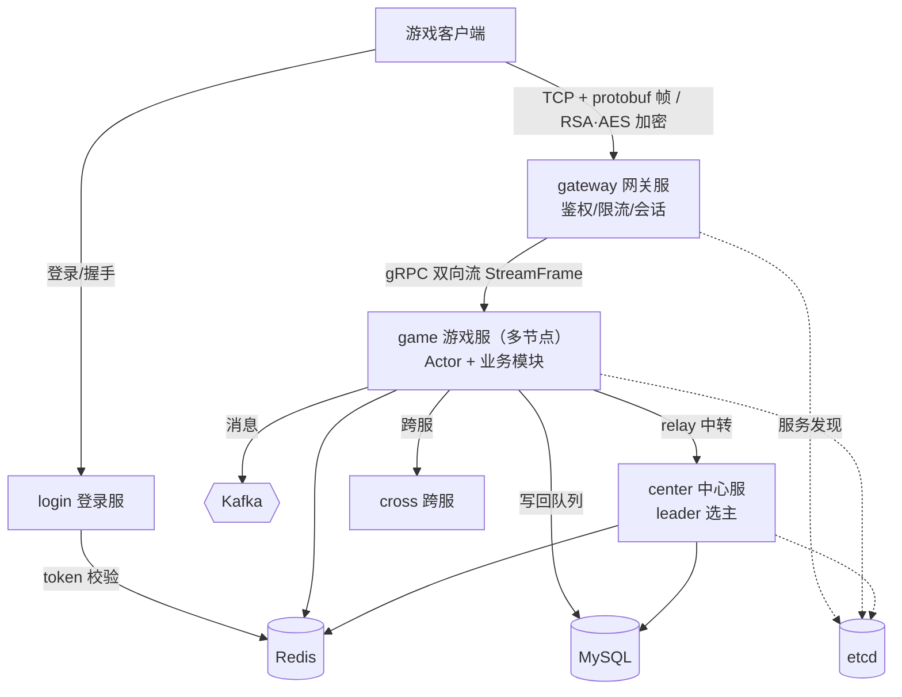

# game_study

通用游戏服务器框架（Go 1.22+）——面向中小型实时/半实时游戏（MMO、MOBA、卡牌、ARPG、SLG）。

> **设计文档仓库**：完整的架构专题（缓存、SLG、RPG、Actor、部署等）独立维护在 [`go_game_docs`](https://github.com/tudoumantou/go_game_docs)，本 README 只给概览与入口。

- 语言与版本：Go 1.22（`go.mod` 锁定，CI 用 `GOTOOLCHAIN` 保证不漂移）。
- 部署形态：七个可独立部署的进程 + 四类外部中间件（etcd / Redis / MySQL / Kafka），`deploy/` 提供 docker-compose 与 k8s 两套。
- 质量基线：`go test ./...` 与 `go test -tags integration ./...` 全绿；CI 五步卡点守护生成一致性。

---

## 1. 项目架构

`game_study` 是一个分布式游戏服务端，按微服务拆成多个进程，覆盖「登录 → 选角 → 进入游戏 → 玩法 → 落库」全链路，重点演示 **Actor 模型、缓存权威 + 写回、跨节点一致性** 这些服务端核心问题在游戏场景下的解法。

### 全局架构



读图要点：

1. **客户端只连网关**：所有下行经网关的 gRPC 流回到客户端；token 由登录服签发，Redis 是唯一真相（网关校验时查 Redis）。
2. **game 是多节点的**：玩家按 `account_id` 对节点取模选路，一个玩家同一时刻只属于一个节点；跨节点交互靠 Actor 远程投递与中心服中转。
3. **缓存权威**：在线玩家状态以 Redis 快照为权威，MySQL 是最终落库；写回异步（write-behind），停机有专门的 drain/flush 阶段。
4. **center 需要选主**：匹配、排行榜归并这类「全局唯一执行者」职责只在 leader 上跑。

### 服务组成

| 服务 | 目录 | 端口 | 职责 |
| --- | --- | --- | --- |
| 登录服 LoginServer | `internal/login` | 8080(HTTP)/8081(metrics) | 账号认证、Token 签发、网关/游戏服列表、充值下单 |
| 网关服 GatewayServer | `internal/gateway` | 9001(TCP)/9101(metrics) | 客户端加密长连接、会话管理、消息路由 |
| 游戏服 GameServer | `internal/game` | 9100(gRPC)/9102(metrics) | Actor 玩家逻辑、业务模块、Write-Behind 落库 |
| 落库进程 Flusher | `cmd/flusher`、`pkg/writebehind` | 无对外端口 | 从 Redis 脏队列定时合批写 MySQL |
| 中心服 CenterServer | `internal/center` | 9200(gRPC)/9201(metrics) | 节点注册/中转/排行榜/统计/跨服分组 |
| 跨服节点 CrossServer | `internal/cross` | 9300(gRPC)/9301(metrics) | 跨服房间/战场（不注册 etcd、不连网关） |
| 地图服 MapServer | `cmd/map`、`internal/worldmap` | 9400(gRPC)/9401(metrics) | SLG 大地图场景循环（设计规格见 §5） |

> 端口成对出现（如 9001/9101）：前一个对客户端/外部，后一个对内部 gRPC。

### 五条核心设计原则

| 原则 | 含义 |
| --- | --- |
| **数据所有权归 Actor** | 玩家状态只有一个权威（内存 Actor + Redis 快照），任何副本都会产生两份真相 |
| **一处权威，其余广播** | 查询类全局状态（在线归属）放 presence；执行类指令（踢人）广播给所有节点，由持有者命中 |
| **失败要响，不能静默** | 错误码、审计日志、fail-closed 校验，坏状态宁可拒绝也不放行 |
| **可测试性是设计约束** | 时钟、定时器、外部依赖全部可注入；测试不睡真实时间 |
| **演进不搞大爆炸** | 每步都可回滚、都有测试守着；先修 bug 再重构，重构必有量化收益 |

---

## 2. 部署

### Docker 本地部署

```bash
make docker-up     # 生成缺失的 RSA 密钥、构建五服务、启动中间件并等待就绪
make smoke         # 登录 → 加密握手 → 创角 → 角色信息（需要本机 Go 1.22+）
make docker-logs   # 查看日志
make docker-down   # 停止容器，保留数据
```

需要 Docker Desktop / Docker Engine + Compose、OpenSSL 和 curl。部署脚本通过 `docker cp` 将配置、密钥和建表 SQL 更新到命名卷，避免依赖 Docker Desktop 目录共享。修改这些文件后再次执行 `make docker-up`；已有 MySQL 数据库需另行执行迁移。

首次启动时 MySQL 自动创建 `game` 用户并执行 `sql/schema/*.sql`；数据库保存在 Compose 的 `mysql` 命名卷中，已有数据库不会重新执行初始化脚本。密钥保存在 `deploy/keys`，启动脚本保留已有密钥。当前配置用于本地开发，端口仅绑定本机，数据库使用开发密码。

可选监控：`make monitoring`，访问 http://127.0.0.1:3000（admin/admin）和 http://127.0.0.1:9090。

### 快速开始（裸机/本机）

```bash
make gen          # proto/data/db 三大生成（需 buf：https://github.com/bufbuild/buf#installation）
make keygen       # 生成网关握手 RSA 密钥对 → deploy/keys
make dev          # 起中间件 etcd/redis/mysql/kafka
make db-init      # 建表
make db-seed      # 灌初始数据（含测试账号）
make run-all      # 按依赖顺序起五进程
make test         # 单测（go test ./...；集成测试需 -tags=integration，见 test/integration）
make lint         # golangci-lint + buf lint + 生成一致性
```

> 集成测试需本机 Docker：`go test -tags=integration ./test/integration/ -v -count=1`（testcontainers 起 MySQL 8.0 + Redis 7）。

---

## 3. Actor 模型

`pkg/actor` 用「分片事件循环 + 有界信箱」把每个玩家的全部消息收敛到单 goroutine 上串行执行，业务侧因此完全免锁；跨节点投递让这套模型从单进程延伸到多游戏服节点。

**为什么是分片哈希而不是一线程一 Actor**：goroutine 虽轻，万级在线仍是万级 goroutine。按 `actorID` 用 fnv32a 哈希取模编入 **1024 个分片**，每分片一个 goroutine 轮转处理名下所有 Actor——片内串行免锁、片间并行。fnv 是固定纯函数，跨进程/重启结果一致，重启后同一玩家仍落同一分片。

**三个核心机制**：

| 机制 | 做法 | 解决的问题 |
| --- | --- | --- |
| 分片哈希 + per-Actor budget | 1024 分片，每轮每个 Actor 最多处理 100 条 | 片内串行免锁、片间并行，高负载下不饿死同片小 Actor |
| 有界信箱 + 显式背压 | 信箱容量 1024，满则拒绝返回 `ErrMailboxFull` 并计数 | OOM 风险与积压都可见可控 |
| inflight 计数 + Drain | 关闭时等到「真的处理完」而非「信箱空」 | 保住玩家最后一段进度，不丢在途 Redis 提交 |

**跨节点投递**：`PID.Node` 空=本地、非空=远端节点；`RemoteSender` 接口 + `RemoteMessage` 显式序列化契约，经中心服中转。本地 PID 一律 `Node=""`，单机部署零行为变化。信封用 JSON + 显式 `type_url` 注册表（启动期即发现漏注册）。

**业务侧契约只有三条**：`Receive` 不阻塞、消息类型自己断言、想改状态就发消息。

关键文件：`pkg/actor/{actor,mailbox,system,context,remote}.go`、`internal/game/player/{actor,manager,remote}.go`。

---

## 4. 缓存架构

一句话：**两条写入路径** + **两张 Redis 表** + **一套手写的映射声明**。

### 两条写入路径（除此之外没有第三种）

| 路径 | 权威 | 回执时机 | 适用 |
| --- | --- | --- | --- |
| **业务数据：内存优先（Write-Behind）** | 内存 | Redis 写完（失败也回） | 签到/背包/任务/伙伴/装备——丢了让玩家重做 |
| **充值：数据库优先（Write-Through）** | MySQL | **MySQL 提交之后** | 充值/交易/订单——丢了要赔钱 |

内存优先流程：内存先改 → 写 Redis 数据表 → 登记索引 → 标脏 → 定时落库（落库数据源是**内存**不是 Redis，避免写回旧值）。判定标准只有一条：**这笔数据丢了，是要赔钱/回滚订单，还是让玩家重新操作一次？**

### 两张 Redis 表

| 表 | key | 类型 | 内容 |
| --- | --- | --- | --- |
| **数据表** | `e:{table}:{id}` | Hash | 一行记录的字段快照 |
| **索引表** | `by_owner:{table}` | ZSET | score=归属者 id，member=实体 id |

一个 ZSET 同时表达「存在性 + 归属列表 + 反向归属查询」三件事（O(1)~O(log N)），把早期「id 映射 + role 映射 + 数据」的 3 份写降到 2 份。启动只建索引不搬数据（数据按需懒加载），索引未就绪/Redis 故障时回落 MySQL。

### 故障降级：Redis 熔断

网络黑洞（丢包/半开连接）下每条命令会等满超时（默认 5s），把降级拖成不可用。go-redis `ProcessHook` 上挂三态熔断器（closed/open/half_open）：故障确认后命令不再发出，既有降级路径从「等 5s 后降级」变成「立刻降级」，无需任何业务代码配合。配置（`redis.circuit_breaker`）：`threshold`(连续失败次数，默认 5)、`cooldown`(默认 5s)、`probes`(半开探测数，默认 1)。

---

## 5. SLG 架构（大地图子系统设计规格）

> 这是**待开发的子系统设计规格**（不是现有功能说明），目标是服务器权威的 SLG 大地图。详细文档见 `go_game_docs` 的 `slg场景地图设计开发.md`。

设计要点：

- **独立 `cmd/map` / `internal/worldmap` 服务**，第一版一个世界由一个 MapServer 承载、内部 **25 个场景循环**（SceneLoop），每个场景单线程单写者、有界 channel，保证同一场景状态串行、业务侧免锁。
- **SQL 权威 + epoch 栅栏**：地图业务命令（部队/资源/采集/战斗/移交）在同一 SQL 事务提交，只有提交成功才变更内存镜像并发布事件；world 行用 `epoch` 做写入所有权代次，旧 epoch 提交被栅栏拒绝，实现故障切换。
- **跨场景所有权移交（Transfer）**：普通行军穿边界、攻击迁入防守场景、回城脱离，都用同一 Transfer 流程——源冻结 → 目标 Prepare → SQL 原子更新 owner + 两场景 revision + transfer → 目标 Activate，提交结果未知时按持久化回执解析而非猜测。
- **AOI / 行军线 / Ghost**：`AOIWorker` 维护订阅与投影、批量推送、可丢弃重建；`LineWorker` 只显示行军路线不是行军逻辑真源；`ViewCoordinator` 处理跨广播块订阅，不持有业务写权限。
- **玩家资产交接**：地图用持久化「交接单 + 至少一次投递 + 玩家原子去重」实现业务上的一次发奖，避免跨系统单事务「恰好一次」的谎言；交接单确认必须发生在玩家 Redis 快照 CAS 成功之后。
- **不变量优先**：文档列出 INV-01~10（单世界单 epoch、单逻辑 OwnerScene、同资源点唯一采集会话、战损只应用一次、交接单最多加一次背包等），并通过 `tools/mapcheck` 只读核验。

---

## 6. RPG 架构（实时战斗系统）

实现位置：`internal/scenemap/battle`（RPG 战斗框架）。核心特征是**服务器权威、实时结算**，不是客户端 lockstep。

- **MGR Actor 单写者**：`battle` 本身不是 Actor、没有 goroutine，全部入口都在 MGR 的串行队列里；依赖方向始终是 `battle → mgr`，MGR 不 import battle。
- **LAUNCH/CAST 分离 + 前摇**：受理后即刻写 CD（受理即扣），LAUNCH 只挂 Buff 不造成伤害，前摇到期才 CAST 结算；前摇公式吃攻速与距离，再统一按地图倍速缩放。
- **伤害公式链**：攻防/暴击/会心/元素/格挡/增伤/歧视/宠物/地图/PK 压制/真实攻防/百分比，**整数定点、每步 `/10000` 截断**，可复现、无浮点误差。
- **双回路**：表现回路（飘字/血条/Buff 同步）走 AOI 视野广播；结果回路（`SkillResultEvent`/死亡事件）投递目标主人的玩家 Actor。NPC 属性由 MGR 直写，玩家属性只发事件——这是「单写者 + 属性归属」的边界。
- **死亡链统一入口 + 幂等**：`Runtime.dead` 标记保证同一目标只死一次；怪物被 Despawn 后 UUID 复用，残留标记会把新怪判成尸体，需重建投影并清标记。

未实现（后续）：被动技能逐条释放、光环/区域、时停横幅、跨节点施法、AI 主动施法、伤害榜等。

---

## 7. 帧同步 / 实时模拟架构

本项目的「实时模拟」采用**服务器权威的 tick 模型**，与经典客户端 lockstep 帧同步有本质区别：

| 维度 | 经典帧同步（lockstep） | 本项目（服务器权威 tick） |
| --- | --- | --- |
| 状态真源 | 各客户端按相同输入重演 | **服务器**持有并结算状态，客户端只收结果 |
| 同步单位 | 固定帧号、每帧广播输入 | 逻辑 tick（固定间隔）推进，结果事件下发 |
| 反作弊 | 依赖所有客户端一致 | 服务器是唯一裁决者，客户端不可信 |
| 断线重连 | 需补帧/重演 | 直接拉取服务器权威快照 |

实际落地：

- **scenemap / RPG 战斗**：由 MGR 每 **500ms** 统一驱动 `BuffTick`（`deps.BuffTick = battle.Tick`），触发器秒表不随倍速缩放；位置/到达/判定是状态边界，普通移动按「绝对起点 + 时间推导」重算，不每帧 `pos += speed*dt` 累积误差。
- **SLG 大地图**：默认逻辑 Tick **1s**，所有移动/采集/战斗 deadline 按 `due_at_ms` 顺序补处理（重启后不重演全部 tick）；跨场景命令串行进入 SceneLoop 单写者。
- **为什么不用客户端帧同步**：游戏服已用 Actor 模型保证玩家状态串行权威，场景/战斗再叠加一层服务器 tick 即可让「外挂伪造坐标/伤害」在服务器被否决；代价是服务器要算模拟，但换来确定性与可回放（战斗用确定性 FakeResolver 跑通流程）。

---

## 8. 目录铁律

| 目录 | 规则 |
| --- | --- |
| `api/` | 协议单一事实源，只放 `.proto` 与 buf 配置 |
| `pkg/pb` `pkg/model` `pkg/gamedata` | **生成代码，禁止手改**（`make gen` 产出，CI 卡点守护） |
| `pkg/` | 可复用基础库，禁止 import `internal/` |
| `internal/` | 服务私有实现，禁止跨服务 import |
| `cmd/` | 只做组装（配置 → 组件 → 服务 → 注册中心 → 优雅退出），不含业务 |
| `sql/schema` | 手写 DDL（gendb 输入）；`sql/seed` 初始数据 |

## 9. 分层规范

```
cmd/main.go            组装层
internal/<svc>/server.go
  ├── handler/router   接入层（协议解析/校验/中间件）
  ├── service          领域层（流程编排/事务边界）
  └── repo             数据层（SQL/Redis）
游戏服特殊分层：rpc.server → actor → player/scene → module → flusher
```

依赖方向铁律：`handler/router → service → repo`，`module → actor context → pkg/*`，任何一层不得反向依赖。

## 10. P0 生成物规模

| 产物 | 数量 | 生成器 |
| --- | --- | --- |
| `pkg/pb/**/*.pb.go` | 26 个 proto | buf generate |
| `pkg/gamedata/*_gen.go` | 32 张配置表 | gendata |
| `pkg/model/*_gen.go` | 25 张表 CRUD | gendb（`sql/schema` 19 个 DDL） |
| `bin/{login,gateway,game,center,cross}` | 5 个静态二进制 | scripts/build.sh |

---

> 更详细的专题（缓存、SLG、RPG、Actor、部署、场景设计、开发流程等）请见独立文档仓库：[`go_game_docs`](https://github.com/tudoumantou/go_game_docs)。
