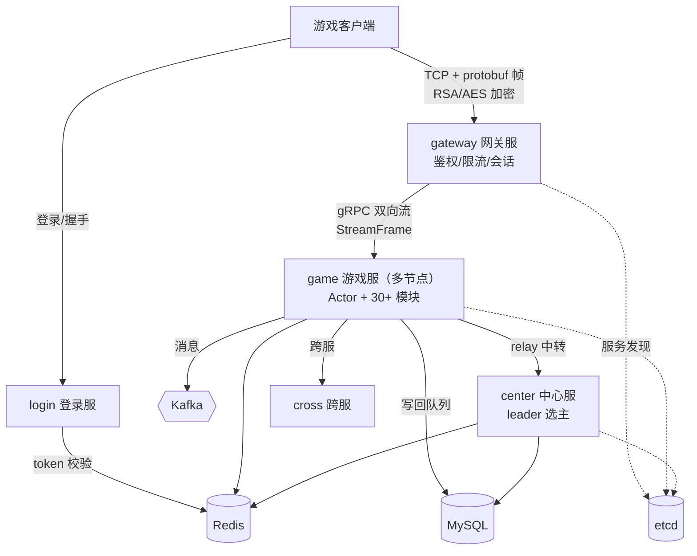
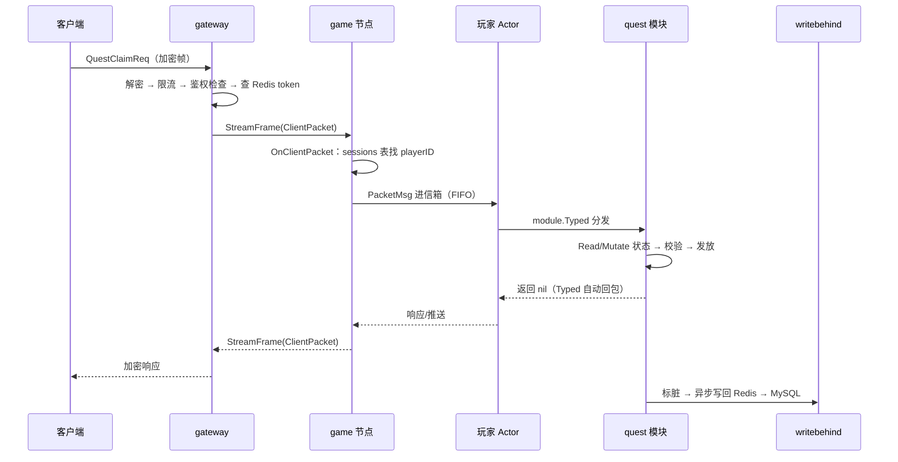

# 01 项目简介与全局架构

> 一句话定位：game_study 是一个用 Go 编写的**分布式游戏服务端**，按微服务拆成七个进程，覆盖「登录 → 选角 → 进入游戏 → 玩法 → 落库」全链路，重点演示 Actor 模型、缓存权威 + 写回、跨节点一致性这些服务端核心问题在游戏场景下的解法。

## 1. 项目定位与规模

- 语言与版本：Go 1.22（`go.mod` 锁定，CI 用 `GOTOOLCHAIN` 保证不漂移）。
- 代码规模：非测试、非生成代码约 **7.8 万行**；`internal/` 按服务分目录，`pkg/` 放公共能力，`api/proto` 是协议唯一定义处。
- 部署形态：七个可独立部署的进程 + 四类外部中间件（etcd / Redis / MySQL / Kafka），`deploy/` 提供 docker-compose 与 k8s 两套。
- 质量基线：`go test ./...` 与 `go test -tags integration ./...` 全绿；CI 五步卡点（见 [60-测试体系/04](../60-测试体系/04-集成测试与CI.md)）。

## 2. 七个进程与端口

端口规划来自设计文档 19.1，各服务 `configs/<服务>-dev.yaml` 里都写了注释：

| 进程 | 入口 | 端口 | 职责 |
| --- | --- | --- | --- |
| login | `cmd/login` | 8080 / 8081 | 账号注册登录、token 签发与校验、账号状态（封禁） |
| gateway | `cmd/gateway` | 9001 / 9101 | 客户端 TCP 接入、加解密、鉴权、限流、会话管理、转发 |
| game | `cmd/game` | 9100 / 9102 | 玩家 Actor、全部业务模块、场景、战斗 |
| center | `cmd/center` | 9200 / 9201 | 选主、匹配、排行榜、里程碑、统计、归档、中转 |
| cross | `cmd/cross` | 9300 / 9301 | 跨服战斗小组 |
| map | `cmd/map` | — | 独立地图/场景进程（RPG 场景框架） |
| flusher | `cmd/flusher` | — | 脏数据周期落库（非缓存玩家的保存通道） |

> 端口成对出现（如 9001/9101）的约定是：前一个对客户端/外部，后一个对内部 gRPC。

## 3. 全局架构

读图要点：

1. **客户端只连网关**：所有下行经网关的 gRPC 流回到客户端；客户端拿到的 token 由登录服签发、Redis 是唯一真相（网关校验时查 Redis）。
2. **game 是多节点的**：玩家按 `account_id` 对节点取模选路（见 [20-网关层/01](../20-网关层/01-网关总览与连接管理.md)），一个玩家在同一时刻只属于一个节点，跨节点交互靠 Actor 远程投递与中心服中转。
3. **缓存权威**：在线玩家的状态以 Redis 快照为权威，MySQL 是最终落库；写回是异步的（writebehind），停机时有专门的 drain/flush 阶段（见 [10-基础设施层/06](../10-基础设施层/06-缓存cache与writebehind.md)）。
4. **center 需要选主**：匹配、排行榜归并这类「全局唯一执行者」的职责只在 leader 上跑（见 [40-中心服/02](../40-中心服/02-Leader选主.md)）。

## 4. 五条核心设计原则

这一轮的所有改动都在这几条原则下做取舍，读代码前先建立这些直觉：

| 原则 | 含义 | 体现在 |
| --- | --- | --- |
| **数据所有权归 Actor** | 玩家状态只有一个权威（内存 Actor + Redis 快照），任何副本都会产生两份真相 | 网关被纠正为**不保存**「角色→会话」映射（[70-实录/07](../70-开发过程实录/07-封禁与GM踢人链路.md)） |
| **一处权威，其余广播** | 查询类的全局状态（在线归属）放 presence；执行类指令（踢人）广播给所有节点，由持有者命中 | `claimOnline` / `Broadcast` |
| **失败要响，不能静默** | 错误码、审计日志、fail-closed 校验，坏状态宁可拒绝也不放行 | 账号未知状态拒登录（[30-登录服/02](../30-登录服/02-账号体系与封禁.md)）、validate 坏数据整批回滚 |
| **可测试性是设计约束** | 时钟、定时器、外部依赖全部可注入；测试不睡真实时间 | Timer 接口、Config.Clock、onlinePresence 接口 |
| **演进不搞大爆炸** | 每步都可回滚、都有测试守着；先修 bug 再重构，重构必有量化收益 | 十个专题全部附带变异验证（[70-实录](../70-开发过程实录/01-定时器测试flaky修复.md)） |

## 5. 一次请求的全链路

以「玩家领取任务奖励」为例，把各层串起来：

注意两个容易踩的细节，后面有专文：

- 第 4 步网关「查 Redis token」失败即断连，不做重试恢复（错杀比放过安全）。
- 第 6 步 `module.Typed` **自动回包**，handler 内再手动 reply 就是重复回包——这正是 P0 串号事故的根因（[70-实录/02](../70-开发过程实录/02-P0响应串号与幂等失效.md)）。

## 6. 小结

game_study 的架构可以概括为：**网关管连接、游戏服管状态、中心服管全局、缓存保权威、异步做落库**。后续所有文档都在这张图上展开；建议按 [00-总览](01-项目简介与全局架构.md) → 对应服务层 → 开发实录的顺序阅读。
