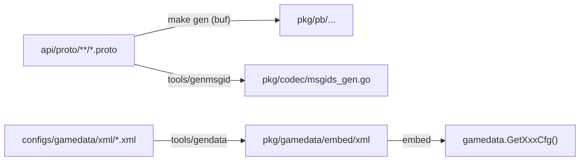

# 03 技术栈与外部依赖

> 每个依赖都是「为什么要它」；每个「为什么不用」同样是设计决策。这份文档逐项过一遍 go.mod，再讲外部中间件与版本锁定策略。

## 1. 运行时与语言

- **Go 1.22**：`go.mod` 指令锁定。选 1.22 而不是更新的版本，是因为 CI 里的 golangci-lint v1.64.8 要求 `go >= 1.23` 会不兼容（v2 才行），团队选择锁 lint 大版本而非追新 Go。
- **GOTOOLCHAIN**：不开启自动升级，保证本地与 CI 用同一个工具链。

## 2. 直接依赖逐项说明

`go.mod` 的 require 块（去掉 indirect）：

| 依赖 | 版本 | 用途 | 备注 |
| --- | --- | --- | --- |
| `google.golang.org/grpc` | v1.65.0 | 网关↔游戏服、游戏服↔中心服的内部通信 | 双向流（Channel）是会话绑定的基础 |
| `google.golang.org/protobuf` | v1.34.2 | 所有协议消息 | 生成物在 `pkg/pb`，CI 校验不一致 |
| `go.etcd.io/etcd/client/v3` | v3.5.16 | 服务发现 + 选主（concurrency.Election） | 选主见 [40-中心服/02](../40-中心服/02-Leader选主.md) |
| `github.com/redis/go-redis/v9` | v9.7.3 | 缓存权威：token、在线状态、玩家快照、排行榜 |  Lua 脚本做原子 CAS |
| `github.com/go-sql-driver/mysql` | v1.8.1 | MySQL 驱动 | 落库最终一致 |
| `github.com/segmentio/kafka-go` | v0.4.47 | 邮件投递、审计日志、战斗事件 | `pkg/mq` 封装 |
| `github.com/stretchr/testify` | v1.9.0 | 测试断言（require） | 断言统一史见 [70-实录/10](../70-开发过程实录/10-停机flaky与持续集成.md) |
| `go.uber.org/zap` | v1.27.0 | 结构化日志 | `pkg/log` 封装 |
| `github.com/prometheus/client_golang` | v1.19.1 | 指标 | `pkg/metrics`，grafana 看板在 deploy/ |
| `golang.org/x/crypto` | v0.24.0 | RSA/AES 握手加密 | 网关握手见 [30-登录服/01](../30-登录服/01-登录流程与握手.md) |
| `golang.org/x/sync` | v0.11.0 | errgroup | 并发收尾 |
| `go.uber.org/automaxprocs` | v1.6.0 | 容器里自动设 GOMAXPROCS | 防 k8s limit 误判 |
| `github.com/samber/lo` | v1.53.0 | 泛型工具函数 | 减少样板 |
| `gopkg.in/yaml.v3` | v3.0.1 | 配置解析 | `pkg/config` |

测试专用（不会进生产二进制）：

| 依赖 | 用途 |
| --- | --- |
| `github.com/DATA-DOG/go-sqlmock` | SQL 层单测替身 |
| `github.com/alicebob/miniredis/v2` | 内存 Redis，免起真容器 |
| `github.com/testcontainers/testcontainers-go`（含 mysql/redis 模块） | 集成测试起真容器，见 [60-测试体系/04](../60-测试体系/04-集成测试与CI.md) |

## 3. 「为什么不用」系列

这些决策写在代码注释里，文档同步沉淀：

1. **不用 `golang.org/x/time/rate`**：只需要「令牌桶 + 按 key 兜一张表」，且要能注入时钟（测试推进时间，不能真睡），自己写 178 行更直接（`pkg/ratelimit/ratelimit.go` 包注释原话）。
2. **不用 Ticker 做场景心跳**：Ticker 间隔创建后不可改，倍速一切换就要 Stop/New，新旧交替必然丢/多一拍；且 Ticker 会丢弃来不及处理的 tick——游戏循环丢一拍意味着 buff 少结算一次。改用自续期 `time.Timer` + 手动 `Reset`（`internal/scenemap/mgr/timer.go`）。
3. **不引 DI 框架**：依赖全部显式传参（`Deps` 结构体、`Config`），装配在 `cmd/*/main.go` 与各服务 `Start` 里完成——游戏服务端的装配是启动时一次性的，运行时不需要容器。
4. **不用注册中心客户端直连 etcd 做选路**：网关到 game 的选路用「etcd resolver + 取模」，查询在线归属用 Redis presence，etcd 只做服务发现与选主，职责不混。

## 4. 外部中间件与角色

| 组件 | 角色 | 关键使用点 |
| --- | --- | --- |
| **etcd** | 服务注册/发现、leader 选主 | 三段式注册（实例/路由/就绪），租约 TTL 10s |
| **Redis** | **缓存权威**：token、在线归属、玩家快照、脏队列、排行榜、幂等键 | 单点故障时的行为在 R2.1 契约里定义 |
| **MySQL** | 最终落库：账号、角色、各模块表 | schema 在 `sql/schema`，migrations 三段式管理 |
| **Kafka** | 异步消息：邮件投递、审计、战斗事件 | 每实例独立 consumer group，分区按 playerID 保序 |

四类中间件的本地起法见 `deploy/docker`；CI 里则用 testcontainers 按需起真实实例，不用 mock 顶替核心路径。

## 5. 版本锁定策略

CI（`.github/workflows/ci.yaml`）把「版本漂移」当成一类事故防：

- **buf 锁 1.74.0**：与本地一致，避免生成输出随版本漂移导致 gen diff 误报；
- **golangci-lint 锁 v1.64.8**：v2 要求 go >= 1.23，与 go.mod 的 1.22 不兼容；
- **Go 1.22**：与 go.mod 指令一致；
- CI 第①步 `make gen` 后 `git diff --exit-code -- pkg/pb pkg/gamedata pkg/model`——**手改生成代码直接挂**，这是「协议唯一事实源」的强制保证。

## 6. 代码生成链路

两代生成物（pb、gamedata）+ 消息号表全部进 CI 一致性检查，源改而生成物没重跑 = 合并不了。

## 7. 小结

技术选的共同取向：**成熟但不追新、能注入就能测、生成物必须一致**。每个「自研而不引库」的决定都附带可测性理由——这是后面所有测试手法（虚拟时钟、fakeTimers、内存替身）的前提。
