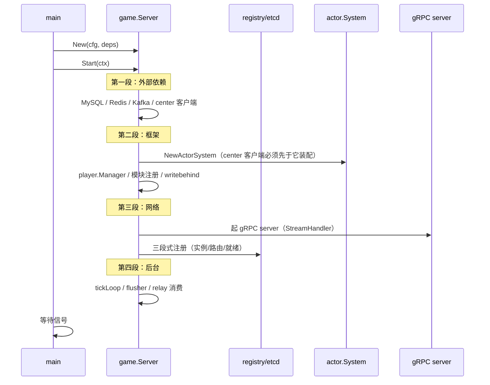

# 04 服务启动流程

> 七个进程的 `main` 是同一套模式：解析参数 → 加载配置 → 建日志 → 注册 etcd → 装配组件 → Start → 等信号 → 优雅停机。本文先讲通用骨架，再以 game 为例走一遍时序，最后讲停机为什么「顺序即正确性」。

## 1. 通用骨架（cmd/*/main.go）

```go
func main() {
    // 1. flag：配置文件路径、环境名（dev/test/docker/prod）
    // 2. config.Load：五步加载（默认值 → 文件 → 环境变量展开 → 校验 → 派生）
    // 3. log.New：结构化日志（zap）
    // 4. 各组件装配：MySQL / Redis / Kafka / etcd registry / rpc 客户端池 …
    // 5. srv.Start(ctx)：阻塞式启动（起 gRPC server、连中间件、注册服务）
    // 6. 信号等待：SIGINT/SIGTERM → cancel(ctx)
    // 7. srv.Shutdown(ctx)：四阶段停机（见下文）
}
```

配置加载的五步（`pkg/config`，详见 [10-基础设施层/03](../10-基础设施层/03-配置系统与热更新.md)）：

1. 内置默认值（代码里的 `DefaultXxx` 常量）；
2. YAML 文件覆盖（`configs/<服务>-<环境>.yaml`）；
3. `${VAR}` 环境变量展开——**敏感信息（DSN、token）只走环境变量，不进仓库**；
4. 校验（必填、端口冲突、`min_idle_conns ≤ pool_size` 这类硬约束）；
5. 派生值（如 limit 的「0=默认开启、负数=关闭」三值语义在这里归一化）。

## 2. game 服启动时序（四段十二步）

以最复杂的 game 为例（对应提交里 `server_start.go` 的装配顺序；详版见 [50-游戏服/01](../50-游戏服/01-游戏服总览与启动.md)）：



顺序上的两个硬约束：

1. **center 客户端必须先于 Actor 系统装配**：跨节点投递（`KickMsg` 等）依赖它做中转（提交 `a23070f` 明确把这条写进注释）；
2. **注册必须放在 gRPC server 起来之后**：否则 etcd 里出现「路由已就绪但端口没监听」的窗口，网关会把连接打过来再失败。

## 3. 停机：四阶段，顺序即正确性

`pkg/shutdown` 定义了四个阶段，`game.Server.Shutdown` 注册了 13 个步骤：


游戏服的具体动作（[50-游戏服/01](../50-游戏服/01-游戏服总览与启动.md) 有完整表）：

| 阶段 | 动作 | 为什么必须在这个位置 |
| --- | --- | --- |
| DRAIN | gRPC server GracefulStop，拒新流 | 之后所有「没有新输入」的假设才成立 |
| DRAINING | 等 Actor 信箱排空、等在途保存回执 | 提前 flush 会把「正在处理的请求」写成旧状态 |
| FLUSH | writebehind drain、非缓存玩家直连落库 | 数据最后一致性窗口 |
| STOP | 关 MySQL/Redis/Kafka/etcd 租约 | 先撤租约再关连接，避免其它节点还以为我活着 |

有状态实例下线时还会 `kickAllSessions`：绑定在本实例的会话无法迁移（Actor 状态在内存），服务端能做的**尽早明确告知**——客户端收到 `KickNotify` 立即重连到其它实例，而不是让后续请求一个个超时（`server_session.go:235`）。

停机阶段的时间竞争曾是 flaky 来源，改成结构化同步的过程见 [70-实录/10](../70-开发过程实录/10-停机flaky与持续集成.md)；「停机取消不再当故障上报」的修法见同篇。

## 4. 配置到运行：一次热更新长什么样

配置不是启动时读一次就完了：

- **LimitConfig**（限流阈值）：改了要重启才生效的部分走文件重载；
- **gamedata**（策划表）：运行时 `Replace` 热更，`atomic.Pointer` 无锁切换——测试里也靠它验证「临时改配置」的行为（见 [70-实录/08](../70-开发过程实录/08-配置漂移修复.md)）；
- **倍速/触发器**（scenemap）：`rearmTimers` 在运行中改间隔。

热更的边界与坑见 [10-基础设施层/03](../10-基础设施层/03-配置系统与热更新.md) 与 [10-基础设施层/04](../10-基础设施层/04-游戏数据gamedata.md)。

## 5. 本地跑起来

```bash
# 中间件（etcd/redis/mysql/kafka）
docker compose -f deploy/docker/docker-compose.yml up -d
# 建表与种子
make db-init
# 七个进程（各自一个终端，或 make run-all）
go run ./cmd/gateway -config configs/gateway/gateway-dev.yaml
go run ./cmd/login   -config configs/login/login-dev.yaml
go run ./cmd/game    -config configs/game/game-dev.yaml
go run ./cmd/center  -config configs/center/center-dev.yaml
```

## 6. 小结

启动流程的设计取向：**装配显式、顺序有注释、停机分阶段、配置分层**。这套骨架的价值在停机时兑现——数据不丢、会话有告知、租约先撤，全部靠「阶段顺序」而非运气。
