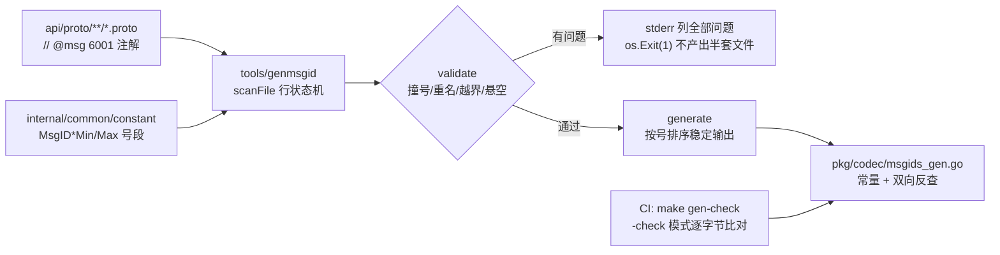

# 02 网络层与编解码

一句话定位：`pkg/net` 提供「一连接一 goroutine」的通用 TCP 服务端，`pkg/codec` 定义 `Length(2B) | MsgID(2B) | Seq(4B) | AES-GCM Body` 的帧格式与「消息号 ↔ proto 对象 ↔ handler」两张注册表，`tools/genmsgid` 把消息号的唯一声明点收敛到 proto 的 `// @msg` 注解并用 CI 卡住漂移。

## 1. 概述

客户端到网关的链路分四层，每层只解决一个问题：

1. **`pkg/net`（tcp_server.go）**：监听端口、accept 连接、为每连接起 goroutine。不解析任何协议，「先拒新、后排空」的关闭顺序。
2. **`internal/gateway/conn`（conn.go）**：单连接的读写循环，把 TCP 字节流按长度前缀切成完整逻辑包（粘包/半包重组），交给 router。
3. **`pkg/codec`（packet.go）**：帧格式的编解码——`Length(2B) | MsgID(2B) | Seq(4B) | Body`，Length 不含自身；protobuf.go 与 registry.go 分别管理「MsgID → proto 工厂」与「MsgID → handler」。
4. **`tools/genmsgid` + `internal/common/constant`**：消息号的分配与生成。唯一声明点是 proto 里的 `// @msg <id>` 注解，生成 `pkg/codec/msgids_gen.go`；号段边界（客户端协议 <9000、内部 gRPC 9000+）由 constant 包定义，`make gen-check` 在 CI 卡点。

加密不在 codec 层：Body 是 AES-256-GCM 密文（布局 `nonce||ciphertext||tag`），加解密由 `pkg/crypto` 的 SessionCipher 负责（RSA-OAEP 握手换密钥，Seq 单调递增防重放）。本文只讲到「Body 是不透明密文」这一接口边界；握手与防重放的完整设计见 [`../20-网关层/02-路由与消息分发.md`](../20-网关层/02-路由与消息分发.md)。

## 2. 涉及文件

| 路径 | 职责 |
| --- | --- |
| `pkg/net/tcp_server.go` | 通用 TCP 服务端：accept 循环、连接 goroutine 管理、幂等 Stop |
| `pkg/net/doc.go` | 包定位说明（不解析协议，仅传输） |
| `pkg/codec/packet.go` | 帧格式：HeaderSize/LengthFieldSize 常量、EncodePacket/DecodePacket/ReadLength |
| `pkg/codec/protobuf.go` | MessageRegistry：MsgID → proto 工厂，Create/Unmarshal/Has/Marshal |
| `pkg/codec/registry.go` | HandlerRegistry：MsgID → 处理函数，Handle/Has |
| `pkg/codec/msgids_gen.go` | **生成物**：102 个消息号常量 + 双向反查表 + MsgCount |
| `internal/common/constant/constant.go` | 号段边界（System/Conn/Login/Player/Bag/Scene/Battle/Social/Mail/Internal）、系统消息号、IsClientMsgID、MaxPacketSize |
| `api/proto/game/v1/*.proto`（21 个业务文件） | 消息声明，`// @msg <id>` 注解即唯一声明点 |
| `api/proto/buf.gen.yaml` | buf 生成配置：消息代码 → `pkg/pb`，gRPC service 同目录 |
| `pkg/pb/game/v1/*.pb.go` | protoc 生成的消息与 service 代码 |
| `tools/genmsgid/main.go` | 扫 proto 注解 → 校验（撞号/重名/越界）→ 生成 msgids_gen.go，`-check` 模式供 CI |
| `internal/gateway/conn/conn.go` | 单连接读写循环、粘包/半包切包状态机、幂等关闭 |
| `internal/gateway/router/router.go` | 解密 → msgID 一致性校验 → 内部号段拦截 → 注册表分发/透传 |

## 3. 核心设计

### 3.1 帧格式与 Length 语义

物理包格式（`pkg/codec/packet.go` 文件头）：

```text
Length(2B) | MsgID(2B) | Seq(4B) | AES-GCM Body
```

- `Length = HeaderSize + len(Body) = 6 + len(Body)`，**不含 Length 字段自身**——这是协议图里最容易写反的一条，测试用 `require.EqualValues(t, HeaderSize+len(p.Body), length)` 专门守它。
- Length 2 字节大端，单包上限 65535，与 `constant.MaxPacketSize = 65536`（64KB）对齐；超限的业务包应在业务层分帧，而不是硬发——长度超限若静默截断，会变成另一个「合法」长度，是协议层最难排查的故障。
- Seq 由 SessionCipher 单调递增分配，接收端做防重放检测。

编解码三个函数分工明确：

```go
func EncodePacket(p Packet) ([]byte, error) {
	if len(p.Body) > constant.MaxPacketSize-HeaderSize-LengthFieldSize {
		return nil, fmt.Errorf("body too large: %d", len(p.Body))
	}
	length := HeaderSize + len(p.Body)
	buf := make([]byte, LengthFieldSize+length)
	binary.BigEndian.PutUint16(buf[0:], uint16(length))
	binary.BigEndian.PutUint16(buf[LengthFieldSize:], p.MsgID)
	binary.BigEndian.PutUint32(buf[LengthFieldSize+2:], p.Seq)
	copy(buf[LengthFieldSize+HeaderSize:], p.Body)
	return buf, nil
}

func DecodePacket(data []byte) (Packet, error) {
	if len(data) < HeaderSize {
		return Packet{}, fmt.Errorf("packet too short: %d", len(data))
	}
	return Packet{
		MsgID: binary.BigEndian.Uint16(data[0:]),
		Seq:   binary.BigEndian.Uint32(data[2:]),
		Body:  data[HeaderSize:],
	}, nil
}

func ReadLength(b []byte) (int, error) {
	if len(b) < LengthFieldSize {
		return 0, fmt.Errorf("length buffer too short")
	}
	return int(binary.BigEndian.Uint16(b)), nil
}
```

- `EncodePacket` 一次性按精确长度 `make`，避免 append 反复扩容；Body 超限返回 error 不做截断。
- `DecodePacket` 的入参必须是**去掉 Length 前缀后的完整一包**（即 `buf[LengthFieldSize:]` 且长度等于 ReadLength 读到的值）；返回的 `Body` 不拷贝、直接引用入参尾部子切片——零拷贝是有意的性能取舍，代价是调用方复用读缓冲时必须自行拷贝，否则后一个包会覆盖前一个包的 Body。
- `ReadLength` 只从 2 字节大端读长度；配合 `io.ReadFull` 使用可正确处理 TCP 半包。

### 3.2 TCP 服务端：先拒新、后排空

`pkg/net` 的 TCPServer 只有三个职责：listen、accept、等连接收敛（`pkg/net/tcp_server.go`）：

```go
type Handler func(conn net.Conn)

func NewTCPServer(addr string, handler Handler) *TCPServer {
	return &TCPServer{addr: addr, handler: handler}
}

func (s *TCPServer) Start(ctx context.Context) error {
	ln, err := net.Listen("tcp", s.addr)
	if err != nil {
		return fmt.Errorf("listen %s: %w", s.addr, err)
	}
	s.listener = ln
	acceptErrCh := make(chan error, 1)
	go s.acceptLoop(acceptErrCh)
	select {
	case <-ctx.Done():
		_ = s.Stop()
		return ctx.Err()
	case err := <-acceptErrCh:
		_ = s.Stop()
		return err
	}
}

func (s *TCPServer) Stop() error {
	s.closeOnce.Do(func() {
		if s.listener != nil {
			s.closeErr = s.listener.Close()
		}
	})
	s.wg.Wait()
	return s.closeErr
}
```

- **「先拒新、后排空」**：Stop 先关 listener（新连接被拒），再 `wg.Wait()` 等存量连接自然结束——反序（先等后关）会无限期接受新连接，优雅退出永远等不到头。
- **不强制断连**：TCP 连接上可能还有未读完的业务消息，强断等于丢请求；主动断连的责任在 Handler（读超时/协议错误/ctx 取消）。
- **阻塞式 Start** 是刻意设计：上层 shutdown 编排需要「服务已就绪」与「服务已退出」两个明确信号，调用方按返回值区分 `ctx.Err()`（正常关服）与其他（故障）。
- `NewTCPServer` 不提前 listen：把「端口占用」错误从构造函数推迟到 Start，保持启动顺序可编排。
- `SetKeepAlive` 对 `*net.TCPConn` 设置 30s 周期探测：对端宕机不会发 FIN，连接呈半开状态，OS 默认 keepalive（通常 2 小时）才发现太慢；非 TCPConn（测试替身）时静默返回。

### 3.3 单连接处理：粘包/半包状态机

TCP 是字节流没有消息边界，`conn.processReadBuf`（`internal/gateway/conn/conn.go:158`）用标准状态机重组：

```go
func (c *Conn) processReadBuf() {
	for {
		if len(c.readBuf) < codec.LengthFieldSize {
			return
		}
		length, err := codec.ReadLength(c.readBuf)
		if err != nil { /* 记日志 + 断连 */ }
		// 长度上限与协议最大包一致：越界即视为攻击/错位，
		// 断连而不是尝试分配，防止恶意长度把 readBuf 撑爆
		if length <= 0 || length > 65535-codec.LengthFieldSize {
			c.Close(fmt.Errorf("invalid packet length %d", length))
			return
		}
		total := codec.LengthFieldSize + length
		if len(c.readBuf) < total {
			// 半包：等后续字节到达，下轮 read 后继续切
			return
		}
		pkt, err := codec.DecodePacket(c.readBuf[codec.LengthFieldSize:total])
		if err != nil { /* 记日志 + 断连 */ }
		// 同步回调：同一连接的包严格保序交给 handler
		c.handler.OnPacket(c, pkt)
		// 粘包情形：把已消费部分前移，剩余半包留在头部继续累积
		copy(c.readBuf, c.readBuf[total:])
		c.readBuf = c.readBuf[:len(c.readBuf)-total]
	}
}
```

要点：

- **长度非法直接断连**（`<=0` 或超上限）：宁可错杀也不解析，防止恶意长度字段耗尽内存——这是协议层最主要的 DoS 面。
- **半包等、粘包切**：`len(readBuf) < total` 时return 等后续字节；一次 Read 可能带多个完整包，循环切完后 copy 前移残余，比重新分配省。
- **同步回调保序**：同一连接的包严格按到达顺序交给 handler，慢 handler 天然形成背压，而不是无限堆积 goroutine。
- 读循环三个退出源（ctx 取消/连接关闭/读错误）都收敛到 `Close`，`closeOnce` 保证「标记 closed → 关 socket → 回调 OnClose」只执行一次；写侧 `Send` 有 10s 写超时防对端不读占死连接。

### 3.4 消息号分配：注解即唯一声明点

消息号是跨进程契约（客户端 + 网关 + 游戏服共用一套坐标系），改号的后果只在特定消息上偶发——旧客户端把请求发到别的 handler 且不报错。工程上用三层机制守住：

1. **号段分段**（`internal/common/constant/constant.go`）：按业务域占一段，段间留整数倍空档（连接 100-199 → 登录 1000-1999，中间 200-999 预留），相邻业务暴涨不挤占邻居；内部 gRPC 占 9000+ 与客户端协议物理隔离：

```go
const (
	MsgIDSystemMin   = 1   // 系统消息（心跳/握手/踢下线/错误码）
	MsgIDSystemMax   = 99
	MsgIDConnMin     = 100 // 网关/连接管理
	MsgIDConnMax     = 199
	MsgIDLoginMin    = 1000 // 登录/账号
	MsgIDLoginMax    = 1999
	// ... Player 2000 / Bag 3000 / Scene 4000 / Battle 5000 / Social 6000 / Mail 7000
	MsgIDInternalMin = 9000 // 内部 gRPC（不暴露给客户端）
	MsgIDInternalMax = 9999
)

// IsClientMsgID 判断是否客户端消息号（内部号段不暴露）
func IsClientMsgID(id uint32) bool {
	return id < MsgIDInternalMin
}
```

2. **`// @msg` 注解声明**（`api/proto/game/v1/game.proto`）：

```protobuf
// 发送聊天（私聊/世界聊；跨服私聊经 Kafka 扇出，见 17.3）
// @msg 6001
message ChatSendReq {
  int32  channel  = 1;
  int64  peer_id  = 2;
  string content  = 3;
  string local_id = 4; // 客户端本地 ID（本地回显 + 发送侧幂等）
}
```

选注解而不是自定义 proto option：option 需要自定义 extension 与自建 protoc 插件，而注解「可被 grep、可被 review、不依赖 protoc 版本」，`make gen` 与 `go test` 都不依赖 buf。

3. **生成 + 校验 + CI 卡点**：`tools/genmsgid` 读 proto 文本与 constant 号段，校验后产出 `pkg/codec/msgids_gen.go`：



校验四类问题（任一不通过即失败，不产出半套文件）：号重复（客户端会收到对方的消息体）、message 重名（生成的 Go 常量撞名）、号越界（不在任何号段内或落在 Internal 段——内部 gRPC 段是服务间通信专用，客户端协议不得占用）、注解悬空（`// @msg` 之后不是 message 声明）。错误全部带 `文件:行号`，直接指回 proto 声明点。

`scanFile` 是一个「注解悬停」行状态机：见到 `@msg` 记 pending；空行与注释不打断邻接关系（策划习惯在注解上方写用途说明）；pending 状态下遇到非 message 的实质行即报悬空错误。生成按 ID 排序 + `format.Source` 格式化，保证任何入口产出同一份文件，`-check` 逐字节比对才可信。

### 3.5 两张注册表：启动期写满、运行期只读

protobuf.go 管「MsgID → 消息对象」，registry.go 管「MsgID → 处理函数」，都在启动期由各业务包 init 填满：

```go
type MessageFactory func() proto.Message

type MessageRegistry struct {
	factories map[uint16]MessageFactory
}

func (r *MessageRegistry) Register(msgID uint16, factory MessageFactory) {
	if _, ok := r.factories[msgID]; ok {
		panic(fmt.Sprintf("msgID %d already registered", msgID))
	}
	r.factories[msgID] = factory
}
```

- **工厂必须每次返回全新实例**：Unmarshal 会把 body 解析进这个实例，共享包级单例会让并发/重入路径的消息内容互相串味。
- **重复注册直接 panic**：两个模块抢同一个号是启动期配置错误，立即炸掉比运行期静默覆盖好——后者会让消息路由到错误的 handler，且只在特定消息上偶发，极难排查。这是「fail-fast 三件套」的第三处（前两处是 actor 的远程注册表与 writebehind 的 Persister 注册表）。
- **运行期只读无锁**：map 并发只读安全，但只要有一个 goroutine 在写，并发读就会触发不可 recover 的 fatal error；用「启动期写满」的约定换掉运行期锁开销。`Handle` 同步调用（而非 `go h(...)`）保证单连接内消息顺序处理。
- **未注册不 panic 返回 error**：运行期遇到未知消息是客户端行为（版本不一致/伪造包），不是进程级配置错误。

## 4. 关键代码解析

### 4.1 网关分发：解密 → 校验 → 透传/本地处理

`internal/gateway/router/router.go` 的 `OnPacket` 把各层串成完整链路：

```go
// 外层 MsgID 与密文内层 MsgID 必须一致：防止把 A 消息的密文塞进
// B 消息的外壳（错包/重放混入），不一致即断
if msgID != p.MsgID {
	_ = c.Close(fmt.Errorf("msgID mismatch"))
	return
}

// 内部号段（9000+）只能走 gRPC，绝不允许来自客户端 socket。
if !constant.IsClientMsgID(uint32(msgID)) {
	_ = c.Close(fmt.Errorf("internal msg id %d not allowed", msgID))
	return
}

// 业务消息：网关不解析，透传给游戏服（4.5 客户端上行透传）
if !h.msgRegistry.Has(msgID) {
	if err := h.forward(sess, uint32(msgID), plaintext); err != nil { ... }
	return
}
msg, err := h.msgRegistry.Unmarshal(msgID, plaintext)
if err != nil { ... }
ctx := context.WithValue(context.Background(), ctxKeyConnID{}, c.ID())
if err := h.registry.Handle(ctx, msgID, msg); err != nil { ... }
```

四道关卡各有目的：

1. **解密失败即断连**：cipher 就绪后所有包走 AES-GCM，解不开说明密钥不对或包被篡改。
2. **外层/内层 MsgID 一致性**：防「A 消息的密文塞进 B 消息的外壳」——错包或重放混入。
3. **内部号段显式拦截**：`IsClientMsgID` 是协议隔离的执行点。注册表恰好没注册这些号（会走透传分支），但那是「碰巧」而非契约——靠注册表兜底时，将来谁把一个内部号注册进客户端表，客户端就能直接触发它；这里显式挡一次，把隔离写成代码。
4. **已注册消息本地处理，未注册透传游戏服**：网关只处理心跳/握手/登出等连接管理消息（router.go:112-126 注册），业务消息原样透传——网关不认识业务 proto，只做传输与安全边界。

`ctxKeyConnID` 用自定义私有类型作 context key：避免不同包用同一个字符串 key 相互覆盖，WithValue/Value 靠类型+值双重匹配。

### 4.2 wire baseline：已下发消息号的回归防线

`pkg/codec/msgids_test.go` 的 `wireBaseline` 逐一比对 102 个消息号：

```go
var wireBaseline = map[string]uint32{
	"EnterGameReq":  1010,
	"ChatSendReq":   6001,
	// ... 共 102 条
}

func TestMsgIDsMatchWireBaseline(t *testing.T) {
	for name, want := range wireBaseline {
		got, ok := MsgID(name)
		require.True(t, ok, "%s 未注册", name)
		require.EqualValues(t, want, got, "%s 号从 %d 变为 %d（会破坏旧客户端）", name, want, got)
	}
	require.EqualValues(t, MsgCount(), len(wireBaseline), "基线 %d 条，注册表 %d 条：新增消息请补进基线", len(wireBaseline), MsgCount())
}
```

守两条不变量：① 已下发客户端的消息号永远不变；② 一号一义、名字↔号码正反查询互为逆运算。新增消息必须同步补进基线，否则测试以「条数不一致」失败——这是故意的：防止有人只加号不进基线、绕过兼容审查。为什么用测试而不是 code review 守：号是跨进程契约，改号后果只在特定消息上偶发，人工审查拦不住，回归测试成本最低。

## 5. 演进记录

- **`2461564` feat(tools): 消息号注册表生成、配置校验与快照热更新（R10.1–R10.4）**——引入 `tools/genmsgid` 与 `// @msg` 注解机制，取代此前手工维护的消息号表。动机：消息号散落在多个文件手工登记，出现过「号重复但两边都能编译通过」的隐患；生成化后撞号/重名/越界在工具期暴露，`-check` 模式进 CI 卡住「改了 proto 忘了重新生成」。
- **`a0ed305` P1-P4 最小可运行链路**——`pkg/net` 与 `pkg/codec` 随加密链路一批接入；帧格式（Length 不含自身）与「先拒新后排空」的关闭顺序在该阶段定型。
- **`0e7d1f0`/`a40f144` docs(comments)**——全量补充中文注释与 Go 语言知识点（本文引用的源码注释即此批成果），并修正了一批过时注释（如 conn.go 中「4B 长度」的旧描述）。
- **`bea479d` refactor(test)**——断言统一为 require；场景定时器改为可注入以消除 flaky（影响网关→场景链路的测试稳定性）。
- **`091ef50`/`ec6258d`/`a5f369f` refactor(test)**——testify 分批替换手写断言，测试代码净减约 2000 行，本文涉及的 codec/msgids 测试同批转换。

## 6. 测试情况

| 测试文件 | 覆盖内容 |
| --- | --- |
| `pkg/codec/codec_test.go` | EncodePacket → ReadLength → DecodePacket 全链路（Length == HeaderSize+len(Body) 的关键断言）；MessageRegistry 工厂返回正确类型空实例；HandlerRegistry 按 MsgID 路由且返回值透传 |
| `pkg/codec/msgids_test.go` | wireBaseline 逐条比对 102 个消息号（防改号/漏登/多登）；MsgName/MsgID 正反查互逆；未注册号/名不命中；注册表内一号多义防御 |
| `tools/genmsgid/main_test.go` | 注解与 message 绑定（中间夹注释不打断）、悬空注解报错、重复号/重名/越界三类校验（含 Internal 段占用拦截）、`-check` 模式比对、`TestRepoProtoDeclarations` 直接跑仓库真实 proto |

codec 测试只验证帧格式与工厂路由，不测加密正确性（由 crypto 包覆盖）与 proto 解析内容（由 proto 库自身保证）——分层不重复测。

## 7. 小结

网络与编解码层用四组决策守住「跨进程契约」：

1. **Length 前缀 + 大端定长**：TCP 无边界的问题用「2B 长度 + 状态机重组」解决，长度非法即断连，把 DoS 面挡在读循环；
2. **先拒新后排空**：TCP 服务端不强制断连，关闭顺序保证「新连接被拒 → 存量排空 → 进程退出」；
3. **注解驱动生成**：消息号唯一声明点在 proto 的 `// @msg`，号段分段留空档，撞号/重名/越界工具期拦截，wireBaseline 测试兜底已下发号码永不变；
4. **两张启动期注册表**：MsgID → 工厂 / MsgID → handler 写满后只读无锁，重复注册 panic、未知消息返回 error——fail-fast 与运行期容错的边界清晰。

相关文档：玩家会话与加密封装见网关层文档，跨服务 gRPC 通信（内部 9000+ 号段）见 [`05-服务发现registry.md`](05-服务发现registry.md) 与中心服文档，消息进入 Actor 后的处理见 [`01-Actor模型.md`](01-Actor模型.md)。
