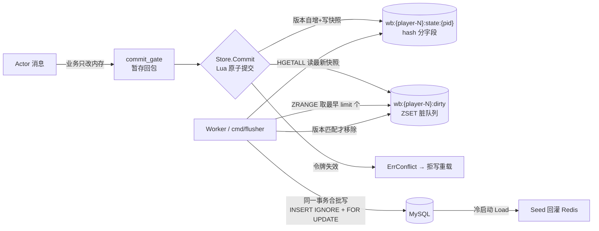

# 06-缓存 cache 与 writebehind

一句话定位：`pkg/cache` 是全部进程访问 Redis 的唯一入口（连接、在线状态、存在性判断、幂等、分布式锁），`pkg/writebehind` 在其上实现 Tier-2 缓存权威链路——玩家热状态先写 Redis，再由落库 worker 异步、合批、带数据库版本栅栏地投影到 MySQL。

## 1. 概述

项目的数据分层是「两级真相」：

- **Tier-1（MySQL 权威）**：账号、充值订单、跨服结算等必须对账的资产，直接写库，见 R2.3 充值双栅栏设计；
- **Tier-2（Redis 权威）**：玩家玩法热状态（档案、属性、背包、各模块 Ext 状态），写 Redis 即算生效，MySQL 只是异步投影。

Tier-2 的核心契约来自 [`../docs/R2.1-缓存原子变更契约.md`](../../docs/R2.1-缓存原子变更契约.md)：**一次 Actor 消息 = 一份 Snapshot = 一次 CAS**，业务 handler 只允许改内存，写库是 Write-Behind 的事。会话所有权（谁能写）由 [`../docs/R2.5-会话所有权与提交通道设计.md`](../../docs/R2.5-会话所有权与提交通道设计.md) 的 epoch 令牌回答。模块侧如何接入（Ext 槽位、persist.go）见 [`../50-游戏服/05-持久化Stateful.md`](../50-游戏服/05-持久化Stateful.md)，本文讲框架侧。

两个包的分工：

- `pkg/cache`：Redis 基础设施。`redis.go` 是全仓唯一创建 Redis 连接的地方；`presence`（谁在线）、`idtable`（记录是否存在）、`idem`（消息是否处理过）、`lock`（跨进程互斥）、`idtab`（发号）五个子模块共用同一个 `redis.UniversalClient`。
- `pkg/writebehind`：Tier-2 链路本体。`types.go` 定义线上快照协议，`store.go` 管 Redis 侧存储与原子提交，`worker.go` 管异步落库，`registry.go`/`flat.go`/`stateful.go`/`ext.go` 构成模块持久化扩展点。

一条消息的完整旅程：玩家 Actor 改内存 → `commit_gate` 暂存回包 → `Store.Commit` 一次 Lua 原子提交（版本自增 + 写快照 + 登记脏队列）→ 进程内 worker 或独立 `cmd/flusher` 定期从脏 ZSET 取玩家 → 同一事务合批写 MySQL → 版本匹配后 Ack 出队。任何一步失败都不 Ack，玩家留在队列，下轮重试。

## 2. 涉及文件

### 2.1 pkg/cache

| 文件 | 职责 |
|---|---|
| `pkg/cache/doc.go` | 包级文档：能力清单、「原子操作下沉 Redis」「降级优先于报错」两条总原则 |
| `pkg/cache/redis.go` | Redis 客户端创建（`UniversalClient` 自动识别单点/集群）、启动 Ping 探活、`GetClient` 逃生舱 |
| `pkg/cache/keygen.go` | key 命名规范 `<域>:<实体>:<id>[:<子键>]`，`PlayerKey`/`OnlineKey`/`EntityKey`/`LockKey` 等构造函数 |
| `pkg/cache/presence.go` | 在线归属（Lua 原子占位，`TrySetOnline`）+ 离线暂存 List（`PendPush`/`PendDrain`，事务管道） |
| `pkg/cache/idtable.go` | ID 存在性集合：后台构建（临时 key + RENAME 原子切换）、`Exists` 回落 DB、`Reconcile` 对账、`CleanOrphans` 孤儿清理 |
| `pkg/cache/idtab.go` | ID 分配器（`INCR` + `SETNX` 初始化），与 idtable 是「分配 vs 存在性」一对 |
| `pkg/cache/idem.go` | 基于 SETNX 的幂等去重，实现 `pkg/mq.Deduper`/`Forgetter` |
| `pkg/cache/lock.go` | 分布式锁（SETNX + TTL，Lua 比对 token 解锁） |
| `pkg/cache/idtable_test.go`、`presence_test.go` | 单元测试 |

### 2.2 pkg/writebehind

| 文件 | 职责 |
|---|---|
| `pkg/writebehind/types.go` | 线上协议：`Snapshot`/`Record`/`FieldSource`、`Partitions=10`、`Partition()` 取模、`Validate` 公共闸门 |
| `pkg/writebehind/store.go` | Redis 侧存储：`commitScript` 原子提交、`AcquireLease` 会话令牌、`Seed`/`Load` 冷启动、`Pending`/`Ack` 队列消费 |
| `pkg/writebehind/worker.go` | 落库 worker：`FlushBatch`/`FlushAll`/`Run` 调度、`Persist` 版本栅栏事务、`persistSnapshots` 合批写各表 |
| `pkg/writebehind/registry.go` | `Persister` 四方法接口与注册表（RWMutex，init 注册，重名 panic） |
| `pkg/writebehind/flat.go` | `RegisterFlat[T]`：单行状态表一行注册成 Persister（语法糖） |
| `pkg/writebehind/stateful.go` | `RegisterStateful[Row, Data]`：Ext 存业务结构、落库经 Codec 转表行 |
| `pkg/writebehind/ext.go` | Ext 槽位编解码助手：`Decode`/`Encode`/`LoadExt`/`SaveExt`、`ExtState` 窄接口 |
| 各 `_test.go` | 单元测试（miniredis + sqlmock） |

配套的 `pkg/flush/flat.go` 定义 `FlatOps[T]`（gendb 生成的 `UpsertXxxBatch`/`FindXxxByPK` 函数对），是 RegisterFlat 的注入点；`internal/game/server_start.go:120` 装配 Store、`:312` 装配 Worker；`cmd/flusher` 是独立落库进程（另见 [`07-限流shutdown与工具包.md`](07-限流shutdown与工具包.md)）。

## 3. 核心设计与数据流

### 3.1 全链路



三个关键不变量（`pkg/writebehind/store.go:6` 文件头注释即此）：

1. **版本单调**：`commitScript` 内 `HINCRBY version 1`，版本只作落库顺序编号；
2. **提交与入队原子**：同一个 Lua 里完成「写状态 + 登记脏队列」，不会出现「状态新了但没入队」（丢落库）或「入队了状态旧」（写回旧数据）；
3. **key 带 hash tag**：`wb:{player-N}` 花括号保证同一玩家的 state/epoch/dirty key 落在同一 Redis Cluster slot，Lua 多 key 操作才能原子执行。

### 3.2 三层可靠性防线

| 层 | 机制 | 挡住什么 |
|---|---|---|
| Redis 侧 | Lua 原子提交 + epoch 令牌 + ZADD NX | 双 Actor 并发写（跨节点/同节点顶号）、重复入队刷新 score |
| 投递侧 | 至少一次：任何一步失败不 Ack，留在队列下轮重试 | 进程崩溃、Redis/MySQL 瞬时故障 |
| 数据库侧 | `player_writebehind.version` + `SELECT ... FOR UPDATE` 栅栏 | 多 worker/重试导致的重复落库、过期 worker 倒写旧快照 |

三层叠加的代价是「重复落库被允许，但被幂等挡住」：Ack 失败时 worker 不重试 Ack（`pkg/writebehind/store.go:407`），下次 tick 该玩家以新版本重新入队重新落库，数据库版本栅栏保证旧版本直接跳过。

### 3.3 cache 子模块的职责边界

几个容易混淆的概念，源码注释里反复强调：

| 易混对 | 区别 |
|---|---|
| `idtab` vs `idtable` | 前者**分配**新 ID（`seq:{name}` String INCR）；后者**判断存在性**（`idtab:{table}` Set） |
| `idem` vs `lock` | 同出 SETNX 思路；前者是「一次性占位」带 TTL 自动过期，后者「谁加锁谁才能解」（token 校验） |
| `presence` vs epoch 令牌 | presence 决定「谁在线」（登录时一次抢占，`online:{pid}`）；`AcquireLease` 决定「谁的写有效」（每次提交校验）。二者 key 不在同一 slot，无法放进同一个 Lua，职责分开反而清晰 |

## 4. 关键代码解析

### 4.1 `cache.Client`：唯一建连处与「降级优先」

```go
// pkg/cache/redis.go:50
func New(cfg RedisConfig) (*Client, error) {
	var client redis.UniversalClient
	opts := &redis.UniversalOptions{ /* Addrs/Password/DB/PoolSize/MinIdleConns */ }
	switch {
	case len(cfg.Addrs) > 1:
		client = redis.NewClusterClient(opts.Cluster())
	default:
		client = redis.NewClient(opts.Simple())
	}
	ctx, cancel := context.WithTimeout(context.Background(), 5*time.Second)
	defer cancel()
	if err := client.Ping(ctx).Err(); err != nil {
		return nil, fmt.Errorf("redis ping: %w", err)
	}
	return &Client{client: client}, nil
}
```

三个设计点：

- **UniversalClient 统一拓扑**：多地址自动走 Cluster，单地址走 Simple，业务代码不感知部署形态；
- **启动即 Ping**：连接失败直接返回 error 让进程快速失败——带着坏配置继续跑，第一个业务请求才炸，排查成本高一个量级；
- **`GetClient()` 逃生舱**（`pkg/cache/redis.go:91`）：通用能力走本包封装，Lua/Scan 等特殊命令经此直接触达，避免封装无限膨胀。

`pkg/cache/doc.go` 立的两条总原则贯穿所有子模块：原子操作（SETNX/INCR/Lua）全部下沉到 Redis 单命令执行，应用层不做「读-判-写」；**降级优先于报错**——Redis 异常时存在性判断回落 MySQL，缓存故障不升级为业务故障。

### 4.2 IDTable：存在性集合怎么建、怎么用

核心约定（`pkg/cache/idtable.go:3`）：**所有以内存态为准的表，启动时都要在 Redis 建一份 ID 表；业务查不到 ID 即等于库没有；ID 查到了但 Redis 没有数据，再去数据库加载。** 这把「记录是否存在」这类高频判断从 MySQL 挪到 Redis O(1)。

构建用四步保证查询端无感（`pkg/cache/idtable.go:144` `BuildOne`）：

1. **keyset 分页**：`WHERE pk > ? ORDER BY pk LIMIT n`，大表深翻页不退化（OFFSET 会成全表扫描）；
2. **落临时 key**：`idtab:{table}:building`，先删掉上次崩溃残留的半成品；
3. **RENAME 原子切换**：查询端全程看到的要么旧完整集合、要么新完整集合；空表特判——一行都没有时 `building` 从未创建，RENAME 会报 `no such key` 导致空表永远 ready 不上，取舍是直接删正式 key（不存在即「都不存在」，与空集语义等价）；
4. **ready 置位是提交点**：置位前 `Exists` 自动回落 DB，构建不阻塞业务。

```go
// pkg/cache/idtable.go:258
func (t *IDTable) Exists(ctx context.Context, table string, id int64) (bool, error) {
	if t.rdb != nil && t.Ready(ctx, table) {
		ok, err := t.rdb.SIsMember(ctx, IDTabKey(table), id).Result()
		if err == nil {
			return ok, nil
		}
		// Redis 异常 → 降级查库，不能让缓存故障变成业务故障
	}
	return t.dbExists(ctx, table, id)
}
```

配套维护：`Reconcile`（每 10 分钟）用 `SCard` vs `COUNT(*)` 数量对账，不一致清 ready 触发重建；`CleanOrphans`（每小时）用 SCAN 扫 `e:{table}:*` 清掉集合里没有的孤儿 hash。表名/列名要拼进动态 SQL，全部过 `identPattern`（`^[a-z_][a-z0-9_]*$`）白名单——标识符无法用参数占位，只能白名单。

### 4.3 Presence：在线归属的 Lua 抢占

```lua
-- pkg/cache/presence.go:60
local cur = redis.call('GET', KEYS[1])
if cur and cur ~= ARGV[1] then
  return {0, cur}
end
redis.call('SET', KEYS[1], ARGV[1], 'PX', ARGV[2])
return {1, ARGV[1]}
```

`GET + SET` 的管道做不到「判断与写入」原子，两台游戏服同时登录同一角色会双双成功、各自以为是权威会话。Lua 把两步合成一次执行；同节点重连（旧值就是自己）走「否则」分支放行，实现「本节点顶掉自己的旧连接」。状态带 TTL 而非永久——节点崩溃后最多 TTL 时间自动视为离线。离线暂存则是 `RPush + LTrim + Expire` 的 `TxPipeline`（`pkg/cache/presence.go:141`）：三条命令一个事务，分开执行中途失败会留下「超长且永不过期」的脏 key；`PendDrain` 把 `LRange + Del` 放同一事务，避免「取了没删」或「删了没取」。

### 4.4 `Store.Commit`：一个 Lua 脚本的四件事

```lua
-- pkg/writebehind/store.go:88（节选）
local token = tonumber(ARGV[1])
if not token or token <= 0 then
  return redis.error_reply('invalid lease token')
end
local epoch = tonumber(redis.call('GET', KEYS[3]) or '0')
if epoch == 0 then
  redis.call('SET', KEYS[3], token)
elseif token ~= epoch then
  return -1
end
local queueType=redis.call('TYPE',KEYS[2]).ok
if queueType~='none' and queueType~='zset' then return redis.error_reply('invalid dirty queue type') end
-- ARGV[5..] 是 field/value 对；field 以 '-' 开头表示删除该 field
...
local next=redis.call('HINCRBY',KEYS[1],'version',1)
redis.call('ZADD',KEYS[2],'NX',ARGV[3],ARGV[2])
return next
```

四件事按序完成：**令牌校验**（与 epoch 不符返回 -1，调用方转 `ErrConflict`）→ **队列类型防御**（脏 key 若不是 zset/none 直接报错，类型被外部改会造成不可预期行为）→ **逐字段写 hash**（`-` 前缀表示 HDEL，删模块状态用）→ **版本自增 + ZADD NX 入队**（NX：已在队列则不刷新 score，保留最早入队时刻，避免连续提交把落库时机无限推迟）。

`Commit` 的签名演进过两次，现在接 `FieldSource`（`pkg/writebehind/store.go:135`）：

```go
func (s *Store) Commit(ctx context.Context, playerID int64, src FieldSource, fields, removed []string, token int64) (int64, error)
```

调用方（`internal/game/player/cache_actor.go:108`）传 `a.state` 与 `DirtyFields()`，按字段现取现序列化——只为写一个字段而复制整份快照（100 件道具约 4.3µs）的成本就此消失。`validateField` 只校验本次写的 Ext 字段：核心字段的写入源是 `State`，`AddItem`/`RemoveItem`/`Grant` 已在入口保证非负与 int32 上限，提交处复检要把 items 反序列化一遍（约 5µs），与优化目的相反。

### 4.5 会话令牌与冷启动三件套

- **`AcquireLease`**（`pkg/writebehind/store.go:241`）：`INCR epoch + PEXPIRE 7d`。每次调用都分配新令牌，因此「同节点顶号」也会让旧 Actor 立即失效——这是原先靠 sessionID 比较 + kick 做、且存在窗口的那件事。7 天远大于 Tier-2 Actor 保留期（90s），不会「Actor 活着但令牌过期」。
- **`Seed`**（`pkg/writebehind/store.go:284`）：冷启动把 MySQL 读出的旧快照 seed 回 Redis。`seedScript` 两道防御：`EXISTS` 检查（缓存已存在不用旧数据盖新的）；`ZSCORE` 检查（玩家已在脏队列说明有比这份 MySQL 数据更新的快照等着落库，此刻 seed 会把「更新版本」倒盖成「旧版本」，直接报错拒绝——宁可暴露问题，不可静默丢更新）。
- **`Load`**（`pkg/writebehind/store.go:321`）：缓存权威路径的唯一起点。HGETALL 逐字段解析 → version 解析 → PlayerID 防串号校验 → `Validate`。任一步坏数据返回 error 而非零值 Snapshot：缓存损坏必须让人工介入，静默返回空状态会把玩家数据清零。

队列侧两个防御：`Pending` 对每个 member 校验「可解析、id>0、`Partition(id)==partition`」——队列里发现不属于本分区的玩家说明 `Partitions` 被改过（协议破坏），必须报错而不是照写；`Ack` 的 Lua 只在 `HGET version == ARGV[1]` 时才 ZREM，防止旧 worker 用过期记录删掉新提交的入队标记。

### 4.6 `Worker.Persist`：数据库版本栅栏

```go
// pkg/writebehind/worker.go:229（流程节选）
byID := make(map[int64]Record)      // ① 同玩家多条取版本最高者
...                                 // ② 按 player_id 排序（与 FOR UPDATE 加锁顺序一致，防死锁）
tx.ExecContext("INSERT IGNORE INTO player_writebehind (player_id, version) VALUES ...") // ③ 播种版本行
tx.QueryContext("SELECT player_id, version FROM player_writebehind WHERE player_id IN (...) ORDER BY player_id FOR UPDATE") // ④ 读栅栏
// ⑤ 只接受 r.Version > 库版本的记录；旧版本是过期 worker 的残留，跳过
persistSnapshots(ctx, tx, accepted)
tx.Commit()
```

版本行 `player_writebehind` 是数据库的最终栅栏：多 worker/重试导致的重复落库在这里幂等。排序不是可选项——多进程并发写不同玩家子集时，行锁获取顺序一致才规避死锁。`INSERT IGNORE` 让并发 worker 先到先建版本行，不冲突。

### 4.7 `persistSnapshots`：一批玩家一个事务

写序有明确理由（`pkg/writebehind/worker.go:334`）：

1. `player` 表 `CASE id WHEN ? THEN ? ... END` 批量 UPDATE `level/exp/coin/scene_id`——保留账号归属、名字等 Tier-1 元信息不动；
2. `SELECT COUNT(*) FROM player WHERE id IN (...)` 校验元信息必须存在——已删角色的残留快照不允许落成孤立背包数据，宁可整批回滚；
3. `player_attr` 合批 UPSERT；
4. `player_item` **差异删除**（`(player_id,item_id) NOT IN` 保留集合）+ 合批 UPSERT——不清表重写，保留道具 UID、过期时间、创建时间；
5. Ext 模块**按名字排序**后交各自 `Persister.PersistBatch`（顺序确定 = 复现/断言友好；未注册模块直接报错，不静默丢数据）；
6. `player_writebehind` 版本 + `applied_grants` 栅栏行收尾。

一批玩家一个事务，整批提交或整批回滚，模块间不会出现「A 模块落了 B 模块没落」的半状态。

### 4.8 调度：错峰、停机与排空

`Run`（`pkg/writebehind/worker.go:149`）把一 tick 内的 10 个分区按 `stagger = interval/Partitions` 依次启动，任一刻只有一个分区的合批事务在写 MySQL，消除「tick 边界 10 个分区同时打库」的周期性尖峰；代价是单玩家落库延迟上界从 interval 变成约 2×interval。每分区独立 30s 子超时，一个分区卡死（大事务/锁等待）不拖垮其余分区。

停机语义两条（都是踩过的坑）：

- **`isShutdownCancel`**（`pkg/writebehind/worker.go:201`）：只认「父 ctx 已取消 + 错误是 `context.Canceled`」——停机取消不是故障，不该触发告警；超时（`DeadlineExceeded`）与父 ctx 仍存活时的取消都是真故障，必须上报；
- **`FlushAll`**（`pkg/writebehind/worker.go:102`）：缓存权威模式下玩家脏数据只在 Redis 队列里，进程内 worker 若只等下一次 ticker，退出时这批数据既没落库、也不在 `flush.Flusher` 的视野内（那条路径处理非缓存玩家），等于直接丢失。`internal/game/server.go:275` 停机时先 `wbWorker.FlushAll` 再 `flusher.FlushAll`；单分区失败不阻断其它分区，`errors.Join` 汇总返回。

### 4.9 模块持久化扩展点

`Persister` 四方法（`pkg/writebehind/registry.go:47`）：`Name`（= Ext 键，全局唯一且版本间稳定）、`Validate`、`PersistBatch`（只准用传入的 tx，不得自己 Commit——事务边界由 worker 统一控制）、`Load`。注册通常在模块包的 `init` 中：只要包被 import（协议注册保证它会被 import），数据链路即生效，杜绝「协议通了但数据不落库」的半接入状态；重名直接 panic，与 module 协议号冲突处理一致。

三条接入路径，判定树见 [`../docs/FlatPersister-模块持久化第三轮简化设计方案.md`](../../docs/FlatPersister-模块持久化第三轮简化设计方案.md)：

- **`RegisterFlat[T]`**（`pkg/writebehind/flat.go:36`）：「一个玩家一行」的单行状态表。内部构造标准 Persister 注册进同一张表，worker/Redis 提交一行不改——语法糖，不是新链路。复杂了可随时删注册改手写，JSON 槽位格式不变，无数据迁移。
- **`RegisterStateful[Row, Data]`**（`pkg/writebehind/stateful.go:45`）：Ext 存业务结构 D，落库时经 `StateCodec` 转表行 R。业务结构可以自由设计（签到用 `{Days, Rewards}`，表里是 `claimed_days`/`claimed_rewards` 两个 JSON 列），代价是多一次转换。
- **手写 Persister**：多表/派生列/差异删除逻辑各异的复杂模块，以签名为参照实现。

### 4.10 接入实例：签到的 persist.go

```go
// internal/game/module/signin/persist.go:17
func init() {
	writebehind.RegisterStateful(stateKey, model.PlayerSigninFlat,
		writebehind.StateCodec[model.PlayerSignin, Data]{
			ToRow:   toRow,
			FromRow: fromRow,
		},
		validate,
	)
}
```

`model.PlayerSigninFlat` 是 `flush.FlatOps[model.PlayerSignin]`（gendb 生成的 `UpsertPlayerSigninBatch`/`FindPlayerSigninByPK` 函数对，类型逐一匹配、零包装 lambda）。`toRow` 把 `Days`/`Rewards` 各序列化成一个 JSON 字符串列（便于 SQL 侧做局部审计）；`validate` 是业务闸门（天数 1-7、奖励数量为正），坏数据整批回滚。业务文件 `signin.go` 里不出现 `json.Marshal`、`SetExt`、`model.PlayerSignin` 这些词——这是「业务只处理内存」的落点。全项目 8 个模块用 `RegisterStateful`（signin/skill/partner/equip/activity/shop/quest/copy），1 个用 `RegisterFlat`（loginreward）；各玩法包统一从 `internal/game/module/register` 空导入以触发 `init` 注册。

## 5. 演进记录

| 提交 | 改了什么 | 为什么 |
|---|---|---|
| `a0ed305` P1-P4 | 新建 `pkg/cache`：Redis 客户端、keygen、分布式锁、ID 分配 | 最小可运行链路需要 Redis 出口，连接管理收敛到一处 |
| `2fc1ebc` P5 | `pkg/mq` 异步链路 + `idem.go` SETNX 去重 | Kafka at-least-once 投递会导致重复到账/重复发奖，需要消费幂等 |
| `5e51678` P9-P11 | 新增 `idtable.go`（475 行 + 405 行测试）：存在性集合、构建、回源、对账 | 「记录是否存在」的高频判断不该每次都打 MySQL；构建不阻塞业务（ready 提交点 + 回落 DB） |
| `77695c5` R3.1 | 新增 `presence.go`：Lua 原子占位在线归属 | 会话权威与顶号踢人需要「判断+写入」原子的归属抢占，管道化 GET+SET 有双登双双成功的竞态 |
| `8c50d27` | 模块持久化改为 `Persister` 扩展点（registry.go 93 行） | 此前新增一个模块要横切改动 8 处（worker/snapshot/cache_load 等）；扩展点把横切降到 0 |
| `1d78ef0` | 签到 `PersistBatch` 改用 gendb 生成代码 | 模块内 SQL 字符串清零 |
| `5d068ea` | FlatPersister 一期：`flat.go` + `ext.go`（LoadExt/SaveExt） | 单行状态表的手写 Persister 是纯机械代码，用泛型 + 函数注入换掉；设计文档诚实核算「存量价值≈0，价值在未来新模块」 |
| `66bd18e` | 落库 worker 增加分片错峰（stagger=interval/Partitions，每分区独立 30s 超时） | 「tick 边界 10 个分区同时打库」的周期性尖峰会推高 MySQL 延迟；错峰把写压力摊平到整个周期 |
| `9c3f9a4` R2.5 | `commitScript` 校验从「expected version 相等」换成「epoch 令牌有效」，新增 `AcquireLease`；Actor 删 clone/两次 marshal/字节比对 | Actor 模型下进程内不存在并发写，CAS 唯一真实场景是「双 Actor 同时存在」；同一问题 presence 已在登录时回答过，每条消息再查一遍是浪费。实测单条消息 74.2µs → 30.8µs（−58%） |
| `bff381d` | 快照从「整份 JSON 塞一个 data field」改为分字段存储，提交只写脏字段 | 改签到状态仍要序列化整个背包（23µs）；分字段后 Ext 变更 9ns/0 allocs。同时暴露并修复 `onGrantItems` 绕过 `ClaimBiz` 直写 `appliedGrants` 导致 Kafka 重投二次发奖的 bug |
| `db75402` | 新增 `RegisterStateful[Row, Data]`，7 个模块迁入 | 业务结构被迫迁就表字段是贫血模型；Codec 让业务结构与表行解耦，persist.go 集中转换 |
| `55dad86` | `Commit` 接 `FieldSource`，按字段现取现序列化 | 只为写一个字段而复制整份快照（100 件道具 4.3µs/14 allocs → 18ns/0 allocs） |
| `f12ceab` | 删除旧格式（整份 data）兼容，`Load`/`Seed` 统一分字段 | 本项目是独立 demo 不存在历史数据；运行期兼容只会把复杂度长期留在热路径，迁移脚本能一次做完 |
| `c441ac2` | `worker.go` 增加 `isShutdownCancel`：停机取消不再当故障上报 | 停机时 flush 被打断上报成告警，日志里全是假故障，真故障被淹没；顺带修正 chat msgID 碰撞概率的测试说法（连续跑 50 次撞 3 次的概率说法不成立，改为测位域边界） |

贯穿始终的两条主线：**提交成本一路下降**（版本 CAS → 令牌 → 分字段 → 按需序列化，每步都有 benchmark 数据支撑）；**横切改动一路下降**（8 处 → Persister 扩展点 → Flat/Stateful 语法糖 → 0）。

## 6. 测试情况

**pkg/cache**（miniredis + sqlmock）：

- `idtable_test.go` 13 项：keyset 分页遍历完整性、空表特判（RENAME 不炸）、已 ready 幂等跳过、未 ready 回落 DB、ready 后命中 Redis、DB 出错传播、`Add`/`Remove` 时序（先库后缓存）、`Reconcile` 数量不符触发重建、`LoadEntity` 三类矩阵（hash 命中/idtab 有 hash 无回源/不存在返回 `ErrNotFound`）、`validateIdent` 白名单、`CleanOrphans` 清孤儿、无 Redis 退化为纯 DB 模式；
- `presence_test.go` 4 项：首次抢占成功、别节点抢占被拒（返回 owner）、同节点重连放行、TTL 过期后可被别节点抢占。

**pkg/writebehind**：

- `store_test.go` 3 项：Commit + 版本化 Ack 全流程（Seed 不入队 → AcquireLease 从 1 开始 → Commit 入队 → 新令牌使旧令牌 `ErrConflict` → **旧版本 Ack 删不掉新提交的入队标记** → Load 恢复）；**损坏缓存不伪装成冷 miss**（`items` 字段被写坏后 Load 必须报错而非 `ErrMiss`，否则会用空状态盖掉玩家数据）；脏 key 类型被改后提交整笔 Lua 报错、快照保持提交前状态（无半更新）；
- `store_field_test.go` 3 项：只写脏字段、删除的 Ext 显式 HDEL、空 Ext 跳过；
- `worker_test.go` 4 项：SQL 栅栏跳过旧版本快照（库 version=2、提交 version=1，零业务 SQL 直接提交）；SQL 失败回滚版本栅栏与状态；**错峰两个不变量**（放在分区 3 的脏玩家仍被完整落库 Ack；排空后空转 tick 不产生任何 SQL）；`isShutdownCancel` 六种组合的边界（停机取消静默、包装的 Canceled 也认、父 ctx 活着的取消要报、超时要报、nil 不报）；
- `flat_test.go` 4 项：RoundTrip（PersistBatch/Load 往返）、validate 钩子生效、缺 Upsert/Load 启动 panic、重名 panic；
- `registry_test.go` 2 项：注册的 Persister 收到属于它的行、未注册模块状态被拒；
- `ext_test.go` 1 项：LoadExt/SaveExt 往返（含 nil 对称）。

**集成层**：`internal/game/player/r31_session_test.go`（真 Redis，令牌接管）、`r21_atomic_test.go`（R2.1 契约：CAS 失败回滚、提交成功回包丢失重试幂等）、`state_dirty_test.go`（每个写方法标脏的测试锁——删掉全量比对后漏标脏就是静默丢数据，这是安全网）。全链路回归见 `TestP6GameplayFlow`（真实 MySQL/Redis + 网关 + 机器人），另见 [`../60-测试体系/01-测试总览与分层.md`](../60-测试体系/01-测试总览与分层.md)。

## 7. 小结

`pkg/cache` 用「唯一建连处 + 五个无状态子模块 + 原子操作下沉 Redis」把多进程共享状态收敛成一组可推理的原语；`pkg/writebehind` 在其上回答了一个更尖锐的问题：**缓存权威模式下，MySQL 怎样在不牺牲正确性的前提下退居二线**。答案是三层防线——Redis Lua 保证提交原子，至少一次投递保证不丢，数据库版本栅栏保证重复无害——加上一组把成本压到极限的优化（分字段、按需序列化）和一组把横切改动归零的扩展点（Persister/Flat/Stateful）。

对新人的三个提醒：写业务永远走 `ctx.State` + `MarkDirty`，不要在 handler 里直接写 MySQL（R2.1 契约）；`Partitions` 是所有进程共享的协议的一部分，不能单进程调整；`player_writebehind` 表是框架表，不标注 `@flat`，天然排除在 Flat 注册之外。
