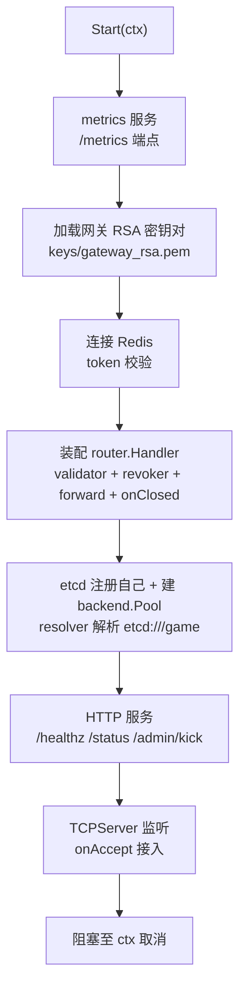
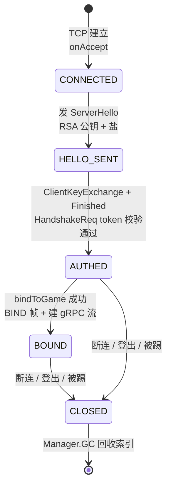

# 网关总览与连接管理

网关是分布式五进程中的「接入层」：对客户端维持海量 TCP 长连接（protobuf + RSA/AES 握手），对内部通过 etcd 发现 game 节点并按会话建立 gRPC 双向流；自身不落地任何业务数据，是天然的无状态层。本文讲清网关进程如何装配（server.go / cmd/gateway/main.go）、一条连接从 accept 到关闭的完整生命周期（conn/）、会话如何管理与回收（session/）、以及与游戏服之间的 gRPC 流如何建立与保活（backend/）。

## 概述

网关在架构里承担四件事，彼此解耦、各由一个子包负责：

1. **接入与协议前处理**（`conn/` + `router/`）：TCP 读写循环、粘包切分、RSA/AES 握手、token 鉴权、内部消息号隔离——安全闸门全部前置在连接入口。
2. **会话管理**（`session/`）：会话状态机（CONNECTED → HELLO_SENT → AUTHED → BOUND → CLOSED）与三张索引表，是「谁在线」的唯一事实源（内存态）。
3. **后端路由**（`backend/`）：按 `session_id` 维护到 game 节点的 gRPC 双向流，另有一条「管理流」专供 GM 踢人等运维指令（见 `03-踢人与管理流.md`）。
4. **进程装配**（`server.go` + `cmd/gateway/main.go`）：把上述组件按依赖顺序组装起来，编排启动与优雅退出。

架构上的核心取舍是**无状态**：会话只存内存，重启即全部断连重连（token 仍在 Redis，玩家重连后无感），换来水平扩容能力与「宕机零恢复成本」。选路策略为「按 `account_id` 对存活 game 节点取模」——同一账号始终落同一节点，Actor 缓存与在线归属（presence）都不需要跨节点迁移。

## 涉及文件

| 路径 | 职责 |
| --- | --- |
| `internal/gateway/server.go` | 网关进程组装层入口：组件装配、启动/停机编排、bindToGame 选路绑定、deliverToClient 下行、forwardPacket 上行透传、KickPlayer 踢人广播、`/admin/kick` HTTP 接口 |
| `cmd/gateway/main.go` | 进程启动入口：加载配置、信号上下文、两阶段优雅退出（Start 收取消 → Shutdown 带总超时） |
| `internal/gateway/conn/conn.go` | 单连接封装：读写循环、TCP 粘包/半包切分、幂等 Close、明文/密文发送 |
| `internal/gateway/conn/manager.go` | 连接全局管理：ID 分配（atomic）、按 ID 检索、计数（MaxConns 限流）、遍历 |
| `internal/gateway/session/session.go` | 会话状态机：五态单向推进、握手状态机与 AES cipher 挂载、token/accountID 认证信息、加密收发 |
| `internal/gateway/session/manager.go` | 会话管理：SID/数值 ID/连接三张索引、超时回收（GC）、批量关闭（CloseAll） |
| `internal/gateway/backend/pool.go` | 到 game 节点的 gRPC 流池：会话级业务流 + 管理流，recvLoop 下行分发 |

## 核心设计

### 进程装配与启动顺序

`server.go` 的 `New` 只创建纯内存组件（`conn.Manager` / `session.Manager`），不碰网络与磁盘；所有 IO 依赖（Redis/etcd/密钥/监听）都收进 `Start`。这样单测可以只跑到 `New` 层，也让「启动失败早暴露」成为可能。

`Start`（`internal/gateway/server.go:119`）的启动顺序即依赖顺序，TCP 监听放在最后——前置依赖全部就绪后才接受客户端连接，失败早暴露而不是接进来再断：



两个容易踩的细节，源码注释里都有记录：

- **配置读取路径错误不会编译失败，只会让分支静默跳过**。历史上曾误读 `s.cfg.Etcd.Endpoints`（实际配置在 `rpc.etcd_endpoints`）导致 etcd 分支被整个跳过——backend 为 nil，会话永远绑不到游戏服，客户端进游戏只能等超时。该缺陷在 P15 全链路演练（提交 `331b5e5`）中暴露并修复，现在优先读 `s.cfg.RPC.EtcdEndpoints`。
- **未配置 Redis 时 validator 走放行分支**（`internal/gateway/server.go:176`），这是为单测环境开的门，生产配置必填——「无 Redis = 不校验 token」只在测试可接受。

### 连接生命周期

`onAccept`（`internal/gateway/server.go:413`）是新连接的入口，顺序是「限流 → 分配 ID → 建会话 → 发 ServerHello → 进入读写循环」：

```go
// internal/gateway/server.go:413
func (s *Server) onAccept(raw net.Conn) {
	// 连接数上限保护：达到即拒并计数，避免 fd 耗尽拖垮整机
	if s.connMgr.Count() >= s.cfg.Server.MaxConns {
		s.logger.Warn("max connections reached", "max", s.cfg.Server.MaxConns)
		metrics.ConnRejected("max_conns")
		_ = raw.Close()
		return
	}
	// connID 同时充当会话数值 ID（NewSession 内绑定），
	// 下行路由与 gRPC BIND 帧都用它标识会话
	connID := s.connMgr.NextID()
	c := conn.New(connID, raw, s.router, s.logger)
	s.connMgr.Add(c)
	metrics.ConnInc()

	sess := s.sessMgr.NewSession(c)
	// ...
	c.Serve(context.Background())
	metrics.ConnDec()
}
```

注意 **connID 同时充当会话数值 ID**（`NewSession` 内绑定），这是与 `backend.Pool`、BIND 帧、下行路由的统一约定——下游全部按这一个数值寻址。`Serve` 用 `context.Background()`：单连接的生命周期独立于进程启动 ctx，停机时由 `sessMgr.CloseAll` 统一断连。

每条连接一个 goroutine（goroutine per conn），`Conn.Serve`（`internal/gateway/conn/conn.go:108`）起读循环 + 写循环占位：

```go
func (c *Conn) Serve(ctx context.Context) {
	defer c.Close(nil)

	go c.writeLoop(ctx)
	c.readLoop(ctx)
}
```

读循环（`readLoop`，`internal/gateway/conn/conn.go:121`）阻塞读 socket，累积到 `readBuf` 后由 `processReadBuf`（`internal/gateway/conn/conn.go:158`）切出完整逻辑包。粘包/半包是 TCP 流式协议的固有现象，这里用「头部够 → 解长度 → 整体够 → 解码 → 前移缓冲」的标准状态机处理：

```go
// internal/gateway/conn/conn.go:158（节选）
func (c *Conn) processReadBuf() {
	for {
		if len(c.readBuf) < codec.LengthFieldSize {
			return
		}
		length, err := codec.ReadLength(c.readBuf)
		if err != nil {
			c.logger.Error("invalid length", "err", err)
			c.Close(err)
			return
		}
		// 长度上限与协议最大包一致（65535 含 4B 头）：越界即视为攻击/错位，
		// 断连而不是尝试分配，防止恶意长度把 readBuf 撑爆
		if length <= 0 || length > 65535-codec.LengthFieldSize {
			c.logger.Error("invalid packet length", "len", length)
			c.Close(fmt.Errorf("invalid packet length %d", length))
			return
		}
		total := codec.LengthFieldSize + length
		if len(c.readBuf) < total {
			// 半包：等后续字节到达，下轮 read 后继续切
			return
		}
		pkt, err := codec.DecodePacket(c.readBuf[codec.LengthFieldSize:total])
		// ...
		c.handler.OnPacket(c, pkt)
		// 粘包情形：把已消费部分前移，剩余半包留在头部继续累积
		copy(c.readBuf, c.readBuf[total:])
		c.readBuf = c.readBuf[:len(c.readBuf)-total]
	}
}
```

**恶意长度字段直接断连**而不是尝试分配——宁可错杀也不解析，这是入口防 DoS 的第一道闸门。解码后的包同步回调 `handler.OnPacket`，同一连接的包严格保序。

关闭路径全部汇合到 `Conn.Close`（`internal/gateway/conn/conn.go:249`），`sync.Once` 保证「标记 closed → 关 socket → 回调 OnClose」只执行一次，任何退出路径（读错误/ctx 取消/主动关闭）都走这里，fd 与 goroutine 同时释放：

```go
func (c *Conn) Close(err error) error {
	c.closeOnce.Do(func() {
		c.closed.Store(true)
		c.closeErr = err
		// close(channel) 是广播语义：读循环 select 与 writeLoop 同时被唤醒
		close(c.closeCh)
		if c.raw != nil {
			_ = c.raw.Close()
		}
		c.handler.OnClose(c, err)
	})
	return c.closeErr
}
```

`Conn.Send`（`internal/gateway/conn/conn.go:216`）未对并发写加锁——当前写路径的并发安全由调用方约定保证（读循环回系统包、后端 recvLoop 回业务包，天然按会话隔离），并设置 10s 写超时防止对端只收不发时连接被长期占死。

### 会话状态机

`session` 包是「谁在线」的唯一事实源。状态机单向推进，`IsAuthed` 用 `>=` 判断，因此「已绑定」也视为已鉴权：



`Session`（`internal/gateway/session/session.go:75`）字段分三组：标识（id/numID/conn）、握手（serverHS/cipher）、认证（token/accountID）。**这里只有账号 ID，没有角色 ID**——会话 ↔ 角色的映射属于游戏服（`players2sess` 是唯一权威），网关若再存一份，顶号/换角时两边必然不一致。这正是「按角色踢人」要把 `player_id` 透传给游戏服的原因（详见 `03-踢人与管理流.md`）。历史坑：早期 `playerID` 字段名叫 playerID 却存 account_id，读代码的人很容易把它当角色用，提交 `c866bea` 已将其删除。

`Manager`（`internal/gateway/session/manager.go:34`）维护三张索引：`bySID`（日志/运维检索）、`byNum`（gRPC/下行路由主键）、`byConn`（读循环收包主键）。三张表共用一把 RWMutex——增删必须三张同步原子完成，多锁无法表达这个复合不变量。SID 格式 `gw-{unix秒}-{seq}`，seq 在锁内自增，与 SID 生成原子绑定，防止并发 NewSession 撞号。

回收有两个入口：

- **GC**（`internal/gateway/session/manager.go:150`）：清理已关闭的残留条目 + 超过 `DefaultSessionReconnectTTL`（90s）仍未鉴权的半开连接。`now` 由调用方注入而非 `time.Now()`，便于单测控制时间。已鉴权会话不在此回收——它们的生命周期由连接断开事件驱动。
- **CloseAll**（`internal/gateway/session/manager.go:127`）：优雅停机用，先摘表（换新 map，O(1)）再逐个 Close，避免 OnClose 回调在持锁状态下重入 Manager 造成死锁。

### 后端 gRPC 流：会话级业务流

`backend.Pool`（`internal/gateway/backend/pool.go:45`）是网关与 game 之间唯一的 RPC 通道。按设计约束（4.5），**每个客户端会话对应一条 `GameService.Channel` 双向 stream**，响应沿同一条流回写，天然保证单会话内消息有序，网关无需在业务层做重排。代价是 gRPC 流数量与在线玩家数成正比（O(N)）——用连接资源换有序与简单。

建流走双检锁（`GetOrConnect`，`internal/gateway/backend/pool.go:205`）：读锁快路径命中 → 未命中升级写锁并二次确认。二次确认不可省：否则两个 goroutine 同时未命中时会各建一条流，后写的覆盖 map，先建的那条失去引用，其 recvLoop 泄漏成孤儿 goroutine。流的 context 从 `context.Background()` 派生而非复用请求 ctx——流的生命周期属于会话而非单次请求。

首帧即 BIND（`bindToGame`，`internal/gateway/server.go:291`），随流一起发出，游戏服据此建立「流 → 会话 → Actor」关联。建流失败必须断客户端连接，否则玩家会对着一个「永远进不去」的会话反复发包：

```go
// internal/gateway/server.go:311（节选）
// 按 account_id 取模选 game server：选路要跟「账号」绑，不能跟角色绑——
// 同一账号换角色重连时应当落回同一节点（Actor 缓存、presence 都在那边）
idx := int(sess.AccountID() % int64(len(nodes)))
node := nodes[idx]
// ...
if _, err := s.backend.GetOrConnect(ctx, target, sess.NumID(), frame); err != nil {
	s.logger.Warn("bind to game failed", "game", node.ID, "err", err)
	s.sessMgr.Remove(sess)
	sess.Close(err)
	return
}
```

不变量：`backend.Pool.streams` 的 key、`server.go` 的 `sessGame`、`session.Manager` 的 `byNum` 三方一致，会话消亡时必须同时清理两侧（`SetOnClosed` 回调与 `forwardPacket` 失败路径），否则出现路由黑洞。

下行方向：`recvLoop`（`internal/gateway/backend/pool.go:271`，goroutine per stream）收到游戏服帧后回调 `deliverToClient`（`internal/gateway/server.go:348`），按数值 ID 查会话、加密写回客户端。若帧是 `KickNotify`，发完通知后主动断连——先 Send 再 Close，保证客户端能收到原因。

## 关键代码解析

### Server 结构与依赖注入

`Server`（`internal/gateway/server.go:68`）字段分四组，注释即架构图：基础组件（New 时即就绪）、加解密（Start 时加载）、服务发现与后端（etcd/backend/redis）、会话→游戏服路由表（`sessGame`，RWMutex 保护，读多写少）。`Server` 本身就是「依赖注入容器」：`New` 只装配无外部依赖的组件，`Start` 才注入有 IO 依赖的。

### 优雅退出

`Shutdown`（`internal/gateway/server.go:593`）顺序即安全顺序：先摘 etcd 注册（不再接新流量）→ 断所有客户端连接（在途请求随断连失败，客户端重连到新节点）→ 停 TCP/HTTP → 关后端流 → 关 etcd/Redis。反序会让新请求继续打到正在关闭的组件上。`cmd/gateway/main.go:79` 给关闭流程兜底 60s 总超时，需覆盖会话排空 + 流关闭 + 摘注册全流程。

### conn.Manager 的 ID 分配

`NextID`（`internal/gateway/conn/manager.go:80`）用 `atomic.Int64.Add(1)` 无锁自增，从 1 开始天然避开「零值即合法 ID」的歧义。ID 分配拆成独立 atomic，避免被 map 锁竞争拖慢——连接数在千级、Add/Remove 与 Get 都频繁，map + RWMutex 的读并发足够且代码直白。

## 演进记录

| 提交 | 日期 | 事件 |
| --- | --- | --- |
| `a0ed305` P1-P4 最小可运行链路 | 2026-10-18 | 接入加密握手/内部通信/Actor/持久化打通，网关 conn/session/backend 骨架成型 |
| `331b5e5` P15 全链路演练 | 2026-10-18 | 压测/故障注入暴露并修复 8 个真实缺陷，含「网关读错配置段（`rpc.etcd_endpoints` 误读为 `etcd.endpoints`）→ etcd 分支被整个跳过 → backend 为 nil → 会话永远绑不到游戏服」 |
| `7b696ef` | 2026-10-19 | 下线时通知重连：`kickAllSessions` 让有状态实例下线的绑定性会话尽早收到 KickNotify 重连 |
| `2e28e12` 补登出/跨节点顶号/封禁拦截 | 2026-10-24 | 登出协议落地，断连链路经 OnClose → OnUnbind → Actor 下线落库全打通 |
| `00ca387` 管理流 | 2026-10-24 | backend.Pool 增 admin map，空载网关也能按角色踢人（见 `03-踢人与管理流.md`） |
| `1051ef9` 补业务限流 | 2026-10-24 | 网关连接级包频率限流接入 OnPacket（见 `04-限流与安全防护.md`） |

教训值得记住的那条：**配置读取路径错误不会编译失败，只会让分支静默跳过**——对「分支跳过 = 功能全废」的配置项，日志必须显式告知。

## 测试情况

| 测试文件 | 覆盖 |
| --- | --- |
| `internal/gateway/session/manager_test.go` | 6 例：三张索引同步清理、Remove 幂等、GC 回收已关闭会话、GC 回收未鉴权半开连接、`SetAuth` 存的是 accountID 而非角色 ID（`TestSetAuthStoresAccountNotRole`）、CloseAll 清空索引 |
| `internal/gateway/router/router_test.go` | 协议隔离入站防线，详见 `02-路由与消息分发.md` |
| `internal/gateway/backend/pool_test.go` | 管理流（bufconn 真实 gRPC），详见 `03-踢人与管理流.md` |
| `internal/gateway/kick_test.go` | 踢人链路网关侧，详见 `03-踢人与管理流.md` |

会话层的测试重点在两个「不变量」：三张索引任何增删必须同步；`SetAuth` 存 accountID 不存角色 ID——后者是提交 `c866bea` 删掉「角色→会话」映射后补上的回归防线。

## 小结

网关的设计可以概括为三句话：**无状态接入层**——会话只在内存，重启即重连，换来弹性与简单；**安全前置**——限流、握手、鉴权、协议隔离全部收口在连接入口（`onAccept` → `Conn.processReadBuf` → `router.OnPacket`），异常连接不消耗后续资源；**路由极简**——不解析业务协议，只按 `session_id` 查表透传，角色归属交给游戏服。下一篇 `02-路由与消息分发.md` 讲协议前厅的完整处理顺序与消息号分配规则。
