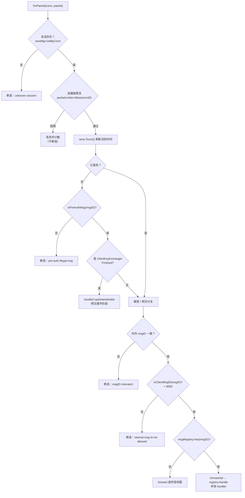

# 路由与消息分发

router 是网关的「协议前厅」：在客户端连接上处理一切非业务语义——心跳、RSA/AES 握手、token 鉴权、合法性与重放校验，并把业务消息透传给游戏服。本文全量解析 `internal/gateway/router/router.go`：消息号到 handler 的注册机制、认证前后的消息分流、登出协议（LogoutReq/Resp 100/101）与 TokenRevoker、内部消息号隔离白名单，以及 `tools/genmsgid` 的消息号分配规则。

## 概述

网关的核心设计原则是**只认识消息号，不认识消息体**：`msgRegistry` 登记的是网关认识的系统消息（心跳/握手/登出/踢下线）的 proto 类型，未登记的一律透传。新增业务协议不需要改网关，网关版本与游戏协议解耦——这是「网关无业务语义」的落地方式。

由此路由层天然分成三类消息：

| 类别 | 消息号 | 处理方式 |
| --- | --- | --- |
| 系统消息 | 1/2 心跳、11/12/13 握手、100/101 登出、10 踢下线 | 网关闭环处理（本地 handler 或明文系统通道） |
| 业务消息 | 1000+（登录段）/2000+（玩家）/3000+（背包）… | 原样透传给游戏服，网关不解析 |
| 内部消息 | 9000-9999 | **绝不允许来自客户端 socket**，只走内部 gRPC |

消息号分段由 `internal/common/constant/constant.go` 定义（设计文档 4.3），段间留空档，相邻业务消息量暴涨时不会「段溢出挤占邻居」：

| 号段 | 范围 | 用途 |
| --- | --- | --- |
| System | 1-99 | 心跳/握手/踢下线/错误码 |
| Conn | 100-199 | 网关/连接管理（登出 100/101） |
| Login | 1000-1999 | 登录/账号（握手请求 1001/1002 复用此段） |
| Player | 2000-2999 | 玩家数据 |
| Bag | 3000-3999 | 背包道具 |
| Scene | 4000-4999 | 场景/地图 |
| Battle | 5000-5999 | 战斗 |
| Social | 6000-6999 | 社交/聊天 |
| Mail | 7000-7999 | 邮件/任务 |
| Internal | 9000-9999 | 内部 gRPC，不暴露给客户端 |

登出（100/101）落在连接段而非登录段——登出作用在「已建立的网关连接」上，但要作废的是登录服签发的 token。

## 涉及文件

| 路径 | 职责 |
| --- | --- |
| `internal/gateway/router/router.go` | 路由处理器：消息注册表、OnPacket 全部分流逻辑、心跳/握手/登出 handler、ServerHello 下发 |
| `internal/gateway/router/router_test.go` | 协议隔离入站防线：内部号隔离、pre-auth 白名单、登出、包限流 |
| `internal/common/constant/constant.go` | 消息号分段常量、系统消息号、`IsClientMsgID` 协议隔离执行点 |
| `tools/genmsgid/main.go` | 从 proto `// @msg` 注解生成消息号注册表（`pkg/codec/msgids_gen.go`） |
| `api/proto/gate/v1/handshake.proto` | 客户端 ↔ 网关协议契约：心跳/握手/登出/踢下线 |
| `pkg/codec/registry.go` / `pkg/codec/protobuf.go` | handler 注册表与消息工厂注册表（构造期建好、运行期只读） |

## 核心设计

### OnPacket 处理顺序即安全顺序

`OnPacket`（`internal/gateway/router/router.go:134`）是整个网关的安全收口，任何校验失败都直接断连，不做「尝试恢复」——握手期的连接成本极低，错杀比放过安全：



关键顺序决策：

1. **限流先于解密**（`internal/gateway/router/router.go:148`）：刷包不打散 CPU 在解密上，超限的处理是**丢弃**而不是断连——移动网络抖动会短暂堆包，断连等于把正常玩家踢下线。
2. **pre-auth 白名单先于解密**：未鉴权连接只放行握手类消息（`isPreAuthMsg`，`internal/gateway/router/router.go:319`），业务包一律视为探测/攻击。
3. **内外 msgID 一致性校验**（`internal/gateway/router/router.go:197`）：防止把 A 消息的密文塞进 B 消息的外壳（错包/重放混入）。
4. **内部号隔离显式化**（`internal/gateway/router/router.go:207`）：9000+ 只能走 gRPC。这是提交 `7452c87` 补上的——原来靠「注册表恰好没注册这些号」兜底，那是碰巧而非契约：谁把内部号注册进客户端表，客户端就能直接触发它。
5. **透传在最后**：未注册消息交 `forward`（`server.forwardPacket`），错误只记日志不断连——断连决策权在 server 层（后端流已死时才升级为断连）。

### 认证前后消息分流

两条独立的闸门，顺序也是防线顺序：

```go
// internal/gateway/router/router.go:156
// 握手完成前，只允许系统消息（心跳/握手）
// 未鉴权连接的业务包一律视为探测/攻击，断连处理
if !sess.IsAuthed() && !isPreAuthMsg(p.MsgID) {
	h.logger.Warn("pre-auth illegal msg", "conn_id", c.ID(), "msg_id", p.MsgID)
	_ = c.Close(fmt.Errorf("pre-auth illegal msg"))
	return
}
```

`isPreAuthMsg` 覆盖握手全链路：ServerHello → ClientKeyExchange → Finished → HandshakeReq/Resp；心跳随时可用来保活。注意 1001（HandshakeReq）就在登录段——未鉴权连接发 1001 是合法的，发 2001 就是攻击。

已鉴权连接则只受「内部号隔离」约束：客户端号段（<9000）放行，9000+ 断连。这第二道闸门防的是「客户端伪造内部 gRPC 号直接触发游戏服内部逻辑」。

### 登出协议：作废 → 回包 → 断连

登出是提交 `2e28e12` 补上的（之前完全没做）。协议定义在 `api/proto/gate/v1/handshake.proto:28`：

```protobuf
// 登出：客户端主动退出。网关作废 token 后回包并断连，
// 断连会触发游戏服 OnUnbind → Actor 下线落库。
//
// 为什么要服务端作废而不是客户端丢弃：token TTL 通常 24h，
// 单纯关 socket 的话 token 仍然有效，被截获后可在 TTL 内重放登录。
message LogoutReq {} // MsgID: 100

message LogoutResp { // MsgID: 101
  int32 code = 1; // 0 成功；非 0 见错误码表
}
```

`handleLogout`（`internal/gateway/router/router.go:376`）的顺序是正确性的一部分，注释写得很清楚，不能改：

```go
// handleLogout 处理主动登出：作废 token → 回包 → 断连。
//
// 顺序不能变：先作废再回包再断连。
//   - 先作废：回包代表「已登出」，若回包后作废失败，客户端会以为 token 已失效；
//   - 回包后才断：conn.Send 是同步 raw.Write，返回即已交给内核；
//     先断会导致客户端收不到 LogoutResp，只能靠读 EOF 猜结果。
func (h *Handler) handleLogout(ctx context.Context, _ proto.Message) error {
	connID := ctx.Value(ctxKeyConnID{}).(int64)
	sess := h.sessMgr.GetByConn(connID)
	if sess == nil {
		return fmt.Errorf("session not found")
	}

	code := int32(0)
	if token := sess.Token(); token != "" && h.revoker != nil {
		if err := h.revoker(token); err != nil {
			h.logger.Warn("revoke token failed", "conn_id", connID, "err", err)
			code = 1005 // 服务器繁忙：token 未能作废，客户端应重试登出
		}
	}

	body, err := proto.Marshal(&gatev1.LogoutResp{Code: code})
	if err != nil {
		return err
	}
	if err := sess.Send(constant.MsgIDLogoutResp, body); err != nil {
		h.logger.Warn("send logout resp failed", "conn_id", connID, "err", err)
	}
	// 断连触发 OnClose → 路由表清理 → 游戏服 OnUnbind → Actor 下线落库
	_ = sess.Conn().Close(fmt.Errorf("client logout"))
	return nil
}
```

`TokenValidator` 与 `TokenRevoker` 刻意分成两个函数类型（`internal/gateway/router/router.go:74` 与 `:81`）而不是合成一个接口——两者的失败语义完全不同：校验失败只是拒绝登录，作废失败意味着「用户以为登出了，token 其实还有效」，必须让客户端知道并重试（回 1005）。合成接口会让调用方误以为两者可以同等对待。装配在 `internal/gateway/server.go:199`：

```go
s.router.SetRevoker(func(token string) error {
	if s.redis == nil {
		return nil // 无 Redis 环境（单测）：没有可作废的存储
	}
	ctx, cancel := context.WithTimeout(context.Background(), 2*time.Second)
	defer cancel()
	return s.redis.GetClient().Del(ctx, tokenKeyPrefix+token).Err()
})
```

注意 key 前缀 `token:` 与登录服 `TokenRepo.key()`（`internal/login/repo/token_repo.go:43`）是跨进程隐性契约——改一处必须改两处，否则表现为「登录拿到的 token 网关全认不出」。

## 关键代码解析

### 消息注册：构造期建好，运行期只读

`NewHandler`（`internal/gateway/router/router.go:93`）在构造期调 `registerMessages` 与 `registerHandlers`，注册表运行期只读——避免运行期加锁，也防止热更新半个路由表：

```go
// internal/gateway/router/router.go:111
func (h *Handler) registerMessages() {
	h.msgRegistry.Register(constant.MsgIDHeartbeatReq, func() proto.Message { return &gatev1.HeartbeatReq{} })
	// ... KickNotify / HandshakeReq/Resp / LogoutReq/Resp
}

// registerHandlers 登记网关本地处理的消息（心跳/握手）。
// 未登记的消息走透传——这是「网关无业务语义」的落地方式。
func (h *Handler) registerHandlers() {
	h.registry.Register(constant.MsgIDHeartbeatReq, h.handleHeartbeat)
	h.registry.Register(constant.MsgIDHandshakeReq, h.handleHandshakeReq)
	h.registry.Register(constant.MsgIDLogoutReq, h.handleLogout)
}
```

`connID` 借 context 传给 handler（`ctxKeyConnID`，`internal/gateway/router/router.go:290`）：handler 签名由 codec 注册表固定，不方便加参数。context key 用自定义私有类型而非 string——避免不同包用同一个字符串 key 相互覆盖。

### ServerHello 的字节序坑

`SendServerHello`（`internal/gateway/router/router.go:465`）的注释记录了一个概率性故障：**salt 必须放在 PEM 之前**。salt 是 32 字节随机二进制，可能以 0x0a/0x0d 开头；若把 salt 放在 PEM 之后，接收方用「跳过 PEM 尾随换行」切分时会把 salt 首字节当成换行吃掉（概率 2/256），导致会话密钥不一致、Finished 帧 GCM 校验失败。实测登录成功率 ~98.7%，且与并发无关——二进制不安全嵌入文本协议边界的典型案例。

### genmsgid：消息号分配规则

消息号的唯一声明点是 proto 里的 `// @msg <id>` 注解（`tools/genmsgid/main.go:7`）：

```protobuf
// @msg 3001
//	message UseItemReq { ... }
```

选注解而不是自定义 proto option 的理由：option 需要自定义 extension 与自建 protoc 插件，而注解「一个可被 grep、可被 review、不依赖 protoc 版本」。工具读 proto 文本 + `internal/common/constant` 的号段常量，产出 `pkg/codec/msgids_gen.go`（102 条消息的常量 + id↔name 反查），`make gen` 与 CI 的 `make gen-check`（`-check` 模式逐字节比对）都不依赖 buf。

校验规则（任一不通过即失败，不产出半套文件，`tools/genmsgid/main.go:308` `validate`）：

- **号重复**：同一号被两个 message 声明（客户端会收到对方的消息体）；
- **message 重名**：生成的 Go 常量会撞名；
- **号越界**：不在任何号段内，或落在内部 gRPC 段（9000+ 客户端协议不得占用）；
- **注解悬空**：`// @msg` 之后不是 message 声明。

错误全部带 `文件:行号` 且指向注解行（不是 message 行）——改号要改的是注解，错误报告必须把人带到注解处。

## 演进记录

| 提交 | 日期 | 事件 |
| --- | --- | --- |
| `a0ed305` P1-P4 最小可运行链路 | 2026-10-18 | 接入加密握手（ServerHello/ClientKeyExchange/Finished）与 token 鉴权入口打通 |
| `331b5e5` P15 全链路演练 | 2026-10-18 | 修复握手 salt 字节序缺陷：ServerHello 由 `PEM\|\|salt` 改为 `salt\|\|PEM` 定长前置，1.3% 登录失败消失 |
| `7452c87` 网关补内部号隔离 | 2026-10-24 | OnPacket 在 pre-auth 之后加显式 `IsClientMsgID` 检查，把「注册表碰巧没注册」变成代码契约，补 5 个用例 |
| `2e28e12` 补登出协议与 TokenRevoker | 2026-10-24 | 新增 LogoutReq/Resp（100/101）、TokenRevoker 接口、「作废→回包→断连」顺序、失败回 1005；登出 4 例测试 |
| `1051ef9` 补业务限流 | 2026-10-24 | OnPacket 解密与分发之前接入连接级包频率限流，详见 `04-限流与安全防护.md` |

登出补上前，客户端只能关 socket——token TTL 24h 内仍然有效，被截获即可重放登录。这是「补登出」要解决的核心安全问题。

## 测试情况

`internal/gateway/router/router_test.go` 覆盖两条独立闸门与登出全分支：

| 用例 | 断言 |
| --- | --- |
| `TestRejectsInternalMsgID` | 已鉴权连接发 9000/9001/9999 必须断连（防客户端伪造内部 gRPC 号） |
| `TestAllowsClientMsgID` | 已鉴权连接发 1002/2001/3001/7001/8999 不被误杀（隔离不能误伤客户端号） |
| `TestUnauthedRejectsBusinessMsg` | 未鉴权连接发 2001/3001/9001 必须断连（pre-auth 闸门） |
| `TestAllowsPreAuthMsg` | 未鉴权时心跳/握手放行，否则连登录都进不来 |
| `TestDropsPacketFromUnknownConn` | 查不到会话的迟到包只断连、不 panic |
| `TestLogoutRevokesTokenAndCloses` | token 被作废、回 code=0、连接断开 |
| `TestLogoutReportsRevokeFailure` | 作废失败回 1005，但仍断连（留着连接更糟） |
| `TestLogoutWithoutRevoker` | 无 Redis 环境不 panic，仍断连 |
| `TestLogoutBeforeAuthRejected` | 未鉴权连接发登出被 pre-auth 闸门挡掉，且 revoker 不被调用 |
| `TestPacketRateLimitDropsExcess` / `TestPacketRateLimitDisabled` | 超突发额度丢弃但连接存活；未注入限流器时不限制 |

测试文件头部的注释点明了设计意图：「之前只靠『注册表恰好没注册 9000+』兜底——那是碰巧而非契约」。登出测试用 net.Pipe 搭建真实收发，`readPacket` 从客户端侧读完整帧并解密验证 LogoutResp 是密文——已鉴权连接的响应必须走 AES-GCM。

## 小结

路由层的全部智慧在**顺序**上：限流 → pre-auth 白名单 → 解密 → msgID 一致性 → 内部号隔离 → 本地处理/透传。每一道闸门解决一类威胁，且「错杀比放过」——握手期连接成本极低。消息号体系由 `constant` 分段 + `genmsgid` 注解生成 + CI 卡点三方守护，客户端与服务端从同一份 proto 生成，杜绝手抄不一致。下一篇 `03-踢人与管理流.md` 讲运维指令如何穿过这套防线抵达游戏服。
