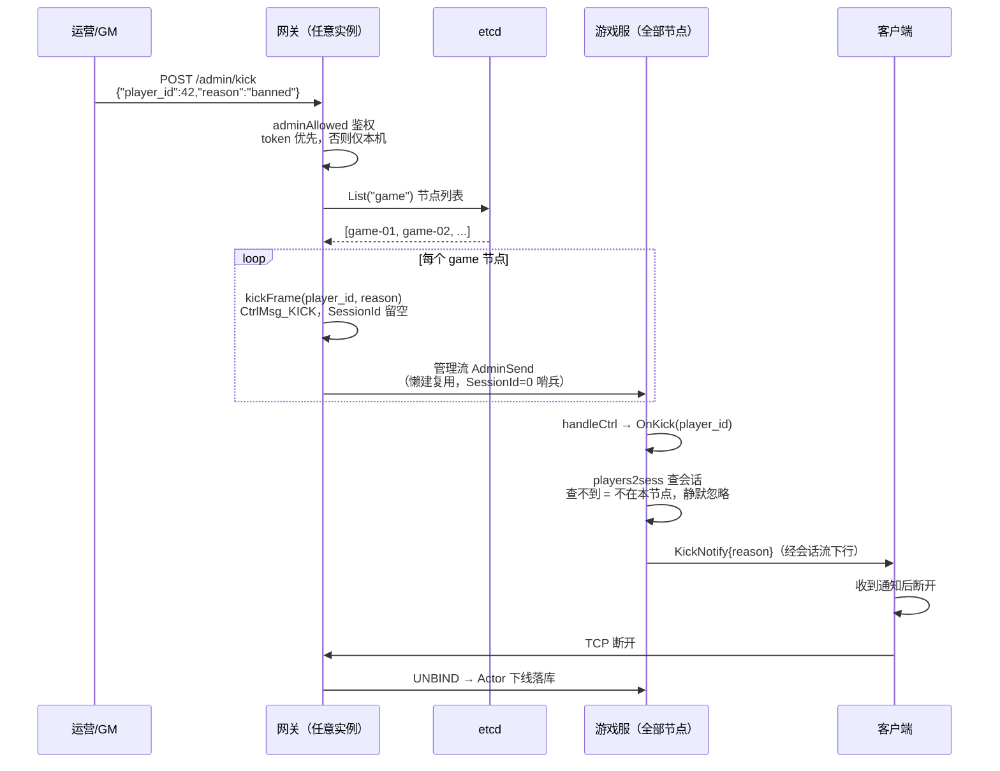

# 踢人与管理流

「封禁能真的把人踢下线，而不是等他自己掉线」——这句话是这条链路存在的全部理由。本文讲清完整闭环：GM/封禁如何通过 `POST /admin/kick` 进入网关，经 etcd 节点列表广播，穿过「管理流」这条独立于玩家会话的 gRPC 通道抵达游戏服，最终由游戏服查 `players2sess` 定位会话、发 KickNotify。核心设计决策：**网关不保存「角色→会话」映射，只传 `player_id`，由游戏服自己查表**。

## 概述

踢人链路要解决三个问题：

1. **入口安全**：`/admin/kick` 是带外运维接口，默认部署没有额外配置也不能被外网打通；
2. **空载可达**：刚启动、玩家都连在别的网关的实例，也必须能踢人——管理动作不该依赖业务流量；
3. **路由正确**：网关只知道角色号，「角色 → 会话 → 节点」的映射在游戏服（`players2sess` 是唯一权威），网关不保副本。

第 3 点是用户明确纠正过的设计：早期为了让网关能按角色找到会话，曾让游戏服回传绑定结果（BindAck）、网关维护一份 `player → session` 索引。那等于把游戏服的数据复制一份到网关——顶号、换角时两边必然对不上（踢到旧会话），与「数据所有权归 Actor」的原则冲突。提交 `c866bea` 删掉了这套错误设计（净减 134 行），改为「网关照传 player_id，游戏服自己查表」。

## 涉及文件

| 路径 | 职责 |
| --- | --- |
| `internal/gateway/server.go` | `KickPlayer`（按 etcd 节点列表广播）、`kickFrame`（控制帧构造）、`handleAdminKick`（HTTP 入口）、`adminAllowed`（管理接口鉴权） |
| `internal/gateway/backend/pool.go` | 管理流：`AdminSend`、`adminStreamFor`、`dropAdmin`、`adminSessionID` 哨兵、`sendMu` 并发写保护 |
| `internal/gateway/kick_test.go` | 网关侧踢人链路测试：帧内容、无后端报错、鉴权、HTTP 四种状态码 |
| `internal/game/rpc/game_server.go` | 游戏服侧：`serveAdminStream`、`handleCtrl` 的 KICK 分发、`AdminSessionID` 哨兵识别 |
| `internal/game/server_session.go` | `OnKick`（按角色号查会话）、`resolveSessionByPlayer`、`kickSession`（发 KickNotify） |
| `api/proto/internalv2/game.proto` | `CtrlMsg` 协议：BIND/UNBIND/KICK/BROADCAST/HEALTH，含「已删除 BindAck」的决策注释 |

## 核心设计

### 完整链路时序



四个关键决策，逐一看源码：

**① 广播而不是查 presence 再单发。** 网关没有「player → node」映射（那份在 Redis presence 里），为一个踢人请求去查 presence 再建流不划算；game 节点通常个位数，广播成本可接受。非持有该玩家的节点查不到会话，静默忽略——广播的常见结果，正常返回。

**② 管理流独立于会话流。** 上一版靠「借任意一条会话流广播」，网关刚启动或玩家都连在别的网关时一条流都没有，`KickPlayer` 直接返回 502。管理流用 `SessionId=0` 作哨兵，不属于任何玩家会话，懒建并复用，发送失败即丢缓存下次重建（靠失败自愈，不做心跳）。

**③ 帧内容：类型必须是 KICK、player_id 必填、SessionId 刻意留空。** 类型写错（比如退化成默认值 UNBIND）时游戏服会把它当成解绑处理——玩家掉线但收不到 KickNotify，客户端表现为「莫名断线」；`player_id` 漏填则游戏服不知道踢谁（它不认会话号）。

**④ 游戏服只发 KickNotify 不断流。** 动作只是发通知——客户端收到后自行断开，随后的 UNBIND 走标准下线（模块 OnLogout + 落库），不在这一层直接清会话状态：那条路径会跳过模块的下线钩子。

## 关键代码解析

### 入口：/admin/kick 与鉴权

```go
// internal/gateway/server.go:540
// handleAdminKick POST /admin/kick {"player_id":123,"reason":"banned"}
//
// 鉴权：配置 admin_token 时校验 Authorization: Bearer <token>；
// 未配置时只接受本机来源（127.0.0.1/::1）。这样默认部署不必新增配置
// 也能给运维用 curl 执行，但外部网络打不进来。
func (s *Server) handleAdminKick(w http.ResponseWriter, r *http.Request) {
	if r.Method != http.MethodPost {
		http.Error(w, "method not allowed", http.StatusMethodNotAllowed)
		return
	}
	if !s.adminAllowed(r) {
		http.Error(w, "forbidden", http.StatusForbidden)
		return
	}
	var req struct {
		PlayerID int64  `json:"player_id"`
		Reason   string `json:"reason"`
	}
	if err := json.NewDecoder(http.MaxBytesReader(w, r.Body, 4096)).Decode(&req); err != nil {
		http.Error(w, "bad request", http.StatusBadRequest)
		return
	}
	if req.PlayerID <= 0 {
		http.Error(w, "player_id required", http.StatusBadRequest)
		return
	}
	// 广播成功即返回 200：本实例没有该玩家的会话是正常情况
	// （他可能连在别的网关），踢人指令已经交给游戏服判断。
	if err := s.KickPlayer(req.PlayerID, req.Reason); err != nil {
		http.Error(w, err.Error(), http.StatusBadGateway)
		return
	}
	w.WriteHeader(http.StatusOK)
	_, _ = w.Write([]byte("ok"))
}
```

注意请求体限 4096 字节（`http.MaxBytesReader`）、`player_id <= 0` 直接 400——管理接口的输入校验与对外 API 同样严格。`adminAllowed`（`internal/gateway/server.go:578`）token 优先，未配置时只放行 `127.0.0.1/::1`。测试 `TestAdminKickRequiresLoopbackWhenNoToken` 覆盖四种来源，`TestAdminKickToken` 覆盖四种 Authorization 头（含「少了 Bearer 前缀」这种常见错误）。

### 广播：KickPlayer 与 kickFrame

```go
// internal/gateway/server.go:479
// KickPlayer 让游戏服踢掉某个角色（GM 踢人 / 封禁生效）。
//
// 参数是角色 ID，不是会话号：会话↔角色的映射是游戏服的事
// （players2sess 是唯一权威），网关不该再存一份。
//
// 下发方式：按 etcd 里的 game 节点列表，对每个节点各发一帧管理指令。
// 用的是「管理流」（不属于任何玩家会话），因此不依赖本网关是否有业务流量——
// 刚启动、空载的网关也能踢人。非持有该玩家的节点收到后查不到会话，静默忽略。
func (s *Server) KickPlayer(playerID int64, reason string) error {
	if s.backend == nil {
		return fmt.Errorf("gateway: backend pool not ready")
	}
	if s.etcdReg == nil {
		return fmt.Errorf("gateway: game registry not ready")
	}
	ctx, cancel := context.WithTimeout(context.Background(), 3*time.Second)
	defer cancel()

	nodes, err := s.etcdReg.List(ctx, "game")
	// ...
	frame := kickFrame(playerID, reason)
	sent := 0
	var errs []error
	for _, n := range nodes {
		if n.Addr == "" {
			continue
		}
		if err := s.backend.AdminSend(ctx, n.Addr, frame); err != nil {
			errs = append(errs, fmt.Errorf("node %s: %w", n.ID, err))
			continue
		}
		sent++
	}
	if sent == 0 {
		return fmt.Errorf("kick broadcast failed: %w", errors.Join(errs...))
	}
	if len(errs) > 0 {
		// 部分节点失败不算致命：踢人指令是幂等的，持有该玩家的节点若在
		// 失败集合里，运营重试一次即可；这里只记日志，不回滚已成功的部分。
		s.logger.Warn("kick partially delivered", ...)
	}
	s.logger.Info("kick delivered", "player_id", playerID, "reason", reason, "nodes", sent)
	return nil
}
```

`kickFrame`（`internal/gateway/server.go:530`）抽成纯函数是为了能测——帧内容错了（类型写成 UNBIND、player_id 漏填）的表现是「游戏服收到后什么都不做」，线上只能从「踢了没反应」发现：

```go
// kickFrame 构造踢人控制帧。
// SessionId 刻意留空——这条指令不针对某个会话，由游戏服按角色号自己定位。
func kickFrame(playerID int64, reason string) *internalv2.StreamFrame {
	return &internalv2.StreamFrame{
		Data: &internalv2.StreamFrame_Ctrl{Ctrl: &internalv2.CtrlMsg{
			Type:     internalv2.CtrlMsg_KICK,
			PlayerId: playerID,
			Payload:  []byte(reason),
		}},
	}
}
```

**部分节点失败不回滚**：踢人指令是幂等的，`sent == 0`（全失败）才返回错误，此时 HTTP 层回 502——区别「请求不合法」与「发不出去」，运维能看出该不该重试。`TestKickFrameCarriesPlayerID` 对帧内容四个字段逐一断言，`TestKickPlayerWithoutBackend` / `TestKickPlayerWithoutRegistry` 断言「静默成功是最坏的结果：运营以为封禁生效了，玩家其实还在线上」。

### 管理流：AdminSend 与哨兵 0

```go
// internal/gateway/backend/pool.go:122
// AdminSend 向指定 game 节点发一帧管理指令（懒建并复用管理流）。
//
// 为什么需要独立的流：发「踢某个角色」时网关只知道 player_id，不知道会话号，
// 因此没法用 streams（key 是会话号）挑一条流下发。原先的做法是「借任意一条
// 会话流广播」，但网关空载（刚启动、玩家都在别的网关）时一条流都没有，
// 踢人就会返回 502——管理动作不该依赖业务流量。
//
// 成本：每个网关对每个 game 节点保持一条空闲流，节点数通常个位数。
// 发送失败时丢弃该流，下次调用重建（不做心跳，靠失败驱动自愈）。
func (p *Pool) AdminSend(ctx context.Context, target string, frame *internalv2.StreamFrame) error {
	st, err := p.adminStreamFor(ctx, target)
	if err != nil {
		return err
	}
	st.sendMu.Lock()
	err = st.stream.Send(frame)
	st.sendMu.Unlock()
	if err != nil {
		// 流可能已断（节点重启/网络切换）：丢掉缓存，下次重建。
		p.dropAdmin(target, st)
		return fmt.Errorf("admin send %s: %w", target, err)
	}
	return nil
}
```

建流首帧必须是 BIND，会话号用哨兵 `adminSessionID = 0`（`internal/gateway/backend/pool.go:193`）。真实会话号来自网关侧连接 ID，必然 > 0，用 0 做哨兵不会冲突，也不会被误当成某个玩家。哨兵值在两个包各定义一份（网关 `backend.adminSessionID` 与游戏服 `rpc.AdminSessionID`），一致性由单测 `TestAdminSessionIDMatchesRPC` 断言——不一致的表现是「踢人指令永远到不了」，而这种故障没有任何日志线索：

```go
// internal/gateway/backend/pool_test.go:55
func TestAdminSessionIDMatchesRPC(t *testing.T) {
	require.EqualValues(t, rpc.AdminSessionID, adminSessionID)
}
```

`adminStreamFor`（`internal/gateway/backend/pool.go:141`）持 `adminMu` 取或建；`dropAdmin`（`internal/gateway/backend/pool.go:180`）仅当缓存仍是这一条时才 delete（防止误删别的 goroutine 刚建的新流），再 `cancel()` 收尾。**管理流不进 `streams` 表**：它没有下行需求，且多个网关实例可以各建一条，用 `sessionID=0` 当 key 会互相顶掉（游戏服侧注释，`internal/game/rpc/game_server.go:93`）。

并发写保护：`adminStream.sendMu` 与 `streamConn.sendMu` 各自串行化对同一条流的写——gRPC 的 Send 不保证并发安全，而这条流有两个写方（router 读循环的业务上行 + Broadcast 借用下发），不加锁时并发写会让 HTTP/2 帧交错，对端直接断流。这是提交 `c866bea` 顺带修掉的一处并发隐患。

### 游戏服侧：serveAdminStream 与 OnKick

游戏服 `Channel` 首帧收到 `SessionId=0` 即识别为管理流（`internal/game/rpc/game_server.go:92`），走独立循环：

```go
// internal/game/rpc/game_server.go:135
// serveAdminStream 处理管理流：只接受控制帧，忽略业务包。
//
// 管理流没有玩家上下文，收到 ClientPacket 说明对端用错了流，丢弃即可
// （不能走 OnClientPacket——那需要 sessionID 对应的会话）。
func (s *GameServer) serveAdminStream(ctx context.Context, stream internalv2.GameService_ChannelServer) error {
	for {
		frame, err := stream.Recv()
		if err == io.EOF {
			return nil
		}
		if err != nil {
			return err
		}
		if d, ok := frame.Data.(*internalv2.StreamFrame_Ctrl); ok {
			s.handleCtrl(ctx, d.Ctrl)
			continue
		}
		s.logger.Warn("unexpected frame on admin stream")
	}
}
```

`handleCtrl` 的 KICK 分支（`internal/game/rpc/game_server.go:157`）有一条重要防守：**没有 player_id 直接忽略，不回退用 session_id**——回退等于把会话号当角色号查表，查不到静默失败、查到了踢错人。最终落到 `OnKick`（`internal/game/server_session.go:338`）：

```go
// OnKick 实现 rpc.StreamHandler：网关要求强制下线（GM 踢人 / 封禁生效）。
//
// 参数是角色 ID：网关只转达「踢谁」，会话由这里查（players2sess 是
// 会话↔角色映射的唯一权威）。网关会把指令广播给所有 game 节点，
// 非持有者查不到会话即返回 nil——这不算失败。
func (s *Server) OnKick(_ context.Context, playerID int64, reason string) error {
	if reason == "" {
		reason = "kicked_by_admin"
	}
	sessionID := s.resolveSessionByPlayer(playerID)
	if sessionID == 0 {
		// 该玩家不在本节点：广播的常见结果，正常返回
		s.logger.Debug("kick target not on this node", "player_id", playerID)
		return nil
	}
	s.kickSession(sessionID, reason)
	s.logger.Info("session kicked by admin", ...)
	return nil
}
```

`kickSession`（`internal/game/server_session.go:259`）只发 KickNotify 不断 TCP：与同节点顶号走同一条路径，客户端收到通知后自行断开，随后的 UNBIND 走标准下线。推不出去不算失败——旧会话可能已经断开，此时 OnUnbind 迟早会到，Actor 的会话身份校验保证它不会影响新会话。

## 演进记录

这条链路是「设计错了再改对」的完整案例，三次提交构成全部历史：

| 提交 | 日期 | 事件 |
| --- | --- | --- |
| `31bfff4` | 2026-10-24 | 首版 GM/封禁踢人链路：CtrlMsg_KICK 从「两端都没实现」补成闭环，入口 `/admin/kick` 按 **session_id** 踢。当时已知限制写在提交信息里：「按 player_id 踢需要网关知道 player→session 映射……要做得让游戏服把绑定结果回传网关」 |
| `c866bea` | 2026-10-24 | **用户纠正后的正确设计**：按角色号踢人，网关删除「角色→会话」映射。删 BindAck 回传、网关 player 索引、`Session.PlayerID` 字段（净减 134 行）；`CtrlMsg_KICK` 改用 player_id 字段，SessionId 刻意留空；游戏服「无 player_id 直接忽略，不回退用 session_id」。同时给 `streamConn` 加 `sendMu` 修广播借道的并发隐患 |
| `00ca387` | 2026-10-24 | 管理流：上一版「借任意一条会话流广播」在网关空载时直接 502。新增 `SessionId=0` 哨兵语义，`serveAdminStream` 不进 streams 表、不触发 OnBind/OnUnbind；网关 `admin map` 懒建复用、失败自愈。测试用 bufconn 跑真实 gRPC |

演进脉络很清晰：**先打通闭环（按会话踢）→ 修正数据所有权（按角色踢）→ 补可达性（管理流）**。第一步的「错误设计」不是白做的——它让「踢人」这个需求先跑了起来，也让「网关维护映射会顶号对不上」这个问题在真实代码里暴露出来。

## 测试情况

网关侧 `internal/gateway/kick_test.go`（5 例）+ `internal/gateway/backend/pool_test.go`（3 例，bufconn 真实 gRPC）：

| 用例 | 断言 |
| --- | --- |
| `TestKickFrameCarriesPlayerID` | 帧四字段：类型必须是 KICK（不能是 UNBIND）、player_id=42、SessionId=0、payload=reason |
| `TestKickPlayerWithoutBackend` | 无连接池必须报错——「没有游戏服流时必须报错，否则运维以为踢成功了」 |
| `TestKickPlayerWithoutRegistry` | 有连接池但拿不到节点列表时报错，错误信息含 registry |
| `TestAdminKickRequiresLoopbackWhenNoToken` | 未配 token 时 127.0.0.1/::1 放行、203.0.113.10/203.0.113.9 拒绝 |
| `TestAdminKickToken` | 配了 token 后 Bearer 校验，本机也不例外；缺 Bearer 前缀拒绝 |
| `TestAdminKickHTTP` | 端到端：GET 405、非本机 403、缺 player_id 400、无后端 502 |
| `TestAdminSessionIDMatchesRPC` | 网关 `adminSessionID` == 游戏服 `rpc.AdminSessionID`，不一致就永远踢不到 |
| `TestAdminSendDeliversKick` | 管理流首帧 BIND 不触发 OnBind，KICK 帧确实到达 handler |
| `TestAdminSendReusesStream` | 第二次发送复用同一条流（不重复建连） |

测试文件头部的注释点明了三层验证价值：「帧内容正确（协议层）、鉴权生效（安全）、无后端流时明确报错（不静默成功）」——任何一层缺失，线上表现都是「踢了没反应」，且没有任何日志线索。

## 小结

踢人链路的精髓是**尊重数据所有权**：角色→会话的映射在游戏服（`players2sess` 是唯一权威），网关只转达 player_id；运维通道独立于业务流量（管理流哨兵 0），空载网关也能履职；失败语义明确——全失败回 502、部分失败记日志等重试、查不到会话静默忽略。与顶号踢人（同节点/跨节点）共享 `kickSession` 同一条下线路径，细节见 `../50-游戏服/03-会话管理与顶号踢人.md`；登出与跨节点顶号的开发实录见 `../70-开发过程实录/06-登出与跨节点顶号.md`。下一篇 `04-限流与安全防护.md` 讲网关如何在前厅挡住刷包与伪造。
