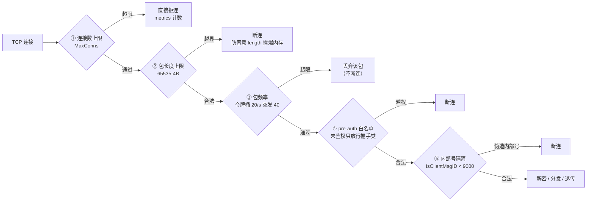

# 限流与安全防护

网关是客户端唯一入口，安全防护的理念是**前置**：越早拦越省 CPU，且能在连接入口把攻击面收敛到最小。本文分层讲清防哪个威胁、在哪拦、为什么这么拦：连接数上限、包长度上限、连接级包频率限流（令牌桶）、未鉴权连接的内部消息号隔离、登录防爆破在登录服的配合，以及各层的测试覆盖。

## 概述

一条客户端包到达业务逻辑之前，要穿过五道闸门。每道闸门针对一类威胁，失败处理策略各不相同——这是设计上最需要注意的：**限流用丢弃，越权用断连**。



第 ④ ⑤ 道闸门的详细解析在 `02-路由与消息分发.md`，本文重点讲第 ③ 道（令牌桶）与整体的配合关系，以及登录防爆破为什么放在登录服。

## 涉及文件

| 路径 | 职责 |
| --- | --- |
| `internal/gateway/router/router.go` | `SetPacketLimiter` 注入、OnPacket 限流分支（解密与分发之前）、pre-auth 白名单、内部号隔离 |
| `pkg/ratelimit/ratelimit.go` | 令牌桶实现：单桶 `Bucket` 与按 key 分桶 `Keyed`，惰性空闲清理 |
| `pkg/config/config.go` | `LimitConfig` 与默认值：`0 = 用内置默认（默认开启）`，`负数 = 关闭` |
| `internal/login/handler/auth.go` | 登录服侧 IP 限流（防爆破的配合方，详见 `../30-登录服/03-登录安全与审计.md`） |
| `internal/common/constant/constant.go` | `IsClientMsgID`：内部 gRPC 号段（9000+）与客户端协议的物理隔离 |
| `internal/gateway/router/router_test.go` | 限流与协议隔离测试 |
| `pkg/ratelimit/ratelimit_test.go` | 令牌桶单测：补充/容量/隔离/清理/并发 |

## 核心设计

### 为什么包频率限流放在网关

提交 `1051ef9` 之前，网关只有「连接数上限」，频率完全没限制：一条连接可以刷包打满 Actor 信箱、刷聊天（每条都写 MySQL + 推对手 + 进 Kafka）、爆破登录。限流放在网关上而不是业务模块里，理由有两层：

1. **越早拦越省 CPU**：包在解密与分发之前就被丢弃，后续业务成本（Actor 投递、写库、推好友）全部省掉；
2. **模块级限流只覆盖各自的消息**，网关级能挡住心跳之外的任何协议刷包——包括将来新增的、模块还没来得及配限流的协议。

### 令牌桶与按连接分桶

`pkg/ratelimit` 自己实现而没有用 `golang.org/x/time/rate`：只需要「令牌桶 + 按 key 兜一张表」这一点能力，且需要注入时钟（测试要推进时间，不能真睡），自己写反而更直接。

```go
// internal/gateway/router/router.go:148
// 连接级限流：先于解密/分发执行，避免刷包把 CPU 和 Actor 信箱打满。
//
// 超限的处理是「丢弃」而不是断连：移动网络抖动会短暂堆包，
// 断连等于把正常玩家踢下线。丢弃已经消除了后续业务成本——
// 客户端有超时重试；真要更严就把 burst 调小。
if h.packetLimiter != nil && !h.packetLimiter.Allow(strconv.FormatInt(c.ID(), 10)) {
	metrics.MsgInc("in", "rate_limited")
	h.logger.Debug("packet rate limited", "conn_id", c.ID(), "msg_id", p.MsgID)
	return
}
```

按 `connID` 分桶：一个连接一个桶，互不挤占——某个玩家被限不影响其他玩家。默认参数 20 包/秒、突发 40（`pkg/config/config.go:117`）：够一个正常客户端在登录后连发十几个请求，又能压住「一个连接把 Actor 信箱打满」的刷包。

**为什么超限丢弃而不是断连**：移动网络抖动会短暂堆包，断连等于把正常玩家踢下线；丢弃已经省掉了后续业务成本，客户端有超时重试兜底。真要更严就把 burst 调小——策略留给配置，不留给代码。

### 配置语义：漏配不能变成不限流

`LimitConfig`（`pkg/config/config.go:101`）的语义是「0 = 用内置默认，负数 = 关闭」：

```go
// pkg/config/config.go:97
// LimitConfig 限流阈值。
//
// 语义：0 = 用内置默认（默认是**开启**的，漏配不能变成不限流）；
// 负数 = 关闭该类限流（排查问题时的临时开关）。
```

对应 `PacketLimit()` 的返回：rate<=0 表示关闭，装配处据此决定是否注入限流器（`internal/gateway/server.go:190`）。网关 dev 配置（`configs/gateway/gateway-dev.yaml`）显式写了 20/40——**显式配置与内置默认一致**，这样改默认值时部署的行为变化是可见的。

### 登录防爆破：为什么配合方在登录服

爆破发生在「还没拿到 token」的阶段，网关根本看不到这些请求——登录是 HTTP，爆破的是 `POST /v1/auth/guest`。登录要查库、签 token、写审计，成本是普通消息的几十倍，且成功一次就能拿到凭证。所以频控放在登录服 handler、按 IP 分桶（默认 20 次/分钟/IP），超限回 429 + 1004 + Retry-After，且在解析 body 之前拦——爆破请求连 JSON 都不必解。

只信 `RemoteAddr`、不信 `X-Forwarded-For`：没有反代时后者可被伪造，每次换个假 IP 就能绕过。完整解析见 `../30-登录服/03-登录安全与审计.md`。

### 内部消息号隔离（简要）

未鉴权连接只放行握手类消息（pre-auth 白名单）；已鉴权连接也不能发 9000+——内部 gRPC 号段与客户端协议物理隔离，靠 `IsClientMsgID` 显式拦截而不是「注册表碰巧没注册」。这是提交 `7452c87` 补上的代码契约，测试在 `router_test.go`（`TestRejectsInternalMsgID` / `TestAllowsClientMsgID` / `TestUnauthedRejectsBusinessMsg`），详见 `02-路由与消息分发.md`。

## 关键代码解析

### Keyed 限流器与惰性清理

`Keyed`（`pkg/ratelimit/ratelimit.go:88`）按 key 分桶，内存随在线规模增长，因此带**惰性空闲清理**——超过 idle 没有访问的桶会被删掉，清理是每次 Allow 顺带扫一次（每 idle/2 一次），不需要后台 goroutine：

```go
// pkg/ratelimit/ratelimit.go:159
// maybeSweep 每 idle/2 顺手清一次空闲桶（调用方持锁）。
//
// 惰性清理的理由：限流器在热路径上，起后台 goroutine 要么多一个生命周期
// 要管，要么在停机时漏；而清扫本身很便宜（一趟 map 遍历）。
func (k *Keyed) maybeSweep(now time.Time) {
	interval := k.idle / 2
	if !k.lastGC.IsZero() && now.Sub(k.lastGC) < interval {
		return
	}
	k.lastGC = now
	cutoff := now.Add(-k.idle)
	for key, b := range k.buckets {
		if b.last.Before(cutoff) {
			delete(k.buckets, key)
		}
	}
}
```

`Allow`（`pkg/ratelimit/ratelimit.go:126`）先补充令牌（按经过时间线性补充，封顶 burst）再尝试取一个。初始满桶允许一次突发（比如登录后客户端立刻连发几个请求），之后按速率回落。`rate <= 0` 时 `Allow` 恒 true——用配置关掉限流时不必改调用点。

网关装配处（`internal/gateway/server.go:190`）：

```go
if rate, burst := s.cfg.Limit.PacketLimit(); rate > 0 {
	s.router.SetPacketLimiter(ratelimit.NewKeyed(rate, burst, 5*time.Minute))
	s.logger.Info("packet rate limit enabled", "rate", rate, "burst", burst)
} else {
	s.logger.Warn("packet rate limit disabled by config")
}
```

idle 传 5 分钟：网关连接断开即不再访问对应桶，5 分钟足以让绝大多数已断连接的桶被清掉。注意关闭限流时打的是 **Warn** 而不是 Info——「限流被关了」是可观测的异常状态，排查问题时不该淹没在 Info 里。

### 各层失败策略对照

| 闸门 | 威胁 | 位置 | 失败处理 | 理由 |
| --- | --- | --- | --- | --- |
| 连接数上限 | fd 耗尽拖垮整机 | `onAccept` | 拒连 + 计数 | 被拒连接不产生 Conn/Session/goroutine |
| 包长度上限 | 恶意 length 撑爆内存 | `processReadBuf` | 断连 | 越界即视为攻击/错位，不错杀就没防线 |
| 包频率 | 刷包打满信箱/写库 | `OnPacket` | **丢弃** | 抖动堆包不是攻击，断连误伤正常玩家 |
| pre-auth 白名单 | 未鉴权探测 | `OnPacket` | 断连 | 握手期连接成本极低，错杀比放过安全 |
| 内部号隔离 | 伪造内部 gRPC 号 | `OnPacket` | 断连 | 协议隔离是契约，没有「宽松处理」语义 |
| 登录 IP 限流 | 爆破登录 | 登录服 handler | 429 + Retry-After | HTTP 语义明确，客户端按状态码退避 |

### 与其它限流点的分工

项目里共有三处限流（提交 `1051ef9` 一次补全），分工明确：

- **网关连接级（20 包/秒）**：管总量，防刷包；
- **聊天频控（1 条/秒）**：为什么不能只靠包级限流——包限流管总量，而聊天单条成本高（写库+推送+消息队列），「每秒一条、连发一小时」包限流完全放行。在游戏服，本文不展开；
- **登录 IP 限流（20 次/分钟/IP）**：防爆破，在登录服。

## 演进记录

| 提交 | 日期 | 事件 |
| --- | --- | --- |
| `a0ed305` P1-P4 最小可运行链路 | 2026-10-18 | 接入加密握手，连接入口的协议框架就位 |
| `331b5e5` P15 全链路演练 | 2026-10-18 | 压测/故障注入/演练中修复 8 个真实缺陷，其中两处直接关系接入层安全：网关读错配置段导致 backend 为 nil、握手 salt 字节序导致 1.3% 登录失败（详见 `02-路由与消息分发.md`） |
| `7452c87` 网关补内部号隔离 | 2026-10-24 | 「注释声称已久，代码一直没有」的 `IsClientMsgID` 显式检查落地，补 5 个用例，变异验证能抓到 |
| `1051ef9` 补业务限流 | 2026-10-24 | 新增 `pkg/ratelimit`，三处接入（网关包频率/聊天频控/登录防爆破）；errcode 里躺了很久的 `RATE_LIMITED=1004` 终于有人触发 |

`1051ef9` 的提交信息记录了接入时的取舍：频控放在聊天内容校验之后（打字打错一次不占额度，否则体验比限流更糟）；登录限流在解析 body 之前（爆破请求连 JSON 都不必解）。「之前只有连接数上限，频率完全没限制」是这条线的起点。

## 测试情况

网关侧 `internal/gateway/router/router_test.go`：

| 用例 | 断言 |
| --- | --- |
| `TestPacketRateLimitDropsExcess` | 令牌几乎不补充、突发 1：连发 5 个包只有 1 个透传，且**连接保持存活**（限流不该断连——抖动期的堆包不是攻击） |
| `TestPacketRateLimitDisabled` | 未注入限流器（单测/关闭配置）时不限制，20 个包全部透传 |

`pkg/ratelimit/ratelimit_test.go`（6 例）：

| 用例 | 断言 |
| --- | --- |
| `TestBucketBurstThenRefill` | 初始满桶允许 burst 个，之后按速率补充 |
| `TestBucketDisabled` | rate<=0 时 Allow 恒 true |
| `TestKeyedIsolatesKeys` | 按 key 隔离：一个 key 耗尽不影响另一个 |
| `TestKeyedSweepsIdleKeys` | 空闲桶被惰性清理 |
| `TestKeyedKeepsActiveKey` | 活跃 key 不被误清 |
| `TestKeyedConcurrent` | 并发下恰好放行 burst 个（-race -count=3） |

测试对「失败处理策略」的断言比限流本身更细：`TestPacketRateLimitDropsExcess` 断言的是「透传次数」而不是「连接状态」——丢弃与断连的区别正是这条防线的体验分水岭。

## 小结

网关安全防护可以归纳成两句话：**所有检查前置于连接入口**（限流 → 白名单 → 解密 → 隔离 → 分发），异常连接不消耗后续资源；**失败处理按威胁分级**——资源耗尽类（连接数/包长度/越权）果断断连，频率类（包限流）温和丢弃。限流默认开启（漏配不等于不限流），关闭必须显式配负数并打 Warn 日志。登录防爆破按「爆破发生在拿到 token 之前」定位在登录服，两层配合。协议隔离的细节在 `02-路由与消息分发.md`，登录侧限流与审计在 `../30-登录服/03-登录安全与审计.md`。
