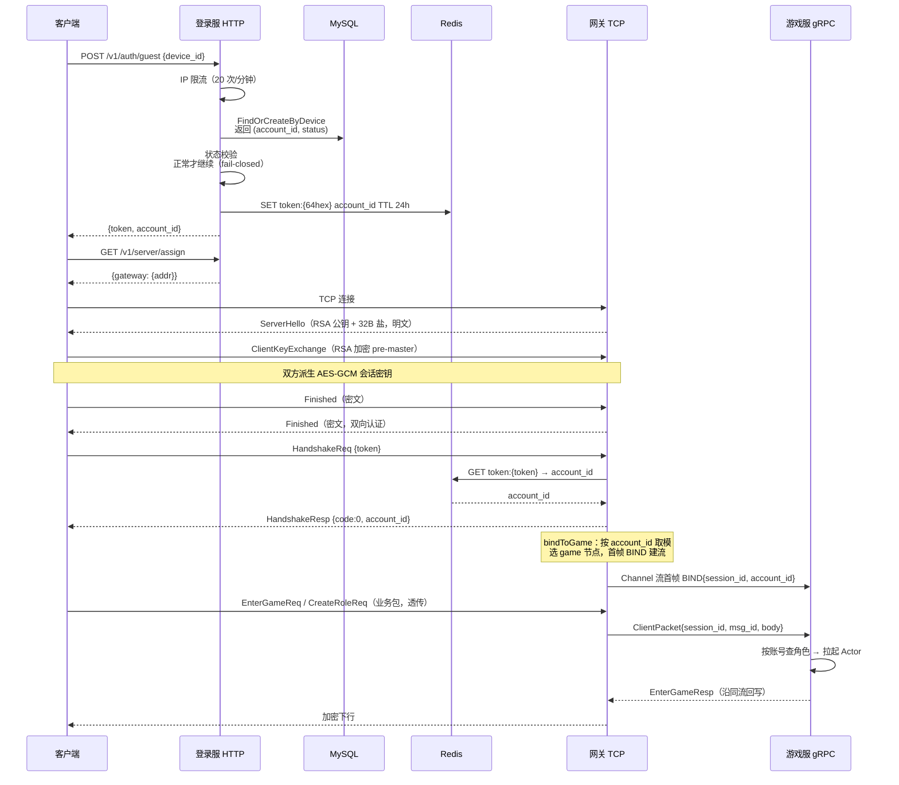
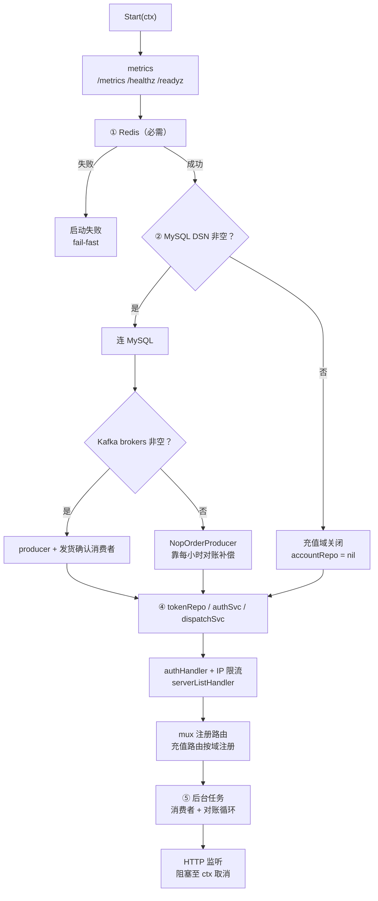

# 登录流程与握手

登录服是玩家进入游戏的第一站：签发/校验 token、分派网关，客户端持 token 来网关握手后进入游戏。本文按 `server.go / handler / service / repo` 四层讲清登录→选角→进入游戏服→网关绑定的完整链路，配 mermaid 时序图，并说明每层的职责边界与降级策略。

## 概述

登录服的架构是教科书式的四层分工，依赖方向严格单向（handler → service → repo → DB/Redis）：

| 层 | 包 | 职责 | 测试方式 |
| --- | --- | --- | --- |
| 组装层 | `internal/login/server.go`、`cmd/login/main.go` | 中间件装配、路由注册、启动/停机编排 | 集成测试 |
| 门面层 | `internal/login/handler/` | 协议转换（HTTP ↔ service 调用）、旁路审计 | httptest |
| 服务层 | `internal/login/service/` | 业务规则：找/建账号、状态校验、签发 token | 内存 fake，不起 MySQL/Redis |
| 仓储层 | `internal/login/repo/` | account/token 的读写，不出现任何 HTTP 概念 | sqlmock/内存库 |

登录服的对外契约分两部分：对客户端是 HTTP（`POST /v1/auth/guest`、`GET /v1/server/assign`，消息体用 `api/proto/login/v1/login.proto` 的 protobuf JSON 序列化），对内部是 Redis 里的 `token:xxx` 键——网关握手时校验同一个 key，「登录服签发、网关校验」的信任链由此建立。它还是五进程中唯一对外暴露 HTTP 的进程。

三个设计取舍值得先记住：

1. **Redis 必需，MySQL/Kafka 可选**：token 存取全在 Redis，连不上 = 登录服无意义，直接启动失败（fail-fast）；无 MySQL 时充值域整体关闭，登录/分派照常——单测与最小部署都能跑。
2. **无 MySQL 时 AuthService 降级为固定账号**（1000001），token 链路照常可测。
3. **就绪探针 Ping Redis/MySQL**：依赖不可用时主动摘流量，比让请求打进来再失败更优雅。

## 涉及文件

| 路径 | 职责 |
| --- | --- |
| `internal/login/server.go` | 组装层：中间件装配（Redis/MySQL/Kafka）、handler/service 装配、路由注册、后台任务、readiness 探针、优雅退出 |
| `cmd/login/main.go` | 进程入口：配置、信号上下文、两阶段优雅退出 |
| `internal/login/handler/auth.go` | `GuestLogin` HTTP handler：频控 → 解 JSON → 调 service → 旁路流水 → 回包 |
| `internal/login/handler/server_list.go` | 选服 handler：`/v1/server/assign`（推荐单网关）、`/v1/server/gateway/list`（全量） |
| `internal/login/service/auth_service.go` | 认证服务：`GuestLogin`（找/建账号 + 状态校验 + 签发 token）、`ValidateToken` |
| `internal/login/service/dispatch_service.go` | 网关分派：P1 静态配置版，`AssignGateway` / `ListGateways` |
| `internal/login/repo/account_repo.go` | account 表读写：`FindOrCreateByDevice`（带 status）、`TouchLogin` |
| `internal/login/repo/token_repo.go` | token 的 Redis 存取删：Set/Get/Del，key 前缀与网关的隐性契约 |
| `api/proto/login/v1/login.proto` | 登录服对外 HTTP 协议契约 |
| `api/proto/gate/v1/handshake.proto` | 客户端 ↔ 网关协议：握手/登出/踢下线（网关侧闭环） |

## 核心设计

### 完整登录时序



时序里有四个关键设计：

**① token 是唯一的信任根。** 登录服签发（写 Redis），网关校验（读 Redis），游戏服不认 token 只认 session。key 前缀 `token:` 是登录服与网关的跨进程隐性契约（`internal/login/repo/token_repo.go:43` 与 `internal/gateway/server.go:66` 的注释互相标注），改一处必须改两处，否则表现为「登录拿到的 token 网关全认不出」。

**② 握手期明文是协议设计的固有窗口。** 密钥交换（RSA）还没完成，没有可用加密通道，只能明文交换公钥与随机盐——靠「握手消息不承载敏感信息」兜底，而不是靠加密。

**③ 选路跟账号绑，不跟角色绑。** `bindToGame` 按 `account_id` 对存活节点取模——同一账号换角色重连时落回同一节点（Actor 缓存、presence 都在那边）。节点扩缩时取模值跳变，需重连才会迁移（本版本不处理在线迁移）。

**④ 创角/进游戏在游戏服侧闭环。** 登录服只管「你是谁」（account_id）；「你有几个角色、进哪个」是游戏服按 account_id 查角色表决定的。网关 BIND 帧只带 account_id，游戏服 `OnBind` 自动按账号查唯一角色绑定。

### 启动顺序与降级矩阵

`Start`（`internal/login/server.go:72`）的顺序即依赖顺序，任何必需依赖失败立即返回，绝不在半初始化状态接流量：



降级矩阵——每个中间件缺失时系统的行为：

| 缺失 | 行为 |
| --- | --- |
| Redis | 启动失败（token 根基） |
| MySQL | 充值路由 404（比注册必然 500 的 handler 诚实）；AuthService 降级固定账号 |
| Kafka | producer 为 nil，订单照常落库靠对账补偿；审计静默 |
| 全部就绪 | 完整功能 |

## 关键代码解析

### handler 层：协议转换 + 频控前置

`GuestLogin`（`internal/login/handler/auth.go:103`）流程：方法校验 → 频控 → 解 JSON → 设备号兜底 → 调 service → 旁路流水 → 回包。频控放在解析 body 之前——爆破请求连 JSON 都不必解，直接回 429。账号不可用是「可预期的拒绝」，用 403 + 业务码返回，客户端据此弹「账号已被封禁」而不是当成服务器故障去重试：

```go
// internal/login/handler/auth.go:128（节选）
// 账号不可用是「可预期的拒绝」，用 403 + 业务码返回：
// 客户端据此弹「账号已被封禁」，而不是当成服务器故障去重试。
switch {
case errors.Is(err, service.ErrAccountFrozen):
	writeJSONStatus(w, http.StatusForbidden, map[string]any{
		"code": 2001, "msg": "账号已被封禁",
	})
	return
case errors.Is(err, service.ErrAccountDeleted):
	writeJSONStatus(w, http.StatusForbidden, map[string]any{
		"code": 2001, "msg": "账号已注销",
	})
	return
}
http.Error(w, err.Error(), http.StatusInternalServerError)
```

`clientIP`（`internal/login/handler/auth.go:165`）取直连地址，`net.SplitHostPort` 解析失败时回退整个 RemoteAddr——防御式解析，宁可多带信息也不丢 IP。IP 在 handler 层补取而非 service 层：`r.RemoteAddr` 是 HTTP 层信息，service 不该依赖 `*http.Request`——分层依赖方向保持 handler→service。

### service 层：状态校验必须前置

`GuestLogin`（`internal/login/service/auth_service.go:80`）顺序：账号（找/建）→ 状态校验 → 更新登录时间 → 生成 token → 写 Redis。token 生成放在账号之后：账号失败就不浪费随机源与一次 Redis 写。状态校验的 fail-closed 语义详见 `02-账号体系与封禁.md`。

### repo 层：唯一索引是并发仲裁者

`FindOrCreateByDevice`（`internal/login/repo/account_repo.go:48`）把「按设备找，没有则建」放在一个方法里——调用方不关心内部是 SELECT 还是 INSERT。两个相同 device 的并发首次登录会都走到 INSERT，靠 `account.device` 唯一索引保证只有一个成功（另一个报 1062）；当前实现把 1062 当错误上抛，由调用方重试即转到 SELECT 命中路径。「唯一索引是并发找/建的最终仲裁者」——比在应用层加锁查重更可靠。

参数化查询（`?` 而非字符串拼接）：SQL 注入的唯一可靠防御是参数化，device 来自客户端，拼接即把注入面敞开。

`TokenRepo`（`internal/login/repo/token_repo.go:29`）用 Redis 而非 MySQL：token 校验在握手热路径，要求亚毫秒级响应与高并发读。value 直接存 account_id 数字——读一次 Redis 就完成「token 是否有效 + 归属是谁」两个问题。TTL 由上层传入（配置 `token.ttl`，缺省 24h）：过期策略是业务决策不是存储决策，过期后 token 自动消失，Redis 的过期机制就是 GC。

### 网关侧衔接：握手与绑定

客户端拿到 token 连上网关后，`handleHandshakeReq`（`internal/gateway/router/router.go:403`）是鉴权入口：validator 查 Redis 拿 account_id，成功则 `SetAuth` 置 AUTHED 并触发 `onAuthed`（`server.bindToGame`）。失败只回错误码 1002 不断连——客户端可能换 token 重试，连接成本已付，没有安全理由断开。`HandshakeResp.PlayerId` 恒为 0——角色在进游戏/创角后确定，网关不预设。完整解析见 `../20-网关层/02-路由与消息分发.md`。

## 演进记录

| 提交 | 日期 | 事件 |
| --- | --- | --- |
| `a0ed305` P1-P4 最小可运行链路 | 2026-10-18 | 游客登录 + token 签发 + 网关握手鉴权打通，最小链路成型 |
| `5ee7195` P6 业务闭环 | 2026-10-18 | 创角/进游戏/角色信息闭环，登录服分派接口与游戏服选角衔接 |
| `a26ed2e` 充值域（R3.3） | 2026-10-19 | 服务端定价/渠道验签/金额匹配，充值域三件套接入登录服 |
| `421c1f6` 登录礼包与流水（R3.2） | 2026-10-19 | 登录成功/失败都记流水，`gs.login.log` 由游戏服消费落 `login_log` 表 |
| `2e28e12` 补登出/封禁拦截 | 2026-10-24 | 账号状态校验上线（之前只有 status 列和错误码，没有校验）；登出协议让「断开」有了一条干净路径 |
| `1051ef9` 补业务限流 | 2026-10-24 | 登录入口补 IP 限流（20 次/分钟/IP），防爆破 |

登出与跨节点顶号的完整开发实录见 `../70-开发过程实录/06-登出与跨节点顶号.md`。

## 测试情况

`internal/login/service/auth_service_test.go` 是登录规则的主防线（8 例，全部内存 fake 不起 MySQL/Redis）：

| 用例 | 断言 |
| --- | --- |
| `TestGuestLoginIssuesToken` | 正常账号签发 token 并写进存储（「token 必须写进存储，否则网关认不出」） |
| `TestGuestLoginRejectsFrozen` | 冻结账号拿不到 token，但 accountID 要回给上层（登录流水需要它定位账号） |
| `TestGuestLoginRejectsDeleted` | 注销账号同样不签发 |
| `TestGuestLoginUnknownStatusFailClosed` | 未知状态一律不发凭证（脏数据不能成为后门） |
| `TestGuestLoginPropagatesLookupError` | 查库失败原样上抛——DB 故障不能被当成封禁 |
| `TestGuestLoginFailsWhenTokenStoreFails` | token 写失败不返回 token（客户端会拿着网关永久认不出的凭证） |
| `TestGuestLoginWithoutAccountRepo` | 无 MySQL 降级固定账号 1000001（避开 0——0 是「未鉴权」哨兵） |
| `TestValidateToken` | 有效/无效/已删除（登出）三种输入；「登出后 token 必须立刻失效」 |

登录流水的游戏服侧消费测试在 `internal/game/mq/loginlog_consumer_test.go`。整链路（登录→握手→进游戏）的集成测试在 `test/integration/`。

## 小结

登录服的设计可以归纳为：**handler 薄、service 纯、repo 稳**——协议转换、业务规则、存储细节三层分离，每层都能脱离依赖单测；**token 单一信任根**——签发与校验只经 Redis 一个键，前缀是全项目最隐性的契约；**降级路径显式**——每个中间件缺失时的行为都写在装配代码里，fail-fast 与「充值域关闭但登录照常」各得其所。账号封禁的状态机在 `02-账号体系与封禁.md`，限流与审计在 `03-登录安全与审计.md`。
