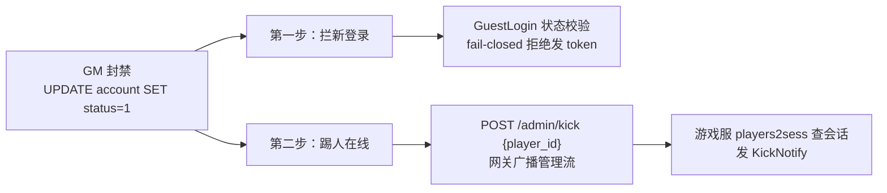

# 账号体系与封禁

账号体系目前是「游客登录」制：device 即身份凭证，一个账号可有多个角色。本文讲清 `account.status` 状态机（正常/冻结/注销/未知，fail-closed）、`ErrAccountFrozen` 的传递路径、封禁后的两步生效机制（拦新登录 + 踢人在线），以及与 GM 封禁操作的联动方式。

## 概述

封禁的产品语义是「不能进游戏」。在进程内判定，唯一有效的入口是登录服的 `GuestLogin`——因为**网关只校验 token，不查账号状态**：已签发的 token 仍会通过校验，所以必须在**发 token 之前**拒绝，否则封禁只是「下次登录失败」，手上那张 token 还能用到 TTL（24h）结束。

这带来封禁的两步生效机制：



两步都要做：只拦不踢，已在线的玩家继续玩到自然掉线；只踢不拦，玩家重连时又能拿新 token 进来。第二步的链路在 `../20-网关层/03-踢人与管理流.md` 完整解析，本文聚焦第一步与两者的衔接。

## 涉及文件

| 路径 | 职责 |
| --- | --- |
| `internal/login/repo/account_repo.go` | account 表读写：`FindOrCreateByDevice` 返回 status、`TouchLogin` |
| `internal/login/service/auth_service.go` | 状态机核心：`statusNormal/Frozen/Deleted` 常量、`ErrAccountFrozen/ErrAccountDeleted`、GuestLogin 的 fail-closed switch |
| `internal/login/handler/auth.go` | 哨兵错误 → HTTP 403 + 业务码 2001 的映射 |
| `sql/schema/game.sql` | account 表 DDL：`status TINYINT DEFAULT 0 COMMENT '0正常 1冻结 2注销'` |
| `internal/gateway/server.go` | `KickPlayer`：踢人在线的执行入口（`/admin/kick`） |
| `internal/game/server_session.go` | `OnKick`：按角色号查 `players2sess` 定位会话 |
| `api/proto/common/v1/errcode.proto` | `ERR_CODE_ACCOUNT_BANNED = 2001`：客户端据此提示 |

## 核心设计

### 状态机与 fail-closed

```mermaid
stateDiagram-v2
    [*] --> 正常 : 建号<br/>status=0
    正常 --> 冻结 : GM 封禁<br/>status=1
    正常 --> 注销 : 用户/运营注销<br/>status=2
    冻结 --> 正常 : 解封
    冻结 --> 注销 : 注销
    注销 --> [*] : 终态
    note right of 正常
        GuestLogin：通过，发 token
    end note
    note right of 冻结
        ErrAccountFrozen
        HTTP 403 + code 2001「账号已被封禁」
    end note
    note right of 注销
        ErrAccountDeleted
        HTTP 403 + code 2001「账号已注销」
    end note
    note right of 未知
        任何其他值（脏数据）
        fail-closed：一律拒绝
    end note
```

核心代码在 `internal/login/service/auth_service.go:61`：

```go
// 账号状态（account.status 列，见 sql/schema/game.sql）。
//
// 为什么在登录入口拦而不是网关：冻结/注销是「账号」属性，网关只认 token；
// 已签发的 token 仍会通过校验，所以必须在**发 token 之前**拒绝——
// 否则封禁只是「下次登录失败」，手上那张 token 还能用到 TTL 结束。
const (
	statusNormal  int32 = 0
	statusFrozen  int32 = 1 // 冻结/封禁
	statusDeleted int32 = 2 // 注销
)

// 账号不可用的哨兵错误（handler 用 errors.Is 映射 HTTP 状态与业务码）。
var (
	ErrAccountFrozen  = errors.New("account frozen")
	ErrAccountDeleted = errors.New("account deleted")
)
```

判定逻辑（`internal/login/service/auth_service.go:87`）：

```go
// 状态校验放在发 token 之前：已冻结的账号不能拿到新凭证。
// 未知状态按「拒绝」处理（fail-closed）——脏数据不该成为后门。
switch status {
case statusNormal:
case statusFrozen:
	return "", accountID, ErrAccountFrozen
case statusDeleted:
	return "", accountID, ErrAccountDeleted
default:
	return "", accountID, fmt.Errorf("account %d has unknown status %d", accountID, status)
}
```

三个设计点：

**① fail-closed。** 未知状态（脏数据、将来新增的状态值忘了同步登录服）一律拒绝。安全判定上，「拒绝」的代价是误伤（玩家找客服），「放行」的代价是后门——不对称的代价决定了对未知值的选择。

**② 查库失败与账号被拒是两种错误。** `FindOrCreateByDevice` 的 DB 故障原样上抛（`TestGuestLoginPropagatesLookupError`：DB 故障不能被当成封禁），handler 对两种错误分别回 403 与 500——前者客户端弹「账号已被封禁」，后者是服务器故障该重试或告警。

**③ 拒绝时仍返回 accountID。** 登录流水需要它定位是哪个账号在尝试登录——风控与客服追溯都依赖这个字段，哪怕这次登录被拒。

### 封禁后如何踢下线

GM 封禁一个在线玩家，链路是「登录服/运营工具 → 网关 `/admin/kick` → 广播 → 游戏服查表 → KickNotify」：

1. 运营对**任意网关实例**发 `POST /admin/kick {"player_id":42,"reason":"banned"}`（本机或带 Bearer token）；
2. 网关 `KickPlayer` 列 etcd 里的 game 节点，对每个节点经管理流发 `CtrlMsg_KICK`（`SessionId=0` 哨兵，`player_id` 必填）；
3. 每个游戏服 `OnKick(playerID)` 查本节点的 `players2sess`——查不到说明不在本节点（广播常态），静默忽略；
4. 持有该会话的节点 `kickSession` 发 `KickNotify{reason}`，客户端收到后断开，随后的 UNBIND 走标准下线（模块 OnLogout + 落库）。

注意 `player_id` 是**角色号**不是会话号：`players2sess`（player→session）是游戏服的唯一权威映射，网关不保副本——这是用户纠正过的设计，详见 `../20-网关层/03-踢人与管理流.md` 的演进记录。如果运营只有 account_id 没有 role_id，需要先经游戏服的账号→角色查询转换（GM 工具的职责，当前 `/admin/kick` 接口只接受角色号）。

踢下线后若不断 token，玩家重连时网关握手仍会校验通过——所以封禁的完整生效依赖两步：`status=1` 拦住新 token 签发 + 已签发 token 的自然过期（或由 GM 工具显式删除 Redis 键）。

## 关键代码解析

### repo 层：status 随账号一起返回

`FindOrCreateByDevice`（`internal/login/repo/account_repo.go:48`）的返回值从「只有 id」扩成 `(id, status)`——封禁（1）/注销（2）必须在登录入口拦掉，否则一个被冻结的账号照样能换 token 进游戏：

```go
// internal/login/repo/account_repo.go:40（节选）
// FindOrCreateByDevice 按设备找账号，没有则创建游客账号。
//
// 返回值带上 status：封禁（1）/注销（2）必须在登录入口拦掉，
// 否则一个被冻结的账号照样能换 token 进游戏。
func (r *AccountRepo) FindOrCreateByDevice(ctx context.Context, device string) (int64, int32, error) {
	// ...
	const q = `SELECT id, status FROM account WHERE device = ? ORDER BY id LIMIT 1`
	// ...
	// 创建游客账号（密码占位，P7 接入渠道登录）
	acc := &model.Account{
		Account:      "guest_" + suffix,
		PasswordHash: "",
		Salt:         "",
		Status:       0,
		Device:       device,
		// ...
	}
	// ...
	return id, 0, nil // 新建账号必然是正常状态
}
```

新建账号必然是正常状态（`Status: 0`）——所以「新号被冻结」只可能来自显式的 GM 操作或数据修复，不会是建号逻辑的 bug。

### handler 层：哨兵错误到 HTTP 的映射

`errors.Is` 沿错误链匹配哨兵错误，冻结/注销都映射 403 + 2001，只是文案不同（「账号已被封禁」/「账号已注销」）——客户端弹给玩家的原因要准确。2001 是 `ERR_CODE_ACCOUNT_BANNED`（`api/proto/common/v1/errcode.proto:22`），客户端按 2xxx 段可做粗粒度分类（一律弹回登录页）。错误码分段与守护见 `03-登录安全与审计.md`。

### 表结构

```sql
-- sql/schema/game.sql（节选）
`status`        TINYINT      NOT NULL DEFAULT 0 COMMENT '0正常 1冻结 2注销',
```

TINYINT + DEFAULT 0：新行缺省正常；注释即文档。账号表不分表（账号量级小，登录服单库单表），`device` 与 `account` 各有唯一索引。

## 演进记录

| 提交 | 日期 | 事件 |
| --- | --- | --- |
| `a0ed305` P1-P4 最小可运行链路 | 2026-10-18 | account 表与游客登录成型，status 列随 DDL 建立（当时无校验） |
| `7452c87` 错误码撞车修复 | 2026-10-24 | 修 4 处模块自建码与 proto 撞车（含客户端会看到错误失败原因的 bug）；`errcode` 注释校准为「proto 语义码 + 模块段码」两套并存 |
| `2e28e12` 账号封禁拦截 | 2026-10-24 | **之前只有 status 列和错误码，没有校验**。`FindOrCreateByDevice` 返回 status；GuestLogin 在发 token 之前拦截冻结/注销，未知状态 fail-closed；HTTP 403 + 2001。提交信息明确：「必须在发 token 前拦：网关只认 token，已签发的那张会一直有效到 TTL」 |
| `31bfff4` → `c866bea` → `00ca387` | 2026-10-24 | 踢人链路三次迭代成型，使「踢已在线玩家」成为可能（此前封禁只能拦下次登录） |

变异验证记录（提交 `2e28e12`）：不校验账号状态——被抓。这五处变异（不作废 token、先断连后回包、跨节点改回拒绝、Actor 不处理 KickMsg、不校验账号状态）全部被抓，说明封禁链路的每个环节都有测试背书。

## 测试情况

`internal/login/service/auth_service_test.go` 的封禁相关用例（全部内存 fake）：

| 用例 | 断言 |
| --- | --- |
| `TestGuestLoginRejectsFrozen` | 冻结账号：`ErrorIs(ErrAccountFrozen)`、token 为空、**存储零写入**、accountID 仍返回 |
| `TestGuestLoginRejectsDeleted` | 注销账号：同上，哨兵错误是 `ErrAccountDeleted` |
| `TestGuestLoginUnknownStatusFailClosed` | status=99：报错、token 为空、零写入——「fail-closed：未知状态一律不发凭证」 |
| `TestGuestLoginPropagatesLookupError` | 查库失败：错误上抛且 `!Is(ErrAccountFrozen)`——DB 故障不能被当成封禁 |
| `TestGuestLoginFailsWhenTokenStoreFails` | token 写失败：不返回 token（否则客户端拿着网关认不出的凭证） |
| `TestGuestLoginWithoutAccountRepo` | 无 MySQL：降级固定账号仍发 token（状态校验只发生在有 accountRepo 时） |

测试文件头部的注释点明了这条链路的价值：「封禁的语义是『不能进游戏』，而进程内判定的唯一入口就在这里：网关只校验 token，不查账号状态。所以『冻结账号必须拿不到新 token』是这条链路上唯一有效的闸门——漏了它，封禁就只是『下次登录失败』」。

## 小结

账号体系的封禁是**纵深防御**的一层：DB 层 status 列是事实源，service 层 fail-closed 是闸门，handler 层 403+2001 是客户端语义，游戏服/网关的踢人链路是「已在线」的清除手段。四层各司其职，任何一层缺失都让封禁退化成「下次登录失败」。当前是游客登录制（device 即凭证），P7 渠道登录接入后 `AuthLoginReq/Resp`（`api/proto/login/v1/login.proto:11`）已有契约位置，届时密码哈希与盐字段（P0 占位）随之启用。登录安全的另一面——IP 限流与审计——见 `03-登录安全与审计.md`。
