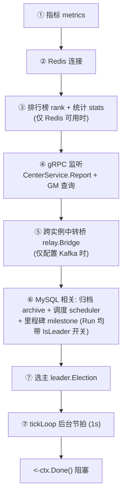

# 01-中心服总览

> 一句话定位：中心服（CenterServer）是 game_study 分布式架构中的「协调者」——负责节点注册/发现、跨服匹配、消息中转、分组统计/排行榜四项常驻职责，并基于 etcd 选主，仅由 leader 执行赛季归档、活动调度、全服里程碑三项有主任务。

## 1. 概述

中心服在七微服务（gateway/login/center/game/cross/map/flusher）中处于编排位置：启动顺序上它必须最先就绪（etcd → 中间件 → 中心服 → 游戏服/跨服 → 网关 → 登录服，见 `cmd/center/main.go:5` 的注释），因为游戏服/跨服进程要靠它完成 gRPC 注册与互相发现。

设计上有一个核心取舍：**各子系统自身不感知集群，多实例协作的全部约定收敛在装配层**（`internal/center/server.go:48-51`）。选主、跨实例中转、分实例统计这三件事都在 `server.go` 的启动编排里完成，子包只面对单实例语义。

中心服的九个子系统按职责分三档：

| 档位 | 子系统 | 是否 leader 专属 | 外部依赖 |
| --- | --- | --- | --- |
| 常驻 | registry 节点注册表 | 否 | 无（纯内存） |
| 常驻 | match 跨服匹配 | 否 | 无（纯内存） |
| 常驻 | relay 中转路由 + bridge 跨实例桥 | 否 | bridge 需 Kafka |
| 常驻 | rank 排行榜 | 否 | Redis |
| 常驻 | stats 分组统计 | 否 | Redis |
| 有主 | archive 赛季归档 | 是 | MySQL + Redis + Kafka |
| 有主 | scheduler 活动调度 | 是 | MySQL + Kafka |
| 有主 | milestone 全服里程碑 | 是 | Redis + MySQL + Kafka |
| 常驻 | leader 选主 | 否 | etcd |

所有「可选」能力（Redis/etcd/Kafka/MySQL）都设计成**未配置即降级，而不是启动失败**：没有 Redis 就没有排行榜和统计；没有 etcd 就 `IsLeader()` 恒 false、有主任务全部跳过；没有 Kafka 中转退化为单实例模式。降级路径在 `internal/center/server.go:99-101` 的 New 注释里写明。

## 2. 涉及文件

| 文件 | 职责 |
| --- | --- |
| `cmd/center/main.go` | 进程入口：加载配置、信号上下文、组装 `center.New`、两阶段优雅退出 |
| `internal/center/server.go` | 组装层：Server 结构体、New/Start/Shutdown、tickLoop 节拍、实例身份 |
| `internal/center/registry/registry.go` | 节点注册表：Register/Heartbeat/Unregister/Tick 巡检 |
| `internal/center/match/matcher.go` | 跨服匹配池：elo 分桶、超时放宽、room_id 拼装、HMAC 令牌 |
| `internal/center/relay/relay.go` | 同实例中转路由：pending 队列、指数退避重试 |
| `internal/center/relay/bridge.go` | 跨实例中转桥：经 Kafka 转发到承载目标节点的实例 |
| `internal/center/rank/rank.go` | Redis ZSet 排行榜：增量写、去重、TopN/Around/RankOf、赛季归档 |
| `internal/center/stats/stats.go` | 分组统计：环形桶时间窗口、多实例快照合并 |
| `internal/center/archive/service.go` | 赛季归档：到期切赛季、榜单入历史表、发奖邮件 |
| `internal/center/scheduler/activity.go` | 活动实例调度：算周期、落库、下发 gs.activity.schedule |
| `internal/center/milestone/service.go` | 全服里程碑：Lua 原子累加、建任务、leader 批量发奖 |
| `internal/center/leader/leader.go` | etcd 选主：campaign、主从切换、Resign 让位 |
| `internal/center/rpc/center_server.go` | gRPC 协议入口：Report 流 + GM 查询，Handler 接口打破循环依赖 |
| `configs/center/center-dev.yaml` | 开发环境配置（同目录另有 docker/prod/test 三份） |

## 3. 核心设计：启动编排

### 3.1 装配边界：New 无 I/O，Start 才连中间件

```go
// New 组装服务器。
// 只装配无外部依赖的组件（注册表/匹配器/中转路由）；依赖 Redis/etcd/Kafka/
// MySQL 的组件保持 nil，由 Start 按配置惰性创建——未配置中间件时中心服以
// 降级模式运行（无排行榜/统计，单实例中转），而不是启动失败。
func New(cfg *config.Config) *Server {          // internal/center/server.go:105
```

这是依赖注入的装配点：`New` 不碰任何 I/O，可安全用于测试；所有可能失败的连接都在 `Start`，失败由进程管理器重启兜底。`main` 只认识 `*config.Config`，子系统之间的相互引用全部收敛在 `internal/center` 内部（`cmd/center/main.go:66-68`）。

### 3.2 Start 七步启动顺序



顺序不可换的三个理由写在 `internal/center/server.go:136-138`：

1. Redis 要先于排行榜/统计（它们持有 client）；
2. gRPC 要先于节点接入（节点一来就要能注册）；
3. 选主要晚于归档/调度（它们的 Run 需要 `IsLeader` 已可查询，提前当选会空转一拍）。

注意第 ⑥ 步里三个服务的 `Run(ctx, s.IsLeader)` 都是以**方法值**传入 leader 探针（`internal/center/server.go:247-263`），这样 leader 状态翻转时任务循环下一拍自然接住，不需要额外的事件通知机制。

### 3.3 tickLoop：单循环多任务节拍

```go
// tickLoop 统一节拍循环（1s）：节点心跳巡检、匹配放宽、中转重试、指标上报。
// 统计快照（5 分钟）与指标（10 秒）在同一循环里用时间差节流，而不是各起
// 定时器：中心服后台任务种类多但都很轻，单循环足够且关闭时只需等一个
// goroutine 退出。
func (s *Server) tickLoop(ctx context.Context) {   // internal/center/server.go:293
```

一个值得注意的细节：`now` 取自 `ticker.C` 而非 `time.Now()`（`internal/center/server.go:291-292`）——同一拍里巡检/超时判定用同一时钟，避免「心跳刚更新但巡检用更晚的 now」造成的边界抖动。这正是测试里用虚拟时钟替代真实 sleep 的前提（详见 [03-匹配排行与里程碑](./03-匹配排行与里程碑.md)）。

### 3.4 Shutdown：先踢后停

```go
// 顺序原理：先踢后停——反过来的话节点还连着自己，gRPC 一停全部瞬断，
// 重连风暴且玩家掉线；先 Kick 给节点 3s 缓冲期去建新连接。
func (s *Server) Shutdown(ctx context.Context) error {   // internal/center/server.go:645
```

关闭编排五步：① `kickAllNodes` 向全部 game/cross 节点下发 `KickNode{Reason: "rolling_restart"}` → ② gRPC `StopWithTimeout(3s)` 强停（避免 Report 流永不结束卡死，与 P13 网关下线同类问题）→ ③ 中转桥 Close（关之前打统计：forwarded/received/delivered/skipped 是判断集群中转健康度的唯一现场证据）→ ④ milestone Close → producer Flush → database Close → ⑤ 指标停。

### 3.5 main 的两阶段优雅退出

```go
// Start 阻塞至 ctx 取消，正常返回即代表关闭信号已到达
if err := srv.Start(ctx); err != nil {          // cmd/center/main.go:72
    ...
}
// ④ 优雅关闭总超时（18.1），配置未显式指定时兜底 60s
total := 60 * time.Second                       // cmd/center/main.go:81
if d, err := config.ParseDuration(cfg.Shutdown.TotalTimeout); err == nil && d > 0 {
    total = d
}
// 用 Background 而非继承已取消的 ctx：关闭流程需要一份独立且仍然有效的超时预算
shutdownCtx, cancel := context.WithTimeout(context.Background(), total)
if err := srv.Shutdown(shutdownCtx); err != nil {
```

信号上下文（`cmd/center/main.go:60`）把 SIGINT/SIGTERM 转成 ctx 取消，ctx 即进程生命周期。`Start` 收取消返回后，`main` 再用**总超时驱动的 Background ctx** 执行 `Shutdown`——避免某条 Report 流不结束把关闭流程无限卡死。

## 4. 关键代码解析

### 4.1 Server 结构体：四组字段

```go
// 字段分四组（顺序即依赖顺序）：
//   - 常驻：reg/matcher/router（New 即建，纯内存，永不 nil）；
//   - 可选中间件产物：rankSvc/statsSvc/redisCli（需 Redis）、election（需 etcd）、
//     database/producer（需 MySQL/Kafka）——为 nil 即对应能力关闭；
//   - 协议入口：centerRPC（Report + GM 查询）、rpcServer（gRPC 监听）；
//   - 集群身份：instanceID（消费组后缀 + 自发自收去重）、groupID（默认分组）。
type Server struct {                             // internal/center/server.go:59
```

集群身份字段有两个容易忽略的设计点：

- `instanceID` 用 hostname 派生（`internal/center/server.go:800-805`）：StatefulSet 的 Pod 名稳定（center-0/center-1），重启后消费组不变、可续上上次提交的 offset；纯随机会在每次重启时创建新消费组，重启期间的中转消息直接丢失。hostname 获取失败才退回 `serviceName + 时间戳`。
- `groupID` 默认 `"group-01"`（`internal/center/server.go:125`）：demo 单分组，未带 group_id 的节点统一落到默认分组，保证跨服匹配有组可依。

### 4.2 集群身份的两处关键用途

`instanceID` 不止是日志标识，它在两个地方承担正确性职责：

1. **统计快照分字段**（`internal/center/server.go:176`）：`statsSvc.SetInstanceID(s.instanceID)`，多中心服实例在 Redis Hash 里按实例 ID 分 field 写，读取时求和而不是互相覆盖（R8.4 修过的坑，见 [03-匹配排行与里程碑](./03-匹配排行与里程碑.md)）。
2. **中转桥自发自收去重**（`internal/center/relay/bridge.go`）：广播消息经 Kafka 后本实例也会收到自己发出去的那条，靠比对 `OriginInstance` 跳过。

`instanceIndex`（`internal/center/server.go:713`）从节点名逆序还原实例序号（center-02 → 2），用于拼装全局唯一 room_id 的实例号段。

### 4.3 选主接入点

```go
func (s *Server) startElection(ctx context.Context) {   // internal/center/server.go:743
	if len(s.cfg.Etcd.Endpoints) == 0 {
		s.logger.Info("etcd not configured, skip leader election")
		return
	}
	...
	// 客户端创建失败只告警不返回错误：选主是增强能力，etcd 挂了不该让
	// 中心服整个起不来——退化成「无主」模式，无主任务不跑而已。
```

`IsLeader` 恒 false 的语义（`internal/center/server.go:788-790`）：

```go
func (s *Server) IsLeader() bool {
	return s.election != nil && s.election.IsLeader()
}
```

选主机制全貌见 [02-Leader选主](./02-Leader选主.md)。

### 4.4 配置要点（configs/center/center-dev.yaml）

| 配置段 | 关键项 | 说明 |
| --- | --- | --- |
| `server` | `name: center-01`、`grpc_addr: 0.0.0.0:9200` | 实例名同时用于实例序号推导与选主 SelfID |
| `etcd` | `lease_ttl: 10`、`leader_key: /game_study/leader/center` | 租约 10s：leader 崩溃后最长约一个 TTL 完成切换 |
| `cross` | `nodes` 静态列表 | P8 阶段用静态配置（生产由 GroupUpdate/配置中心下发） |
| `report` | 心跳超时 15s / 巡检 5s / `relay_retry: 5` | 节点失联判定与中转重试上限 |
| `rank` | `season_days: 30`、`top_n: 1000`、`reward_top: 0` | 赛季长度、榜单容量、发奖名次（0 = 不发） |
| `relay_kafka` | `topic: center.relay` | 跨实例中转主题 |
| `shutdown` | `total: 30s` | 优雅退出总超时（main 兜底 60s，配置优先） |

## 5. 演进记录

中心服从「注册表中转」长到「有主任务协调者」，git 历史脉络清晰：

| 提交 | 阶段 | 内容 |
| --- | --- | --- |
| `c1d7c01` | P8 | 中心服基础：节点注册表 / Report 流 / 跨服匹配 / 消息中转 |
| `143c3b8` | P14 | 全服玩法：Redis 排行榜 / 分组统计 / etcd 选主 |
| `5e51678` | P9-P11 | 跨实例中转 / ID 表与回源 / 分时落库优化 |
| `0fa7a7b` | R7.1/R7.2 | 活动实例调度与幂等消费 |
| `4f1c525` | R7.3/R7.4 | 全服贡献与里程碑发奖 |
| `57a7803` | R8.1/R8.2 | 客户端榜单查询与上报去重 |
| `710cb85` | R8.3/R8.4 | 赛季归档与统计落库 |
| `d4bc105` | R8.4 收口 | fix(center)：统计快照按实例存储并合并读取 |
| `3f07d63` | 测试基建 | test(center)：用虚拟时钟替代真实 sleep（relay/registry/matcher） |
| `873b1d8` | 测试基建 | test(leader)：中心服选主补测试（单元 + 真 etcd failover） |
| `7452c87` | 清理 | refactor：清死代码、修 4 处错误码与 proto 撞车 |

R8.4 的 `d4bc105` 值得单独说明：最初统计快照多实例互相覆盖（都写同一个 field），修复后按实例 ID 分 field、读取时 `MergedMetrics` 求和。这类「单实例视角开发、集群部署才暴露」的问题，正是把集群约定全部收敛在 `server.go` 装配层的原因。

## 6. 测试情况

中心服各包单测（均已核实存在）：

- `internal/center/leader`：7 个单测（默认值/回调去重/Stop 幂等/Resign 语义）
- `internal/center/match`：8 个（含 `TestSweepRelaxesEloAfterTimeout` 用虚拟时钟推进超时）
- `internal/center/registry`：4 个（含 `TestTickRemovesTimeoutNodes` 用注入时钟）
- `internal/center/relay`：4 个 + `bridge` 5 个（含自发自收跳过）
- `internal/center/rank`：12 个（去重/截断/Around 边界）
- `internal/center/stats`：8 个（含 `TestSnapshotMergedAcrossInstances` 多实例合并）
- `internal/center/archive`：4 个纯函数测试（nextSeason/seasonNumber/stableID）
- `milestone`/`scheduler`：无独立单测文件（依赖 MySQL 的路径由集成测试覆盖）

端到端集成测试位于 `test/integration/`（`//go:build integration` tag）：`p8_center_test.go`（注册/匹配/中转主链路）、`p9_relay_bridge_test.go`（Kafka 跨实例中转）、`p14_rank_test.go`（排行榜）、`r7_activity_test.go`（活动调度与里程碑）。leader 的真 etcd failover 测试见 [02-Leader选主](./02-Leader选主.md)。

## 7. 小结

中心服的架构可以浓缩为三句话：

1. **常驻四项**（注册表/匹配/中转/排行统计）任何实例都跑，支撑集群日常运转；
2. **有主三项**（归档/调度/里程碑）只由 leader 执行，用 etcd 租约选主保证全局唯一；
3. **一切集群约定收敛在装配层**——子包保持单实例语义，`server.go` 负责选主接入、实例分字段统计、跨实例中转桥，未配中间件时整条链路 graceful 降级。

下一篇 [02-Leader选主](./02-Leader选主.md) 深入选主机制：为什么需要选主、etcd `concurrency.Election` 的用法、主从切换与 Resign 让位，以及单测与真 etcd failover 测试如何守护它。
