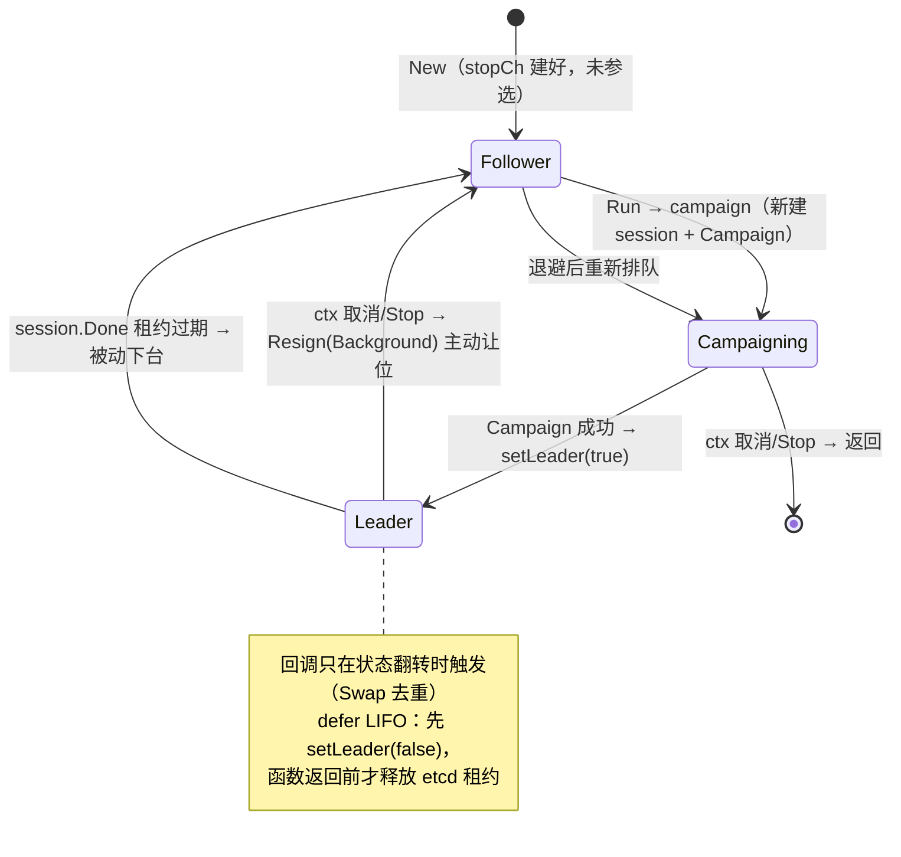

# 02-Leader选主

> 一句话定位：中心服集群通过 etcd `concurrency.Election`（租约 + 前缀比较）选出一个 leader，仅由它执行赛季归档、活动调度、全服里程碑三项「有主任务」，leader 失联时租约过期自动切换、主动退出时 Resign 秒级让位。

## 1. 概述

### 1.1 为什么需要选主

中心服的职责分两类（`internal/center/leader/leader.go:3-5`）：

- **无主（每个实例独立跑）**：Report 接入、消息中转、排行榜写入——这些操作天然幂等或按实例分片，多实例同时执行没有正确性问题；
- **有主（仅 leader 跑）**：全服活动调度、赛季结算归档、全服进度里程碑判定——这些任务的输出是全局单例：赛季表只能切一次、活动实例只能建一份、里程碑发奖只能发一轮。**两个实例同时自认主，归档/赛季结算会双写**（`test/integration/leader_test.go:5-6`）。

选主的目的就是给这三类全局单例任务一个互斥执行者。选主失败模式（脑裂/双主）的代价是写坏数据，所以这部分的测试用真 etcd 跑完整链路而不是打桩。

### 1.2 哪些功能只在 leader 上跑

| 任务 | 周期 | 双主后果 | 挂载点 |
| --- | --- | --- | --- |
| archive 赛季归档 | 30s tick | 赛季表切两次、榜单重复入历史 | `internal/center/server.go:247` |
| scheduler 活动调度 | 30s tick | 活动实例重复创建/重复下发 | `internal/center/server.go:250` |
| milestone 里程碑发奖 | 30s tick + 消费 | 全服奖励重复发放 | `internal/center/server.go:263` |

三者的共同形态是 `Run(ctx, s.IsLeader)`：以方法值传入 leader 探针，tick 循环每 30s 查一次，`IsLeader()` 为 false 就跳过本体。这种「轮询开关」而非「事件驱动」的设计，让选主包的依赖方向保持单向：leader 包只依赖 etcd client，不反向依赖 center 的任何子系统，center 通过 `onChange` 回调把状态接到各任务的开关上（`internal/center/leader/leader.go:10-13`）。

## 2. 涉及文件

| 文件 | 职责 |
| --- | --- |
| `internal/center/leader/leader.go` | 选主管理器：Election 结构、Run/campaign/Resign/Stop/IsLeader/LeaderID |
| `internal/center/leader/leader_test.go` | 单元测试（7 个，不碰 etcd 的部分） |
| `test/integration/leader_test.go` | 真实 failover 集成测试（testcontainers 起 etcd） |
| `internal/center/server.go:743` | `startElection`：装配点，etcd 未配置时跳过 |
| `internal/center/server.go:788` | `IsLeader`：`election != nil && election.IsLeader()` |

## 3. 核心设计

### 3.1 选主机制：etcd concurrency.Election

etcd 的 `concurrency.Election` 基于**租约 + 前缀比较**实现：竞选者各自在选主 key 下创建带 TTL 的条目，key 值最小（创建 revision 最小）的竞选者当选。leader 只要持续续约租约就保持地位；租约过期（进程卡死/网络分区未续约）时条目消失，其余竞选者中 key 最小的自动成为新 leader。

本项目的关键参数：

- 选主 key：`/game_study/leader/center`（`internal/center/leader/leader.go:31`，`DefaultKey`）
- 租约 TTL：默认 10s（`internal/center/leader/leader.go:84`），dev 配置显式 10s
- `SelfID`：传入 `cfg.Server.Name`（如 `center-01`），应稳定唯一——etcd 侧才能把重启前后的竞选者视为同一个参与者（`internal/center/leader/leader.go:63-64`）

### 3.2 生命周期状态机



### 3.3 Run 主循环：退避重试

```go
// 竞选中断（session 过期/etcd 故障）时按指数退避重试，上限 30s：etcd
// 抖动期间不疯狂重连，恢复后又能及时抢回。ctx 取消或 Stop 时返回。
//
// 循环结构：开头非阻塞 select 查退出信号 → campaign 阻塞到任期结束 →
// 退避等待 → 回到开头。campaign 返回 nil 只可能是主动退出，错误则走退避。
func (e *Election) Run(ctx context.Context) error {   // internal/center/leader/leader.go:106
	backoff := time.Second
	for {
		select {
		case <-ctx.Done():
			return ctx.Err()
		case <-e.stopCh:
			return nil
		default:
		}

		err := e.campaign(ctx)
		// ctx.Err() == nil 才记日志：主动取消时 campaign 返回错误是预期内的，
		// 记了只会误导排查（把正常退出当故障）
		if err != nil && ctx.Err() == nil {
			e.logger.Warn("leader campaign broke, retrying", ...)
		}
		...
		if backoff < 30*time.Second {
			// 指数退避封顶 30s：etcd 长时间故障时避免间隔无意义拉长，
			// 恢复后最多等 30s 即可抢回主
			backoff *= 2
		}
	}
}
```

三个设计点：

1. **开头非阻塞 select 查退出**：保证 campaign 返回后、退避等待前能立刻响应退出信号，不会多等一个退避周期；
2. **主动取消不打错误日志**（`leader.go:120`）：ctx 取消时 campaign 返回错误是预期路径，记日志会把正常退出误导成故障；
3. **退避封顶 30s**：etcd 长时间故障时间隔不无限拉长，恢复后最多等 30s 抢回主。

### 3.4 campaign：一次完整任期

```go
func (e *Election) campaign(ctx context.Context) error {   // internal/center/leader/leader.go:150
	session, err := concurrency.NewSession(e.client, concurrency.WithTTL(int(e.ttl)), concurrency.WithContext(ctx))
	...
	defer func() { _ = session.Close() }()

	e.mu.Lock()
	e.session = session
	e.election = concurrency.NewElection(session, e.key)
	election := e.election
	e.mu.Unlock()

	if err := election.Campaign(ctx, e.selfID); err != nil {
		return fmt.Errorf("campaign: %w", err)
	}

	e.setLeader(true)
	// defer 保证任何退出路径（含 panic 后的正常返回）都发出失主回调；
	// 先 true 后注册 false，LIFO 下 false 先执行，配对完整
	defer e.setLeader(false)

	// 阻塞至租约失效 / ctx 取消
	select {
	case <-ctx.Done():
		// 主动退出用 Background 做 Resign：ctx 已取消，让位请求必须还能
		// 发出去并等 etcd 响应，否则其他实例要等满一个 TTL 才能抢主
		_ = election.Resign(context.Background())
		return ctx.Err()
	case <-e.stopCh:
		_ = election.Resign(context.Background())
		return nil
	case <-session.Done():
		e.logger.Warn("leader session expired, stepping down", "self", e.selfID)
		return fmt.Errorf("session done")
	}
}
```

这里有三个容易看错的细节：

1. **每轮新建 session**：租约随 ctx 生命周期，重新排队时拿新租约，旧租约的过期状态不会污染新一轮；
2. **defer LIFO 顺序**（`leader.go:147-149`）：`session.Close` 先注册但后执行——实际退出路径是先跑 `setLeader(false)`（上层先看到失主），函数返回前才释放 etcd 租约，避免「回调还没发出就丢租约」的窗口；
3. **主动退出用 `context.Background()` 做 Resign**（`leader.go:175-176`）：ctx 已取消，让位请求必须还能发出去并等 etcd 响应，否则其他实例要等满一个 TTL 才能抢主——这是滚动重启时主任务空窗长短的关键。

### 3.5 setLeader：只在翻转时回调

```go
// Swap 返回旧值：与目标相同说明是重复设置（重试路径常见），直接返回不
// 触发回调——上层（归档/调度）以回调为唯一切换信号，重复回调会导致
// 任务循环空转重启。
func (e *Election) setLeader(v bool) {   // internal/center/leader/leader.go:255
	if e.isLeader.Swap(v) == v {
		return
	}
	if e.logger != nil { ... }
	if e.onChange != nil {
		e.onChange(v)
	}
}
```

etcd 抖动时状态可能高频翻转，回调去重是刚需而非优化。`logger`/`onChange` 都可为 nil（测试构造半成品 Election 的场景，见 `leader_test.go:21` 的 `New(nil, Config{}, nil)`）。

### 3.6 无锁读与阻塞调用分离

```go
// atomic.Bool.Load 无锁：归档/调度/里程碑的 tick 循环高频轮询，
// 加锁会把选主状态变成热点。读到的是「最近一次确认」的近似值，
// 短暂滞后（租约已过期但回调未到）由各任务的幂等设计兜底。
func (e *Election) IsLeader() bool { return e.isLeader.Load() }   // leader.go:192
```

高频读（每 30s 的 tick 轮询）走 `atomic.Bool`；阻塞操作与状态写分离：

- `LeaderID`（诊断用）是阻塞 RPC，实现上**先拷贝指针再调用**（`leader.go:202-204`）——etcd 的 `Leader()` 会阻塞，持锁等待会把 Resign/Stop 全部堵住；
- `Resign` 先 Resign 再关 session（`leader.go:231-236`）：顺序反了会让租约直接过期，其他实例要等一个 TTL 才能抢主；
- `Stop` 用 `sync.Once` 包住 close（`leader.go:243`）：Run 与外部可能并发调用，重复 close channel 会直接 panic。

## 4. 关键代码解析：三种任期结局

| 结局 | 触发 | 行为 | 对集群的影响 |
| --- | --- | --- | --- |
| 主动退出（ctx 取消） | 进程收到关闭信号 | Resign(Background) → 返回 ctx.Err() | 其他实例秒级接管，无空窗 |
| 主动退出（Stop） | 调用方显式 Stop | Resign(Background) → 返回 nil | 同上 |
| 被动下台（session.Done） | 进程卡死/网络分区，租约未续约 | 记 Warn 日志 → 返回 error → Run 退避重试 | 其他实例等租约过期（≤TTL）后接管 |

`Resign` 对外暴露的语义（`leader.go:218-239`）：恒返回 nil——让位是尽力而为，关闭流程不应被它卡住。`TestSingleInstance` 专门验证 Stop 后 `Run` 返回 nil 而非报错（`test/integration/leader_test.go:177`）。

## 5. 演进记录

| 提交 | 内容 |
| --- | --- |
| `143c3b8` | P14：引入 etcd 选主（与排行榜/统计同批落地） |
| `873b1d8` | test(leader)：中心服选主补测试——单元测试 + 真 etcd failover 集成测试 |

选主能力本身很早就位（P14），但测试欠账了近一年：`873b1d8` 之前选主只有 happy path 的手工验证。该补测提交的说明里记录了变异验证过程——故意破坏 `setLeader` 的去重、`Resign` 的 Background ctx、`Stop` 的 Once，确认每个用例都能挂，才认为测试有效。这正是「错了会写坏数据」模块应有的测试标准。

## 6. 测试情况

### 6.1 单元测试（`internal/center/leader/leader_test.go`，7 个）

真实竞选依赖 etcd，单测只覆盖不碰 etcd 的部分，但每条都对应过真实故障：

| 用例 | 守护的行为 |
| --- | --- |
| `TestNewDefaults` | 空 Key/TTL 落默认值；未参选时不是主 |
| `TestLeaderIDBeforeRun` | 竞选未开始返回错误（调用方按「未知」而非「无主」处理） |
| `TestSetLeaderOnlyNotifiesOnChange` | 重复 setLeader 不回调——上层以回调为唯一切换信号 |
| `TestSetLeaderWithoutLoggerOrCallback` | 半成品实例不 panic |
| `TestStopIsIdempotent` | 重复 Stop 不 panic（Run 与优雅关闭并发） |
| `TestResignBeforeCampaign` | 启动即关闭的实例（election 为 nil）安全让位 |
| `TestResignClearsLeaderState` | 让位后状态立刻翻转，不能还自称主 |

### 6.2 集成测试（`test/integration/leader_test.go`，3 个，testcontainers 真 etcd）

`startEtcd` 用 testcontainers 起 `quay.io/coreos/etcd:v3.5.10`（`leader_test.go:37`），TTL 取 2s 让 failover 秒级完成，每个用例用独立 key 互不干扰：

| 用例 | 验证点 |
| --- | --- |
| `TestLeaderFailover` | 先到者成主、B 在 A 在位期间不得自认主（`require.Never`）、A 退出后 B 接管、双方回调序列精确为 `{true,false}`/`{true}`——**翻转各只回调一次** |
| `TestResignHandsOverImmediately` | TTL 故意拉长到 10s，验证 Resign 后接管耗时远小于 TTL——即走的是主动让位而非租约过期 |
| `TestSingleInstance` | 单实例成主、Stop 后 Run 返回 nil、已 Stop 再 Run 立即返回 |

### 6.3 运行方式

```bash
# 单元测试（无需 etcd）
go test ./internal/center/leader/...

# 集成测试（需要 Docker，拉取 etcd 镜像）
go test -tags integration ./test/integration/ -run TestLeader -v
```

## 7. 小结

中心服选主的设计可以浓缩为四点：

1. **etcd `concurrency.Election` 租约选主**：TTL 默认 10s，崩溃后最长一个 TTL 切换，主动退出 Resign 秒级让位；
2. **状态与回调严格去重**：`atomic.Bool.Swap` 保证翻转才回调，上层任务以回调为唯一切换信号，防抖动导致任务循环空转重启；
3. **读写路径分离**：高频轮询无锁 atomic 读，阻塞 RPC（LeaderID）拷贝指针后再调，互不堵死；
4. **测试分层**：单测覆盖状态机语义（去重/幂等/空安全），集成测试用真 etcd 验证 failover 与 Resign 时效——因为双主的代价是写坏数据，值得容器级验证。

与选主配套的常驻能力（匹配/排行/统计/里程碑）详见 [03-匹配排行与里程碑](./03-匹配排行与里程碑.md)；中心服整体装配见 [01-中心服总览](./01-中心服总览.md)。
