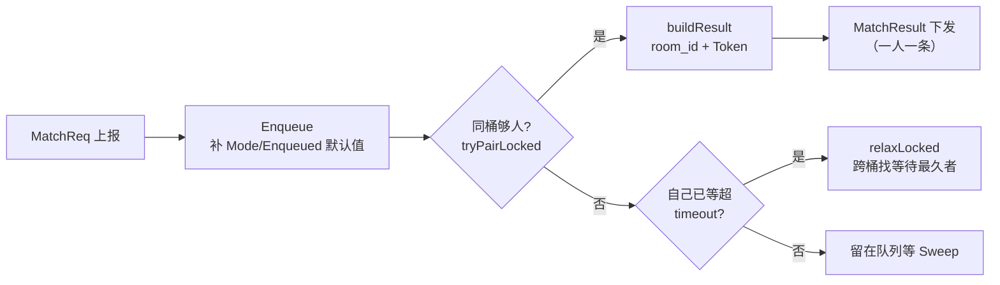

# 03-匹配排行与里程碑

> 一句话定位：本篇覆盖中心服的「玩法数据面」——跨服匹配（match）、Redis 排行榜（rank）、分组统计（stats）、活动调度与全服里程碑（scheduler/milestone）、赛季归档（archive），外加作为它们基础设施的节点注册表（registry）与消息中转（relay）；并记录虚拟时钟如何把这一层的测试从秒级压缩到毫秒级。

## 1. 概述

这一层有两条清晰的分界线：

**分界线一：无主 vs 有主。** match/relay/registry 每个实例独立跑；rank/stats 的写入路径也是无主的（Redis 原子操作，多实例并行写无冲突）；而 scheduler/milestone/archive 是 leader 专属——它们产出全局单例（活动实例、发奖任务、赛季状态），双主即双写（详见 [02-Leader选主](./02-Leader选主.md)）。

**分界线二：纯内存 vs 落中间件。** match/registry 纯内存，中心服重启即重建，客户端重连补发即可；rank/stats 依赖 Redis；archive/milestone 依赖 MySQL + Kafka。落库的一切都有断点状态机，换主重启后从库里恢复续跑。

## 2. 涉及文件

| 文件 | 职责 | 外部依赖 |
| --- | --- | --- |
| `internal/center/match/matcher.go` | 跨服匹配池：elo 分桶、超时放宽、room_id 拼装 | 无 |
| `internal/center/rank/rank.go` | Redis ZSet 排行榜：增量写、去重、TopN/Around | Redis |
| `internal/center/stats/stats.go` | 环形桶时间窗口、多实例快照合并 | Redis |
| `internal/center/scheduler/activity.go` | 活动实例调度：周期算法、落库、Kafka 下发 | MySQL + Kafka |
| `internal/center/milestone/service.go` | 全服里程碑：Lua 累加、建任务、leader 发奖 | Redis + MySQL + Kafka |
| `internal/center/archive/service.go` | 赛季归档：到期切赛季、榜单入历史、统计落库 | MySQL + Redis + Kafka |
| `internal/center/registry/registry.go` | 节点注册表：Register/Heartbeat/Tick 巡检 | 无 |
| `internal/center/relay/relay.go` | 同实例中转路由：pending + 指数退避 | 无 |
| `internal/center/relay/bridge.go` | 跨实例中转桥：Kafka 转发 | Kafka |

## 3. 核心设计

### 3.1 跨服匹配：elo 分桶与超时放宽



三个设计决策：

1. **elo 分桶 200 分一档**（`internal/center/match/matcher.go:40`）：宽度是「精度 × 池子浓度」的折中——桶内分差小到体验可接受、人数又多到能凑齐一局。负 elo 归 0 桶（`matcher.go:403-408`）：扣分掉到 0 以下的玩家不该独占一个永远凑不齐的桶。
2. **放宽是单向授权**（`matcher.go:169-174`）：只有自己已等超 timeout 的 ticket 才能把别人拉出同桶——否则新人每次都「降维」匹配老队列，公平性失衡。候选评分取「等待最久」而非「elo 最近」（`matcher.go:290-291`）：等待越久越急需解救，elo 差一点对体验的影响小于继续排队。
3. **room_id 三段式拼装**（`matcher.go:348-353`）：

```go
// room_id = 实例号(8b) << 40 | 秒级时间戳(32b) << 8 | 序号(8b)
// 三段各自掩码互不污染：实例号占高位防跨实例撞号；秒级时间戳防同实例
// 重启后复用旧号（客户端可能缓存旧 room_id 来上报）；低 8 位自增防同秒多局
```

准入令牌按 `(room_id, player_id)` HMAC 签名、截断 16 字节 hex（`matcher.go:394-397`）：令牌只需不可伪造，不需要全强度摘要；输入格式与跨服侧约定一致，改格式等于两侧同时失效。

配对失败（无跨服节点）时两人**放回队首**而非丢弃（`matcher.go:280-283`）：跨服地址可能只是暂时没同步到，丢了要客户端重新排队。

### 3.2 排行榜：增量上报与业务键去重

存储用 Redis ZSet，member = `{playerId}:{serverId}`，key 带 season 天然隔离赛季（`internal/center/rank/rank.go:3-11`）。写入语义有三个要点：

- **ZINCRBY 增量**（`rank.go:83-85`）：与「竞技场胜负加减分」语义一致，上报即 delta；要上报绝对值需新增 absolute 标志位，P14 暂不引入。
- **SETNX 业务键去重**（`rank.go:119-130`）：带 biz_id 的上报同一次结算重投不会重复加分，TTL 30 天按赛季周期设定。**Redis 失败时宁可不加分**——重复加分无法自动修正，少加一次可以运营补偿（`rank.go:93-94` 的「宁少勿多」原则）。
- **无锁 currentSeason 是有意识的选择**（`rank.go:50-53`）：写只发生在 leader 归档完成这一低频点，最坏后果是一两条上报落到新赛季，可接受；注释里写明了硬化路径（换 `atomic.Pointer[string]`）。

### 3.3 统计：环形桶与多实例合并

内存里按 `(group, feature)` 开四个窗口（1m/5m/1h/1d）的环形桶，一次上报同时喂四个窗口（`internal/center/stats/stats.go:205-207`）——用写入时的固定成本换查询时的零计算。

环形桶的经典陷阱是**数组复用导致旧值残留**，解法是每槽带时间戳（`stats.go:72-77`）：

```go
// slotTS 是「槽位卫生」的关键：数组复用导致旧槽里可能躺着上个周期的
// 数据，靠「槽位记录的时间片 ≠ 当前时间片」判定过期并清零——
// 没有它，本周期的查询会把上周期的残值加进来。
```

多实例合并（R8.4）是本包踩过坑的地方：早期快照用窗口名做 field，多实例互相抹掉对方的数据，**落库值偏小且无法察觉**（`stats.go:13-15`）。修复后 field = 实例 ID，`MergedMetrics` 逐个 field 求和（`stats.go:314-318, 374-401`），`InstanceCount` 用 HLen 暴露「到底合了几个实例」的诊断证据。

### 3.4 活动调度与里程碑：同源周期算法

scheduler 与 milestone 的关键约定是**周期算法同源**（`internal/center/scheduler/activity.go:4-6`）：即使游戏服一条调度消息都没收到，它用 `pkg/activity.Window` 同一套算法也能算出正确的活动窗口——Kafka 只是「提前知情」的优化，不是正确性依赖。这带来两个推论：

- scheduler「先落后发」（`activity.go:91-92`）：消息可能丢，库里的状态不会——重启后的新 leader 看到本期已有记录便不再补发；
- milestone 的 `currentInstance` 与 scheduler 同算法（`milestone/service.go:289-302`），两侧不需要任何通信就对「当前是第几期」达成一致。

里程碑的累加用 Lua 保证幂等（`milestone/service.go:41-58`）：

```lua
local old = tonumber(redis.call('HGET', key, pid) or '0')
if val <= old then return 0 end
redis.call('HSET', key, pid, val)
redis.call('INCRBY', totalKey, val - old)
return val - old
```

上报绝对值而非增量：重投相同值得到差值 0，天然幂等（`service.go:7-8`）。三条命令合并为一次原子执行，「读旧值 → 判断 → 写新值」不存在竞态。

发奖路径的排序是「**先发后标记**」（`milestone/service.go:216-217`）：标记意味着承诺已送达，反过来先标记后发送，进程在两者之间崩溃就会丢奖励。任务表用 `INSERT IGNORE` 而非 UPSERT（`service.go:195-197`）：任务行一旦存在就保留原 status——已完成（done）的任务不能被一次重跑打回待发，那会重复发奖。

### 3.5 赛季归档：断点状态机

归档是 rank/stats 的下游消费者（`internal/center/archive/service.go:9-11`），核心不变量是「**先全部归档完再切赛季**」（`service.go:209-216`）：

```go
for _, rankType := range s.cfg.RankTypes {
    if err := s.archiveOne(ctx, season, rankType); err != nil {
        // 任一榜单归档失败就停在这里：不切赛季，下一轮继续重试。
        // 切了赛季会让失败的榜单永远失去归档机会——旧榜 key 已无引用，
        // 未归档数据随赛季切换永久丢失。
        return fmt.Errorf("archive %s/%s: %w", season, rankType, err)
    }
}
```

单个榜单的归档用 `rank_archive_task` 表做断点（`service.go:36-38`）：pending → running → done 三态，running 态重启后重跑（rank_history 按唯一键 UPSERT 不产生重复行），done 态直接跳过——**一个赛季只会完整结算一次**。发奖在入库之后（`service.go:275-276`）：失败下轮补发，mail_id 由 FNV-1a 从业务键派生，重发不重复到账。

统计落库读的是 Redis 多实例合并值而非本地 Query（`service.go:347-353`）：多中心服部署下各实例只写自己那份快照，只有求和才是全服真实值。窗口起点对齐到边界（`windowRange`，`service.go:379-384`），UPSERT 覆盖同一窗口——补跑/重跑必须是覆盖语义，否则 GM 查询把多行累加成错误值。

### 3.6 注册表与中转：不变量与尽力而为

registry 的不变量是 **nodes 与 senders 的 key 集合始终一致**（`internal/center/registry/registry.go:52-57`）：Register 成对写入、Unregister/Tick 成对删除，不会出现「有节点无下发通道」的中间态。「注册了但从不说话」视为失联（`registry.go:46-49`）：只有 Register 没有心跳的节点也会因超时被摘除。

relay 的可靠性约定是**尽力而为**（`internal/center/relay/relay.go:7-8`）：未送达按指数退避重试至多 5 次（≈6s 总窗口），仍失败丢弃并计数；中心服不持久化中转消息，丢消息由业务层幂等/重查兜底。广播不重试（`relay.go:143-148`）：任一节点离线就重试会把消息重复推给已收到的人（Pusher 无去重），比丢一条更糟。计数权归一：retries 只在 NextRetry 里 ++（`relay.go:152-155`），避免两条路径同时递增导致退避曲线跳档。

## 4. 演进记录

| 提交 | 内容 |
| --- | --- |
| `c1d7c01` | P8：节点注册表 / Report 流 / 跨服匹配 / 消息中转 |
| `143c3b8` | P14：Redis 排行榜 / 分组统计 / etcd 选主 |
| `5e51678` | P9-P11：跨实例中转桥（Kafka）/ ID 表与回源 / 分时落库 |
| `0fa7a7b` | R7.1/R7.2：活动实例调度与幂等消费 |
| `4f1c525` | R7.3/R7.4：全服贡献与里程碑发奖 |
| `57a7803` | R8.1/R8.2：客户端榜单查询与上报去重 |
| `710cb85` | R8.3/R8.4：赛季归档与统计落库 |
| `d4bc105` | R8.4 收口：统计快照按实例存储并合并读取（修多实例互相覆盖） |
| `6c21f5e` | test(stats)：断言改按实例字段 |
| `3f07d63` | test(center)：用虚拟时钟替代真实 sleep |

## 5. 测试情况：虚拟时钟的应用

提交 `3f07d63`（test(center): 用虚拟时钟替代真实 sleep）是这一层测试基建的分水岭。三个包为此把时钟做成可注入字段（`now func() time.Time`），测试直接拨钟而不 sleep：

| 包 | 注入点 | 代表用例 |
| --- | --- | --- |
| `match` | `m.now`（`matcher.go:97`） | `TestSweepRelaxesEloAfterTimeout`：把时钟推到超时后， Sweep 立即放宽配对 |
| `registry` | `r.now`（`registry.go:70`） | `TestTickRemovesTimeoutNodes`：拨钟越过 timeout，Tick 立即摘节点 |
| `relay` | `NextRetry(now)` 参数 | `TestRelayRetriesOnFailure`：给「已过期」的时刻取重试队列，再逐轮拨钟跨过指数退避窗口直到丢弃 |

`relay_test.go:65-67` 的注释解释了动机：真实时钟下「睡多久都可能因调度抖动不够」，而到期判定本身只依赖传入的 now。收益是整个 center 测试套件从秒级降到 1 秒内，且 30 次 `-race` 全绿。

其余单测覆盖：matcher 8 个（同桶配/跨桶不配/去重/放宽/取消/无跨服节点/room_id 唯一）、relay 4 个 + bridge 5 个（含自发自收跳过）、rank 12 个、stats 8 个（含 `TestSnapshotMergedAcrossInstances`）、archive 4 个纯函数（nextSeason/seasonNumber/stableID/windowRange）。milestone/scheduler 无独立单测文件（依赖 MySQL 的路径由 `test/integration/r7_activity_test.go` 覆盖）。

## 6. 小结

这一层可以归纳为三类模式：

1. **纯内存即重建**（match/registry）：中心服不持久化玩家业务数据，重启后客户端重连补发重建——简单且够用，因为中心服不是数据权威；
2. **Redis 原子操作保无主正确性**（rank/stats 写路径）：ZINCRBY/Lua/SETNX 单命令原子，多实例并行写无冲突，多实例读合并（R8.4）；
3. **MySQL 断点保有主可恢复**（archive/milestone/scheduler）：状态机 + UPSERT 幂等 + 稳定 mail_id，换主重启后续跑，一个赛季只结算一次。

配套的选主机制见 [02-Leader选主](./02-Leader选主.md)，整体装配见 [01-中心服总览](./01-中心服总览.md)。
