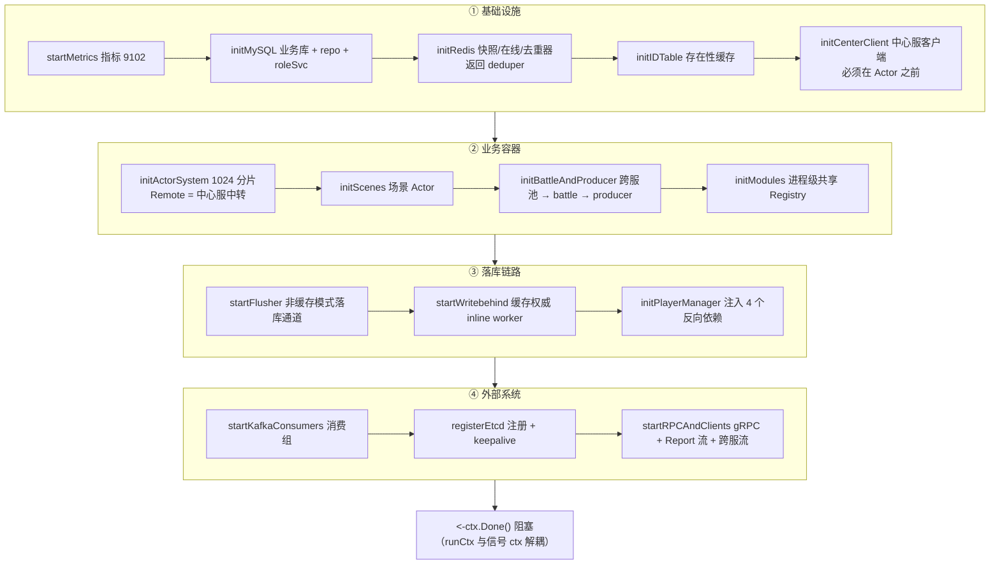

# 01-游戏服总览与启动

> 一句话定位：游戏服（GameServer）是承载玩家业务的进程——以 Actor 系统跑有状态实体、以模块注册表分发业务协议、以写穿透链路把玩家状态落库，本篇文章完整拆解它的装配结构与「四段十二步」启动时序。

## 1. 概述

游戏服在七微服务中依赖面最广：MySQL/Redis/Kafka/etcd/中心服/跨服六类外部系统全都接入，因此它的启动顺序是整个项目里最需要设计的部分。两个核心原则贯穿始终：

1. **New 无 I/O，Start 才连中间件**（`internal/game/server.go:116-124`）：`New` 只建三张会话 map，所有连接与监听都收进 `Start`，失败可重试；`main` 只认识 `*config.Config`，组件间的相互引用全部收敛在 `internal/game` 内部。
2. **装配顺序即依赖顺序**（`cmd/game/main.go:66-67`）：先 Redis/MySQL/Kafka 句柄，再 Actor 系统，最后才是对外监听——保证第一个客户端连上时内部已就绪。

启动被拆成「一步一个方法」（`internal/game/server_start.go:1-9`）：`Start` 原本是 320 行平铺，读者要一路滚到底才知道服务是怎么长出来的；拆开后 `Start` 本身成为启动顺序的目录。文件头注明三处**不能调换**的依赖：

```go
// 三处**不能调换**的依赖：
//   - 中心服客户端在 Actor 系统之前：actor.Config.Remote 引用它（P0 跨节点）
//   - 场景管理器在模块注册之前：scene 模块要拿它转发协议
//   - 跨服池在 battle 模块之前：battle 依赖它透传战斗
```

## 2. 涉及文件

| 文件 | 职责 |
| --- | --- |
| `cmd/game/main.go` | 进程入口：配置、信号上下文、两阶段优雅退出 |
| `internal/game/server.go` | Server 结构体、Start 目录、readiness、Shutdown 编排 |
| `internal/game/server_start.go` | 启动装配：每个 init/start 方法一个职责 |
| `internal/game/server_session.go` | 会话表与玩家绑定（详见 [03-会话管理与顶号踢人](./03-会话管理与顶号踢人.md)） |
| `internal/game/server_adapters.go` | 层间适配器：chatMessenger/centerHandler/rankQuerier 等 |
| `internal/game/offline.go` | 离线暂存补投（登录后 drain） |
| `internal/game/player/` | 玩家 Actor 与管理器（详见 [02-玩家Actor与消息处理](./02-玩家Actor与消息处理.md)） |
| `internal/game/module/` | 模块系统（详见 [04-模块系统module](./04-模块系统module.md)） |
| `internal/game/center/client.go` | 中心服 Report 流客户端（`report/` 目录的 README 指向此处） |
| `internal/game/mq/` | Kafka 消费组：充值/邮件/跨服私聊/活动/登录日志 |
| `internal/game/remote/` | Actor 远程消息的类型 URL 注册 |
| `internal/game/flusher/` | 占位目录：README 指向 `cmd/flusher/main.go` + `pkg/flush` + `pkg/writebehind` |
| `configs/game/game-dev.yaml` | 开发配置（同目录另有 docker/prod/test） |

## 3. 核心设计：四段十二步启动时序



### 3.1 为什么 runCtx 与信号 ctx 解耦

```go
// runCtx 是组件生命周期，与外部信号 ctx 解耦。
//
// 收到 SIGTERM 时外部 ctx 立刻取消；如果组件直接挂在它上面，Actor 会同时停掉，
// Shutdown 再想「排空在途 → 确认保存」就没有对象可等了。所以内部统一用
// runCtx，由 Shutdown 在正确时机 cancel。
```

（`internal/game/server.go:106-112`）

这是理解启动/关闭的钥匙：外部 ctx 只负责**通知**「该退了」，不停任何组件；组件全挂在 `runCtx` 上，由 `Shutdown` 按 DRAIN→DRAINING→FLUSH→STOP 的节奏逐层 cancel。`Start` 里还有一道保险（`server.go:130-136`）：只有「启动失败提前返回」才在 defer 里收掉 `runCtx`，正常走到末尾时由 `Shutdown` 负责取消。

### 3.② 关键装配点的设计取舍

**initRedis 的降级链**（`server_start.go:99-127`）：未配 Redis 时 deduper 退化为 `NoopDeduper`——消费侧变成「至少一次」投递，由业务幂等兜底；`cacheStore`/`presence` 保持 nil，缓存权威模式整体关闭。

**initActorSystem 的远程降级**（`server_start.go:158-182`）：`actor.Config.Remote` 引用中心服客户端，远程 PID 经中心服中转投递；未配中心服时不设 Remote——远程 PID 按本地找、找不到报错，与单机部署行为一致（**宁可显式失败，不静默丢消息**）。

**initModules 的共享约束**（`server_start.go:222-226`）：

```go
// Module 对象进程级共享，一套 Registry 服务所有玩家：玩家数据只允许放
// Context.State 或按 player_id 索引的容器，严禁在共享 Module 上加
// currentPlayer 一类「以为只有一个玩家」的字段。
```

依赖 MySQL 的模块（mail/chat/guild/team 直写库，quest/equip 等经 Persister）在无库环境整体跳过，玩家仍可用 profile/attr/bag/item/battle。

**落库链路二选一**（`server_start.go:328-338`）：缓存权威模式下 `onDirty` 置为 nil——缓存玩家的持久化改由 Redis 脏队列 + writebehind worker 承担。注释写明了踩坑后果：「缓存模式若仍走 flusher，玩家会被标进一个没有消费者的队列，永远不落库」。

## 4. 关键代码解析

### 4.1 Shutdown：DRAIN→DRAINING→FLUSH→STOP

```go
// 顺序是这套流程的全部意义：
//  1. 摘注册：网关不再把新会话路由过来；
//  2. 停 gRPC、停消费者：外部与内部的新业务入口都先关掉；
//  3. 排空 Actor：等已经在信箱里的消息处理完，把状态写进 Redis；
//  4. FlushAll：把 Redis 脏任务确认落库，失败必须上报；
//  5. 停 Actor 与其余组件。
//
// 反过来（先 FlushAll 再停入口）会留一个窗口：FlushAll 扫完后仍有请求进来标脏，
// 进程退出时这批数据谁都没落库 —— R1.3 修的就是这个。
```

（`internal/game/server.go:207-217`）

用 `shutdown.Manager` 编排（`server.go:219-345`），四阶段共 13 个注册项：

| 阶段 | 注册项 | 要点 |
| --- | --- | --- |
| DRAIN | unregister | 摘 etcd 注册 + kickAllSessions + 等 3s 让网关重建连接池 |
| DRAINING | stop-rpc / stop-consumers / drain-actors | 先关入口再等在途；`actorSys.Drain` 等信箱排空 |
| FLUSH | flush-all | **先 wbWorker.FlushAll 再 flusher.FlushAll**——缓存权威模式下脏任务在 Redis 队列，只调 flusher 是空转（缓存玩家的 onDirty 已置空） |
| STOP | stop-cross / stop-center / stop-actors / close-producer / close-etcd / close-database / close-redis / stop-metrics | stop-actors 先 cancel runCtx（定时器与后台 worker 退出）再停分片 |

DRAIN 阶段的 3s 等待有一段诚实的实测注释（`server.go:232-238`）：它**不能**消除滚动发布期间的请求失败——实测 7100 请求 45 失败（0.63%），加 3s 等待后仍是 45，失败来自「已绑定会话被断开」而非路由滞后。这类「实测数据写进注释」的风格在本仓库随处可见。

`main` 侧的两阶段退出与中心服同构（`cmd/game/main.go:76-91`）：游戏服是五进程里关闭链路最长的（在途会话排空 + Actor Flush 进 Redis + Kafka 缓冲刷出），兜底 60s 并允许配置覆盖，`Shutdown` 用独立 Background ctx 驱动。

### 4.2 readiness 与外部依赖表

```go
func (s *Server) readiness(ctx context.Context) error {   // internal/game/server.go:191
	// nil 检查的含义是「未配置则不检查」：演示/单测环境可以只起部分依赖，
	// 探针只对实际启用的组件负责，不会因为没配 MySQL 就永远 not ready。
```

就绪探针只查实际启用的组件（MySQL Ping / Redis Ping）。dev 配置（`configs/game/game-dev.yaml`）的关键外部依赖：

| 依赖 | 用途 | 降级行为 |
| --- | --- | --- |
| MySQL | 玩家数据/模块持久化 | 无库时依赖库的模块整体跳过 |
| Redis | 快照/在线归属/去重/离线暂存/ID 表 | 无 Redis 时 NoopDeduper + 纯本地在线判断 |
| Kafka | 充值/邮件/跨服私聊/活动/登录日志 | 无 Kafka 时消费者与 producer 关闭 |
| etcd | 服务注册（网关 resolver 发现本节点） | 无 etcd 时网关无法发现，单机可用 |
| 中心服 | Report 流（注册/匹配/中转/排行上报） | 无中心服时 battle 降级本服匹配、远程投递显式失败 |
| 跨服节点 | 战斗透传 | 无跨服时 battle 本服闭环 |

### 4.3 适配器层：接口翻译的集散地

`server_adapters.go` 的定位写在文件头（`internal/game/server_adapters.go:1-9`）：每个类型都在做「把某个包的接口翻译成另一个包期望的形状」——`chatMessenger` 把 Server 的能力翻译成 chat 模块的 Messenger，`centerHandler` 把中心服回调翻译成 Server 的动作，`rankQuerier` 把中心服客户端翻译成 rank 模块的 Querier。放在一起的理由：改动时关心的永远是「两侧接口是否对齐」，而不是「Server 的生命周期怎么走」。

`chatMessenger.Push` 的顺序敏感设计（`server_adapters.go:56-65`）值得注意：优先走 Actor 而非直接会话下行，是为了保证「聊天回包与玩家自己的业务回包」同序——否则客户端可能看到「先收到回复、后收到请求响应」的乱序。

### 4.4 离线补投：尽力而为的搬运工

`offline.go` 只做「搬运」（`internal/game/offline.go:6-7`）：把离线期间暂存在 Redis 的消息翻译成协议推送，不改任何玩家状态，因此**不经过 Actor**（不占玩家处理窗口，也不需要快照 CAS）。`PendDrain` 取出即清空（至少一次语义），推送失败不重试、剩余消息随清空丢弃；2s 短超时保证登录流程不被拖住。

## 5. 演进记录

| 提交 | 内容 |
| --- | --- |
| 早期 Sprint | pkg/actor 运行时 + PlayerActor 基础模块 |
| P5 | 游戏服消费者与业务模块、服务接线与优雅关闭 |
| P8/P9-P11/P14 | 中心服 Report 流接入、ID 表、跨服与匹配接入 |
| R1.3 | 集成验证与边界文档（关停顺序：先停入口再 Flush） |
| `2e28e12` | feat：补登出、跨节点真顶号、账号封禁拦截（会话链路补强） |
| `1051ef9` | feat(limit)：补业务限流（聊天频控等） |
| `497e603` | test(shutdown)：修两个时间竞争导致的 flaky |

游戏服的启动结构本身没有大改，但每一次「补强」都在往这套骨架上加东西——跨节点顶号加了 `claimOnline`/`SetKickHook`/`SetPresence`，限流加了 `ratelimit.NewKeyed`。装配层的方法拆分（`server_start.go`）让这些增量的落点始终清晰。

## 6. 测试情况

- `internal/game/server_test.go`：Server 级基础用例；
- `internal/game/claim_online_test.go`：8 个用例覆盖跨节点顶号（fakePresence 接管/同节点不踢/Redis 抖动/覆盖失败/KickMsg 投递目标断言等，详见 [03-会话管理与顶号踢人](./03-会话管理与顶号踢人.md)）；
- `internal/game/server_kick_test.go`：4 个用例（resolveSessionByPlayer/未知角色 noop/无 RPC 返回 nil/默认 reason）；
- `internal/game/rpc/game_server_test.go`：4 个用例（StreamHandler 协议入口）；
- `internal/game/mq/`：`loginlog_consumer_test.go`、`recharge_consumer_test.go`；
- `internal/game/remote/remote_test.go`：远程消息编解码注册；
- 端到端：`test/integration/r13_shutdown_test.go`（优雅关闭时序）、`p12_preload_test.go`（登录预加载）、机器人冒烟（`test/robot/`）。

启动顺序本身由 `docs/游戏服启动流程解析.md` 以 13 步表格 + 三个时序窗口的形式固化为文档，其中「首个玩家不在 Start 时加载」「模块不是每玩家一份」两条是初学者最容易误解的点。

## 7. 小结

游戏服的骨架可以记为三句话：

1. **依赖最多的进程，顺序即正确性**：中心服客户端在 Actor 前、场景在模块前、跨服池在 battle 前，三处不可调换写进文件头；
2. **runCtx 与信号解耦**：外部 ctx 只通知、内部 ctx 由 Shutdown 按 DRAIN→DRAINING→FLUSH→STOP 逐层收，缓存权威模式下「先 wbWorker 后 flusher」的 Flush 顺序是数据不丢的关键；
3. **一切皆可降级**：六类外部依赖任一缺失都有明确降级路径（NoopDeduper/模块跳过/显式失败），单机与集群跑同一套代码。

往下游走：[02-玩家Actor与消息处理](./02-玩家Actor与消息处理.md) 拆解 mailbox 里的世界，[03-会话管理与顶号踢人](./03-会话管理与顶号踢人.md) 拆解会话表的并发与顶号链路。
