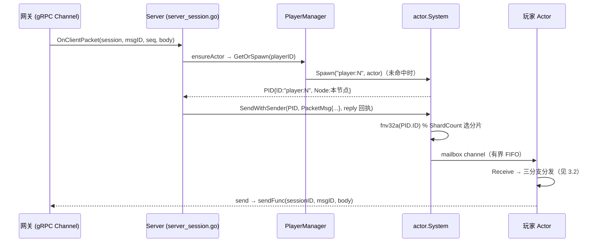

# 02-玩家Actor与消息处理

> 一句话定位：每个玩家是一个 Actor——基于 `pkg/actor` 的分片 goroutine + 有界 mailbox 实现「单玩家串行、玩家间并行」的无锁并发模型；本篇拆解消息如何进信箱、三分支分发、缓存权威流程、KickMsg 跨节点投递与 PlayerManager 的生命周期管理。

## 1. 概述

`internal/game/player` 包只有三个文件，但承载了游戏服最核心的并发契约：

| 文件 | 职责 |
| --- | --- |
| `player/actor.go` | 玩家 Actor：消息定义、分发、bind/unbind、缓存权威流程、场景心跳 |
| `player/manager.go` | PlayerManager：Actor 生命周期（Spawn/Get/Resolve/Remove） |
| `player/remote.go` | 跨节点消息的类型 URL 注册（P0 横切能力） |

并发模型的全部前提写在 `actor.go:184-187`：

```go
// Actor 玩家 Actor。
//
// 约定：全部字段只在 Actor 自己的分片 goroutine 内读写（mailbox 串行化
// 保证），不存在字段级并发；唯一的例外是 State，它的锁只给外部只读探针。
```

也就是说：**业务代码无锁**。背包、属性、任务进度全部在单玩家的串行流里改，不需要 mutex、不需要考虑竞态——这是 Actor 模型换来的最直接收益。

## 2. 涉及文件

| 文件 | 职责 |
| --- | --- |
| `internal/game/player/actor.go` | Actor 本体（785 行）：消息类型 + Receive/receive + bind/unbind/save + 缓存流程 |
| `internal/game/player/manager.go` | Manager：双检锁 GetOrSpawn、Get/Resolve 分工、ForEach |
| `internal/game/player/remote.go` | 三个 remoteTypeURL 常量 + init 注册 |
| `pkg/actor/` | Actor 运行时：分片、mailbox、ScheduleOnce、RemoteSender |
| `internal/game/player/state.go` | 玩家状态（State）——本系列 [04-模块系统module](./04-模块系统module.md) 的消费方 |
| `internal/game/server_session.go` | 会话表：消息的来路与回执（见 [03-会话管理与顶号踢人](./03-会话管理与顶号踢人.md)） |

## 3. 核心设计

### 3.1 消息进信箱的完整路径



三个关键机制：

1. **fnv32a 哈希分片**：同一玩家的所有消息总是落到同一分片、同一 goroutine——串行性的来源；不同玩家落在不同分片——并行性的来源。分片数由配置决定（dev 是 1024）。
2. **有界 mailbox**：channel 容量固定（dev 是 4096），天然背压——玩家消息速率超过处理速率时 `Send` 报错而非无限堆积。
3. **SendWithSender 回执**：需要「等待处理结果」的调用方（如 bindPlayer）带一个 reply 通道，Actor 用 `ctx.Respond` 回写；纯下行不带。KickMsg 这类**单向通知不带 Done**（`actor.go:83-92`）：顶号是尽力而为的通知，不需要对端确认。

### 3.2 Receive 的三分支分发

```go
// 分发逻辑：缓存权威模式下有三条路径——
//   - 纯下行消息（Push/ScenePush/心跳）：不改状态，直接进 receive；
//   - 无状态模块的协议（见 module.StatelessAware）：同样直接进 receive，
//     跳过 clone/CAS（榜单查询、聊天转发这类不碰 State 的请求占相当比例，
//     而 clone 一份含背包/属性/Ext 的 State 并不便宜）；
//   - 其余消息进 receiveCached 的「克隆→业务→CAS」流程。
func (a *Actor) Receive(ctx *actor.Context) {   // player/actor.go:289
```

三条路径的分流条件是性能优化的典型手法：**按消息性质付不同成本**。纯下行零成本；无状态协议（`IsStateless(msgID)`）跳过克隆；有状态协议才走完整的「克隆 → 业务 → diff → CAS」。`canBypassCache`（`actor.go:314-317`）还要求三个前提缺一不可：已加载、无未决提交、无待重载——否则版本栅栏会被绕过。

非缓存模式下所有消息统一走 `receive`（`actor.go:323`），开头是 `needsReload` 闸门：上次 COMMIT 结果未知时，除 Save/Unbind 外的任何消息都先触发行锁重载，**避免把过期背包写回库**。

### 3.3 bind/unbind：生命周期与脏回调

`onBind`（`actor.go:424-452`）的顺序不可乱：首次上线先 `preload`（失败回 `BindResult{Code:1}`——半成品 Actor 上线比拒绝登录更危险）→ `RecalcAttrs` + `ClearBonus`（放在 Actor 层而不是某个模块里：模块注册顺序会变，「谁先登录谁清」会让后注册的模块加成被前一个清掉）→ `registry.LoginAll` → `startSceneLink`。

`setState`（`actor.go:502-507`）有一个必须理解的坑：

```go
// **必须走这里而不是直接 `a.state = state`**：预加载返回的是全新的 State 实例，
// 构造时挂的 dirtyHook 在它身上不存在。直接赋值会让「加载完成后的所有修改都不再
// 通知 flusher」——数据永远不落库，且不会有任何报错（线上表现为玩家进度丢失）。
```

`onUnbind`（`actor.go:564-586`）的第一件事是**会话身份校验**：`msg.SessionID != a.sessionID` 的旧连接延迟 UNBIND 直接忽略——玩家可能已在另一设备顶号，此时解绑会把仍在线的权威会话打成离线。这是跨节点顶号链路在 Actor 侧的收口点（详见 [03-会话管理与顶号踢人](./03-会话管理与顶号踢人.md)）。

### 3.4 缓存权威模式：token、CAS 与 commitGate

缓存模式下 Actor 多出一组字段（`actor.go:219-238`），各自回答一个分布式问题：

| 字段 | 问题 | 机制 |
| --- | --- | --- |
| `token` | 我还有权写吗？ | R2.5 会话所有权令牌，`preload` 时 `AcquireLease` 取得，被新会话接管后失效，提交被拒 |
| `cacheVersion` | 我基于哪版改的？ | CAS 期望值，提交成功前进、失败保持 |
| `cacheReload` | 内存过期了吗？ | 上次提交回滚/结果未知时置位，下一条消息前重新 `LoadCached` |
| `gate` | 下行何时发出？ | 提交通道：提交窗口内的下行先暂存，CAS 成功才按序刷出 |
| `cachePending` | 旧快照怎么办？ | 不可回滚消息的结果未知时保留版本与状态，`finishPending` 核对 Redis 实际版本再放行 |

`preload` 的顺序（`actor.go:515-535`）刻意保证「先取令牌再读快照」——令牌是「我有权写」的凭据，不能出现「读到了状态但没有令牌」的半就绪态。`send`（`actor.go:762-770`）在 gate 窗口内**拷贝 body**：业务层的 body 多来自可复用的解码缓冲，不拷贝的话窗口内后续消息会把内容改写。

### 3.5 场景心跳：自调度而非 goroutine

```go
// Go 知识点：自调度用 ScheduleOnce 消息而不是 time.Ticker goroutine——
// 心跳状态活在 Actor 里，不需要额外 goroutine，也就不存在「Actor 停了
// ticker goroutine 忘记回收」的泄漏路径；间隔到期前的取消由信箱丢弃兜底。
```

（`actor.go:477-479`）

`onSceneHeartbeat` 每次处理完都重新 `ScheduleOnce` 一条 `sceneHeartbeatTick` 给自己。没有心跳的后果写在注释里：挂机不动的玩家会被场景的「90 秒无消息」兜底当成幽灵清掉，但人其实还在线——下一次移动就收到 4005（不在场景中），表现为「原地卡住」。

### 3.6 PlayerManager：双检锁与 Get/Resolve 分工

`GetOrSpawn`（`manager.go:117-154`）是并发热点，三层防御：

1. **RLock 快路径**覆盖绝大多数已在线请求；
2. **跨节点守卫**：本地未命中且 presence 显示玩家在线在别的节点时，返回该节点的**远程 PID** 而不是就地 Spawn——双 Actor 是双写分叉（两份内存各自 CAS 同一份 Redis 快照，后写的覆盖先写的）；
3. **Lock 双检**：两个会话同时为首个上线者时只有一个线程执行 Spawn。Redis 查询放在写锁外：不把 IO 压在临界区上。

`Get` vs `Resolve` 的分工（`manager.go:156-187`）是明确的性能契约：

```go
// 与 Resolve 的分工：Get 是「本节点一定持有」场景的快路径
// （会话绑定、本节点保存）；Resolve 是「玩家可能在线在别的节点」
// 场景的全解析（跨节点推送）。热路径不要为用不到的能力付 Redis RTT。
```

`ForEach`（`manager.go:203-214`）的回调在 RLock 持有期间执行，**回调内不能再调用 Manager 的写方法**——RWMutex 不是可重入锁，会死锁；需要删除时先在回调外收集 ID。

### 3.7 remote.go：横切能力的单独安放

```go
// 为什么单独一个文件：远程化是「横切能力」而不是玩家业务——注册表与
// 类型标识常量聚在一处，将来新增可远程消息（SaveMsg/KickMsg…）只改
// 这里，actor.go 保持纯业务。
```

（`player/remote.go:1-9`）

三个类型 URL 用 `game_study.player.` 前缀防撞车，包 init 时注册（进程启动期）。注释点明了故障设计：`RegisterRemote` 重复注册会 panic、漏注册的故障现象是「远程消息解码报 type not registered」——在启动期/测试期暴露，而不是线上某条消息突然丢。

## 4. 关键代码解析：KickMsg 跨节点投递

顶号时另一节点发来的 `KickMsg` 是**值类型**而非指针（`actor.go:83-92`）：`MarshalRemote` 返回的是值 `m` 而非 `&m`，`Receive` 里的 case 也是 `case KickMsg:`——单向通知不需要回执通道，走完解码注册表后由 `receive` 的 `case KickMsg` 分支触发 `onKick` 回调（`actor.go:371-375`），最终关闭本节点的网关会话。完整链路见 [03-会话管理与顶号踢人](./03-会话管理与顶号踢人.md)。

## 5. 演进记录

| 提交 | 内容 |
| --- | --- |
| Sprint 4 | pkg/actor 运行时 + PlayerActor 与基础模块 |
| `2e28e12` | feat：补登出、跨节点真顶号、账号封禁拦截——KickMsg 远程投递与 SetKickHook 接入 |
| R2.x 系列 | 缓存权威：围栏令牌（token）、提交通道（gate）、值双栅栏 |
| P0 | Actor 远程化：PID 带节点 + 位置表 + RPC 转发 |

Actor 的演进主线是「从单机到分布式」：最初 mailbox 串行只为单进程内正确性；跨节点顶号（`2e28e12`）引入了远程消息与 presence 归属表；缓存权威（R2.x）又把 token/gate/version 三套栅栏加进来——但「单玩家串行」的核心约定始终未变，新机制全部做成 Actor 内部的额外分支而非破坏主干。

## 6. 测试情况

- `internal/game/player/kick_test.go`：4 个用例（KickMsg 触发回调/未知玩家/跨节点场景）；
- `internal/game/player/commit_gate_test.go`：6 个用例（提交通道暂存/刷出/窗口拷贝）；
- `internal/game/player/r31_session_test.go`：会话身份校验（stale UNBIND 被忽略）；
- `internal/game/remote/remote_test.go`：远程消息编解码注册往返；
- `internal/game/claim_online_test.go`：8 个用例覆盖跨节点顶号（含 `TestKickRemotePlayerSendsKickMsg` 断言 `rs.to.Node="game-01"`、`rs.to.ID="player:7"`、消息类型是 `player.KickMsg`）；
- `test/integration/p12_preload_test.go`：登录预加载端到端。

## 7. 小结

玩家 Actor 的设计可以浓缩为四层：

1. **并发层**：分片 goroutine + 有界 mailbox FIFO，业务无锁；
2. **分发层**：三分支按消息性质付成本（纯下行直发/无状态跳过 CAS/有状态走完整流程）；
3. **一致性层**：缓存权威模式下 token（能不能写）+ version（基于哪版）+ gate（何时发下行）三套栅栏各司其职；
4. **分布式层**：远程 PID + 类型 URL 注册 + presence 归属表，跨节点顶号与推送复用同一套投递机制。

模块如何挂在 Actor 上被 Dispatch，见 [04-模块系统module](./04-模块系统module.md)；会话表的并发与顶号全链路，见 [03-会话管理与顶号踢人](./03-会话管理与顶号踢人.md)。
