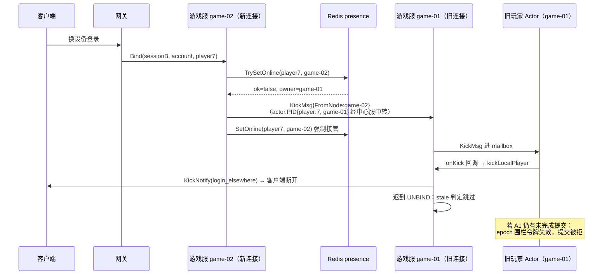

# 03-会话管理与顶号踢人

> 一句话定位：`server_session.go` 用三张同一把锁保护的映射表维护「会话↔角色」权威关系，以 claimOnline 抢占 + KickMsg 远程投递 + 围栏令牌挡旧提交，实现「同一角色只允许一个权威会话」的顶号契约——同节点与跨节点行为完全一致。

## 1. 概述

会话管理要回答三个问题：**谁在线**（presence，Redis 在线归属表）、**哪个会话是权威的**（players2sess，进程内映射表）、**旧会话的迟到消息怎么办**（stale 判定 + 围栏令牌）。

核心数据结构（`internal/game/server.go:96-104`）：

```go
// mu 保护下面三张会话映射表的全部读写；players2sess 是
// player→session 的唯一权威映射，顶号判定与下行路由都读它，
// 必须与 sessions/accounts 在同一把锁内原子更新。
mu       sync.RWMutex
sessions map[uint64]int64 // session_id -> player_id（0 = 未选角）
accounts map[uint64]int64 // session_id -> account_id
// players 反向索引：player_id -> session_id（跨服结算推送用）
players2sess map[int64]uint64
```

三张表必须在**同一把锁内**原子更新的原因写在注释里：`players2sess` 是顶号判定的唯一权威，如果切换与 sessions 写入不同步，旧连接的迟到 UNBIND 会命中错误的会话身份。

## 2. 涉及文件

| 文件 | 职责 |
| --- | --- |
| `internal/game/server_session.go` | 会话表全部逻辑（536 行）：bind/unbind/kick/claim |
| `internal/game/server_kick_test.go` | 按角色踢人的 4 个单测 |
| `internal/game/claim_online_test.go` | claimOnline 与 KickMsg 投递的 8 个单测 |
| `internal/game/player/actor.go:564` | Actor 侧 stale UNBIND 校验（会话身份的最后一道闸） |
| `internal/game/server_adapters.go:103` | gamePusher：读 players2sess 做战斗下行 |
| `docs/R2.5-会话所有权与提交通道设计.md` | 设计契约：epoch 围栏令牌与提交通道 |

## 3. 核心设计

### 3.1 顶号契约：R3.1「一个角色一个权威会话」

```go
// 顶号规则（R3.1）：同一角色只允许一个权威会话。新会话绑定成功后主动踢掉旧会话，
// 旧连接收到 KickNotify 后断开，其迟到的 UNBIND 会被 Actor 的会话身份校验忽略。
```

（`internal/game/server_session.go:204-205`）

这句话里有三层机制，分别挡三种时序问题：

| 时序问题 | 机制 | 代码位置 |
| --- | --- | --- |
| 新会话绑定与旧会话踢出的竞态 | 三张表同一把锁内「读旧 → 写新」，先切换再 kick | `server_session.go:215-227` |
| 旧连接的迟到 UNBIND 把新会话打成离线 | 进程内 stale 判定 + Actor 会话身份校验 | `server_session.go:377-394`、`player/actor.go:570-574` |
| 旧节点 Actor 还活着，其快照提交覆盖新会话 | 围栏令牌（epoch，R2.5）挡旧提交 | `player/actor.go:220-224` |

### 3.2 claimOnline：接管而非拒绝

```go
// 为什么是「接管」而不是「拒绝」：顶号的产品语义是「新登录挤掉旧会话」，
// 与连接落在哪个节点无关。早先的实现跨节点直接拒绝，玩家换设备时如果
// 网关把连接路由到另一个游戏服，就会看到「已在其它节点登录」的报错——
// 同节点顶号、跨节点报错，行为不一致。
```

（`internal/game/server_session.go:126-135`）

`claimOnline` 是自由函数 + 窄接口的形态（`server_session.go:117-157`），这是可测试性的关键设计：

```go
// onlinePresence 是顶号抢占用到的在线归属能力（接口隔离）。
// 只声明这两个方法：抢占用 TrySetOnline（带冲突检测），接管用 SetOnline
// （强制覆盖）。*cache.Presence 隐式实现，测试可注入 fake。
type onlinePresence interface {
	TrySetOnline(ctx context.Context, playerID int64, nodeID string, ttl time.Duration) (ok bool, owner string, err error)
	SetOnline(ctx context.Context, playerID int64, nodeID string, ttl time.Duration) error
}
```

三条分支各有深意：

1. `err != nil` → **放行**：Redis 抖动时宁可双开一会儿，也别让玩家登不进来；双开的窗口由围栏令牌兜底（后写者胜），最终一致；
2. `ok || owner == self` → 直接返回（首次占用或同节点重连）；
3. 被别人持有 → `notify(owner, playerID)` 异步通知旧节点踢人，随后立刻 `SetOnline` 强制接管。**notify 是异步的、不等待**：旧节点的 Actor 可能还活着一小会儿，但它的快照提交会被 epoch 挡掉——这正是 R2.5 设计的目标场景，不需要在顶号路径上额外加锁等待。

### 3.3 跨节点顶号完整链路



链路要点：

- **KickMsg 是单向通知**（不带 Done 通道），经 `actor.PID{ID: "player:7", Node: "game-01"}` 走 Actor 远程投递——`RemoteSender` 经中心服中转（见 [02-玩家Actor与消息处理](./02-玩家Actor与消息处理.md)）；
- **kickLocalPlayer 只发 KickNotify 不断 TCP**（`server_session.go:186-200`）：与同节点顶号走同一条路径，客户端收到通知后自行断开，随后的 UNBIND 走标准下线（模块 OnLogout + 落库）；
- **kickRemotePlayer 发不出去不算失败**（`server_session.go:171-184`）：presence 已被覆盖，旧节点的提交会被围栏令牌挡住，它自己的心跳/UNBIND 也会让它下线，只是晚一点。

### 3.4 OnUnbind 三段式与 stale 判定

```go
// 三段式：摘本地映射 → 判定是否被顶号 → 权威会话才解 Actor + 清在线归属。
// 「被顶号的旧会话」是最容易写错的分支：它的一切副作用都必须跳过，
// 否则会把仍在线的权威会话打成离线（见下方 stale 注释）。
func (s *Server) OnUnbind(ctx context.Context, sessionID uint64) error {   // server_session.go:372
```

（`server_session.go:367-409`）

第一段在锁内摘三张表并做 stale 判定：`players2sess[playerID] == sessionID` 说明还是权威会话，否则 `stale = true`。第二段 stale 直接返回——**不能解绑 Actor，也不能清在线归属**，否则会把仍在线的权威会话打成离线、其它节点还能趁机抢占。第三段（权威会话）才发 UnbindMsg 给 Actor、并核对 presence 归属确实是本节点才 SetOffline。

Actor 侧还有一道对称校验（`player/actor.go:568-574`）：`msg.SessionID != a.sessionID` 的 UNBIND 直接忽略——两层 stale 判定互相兜底，任何一层漏了另一层还能挡住。

### 3.5 懒加载与会话级协议

`OnClientPacket`（`server_session.go:411-447`）有两个容易看错的点：

1. **会话级协议（1010 进游戏/1020 创角）始终在 Server 层处理**，不受 playerID==0 限制：已有角色的账号在 OnBind 阶段就被自动绑定，此时客户端仍会发 EnterGame(1010)，若走 Actor 路由会因「无模块处理 1010」而静默丢包；
2. **Actor 懒加载**（`server_session.go:434-437`）：创角/进游戏只记 sessions，Actor 在首个业务包时创建。好处有两个：① 创角后立刻加载会读到「刚建的空角色」，若随后有补偿道具/GM 改库，内存与库就不一致；② 只登录不操作的账号不占 Actor 资源。反方向的代价由 `ensureActor`（`server_session.go:272-292`）兜底：重连时必须补 BindMsg——Actor 离线后不销毁（Tier-2 保留 90s），里面的 sessionID 还是旧的，不刷新的话回包发不出去。

`drainOffline` 的时机（`server_session.go:473-475`）也有注释：必须放在 1011（进游戏回执）**之后**——客户端收到回执才开始处理推送，过早补投会被当成「未知消息」丢掉。

## 4. 关键代码解析：按角色踢人

```go
// resolveSessionByPlayer 返回玩家当前权威会话（0 = 不在本节点）。
//
// players2sess 是「角色 → 会话」的唯一权威：顶号时它先于 kick 完成切换，
// 所以这里读到的永远是最新会话。网关不持有这份映射（它只知道角色号），
// 这也正是「按角色踢人」必须经游戏服的原因。
func (s *Server) resolveSessionByPlayer(playerID int64) uint64 {   // server_session.go:361
```

GM 踢人/封禁指令由网关广播给所有 game 节点（提交 `c866bea` 引入的设计），非持有者查不到会话即返回 nil——这不算失败。`OnKick`（`server_session.go:329-354`）的动作只是发 KickNotify，**不在这一层直接清会话状态**：那条路径会跳过模块的下线钩子（OnLogout 的落库时机）。

## 5. 演进记录

| 提交 | 内容 |
| --- | --- |
| R3.1 | 顶号规则：同角色唯一权威会话 |
| `c866bea` | refactor(kick)：按角色号踢人，网关不再保存「角色→会话」映射 |
| `2e28e12` | feat：补登出、跨节点真顶号、账号封禁拦截（claimOnline 自由函数化 + onlinePresence 接口 + KickMsg 远程投递） |
| `00ca387` | feat(gateway)：管理流——空载网关也能按角色踢人 |
| R2.5 | 会话所有权与提交通道设计（epoch 围栏令牌） |

跨节点顶号的行为演进很有代表性：早先实现跨节点直接拒绝登录（「已在其它节点登录」报错），与同节点顶号行为不一致；`2e28e12` 把 claimOnline 重写为「notify + SetOnline 接管」的自由函数，并用 `onlinePresence` 窄接口让它可被 fake 注入——8 个单测覆盖接管/同节点/首次/Redis 抖动/覆盖失败/无通知器/KickMsg 目标/无 Actor 系统八种场景。

## 6. 测试情况

`internal/game/claim_online_test.go`（171 行，8 个用例）：

| 用例 | 验证点 |
| --- | --- |
| `TestClaimOnlineTakesOverFromOtherNode` | 被别人持有时 notify + SetOnline 接管，tookOver=true |
| `TestClaimOnlineSameNodeNoKick` | owner==self 不踢不通知 |
| `TestClaimOnlineFirstLogin` | 首次 TrySetOnline 成功直接返回 |
| `TestClaimOnlineRedisDownDoesNotBlock` | Redis 报错时放行（不阻断绑定） |
| `TestClaimOnlineForceSetFails` | 接管时 SetOnline 失败返回错误 |
| `TestClaimOnlineNilNotify` | notify 为 nil 不 panic |
| `TestKickRemotePlayerSendsKickMsg` | 断言 `rs.to.Node="game-01"`、`rs.to.ID="player:7"`、消息类型是 `player.KickMsg`、`FromNode="game-02"` |
| `TestKickRemotePlayerWithoutActorSystem` | actorSys 为 nil 静默返回 |

`internal/game/server_kick_test.go`（64 行，4 个用例）：`TestResolveSessionByPlayer`（权威会话/未知角色返回 0）、`TestOnKickUnknownPlayerIsNoop`（广播模式下安静忽略）、`TestOnKickKnownPlayerWithoutRPCStillReturnsNil`（下行不可用也只记日志不上抛——否则网关把「旧连接已断」当成踢人失败，运营看到大量假告警）、`TestOnKickDefaultReason`。

集成侧：`test/integration/` 有跨节点真顶号的端到端用例（真实两个 game 节点 + presence）。

## 7. 小结

会话管理可以浓缩为三句话：

1. **players2sess 是唯一权威**：顶号判定、下行路由、GM 踢人都读它；三张表同一把锁原子更新是它的正确性前提；
2. **跨节点顶号 = 接管而非拒绝**：claimOnline 抢占失败时 notify 旧节点 + 强制覆盖 presence，新旧节点行为一致；旧节点的迟到提交由 R2.5 围栏令牌挡掉；
3. **踢人只发通知不清状态**：KickNotify 之后客户端自行断开，UNBIND 走标准下线——模块 OnLogout 的落库时机永远不被跳过。

配套阅读：[02-玩家Actor与消息处理](./02-玩家Actor与消息处理.md) 的 KickMsg 投递细节、[05-持久化Stateful](./05-持久化Stateful.md) 的 OnLogout 落库、`docs/R2.5-会话所有权与提交通道设计.md` 的完整契约。
