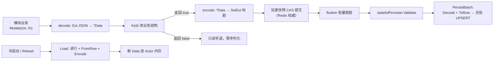

# 05-持久化Stateful

> 一句话定位：`Stateful[Data]` 泛型基座 + `RegisterStateful` 持久化注册，把「内存结构 ↔ Ext JSON ↔ MySQL 行」的往返样板收进框架——7 个玩法模块迁移后业务文件合计净减约 490 行，持久化细节全部搬进各模块的 persist.go。

## 1. 概述

迁移前，一个像签到这样的模块要自己写四段往返代码（`internal/game/module/stateful.go:3-13`）：

```go
// load(state)   → json/行 解码成 *Data
// save(state,d) → *Data 编码回 Ext
// decode(row)   → 行转 Data
// validate(row) → 落库前校验
```

其中前两段纯属样板（signin 里 29 行），而且**要求业务开发者理解 Ext 的存在**。R2.6 的设计是把这段分层：

- **业务层**（quest.go 等）：只声明结构体 `Data`，用 `Read`/`Mutate` 闭包访问，代码里不再出现 `json.Marshal`/`SetExt`/`model.PlayerQuest` 这些词；
- **适配层**（persist.go）：集中「Data 怎么变成表行」的转换代码；
- **框架层**（`pkg/writebehind`）：`StateCodec` + `RegisterStateful` + flusher 批量落库。

## 2. 涉及文件

| 文件 | 职责 |
| --- | --- |
| `internal/game/module/stateful.go` | Stateful[T] 基座：Read/Mutate/State + decode/encode |
| `pkg/writebehind/stateful.go` | RegisterStateful：四项非空校验、statefulPersister、Validate/PersistBatch/Load |
| `pkg/writebehind/ext.go` | Decode/Encode/ExtState/LoadExt/SaveExt 泛型助手 |
| `internal/game/module/quest/persist.go` | 任务模块持久化适配（样板范例） |
| `internal/game/module/{activity,partner,skill,shop,equip,copy}/persist.go` | 其余 6 个模块的同构适配 |
| `internal/game/module/register/register.go` | 空白导入聚合 9 个模块的 init |

## 3. 核心设计

### 3.0 数据流全景



### 3.1 Stateful[T]：业务只写闭包

```go
//	m.Stateful = module.NewStateful("signin", newData,
//		module.ThinLogger(logger),
//		module.ThinErrCode(codeSystem),
//	)
//	m.HandleR(MsgClaimReq, MsgClaimResp, &gamev1.SigninClaimResp{}, m.onClaim)
//
//	func (m *Module) onClaim(ctx *module.Context, _ uint32, _ []byte) error {
//		return m.Mutate(ctx, func(d *Data) bool {
//			d.Days = append(d.Days, today)
//			return true          // 有改动 → 写回 Ext 并标脏
//		})
//	}
```

（`internal/game/module/stateful.go:31-46`）

三个 API 各有明确语义：

| API | 语义 | 关键细节 |
| --- | --- | --- |
| `Read(ctx, fn)` | 只读访问，不回写 | 解码后交给 fn |
| `Mutate(ctx, fn)` | 读写访问，fn 返回 true 才写回 | 见下方「为什么返回 bool」 |
| `State(ctx)` | 拿解码副本 | 每次调用都解码，循环里要自己缓存 |

`Mutate` 的 bool 返回值是性能设计（`stateful.go:77-81`）：很多请求是「只读 + 早退」（已领取、配置缺失、背包已满），无权改状态却触发一次序列化与标脏，会让每条消息都产生一次提交——fn 的返回值就是「我到底改没改」的答案。

`decode` 对 Ext 空槽位的处理（`stateful.go:99-112`）：从未写入过的模块用 `newFn` 构造空状态（比如空切片而不是 nil），业务闭包里不必到处判空。`encode` 走 `SetExt`——它内部标脏。

Stateful 内嵌 `*Thin`（`stateful.go:15-17`）：Module 七件套仍由 Thin 提供，Stateful 只多管「状态结构体的编解码」一件事。适用边界也写在文件头：**状态是单个结构体**的模块适用；多表关联或跨玩家事务（好友/公会/队伍）不适用，保持手写。

### 3.2 RegisterStateful：Ext 存业务结构，落库存表行

```go
// 与 RegisterFlat 的差别：
//
//	RegisterFlat[T]         Ext 的 JSON 就是表行 T（业务结构被迫迁就行字段）
//	RegisterStateful[R, D]  Ext 存业务结构 D，落库时经 Codec 转成行 R
//
// 后者让业务结构可以自由设计（比如签到用 {Days, Rewards}，而表里是
// claimed_days/claimed_rewards 两个 JSON 字符串列），代价是多一次转换。
```

（`pkg/writebehind/stateful.go:1-10`）

`StateCodec[Row, Data]` 是双向转换契约（`stateful.go:23-31`）：`ToRow(playerID, d)` 落库时每行一次调用（playerID 由落库批次提供，业务结构不必自己带主键）；`FromRow(row)` 冷启动读取时调用。**任一侧返回错误都会让整批回滚**——坏数据宁可失败，也不静默丢玩家。

`RegisterStateful` 的四项非空校验全部 panic（`stateful.go:51-59`）：空 name、缺 Upsert/Load、缺 ToRow/FromRow——都是编码错误，启动期暴露。`statefulPersister` 实现 Persister 接口的三个方法：

| 方法 | 时机 | 行为 |
| --- | --- | --- |
| `Validate(raw)` | 落库前 | 先 Decode 解出结构，再跑模块自定义 validate——**解不出来比校验失败更严重**，先报解码错 |
| `PersistBatch` | flusher 批量落库 | 逐个 Decode + ToRow 后合批 Upsert；单行转换失败整批回滚 |
| `Load` | 冷启动/Reload | 读行 + FromRow + Encode；`sql.ErrNoRows` 返回 `(nil, nil)`——没有行等价于「从未写过」 |

### 3.3 ext.go：首次使用与数据损坏的区分

```go
// raw 为空表示该模块还没有任何数据（从未写入过），返回 (nil, nil) 而不是报错——
// 「首次使用」和「数据损坏」必须区分开：前者是正常冷启动路径，
// 后者要报错让人工介入。
```

（`pkg/writebehind/ext.go:19-27`）

`Encode` 与 `Decode` 严格对称（`ext.go:38-45`）：nil 指针入、nil 出，使「清除模块」成为合法操作，不需要单独的 Clear API。`ExtState` 窄接口（`ext.go:56-68`）只声明两个方法——模块不必依赖整个 player.State（几十个方法），单测的假实现只有几行。

### 3.4 persist.go 样板：以 quest 为例

每个模块的 persist.go 是同构的四件套（`internal/game/module/quest/persist.go`）：

```go
// init 注册持久化：Ext 槽位存 Data（业务结构），落库时转成 player_quest 行。
func init() {
	writebehind.RegisterStateful(stateKey, model.PlayerQuestFlat,
		writebehind.StateCodec[model.PlayerQuest, Data]{
			ToRow:   toRow,
			FromRow: fromRow,
		},
		validate,
	)
}
```

- `toRow`：任务状态整体存一个 JSON 列（`persist.go:28-34`）；
- `fromRow`：空列等价于「一个任务都没接」，顺手保证 map 非 nil（`persist.go:37-48`）；
- `validate`：落库前校验 id/status/progress 范围——「Status 上界是 statusClaimed：超范围说明快照被改坏，宁可这批写回失败，也不把非法状态带进数据库」（`persist.go:50-66`）。

`register/register.go` 解释了这套 init 机制的存在理由（`register.go:1-12`）：游戏服直接导入模块、Persister 随包 init 生效；而**独立落库进程（cmd/flusher）与集成测试不导入业务模块**，需要显式导入本包——否则框架遇到未注册的模块状态会拒绝落库。「宁可整批回滚，也不静默丢数据」的刻意设计。

## 4. 演进记录：七个模块的迁移实录

R2.6 落地为 7 个独立提交，每个提交信息自带前后行数（已逐一核实）：

| 提交 | 模块 | 行数变化 | 附加收益 |
| --- | --- | --- | --- |
| `dff3b7a` | quest | 365 → 299 | — |
| `09951a4` | activity | 510 → 332 | — |
| `f4d375b` | partner | 386 → 316 | 不变量校验移到 persist.go |
| `50cb3b5` | skill | 360 → 300 | — |
| `7798eab` | shop | 287 → 268 | 补 7 个单测（覆盖率 0% → 74%） |
| `3233ea2` | equip | 360 → 328 | 穿戴/卸下加成改为闭包外结算 |
| `dbcd757` | copy | 275 → 210 | — |

**业务文件合计从 2543 行降到 2053 行，净减约 490 行**（各提交信息口径）。同时新增 7 个 persist.go 共约 468 行纯转换代码——净减数小于「删掉的旧持久化样板」的原因是有部分业务逻辑被改写为 `Mutate` 闭包后仍在业务文件里，只是形态变了。迁移是分批进行的（7 个独立提交而非一次性重写），与 [04-模块系统module](./04-模块系统module.md) 的 Thin 迁移节奏一致。

## 5. 测试情况

- `pkg/writebehind`：`ext_test.go`（Decode/Encode 对称性、空 raw 语义）、`flat_test.go`、`registry_test.go`（RegisterStateful 的非空校验 panic）、`store_test.go`、`store_field_test.go`、`worker_test.go`；
- `internal/game/module/` 各模块：迁移提交顺带补强单测（shop 从 0% 到 74% 即 `7798eab` 的显式成果）；
- 集成测试：`test/integration/` 的落库链路用例覆盖「写 → flush → 冷启动 Load」的完整往返。

## 6. 小结

Stateful 持久化可以浓缩为三句话：

1. **业务结构自由设计**：Ext 里存 `Data` 而不是表行，`StateCodec` 负责双向转换——业务不为 schema 妥协；
2. **坏数据整批回滚**：Validate 在 PersistBatch 最前、转换失败不带任何一行进库——「宁可失败，也不静默丢玩家」是这套机制的一贯态度；
3. **注册表 + init 副作用**：模块自己注册持久化，独立 flusher 进程靠 `register` 包显式聚合——未注册即拒绝落库，刻意的fail-fast。

模块如何被 Actor 驱动，见 [02-玩家Actor与消息处理](./02-玩家Actor与消息处理.md)；模块契约全景，见 [04-模块系统module](./04-模块系统module.md)。
