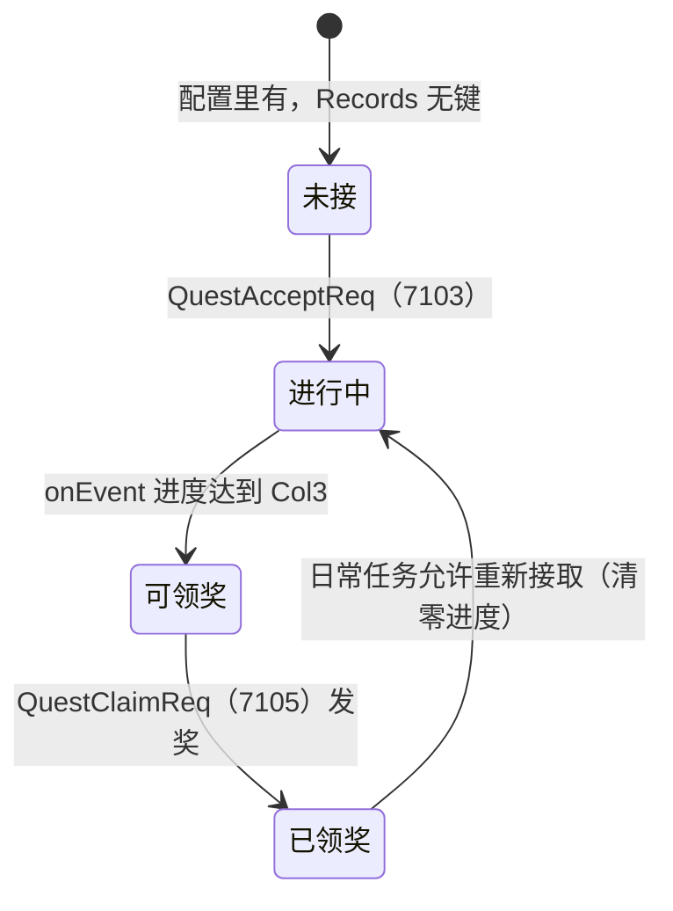
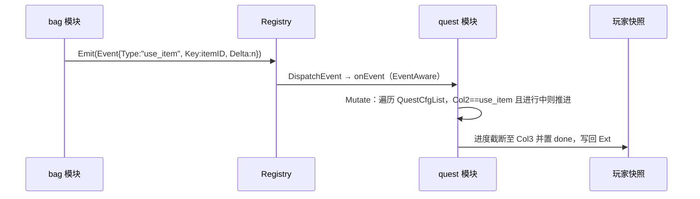

# 06 任务与签到（quest / signin / loginreward / level）

> 一句话定位：本文覆盖游戏服「日历与进度」类玩法四件套——任务系统（接取/推进/领奖）、按周签到的 signin、按天登录奖励的 loginreward，以及等级模块的占位现状；它们的共同特征是「单结构体状态 + Ext 槽位 + 快照 CAS 原子提交」。

## 1. 概述

这四个模块回答的是同一类问题：**玩家的「周期性/累计性进度」放在哪、怎么推进、怎么保证不重复发奖**。项目对这类玩法的统一答案是：

- 状态整体放进玩家快照的 Ext 槽位（`Ext["quest"]`、`Ext["signin"]`、`Ext["login"]`），不单独写 MySQL 业务表；
- 领取事实与道具/经验奖励在**同一条消息的同一次 Redis CAS** 里提交，失败整批回滚（契约见 `docs/R2.1-缓存原子变更契约.md`）；
- 任务推进不走轮询，而是订阅 `module.Event` 行为事件（kill / use_item / copy_pass），由背包、副本等产出方 `Emit` 驱动。

四个模块的分工与形态差异很大，先看全景：

| 模块 | 状态结构 | 协议 | 推进方式 | 模块基座 |
|---|---|---|---|---|
| quest 任务 | `Data{Quests map[int32]Record}` | 7101-7106 六条 | 事件订阅（EventAware） | `Stateful[Data]` |
| signin 签到 | `Data{Days []int32, Rewards map[int32]int64}` | 6601-6604 | 时钟驱动（北京时间周几） | `Stateful[Data]` |
| loginreward 登录礼包 | `Data{LastDay, Streak}` | 无协议 | 登录钩子 OnLogin | `Thin` |
| level 等级 | 无（占位目录） | 2011 推送 | 玩家层 `AddExp` | — |

模块系统的公共契约（Module 接口、Registry、EventAware 可选接口）见 [`../50-游戏服/04-模块系统module.md`](../50-游戏服/04-模块系统module.md)；`Stateful[T]` 基座与持久化注册详见 [`../50-游戏服/05-持久化Stateful.md`](../50-游戏服/05-持久化Stateful.md)。

## 2. 涉及文件

| 路径 | 职责 |
|---|---|
| `internal/game/module/quest/quest.go` | 任务模块：列表/接取/领奖、事件订阅推进进度 |
| `internal/game/module/quest/persist.go` | `RegisterStateful` 持久化适配：Data ↔ `player_quest` 行 |
| `internal/game/module/quest/quest_test.go` | 单测：接取-推进-领奖闭环、幂等、快照形状 |
| `internal/game/module/signin/signin.go` | 签到模块：周几口径、领取幂等、发奖预检 |
| `internal/game/module/signin/persist_gen.go` | 生成：`SignIn` ↔ `player_signin` 两列 JSON（gencodec） |
| `internal/game/module/signin/signin_test.go` | 单测：周几分派、状态往返、领取闭环、配置校验 |
| `internal/game/module/loginreward/loginreward.go` | 登录礼包：无协议，OnLogin 自动发放 + 连续登录天数 |
| `internal/game/module/loginreward/loginreward_test.go` | 单测：首登/连签/断签/重连/超档/坏配置 |
| `internal/game/module/level/README.md` | 占位说明：等级逻辑在 `internal/game/player/actor.go` |
| `api/proto/game/v1/game.proto` | 任务协议 7101-7106 |
| `api/proto/game/v1/game.proto` | 签到协议 6601-6604 |

## 3. 核心设计

### 3.1 任务生命周期与状态机



任务模块只存「接取/进度/领取」三态，**不存任务定义**——任务列表由 `quest.xml` 配置派生，「没接取」用「map 里没有这个键」表达，而不是 `Status=-1`，这样领取事实的判定不会有第三态（`quest.go:70-79`）。

内部状态与协议状态是两套编码（`quest.go:49-58`、`quest.go:155-191`）：内部 `statusDoing/statusDone/statusClaimed = 0/1/2`，协议 `QuestEntry.Status` 是 `0 未接/1 进行中/2 可领奖/3 已领奖`——协议需要显式表达「未接」，所以列表下发时做一次映射。

### 3.2 事件驱动推进



背包使用道具 `Emit "use_item"`、副本结算 `Emit "copy_pass"`、战斗击杀 `Emit "kill"`——产出方不需要知道谁在听，quest 模块通过 `ThinOnEvent` 挂接订阅（`quest.go:119-153`）。一次事件只解析一次状态、只写回一次；`Mutate` 闭包返回 `false`（一个任务都没推进）时基座不会写回 Ext，也就不会产生一次无意义的提交。

### 3.3 领取的原子性：领取事实 + 奖励 = 一次 CAS

`onClaim`（`quest.go:218-280`）把三件事放进同一个提交窗口：`Status=claimed` 写进 Ext、钻石进 `Items`、经验进 `Profile`。Redis CAS 失败时三者一起回滚，不会出现「状态已领、奖励没到账」。满包/超限时整个领取被拒且**不占用业务键**（quest 是主动领取类业务，用业务状态里的「已领取」事实做幂等，不占用 `applied_grants`，避免其无限膨胀）。

### 3.4 签到的周几口径与登录礼包的日序号

两个日历玩法共享同一个设计约束：**模块不持时钟锚点，但口径固定 UTC+8**。

- signin 用 `weekdayOf`（`signin.go:244-250`）：`time.Weekday` 的零值是 Sunday，与「周一=1」差一天，所以周日单独映射成 7；`In(businessZone)` 把时间切到固定时区再取 Weekday，避免服务器跑在 UTC 容器把周一算成周日。
- loginreward 用 `businessDay`（`loginreward.go:237`）：`(now.Unix() + 8*60*60) / 86400` 得到自然日序号，`LastDay=0` 的零值语义不等于任何自然日（真正的第 0 天早已过去），可以安全表示「从未发放」。

跨周清零被刻意设计成**外部职责**：signin 的 `Data` 跨周不会被自动清零，由周期回调模块调用 `Reset` 完成（`signin.go:58-69`）——模块不持时钟锚点，读取路径不自动清。

## 4. 关键代码解析

### 4.1 quest：Stateful 注册与持久化适配

```go
// internal/game/module/quest/persist.go:17-25
func init() {
	writebehind.RegisterStateful(stateKey, model.PlayerQuestFlat,
		writebehind.StateCodec[model.PlayerQuest, Data]{
			ToRow:   toRow,
			FromRow: fromRow,
		},
		validate,
	)
}
```

`RegisterStateful` 声明「Ext 存业务结构 `Data`，落库时经 Codec 转成 `player_quest` 行」。三个转换职责：

```go
// internal/game/module/quest/persist.go:28-34
func toRow(playerID int64, d *Data) (*model.PlayerQuest, error) {
	raw, err := json.Marshal(d.Quests)
	if err != nil {
		return nil, fmt.Errorf("encode quest state: %w", err)
	}
	return &model.PlayerQuest{PlayerId: playerID, Quests: string(raw)}, nil
}
```

```go
// internal/game/module/quest/persist.go:54-66
func validate(d *Data) error {
	for id, rec := range d.Quests {
		if id <= 0 {
			return fmt.Errorf("invalid quest id %d", id)
		}
		if rec.Status < statusDoing || rec.Status > statusClaimed {
			return fmt.Errorf("invalid quest status %d", rec.Status)
		}
		if rec.Progress < 0 {
			return fmt.Errorf("invalid quest progress %d", rec.Progress)
		}
	}
	return nil
}
```

`validate` 是落库前最后一道闸：`Status` 上界是 `statusClaimed`，超范围说明快照被改坏，宁可这批写回失败，也不把非法状态带进数据库。业务文件（quest.go）里因此不再出现 `json.Marshal` / `SetExt` / `model.PlayerQuest` 这些词。

### 4.2 quest：onEvent 的截断防护

```go
// internal/game/module/quest/quest.go:134-144
target := int32(cfg.Col3)
next := rec.Progress + int32(evt.Delta)
// 到达目标即置完成态并截断：超额计数没有意义，
// 截断还能防止 int32 被恶意大 Delta 冲爆。
if next >= target {
	next = target
	rec.Status = statusDone
}
rec.Progress = next
d.Quests[id] = rec
```

`d.Quests[id] = rec` 是必须的：`map[int32]Record` 是值类型 map，读出来的是副本，就地改 `rec.Progress` 不生效。截断同时防「恶意大 Delta 冲爆 int32」——进度没有累计价值，完成态才是。

### 4.3 quest：onClaim 的拒绝码早退

```go
// internal/game/module/quest/quest.go:231-260（节选）
err := m.Mutate(ctx, func(d *Data) bool {
	rec, ok := d.Quests[req.QuestId]
	if !ok {
		resp.Code = codeQuestUnfinished
		return false
	}
	if rec.Status == statusClaimed {
		resp.Code = codeQuestClaimed
		return false
	}
	if rec.Progress < int32(cfg.Col3) {
		resp.Code = codeQuestUnfinished
		return false
	}
	// 发奖：经验 + 钻石（配置约定 target*100 经验、target*10 钻石）。
	grants := []module.ItemGrant{{ItemID: 1001, Count: int64(cfg.Col3) * 10}}
	c, grantErr := module.Grant(ctx.State, grants)
	if grantErr != nil {
		resp.Code = codeBagFull
		return false
	}
	...
	rec.Status = statusClaimed
	d.Quests[req.QuestId] = rec
	applied = true
	return true
})
```

三个拒绝分支全部 `return false`——闭包没有改动，基座不写回 Ext、不产生提交。`applied` 标志区分「拒绝」与「成功」：拒绝时闭包里已设好业务码，函数尾部不能再覆盖成 0。发奖走统一的 `module.Grant`（溢出预检 → 容量预检 → 入包），见 [`09-商店与经济.md`](09-商店与经济.md) 对 grant/spend 入口的展开。

### 4.4 signin：一次 Mutate 走完「读状态 → 校验 → 登记」

```go
// internal/game/module/signin/signin.go:150-174（节选）
err := m.Mutate(ctx, func(d *Data) bool {
	// 无论走哪个分支，回包都要带当前状态，统一在这里取样。
	defer func() { snap = *d }()

	g, cfgErr := rewardsForDay(today)
	if cfgErr != nil {
		code = codeConfig
		return false
	}
	grants = g
	if d.has(today) {
		already = true // 幂等：重复领取回「已领」状态，不再发奖
		return false
	}
	// 发奖与登记在同一个提交窗口里：Grant 失败时不改任何状态，
	// 领取位也就不会置上，玩家清包后可重新领。
	c, grantErr := module.Grant(ctx.State, g)
	if grantErr != nil {
		code = grantCode(grantErr)
		return false
	}
	changes = c
	d.add(today, g)
	return true
})
```

两个细节值得注意：

1. `defer func() { snap = *d }()`——无论走哪个分支，回包都要带当前状态（已领天数/奖励汇总），统一在闭包里取样，避免每个分支各写一份；
2. `grantCode` 把 `ErrItemLimit`（6602）与 `ErrBagFull`（6603）分开：满包是「清包再来」，超限是「数量异常」，客户端提示与客诉话术都不一样，所以不合并成一个码。

配置侧的两级溢出防护在 `rewardsForDay`（`signin.go:265-292`）：单项 `Count` 与累计和都不得超过 int32（协议字段宽度）；输出前按 ItemID 排序——map 的 range 顺序随机，直接 append 会让每次领取的奖励顺序不同，客户端展示会抖动。

### 4.5 signin：时钟注入与周边界

```go
// internal/game/module/signin/signin.go:117-122
// 每个请求只采样一次时钟，防止处理途中跨过周零点：
// 若在 has() 判断后重新取时间，跨过周日 24 点的请求会出现
// 「按旧周几判定已领、按新周几发奖」的错位。
today := weekdayOf(m.now())
```

`now` 是可注入时钟（`New(logger, clock ...func() time.Time)`），测试可以验证跨周边界。这是「可选依赖」惯用法：可变参数 + nil 检查，比再提供一个 `NewWithClock` 更省 API 面积。

### 4.6 loginreward：登录钩子上的幂等

```go
// internal/game/module/loginreward/loginreward.go:130-146（节选）
func (m *Module) grantOnLogin(ctx *module.Context) error {
	day := businessDay(m.now())
	d, err := load(ctx.State)
	if err != nil {
		return err
	}
	if d.LastDay == day {
		return nil // 今天已经领过
	}
	// 连续登录判定：昨天（day-1）领过才 +1，否则（断签/首次）重置为 1。
	if d.LastDay == day-1 {
		d.Streak++
	} else {
		d.Streak = 1 // 断签或首次登录
	}
	d.LastDay = day
	...
```

幂等靠状态本身：重连会再次触发 OnLogin，但 `LastDay` 已是今天时直接返回。**刻意不占用 AppliedGrants**——每天一个业务键会让 `applied_grants` 无限膨胀。满包时不前进状态（`loginreward.go:153-161`）：下次登录会重新发放，不会吞掉当天奖励；这与 quest/copy 的「满包拒绝」不同——那边是玩家主动重试，这里连重试入口都没有，只能靠状态不前进来保奖励。

### 4.7 level：占位目录的真实情况

`internal/game/module/level/` 只有一份 README（`level/README.md:1-6`）：

> 升级逻辑不在本目录，真实实现在 `internal/game/player/actor.go`：`State.AddExp` 连续升级 + 协议 2011 `LevelInfoNotify` 推送；配置 `level.xml`，数据落 `player.level/exp`。

这是有意的分工：等级是**玩家级资产**（像经验/金币），不是玩法进度，所以不占 Ext 槽位、不单独成模块。各玩法模块通过 `module.AddExpFunc`（`module.go:93-97`）声明「我要加经验」，升级规则、等级上限与升级推送由玩家层统一处理——依赖倒置避免每个模块各写一套。quest 领奖与 copy 结算都通过 `ctx.AddExp` 回调使用它。

## 5. 演进记录

| 提交 | 事件 |
|---|---|
| `421c1f6` | feat(login): 登录礼包与登录流水闭环（R3.2）——loginreward 首次落地 |
| `cb6bbb3` | P6 业务闭环（第二批）：等级/任务/装备/技能/聊天/公会/组队/副本/商店/活动——quest 首次落地 |
| `db75402` | feat(module): Stateful[T] 状态结构托管，业务文件不再出现持久化代码 |
| `dff3b7a` | refactor(quest): 迁到 Stateful[Data]（365 → 299 行） |
| `7452c87` | refactor: 清死代码；修 4 处错误码与 proto 撞车 |

**quest 迁 Stateful（365 → 299 行）**：迁移前 quest 自己维护「内存结构 ↔ Ext JSON ↔ MySQL 行」的往返，还要手写 load/save。`Stateful[T]` 基座把 decode/encode/标脏收进基座后，业务文件只剩规则；减少的 66 行几乎全是样板。同期 activity/partner/skill/shop/equip/copy 做了同样的迁移——这是 R2.6「单结构体模块基座」的批量落地。

**错误码与 proto 撞车修复**：`7452c87` 修掉 4 处模块自定义错误码与 proto 枚举值撞车的问题——客户端按码弹文案，码值撞车会让「任务已领取」显示成别的玩法的话术。这也是本项目「错误码按模块号段分配」（4.10 约定）的原因：quest 用 7101-7105、signin 用 6601-6603，客户端按号段直接定位是哪个玩法拒绝的请求。

## 6. 测试情况

`go test -cover ./internal/game/module/quest/ ./internal/game/module/signin/ ./internal/game/module/loginreward/` 当前结果：quest **54.2%**、signin **74.5%**、loginreward **71.2%**。

**quest（4 个用例）**：

- `TestAcceptProgressClaim`：接取 → 事件推进到完成 → 领奖发道具与经验的完整闭环；
- `TestClaimIdempotent`：重复领奖回 7104 且不二次发奖；
- `TestClaimUnfinished`：进度不足回 7103；
- `TestSnapshotShape`：Ext 槽位里 JSON 的形状稳定（线上契约，旧快照要能读出来）。

**signin（5 个用例）**：`TestWeekdayOf`（周日映射 7、UTC 容器口径）、`TestDataAdd`（天数升序落库）、`TestStateRoundTrip`（Ext ↔ Data 往返）、`TestClaimFlow`（领取 + 幂等 + 满包拒绝）、`TestRewardConfiguration`（七天奖励配置齐全，启动期 ThinInit 校验）。

**loginreward（6 个用例）**：`TestFirstLoginGrants`、`TestConsecutiveStreak`（连签 +1）、`TestSameDayReconnectNoDoubleGrant`（重连不重发）、`TestBreakResetsStreak`（断签重置为 1）、`TestBeyondMaxTier`（超最大档按最大档发）、`TestParseRewardRejectsBadConfig`（坏配置拒绝）。

测试全部经 `moduletest` 脚手架在内存里跑（假 State + Recorder 收回包），不碰 Redis/MySQL，方法见 [`../60-测试体系/02-moduletest脚手架.md`](../60-测试体系/02-moduletest脚手架.md)。「12 个零测试模块补齐单测」的完整过程见 [`../70-开发过程实录/03-补齐12个零测试模块.md`](../70-开发过程实录/03-补齐12个零测试模块.md)。

## 7. 小结

- 任务与签到是「单结构体状态」玩法的范本：`Stateful[Data]` 管编解码，业务只管规则；领取事实与奖励同一次 CAS，失败整批回滚。
- quest 的三态状态机 + 事件驱动推进，让「打怪/用道具/通关」自动转化为任务进度，产出方与消费方零耦合。
- 两个日历玩法的共同教训是**口径必须固定**：UTC+8 写死进 `weekdayOf`/`businessDay`，进程跑在 UTC 容器也不能改变「今天周几」的判定；跨周/跨天的清零职责被刻意放在模块外或读取路径上。
- level 的「占位」提醒我们区分玩家级资产与玩法进度：前者随主快照走，后者才占 Ext 槽位。
