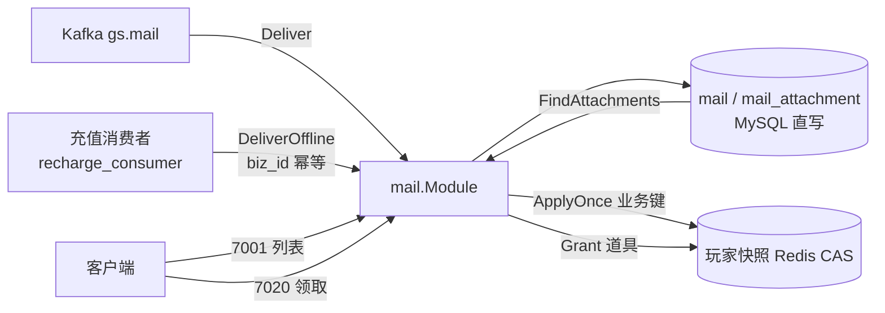
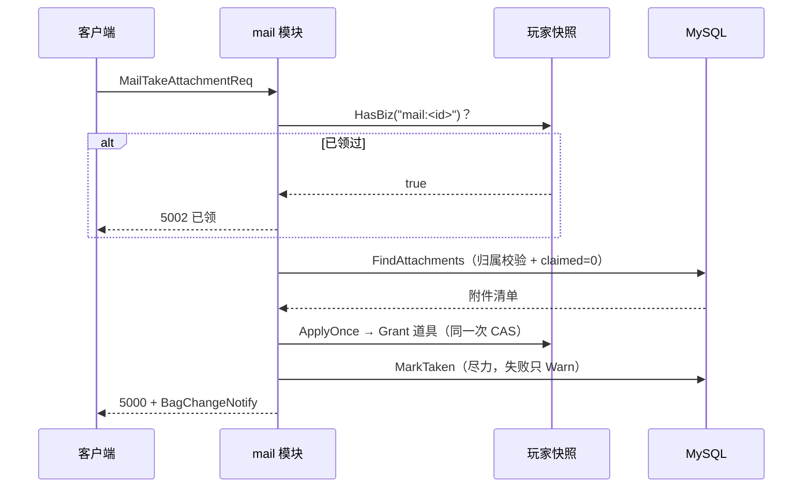

# 07 邮件系统（mail）

> 一句话定位：邮件是游戏里唯一「横跨 Kafka 投递、MySQL 持久化、玩家快照幂等领取、离线兜底发放」四条链路的模块——本文讲清它的全量实现，以及为什么领取幂等「寄生」在玩家快照上而不是先写 SQL。

## 1. 概述

邮件模块（`internal/game/module/mail`）对应设计文档 4.9.3 / R2.2，承担三件事：

1. **投递**：`Deliver`（Kafka 消费调用）建主邮件 + 附件；`DeliverOffline`（Tier-1 发放，充值到账等）以 `biz_id` 幂等建一封带附件的系统邮件；
2. **列表**：`onList` 倒序取最近 100 封，附件有无用 `EXISTS` 子查询一次带出；
3. **领取**：`onTake` 走玩家快照的 `ApplyOnce` 业务键（A 类幂等），与道具在同一次 Redis CAS 提交，SQL 侧 `claimed` 只做尽力展示标记。

它与其他模块最大的结构差异：**没有 Ext 槽位**。邮件数据全在 MySQL（流水型数据，与玩家快照解耦），但领取幂等「寄生」在玩家快照上——业务键 `mail:<id>` 随快照 CAS 原子提交。这是 R2.2 修复的核心：SQL 先标记会在 Redis 提交失败时丢奖励，快照业务键不会。

模块无内存态、无锁：`OnMessage` 在玩家 Actor 内串行执行，跨玩家一致性由 DB 约束（唯一键）与快照业务键分工保证。

## 2. 涉及文件

| 路径 | 职责 |
|---|---|
| `internal/game/module/mail/mail.go` | 邮件模块全量：协议、`Repo` 仓储、`mailRepo` 窄接口、投递/列表/领取 |
| `internal/game/module/mail/mail_test.go` | 单测：15 个用例，`fakeRepo` 内存实现全部规则 |
| `api/proto/game/v1/game.proto` | 邮件协议 7001/7002 列表、7020/7021 领取 |
| `internal/game/mq/recharge_consumer.go` | 充值离线发放调用方（`DeliverOffline` 的上游） |
| `docs/R2.3-充值双栅栏与最终一致设计.md` | 离线邮件作为充值 Tier-1 兜底的设计依据 |

## 3. 核心设计

### 3.1 数据与职责全景



邮件是「MySQL 直写模块」——不过 Persister 快照链路。这与签到/任务（Ext 槽位 + Write-Behind）形成对照：**流水型数据直写，进度型数据走快照**。把聊天历史、邮件这种只增不改的流水塞进玩家快照 JSON 列，会把快照撑爆。

### 3.2 领取幂等：为什么权威在快照而不是 SQL

`onTake` 的顺序是精心设计的（`mail.go:463-555`）：



三个关键决策：

1. **`HasBiz` 必须先于 `FindAttachments`**：`MarkTaken` 生效后重复请求必须稳定回 5002（已领），顺序颠倒会拿到 5003（无附件）——这是可观测的行为退化（`mail.go:470`）；
2. **SQL 的 `claimed` 只是展示**：权威事实在快照业务键上。`MarkTaken` 失败不影响正确性，重复领取由快照拦截；
3. **满包不占业务键**：`Grant` 失败时 `ApplyOnce` 不占用键，玩家清空背包后可重新领取，不会被「已申请」永久卡死（`mail.go:508-511`）。

这正是 R2.2 与早期实现的区别：早期「SQL 先标记已领」在 Redis 提交失败时会丢奖励（SQL 说领了、道具没到），快照业务键把「领取事实」与「道具」绑成同一次原子提交。

### 3.3 列表的 N+1 规避

```go
// internal/game/module/mail/mail.go:148-153
const q = `SELECT m.id, m.title, m.channel, m.status, m.expire_at, m.created_at,
                  EXISTS(SELECT 1 FROM mail_attachment a WHERE a.mail_id = m.id) AS has_att
           FROM mail m
           WHERE m.player_id = ?
           ORDER BY m.id DESC LIMIT ?`
```

100 封列表若逐封查附件是 101 次查询（经典 N+1）；`EXISTS` 子查询让 DB 用一次半连接算完，列表接口只发 1 条 SQL。`ORDER BY m.id DESC`：自增主键即时间序，走主键索引倒序扫描，无 filesort。limit 钳制：越界/非法回落 100（产品约定的单页上限，与聊天的 50 不同）。

### 3.4 离线发放：biz_id 唯一键

```go
// internal/game/module/mail/mail.go:270-282（节选）
res, err := tx.ExecContext(ctx,
	`INSERT IGNORE INTO mail (player_id, template_id, title, content, channel, biz_id)
	 VALUES (?, 0, ?, ?, 0, ?)`, playerID, title, content, bizID)
...
n, err := res.RowsAffected()
if n == 0 {
	return nil // 已发放过
}
mailID, err := res.LastInsertId()
```

`INSERT IGNORE + RowsAffected()==0` 是「不存在才插」的 DB 惯用法：比先 SELECT 再 INSERT 少一次往返，且彻底无竞态。两个防御细节：

- `bizID == ""` 时直接报错让上游重试——充值链路「报错可重试」远好过「重复发奖」（`mail.go:265-267`）；
- `RowsAffected=0` 时直接返回，绝不能拿 `LastInsertId` 插附件（会插出 `mail_id=0` 的孤儿行）。

邮件与附件在同一 SQL 事务里落库；这条路径的幂等由 **DB 唯一键**保证（跨实例、跨重启的最终防线），因为离线发放可能由任意实例执行。

## 4. 关键代码解析

### 4.1 mailRepo 窄接口：为可测试性而抽

```go
// internal/game/module/mail/mail.go:303-315
// mailRepo 是模块对仓储的全部依赖（接口隔离）。
//
// 抽成接口只为一件事：让「领取幂等」「满包不发奖」这类纯业务规则能在内存里
// 测，不必为一条断言拉起 MySQL。*Repo 隐式实现它，装配层代码不变。
type mailRepo interface {
	UnreadCount(ctx context.Context, playerID int64) (int64, error)
	Insert(ctx context.Context, m *model.Mail) (int64, error)
	InsertAttachment(ctx context.Context, mailID int64, itemID, count int32) error
	ListByPlayer(ctx context.Context, playerID int64, limit int) ([]MailRow, error)
	FindAttachments(ctx context.Context, playerID, mailID int64) ([]Attachment, error)
	MarkTaken(ctx context.Context, mailID int64) error
	DeliverOffline(ctx context.Context, playerID int64, bizID, title, content string, items []Attachment) (bool, error)
}
```

模块只面向接口编程：`Module.repo` 字段是 `mailRepo` 而非 `*Repo`，测试注入 `fakeRepo`（内存 map）即可验证全部业务规则。这是「接口隔离原则」在游戏服务端的典型用法——mail/chat/team/guild 四个 MySQL 直写模块都做了同样的抽取（见 [`11-社交系统.md`](11-社交系统.md)）。

接口方法与 `*Repo` 的方法一一对应，`*Repo` 隐式实现它，**装配层代码不变**——抽接口的成本只是模块内多一个类型声明。

### 4.2 Module 与降级语义

```go
// internal/game/module/mail/mail.go:321-340（节选）
type Module struct {
	*module.Thin

	// repo 仓储；nil 表示无 DB 环境（列表/领取降级，离线发放报错，见各方法）
	repo   mailRepo
	logger *log.Logger
}

func New(repo mailRepo, logger *log.Logger) *Module {
	m := &Module{repo: repo, logger: logger}
	m.Thin = module.NewThin("mail",
		module.ThinLogger(logger),
		module.ThinLogin(m.onLogin),
		module.ThinLogout(m.onLogout),
	)
	m.HandleR(msgIDMailListReq, msgIDMailListResp, &gamev1.MailListResp{}, m.onList)
	m.HandleR(msgIDMailTakeReq, msgIDMailTakeResp, &gamev1.MailTakeAttachmentResp{}, module.Typed(msgIDMailTakeResp, m.onTake))
	return m
}
```

`repo == nil`（无 DB 环境）时的降级策略按方法职责区分：列表/领取自然报错上抛，而 `DeliverOffline` 必须显式失败：

```go
// internal/game/module/mail/mail.go:342-352
func (m *Module) DeliverOffline(ctx context.Context, playerID int64, bizID, title, content string, items []Attachment) (bool, error) {
	if m.repo == nil {
		return false, fmt.Errorf("mail repository unavailable")
	}
	return m.repo.DeliverOffline(ctx, playerID, bizID, title, content, items)
}
```

与 guild/chat 的「repo 为 nil 降级成功」**刻意相反**：邮件发放是奖励链路，缺 DB 时必须让上游看到失败、走 Kafka 重试，而不是假装成功——「报错重试」永远好过「静默丢奖励」。

### 4.3 Deliver：模板填充与附件容错

```go
// internal/game/module/mail/mail.go:392-405（节选）
title, content := msg.Title, msg.Content
if cfg, ok := gamedata.GetMailTemplateCfg(int64(msg.TemplateID)); ok {
	if title == "" {
		title = cfg.Col1
	}
	if content == "" {
		content = cfg.Col2
	}
}
```

「模板填默认值、消息非空则覆盖」：补偿邮件只需下发「模板号 + 附件」，文案集中在配置表（运营可改）；需要个性化时仍可在消息里写死。这是提交 `cda0e9e` 修掉的「配置写了但代码没读」漂移之一——旧实现完全忽略模板表，改文案必须改发送端代码。

附件插入的三级容错（`mail.go:419-427`）：`Count <= 0` 跳过（脏数据插进去会让领取时发 0 个甚至负数道具）；插入失败只 Warn 不返回错误（主邮件已建成，缺附件好过整封丢——若整封报错重投，Kafka 侧重试又会建一封新邮件，玩家看到两封同名邮件反而更糟）。

### 4.4 onTake：回包里的存量语义

```go
// internal/game/module/mail/mail.go:537-553（节选）
changes := lo.Map(atts, func(a Attachment, _ int) *gamev1.ItemChange {
	return &gamev1.ItemChange{
		// demo 期道具无唯一实例 uid，用 itemID 占位（协议字段不可省）
		ItemUid: int64(a.ItemID),
		ItemId:  a.ItemID,
		// 回包带领取后存量而非本次发放数：客户端直接刷新显示
		Count:  int32(ctx.State.GetItemCount(a.ItemID)),
		Change: 1,
	}
})
resp.Code = codeOK
// 奖励复用 BagChangeNotify 格式塞进 Rewards：客户端一套道具变更
// 渲染逻辑同时处理邮件奖励和背包操作，省一个专用消息类型
if raw, err := proto.Marshal(&gamev1.BagChangeNotify{Changes: changes}); err == nil {
	resp.Rewards = raw
}
```

两个协议设计：回包带**领取后存量**而非本次发放数（客户端直接刷新显示，不必再算）；奖励复用 `BagChangeNotify` 格式塞进 `Rewards` 字段（客户端一套道具变更渲染逻辑同时处理邮件奖励和背包操作）。

## 5. 演进记录

| 提交 | 事件 |
|---|---|
| `5ee7195` | P6 业务闭环：创角/进游戏/角色信息/背包/邮件领取——mail 首次落地 |
| `5ab39ac` | refactor(module): 七个玩法模块状态进快照，充值补离线持久发放（R2.2–R2.4）——领取幂等改走快照业务键 |
| `0833cc5` | test(mail): 补邮件模块单测（0% → 43%）；抽出 mailRepo 接口 |
| `ba16094` / `00061fe` | refactor(module): Typed/HandleR 铺开，模块层手写解包清零 |
| `cda0e9e` | fix(config): mail_template 漂移修复——模板填默认值、消息非空覆盖 |

**抽 mailRepo 接口（0% → 43%）**：补测前的困境是每条断言都要 MySQL。抽出窄接口后 `fakeRepo` 顶上，15 个用例全部内存运行；`*Repo` 隐式实现接口，装配层零改动。后续 `dcd8354`（修重复回包导致响应串号）与 `cda0e9e`（模板填充）继续补用例，覆盖率走到 45.2%。

**R2.2 快照业务键幂等**：早期 `onTake` 先写 SQL `claimed` 再发奖，Redis 提交失败时「SQL 说领了、道具没到」。改为 `HasBiz` 前置 + `ApplyOnce` 后，领取事实与道具在同一次 CAS 里同生共死，SQL 的 `MarkTaken` 降级为尽力展示。

## 6. 测试情况

当前 `go test -cover ./internal/game/module/mail/`：**45.2%**（`0833cc5` 时为 43%）。15 个用例分五组：

**领取主路径（3 个）**：

- `TestTakeGrantsAndMarksTaken`：首次领取——发奖、占业务键、`MarkTaken` 被调用；
- `TestTakeIsIdempotent`：重复领取回 5002 且不二次发奖（`HasBiz` 先于 `FindAttachments` 的顺序断言）；
- `TestTakeBagFullKeepsClaimable`：满包回 5004 且**不占业务键**——清包后可重新领取。

**错误码与边界（3 个）**：`TestTakeErrorCodes`（5001 不存在 / 5003 无附件）、`TestTakeRejectsNonPositiveID`（负 id 省一次 DB 往返）、`TestTakeSurvivesMarkFailure`（`MarkTaken` 失败仍回 5000，快照才是权威）。

**列表（2 个）**：`TestListProjectsRows`（`EXISTS` 折算 `HasAttachment`、`Status>=1` 折算 `Read`、`ExpireAt.Valid` 判空）、`TestListPropagatesRepoError`。

**生命周期与投递（7 个）**：`TestDeliverOfflineRequiresRepo`（nil repo 必须报错而非假装成功）、`TestOnLoginQueriesUnread`、`TestOnLogoutMarksDirty`、`TestDeliverSkipsNonPositiveAttachments`、`TestDeliverFailsWhenMailInsertFails`、`TestDeliverUsesTemplate` / `TestDeliverMessageOverridesTemplate` / `TestDeliverUnknownTemplateKeepsMessage`（模板填充三态）。

测试文件头（`mail_test.go:1-11`）点明了覆盖重点：领取幂等 + 「一请求一响应」（用了 `module.Typed` 就不能再自己回包，多回一条会让下一次请求读到上一条的响应）。全部用例不碰数据库：`mailRepo` 由 `fakeRepo` 顶上，纯内存运行。

## 7. 小结

- 邮件是四条链路的交汇点：Kafka 投递、MySQL 直写、快照业务键幂等、离线 biz_id 兜底。理解它的关键是分清**哪份数据是权威**——领取事实在快照，展示标记在 SQL，投递幂等在 DB 唯一键。
- `mailRepo` 窄接口用最小成本（一个类型声明）换来全部业务规则的可测性，是四个关系型模块的共同模式。
- 两个「刻意相反」的设计值得记住：`DeliverOffline` 缺 DB 必须报错（奖励链路不能静默丢），而 `Deliver` 的附件插入失败只 Warn（主邮件已建成，缺附件好过重复建单）。
- 列表的 `EXISTS` 子查询与 limit 钳制，是「流水型数据」接口的标配防护。
