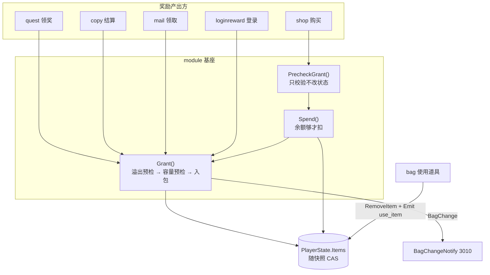
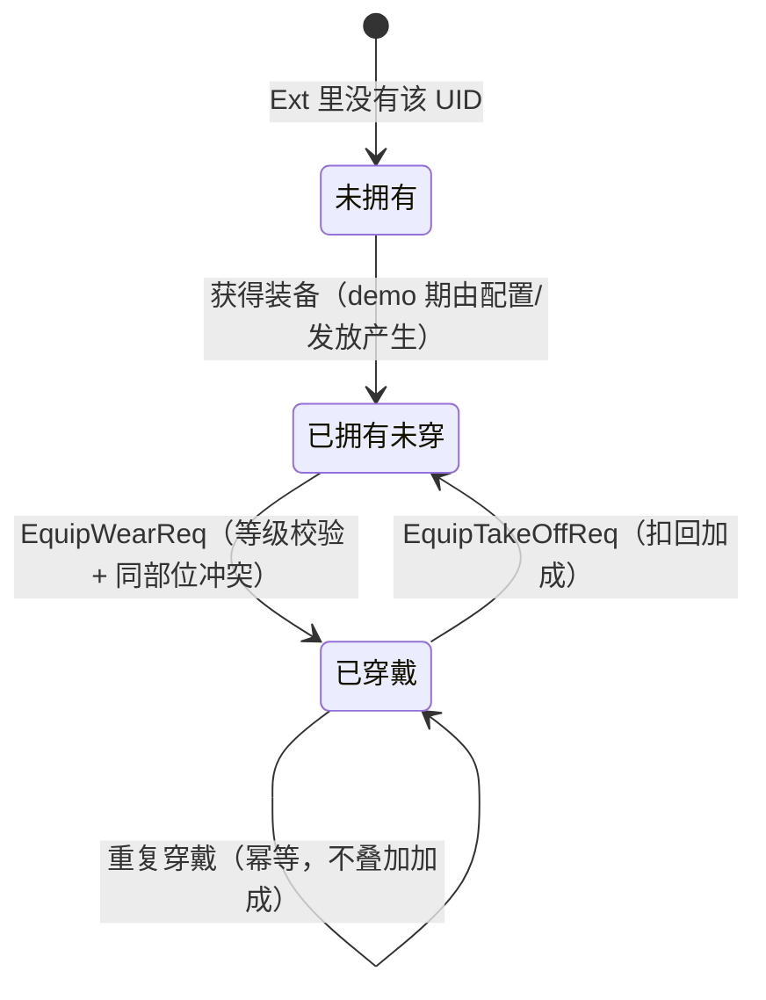

# 08 背包与装备（bag / equip / item）

> 一句话定位：背包是玩家道具资产的协议面（持有量在玩家快照里，模块只管规则），装备是「拥有事实进 Ext、加成只进内存」的派生态范本；两者通过统一的 Grant/Spend 入口与 `BagChangeNotify` 协议联动。

## 1. 概述

这一组三个模块回答「玩家身上有什么」：

| 模块 | 管什么 | 状态在哪 |
|---|---|---|
| bag 背包 | 道具的**使用**与列表展示 | 无自有状态——持有量是 `PlayerState.Items()` 管理的 `map[int32]int64`，随玩家主快照 CAS |
| equip 装备 | 装备实例的**穿戴/卸下**与属性加成维护 | `Ext["equip"]` 存实例列表（JSON 列），加成只进内存 |
| item 物品 | 道具配置的「归属层」——模块位与扩展点 | 无状态、无协议 |

关键的设计切分：**道具是「资产」不是「玩法进度」**。持有量与经验/金币一样随玩家主快照提交，不单独占 Ext 槽位——这保证扣道具与加奖励在同一事务语义里。装备实例则是「玩法进度」，整包进 Ext。加成（atk 等）是**派生值**：只进内存不落库，每次登录从快照里的装备列表重算。

堆叠模式（P6）：`item_uid` 用 `item_id` 占位——同一配置 ID 只存一个数量，不追踪唯一实例（demo 期取舍，协议字段不可省所以用 itemID 占位）。

## 2. 涉及文件

| 路径 | 职责 |
|---|---|
| `internal/game/module/bag/bag.go` | 背包模块：3001 使用道具 / 3003 列表 / 3010 变更推送 |
| `internal/game/module/bag/bag_test.go` | 单测：7 个用例（0% → 80.4%） |
| `internal/game/module/equip/equip.go` | 装备模块：3101-3106，穿戴/卸下/列表/加成 |
| `internal/game/module/equip/persist.go` | `RegisterStateful` 适配：Data ↔ `player_equip` 行 + UID 唯一性校验 |
| `internal/game/module/equip/equip_test.go` | 单测：13 个用例（0% → 91.6%） |
| `internal/game/module/item/item.go` | 道具模块位：无协议，登录/下线观测钩子 |
| `api/proto/game/v1/game.proto` | 道具/背包协议（ItemEntry/ItemChange/BagChangeNotify） |
| `api/proto/game/v1/game.proto` | 装备协议 3101-3106 |

## 3. 核心设计

### 3.1 资产流：统一的发放/消耗入口



`Grant`/`Spend` 是 `internal/game/module/grant.go` 与 `spend.go` 提供的统一入口，解决的问题与用法详见 [`09-商店与经济.md`](09-商店与经济.md)。背包模块与它们的关系：背包自己不调用 Grant（它是资产协议面），但所有发奖最终都写进它管理的 `Items`，并通过它定义的 `BagChangeNotify` 通知客户端。

### 3.2 装备：拥有与穿戴是两个事实



`Entry.Equipped` 字段表达穿戴状态，「拥有」由列表存在性表达。卸下**不删除实例**——「拥有」与「穿戴」是两个事实，分别由列表存在性与 `Equipped` 字段表达（`equip.go:192-195`）。加成只由已穿戴件提供。

### 3.3 加成闭包外结算：为什么 AddBonus 不在 Mutate 闭包里

`Stateful.Mutate` 的契约是「闭包只改 `d`，返回 true 后基座写回 Ext」。如果 `AddBonus` 放在闭包内，闭包的早退分支（已穿戴、等级不足、部位冲突）稍不留神就会在 `return false` 前把加成加上——状态没变、属性却加了，且没有任何回滚。当前实现把加成金额存到闭包外的 `bonus` 变量，仅在 `Mutate` 成功返回后应用：

```go
// internal/game/module/equip/equip.go:181-185
if bonus != 0 {
	// 加成只改内存，与 Equipped 在同一条消息的快照 CAS 里一起生效：
	// CAS 失败则属性与状态一起回滚，不会「状态说穿了、属性没加」。
	ctx.State.AddBonus("atk", bonus)
}
```

`bonus` 只在成功路径上被赋值（穿戴 `+Col4`、卸下 `-Col4`），拒绝路径上它保持 0。这是「闭包纯度」的纪律：**闭包内的副作用必须与返回值同进同退**。

### 3.4 登录重算：先清空再叠加

```go
// internal/game/module/equip/equip.go:100-112
func (m *Module) onLogin(ctx *module.Context) error {
	return m.Read(ctx, func(d *Data) {
		// 不清空加成：玩家层已在 LoginAll 前统一清空，这里只叠加自己的部分。
		for _, e := range d.Equips {
			if !e.Equipped {
				continue
			}
			if cfg, ok := gamedata.GetEquipCfg(int64(e.EquipID)); ok {
				ctx.State.AddBonus("atk", cfg.Col4)
			}
		}
	})
}
```

加成是派生值，不落库：每次登录从快照里的装备列表重算，避免重复累加。**时序契约**：玩家层在 `LoginAll` 之前统一 `ClearBonus`，本模块只叠加自己的部分；若不先清空，重连一次就会把 atk 加成翻倍。伙伴模块（partner）的加成同理——各模块只算自己的份，清空是玩家层的单一职责。

## 4. 关键代码解析

### 4.1 bag：onUse 的四步校验与事件产出

```go
// internal/game/module/bag/bag.go:121-161（节选）
func (m *Module) onUse(ctx *module.Context, req *gamev1.UseItemReq, resp *gamev1.UseItemResp) error {
	itemID := int32(req.ItemUid)
	count := req.Count
	// 未带数量按 1 个处理；堆叠模式下 ItemUid 即 item_id。
	if count <= 0 {
		count = 1
	}

	cfg, ok := gamedata.GetItemCfg(int64(itemID))
	if !ok {
		resp.Code = codeItemNotExist
		return nil
	}
	// 配置约定：Col3 = 单次可使用数量上限，<=0 表示不可主动使用
	if cfg.Col3 <= 0 {
		resp.Code = codeItemNotUsable
		return nil
	}
	// 请求数量超过单次上限时截断，而不是报错：与客户端的批量使用体验一致。
	if int64(count) > cfg.Col3 {
		count = int32(cfg.Col3)
	}

	have := ctx.State.GetItemCount(itemID)
	if have < int64(count) {
		resp.Code = codeItemNotEnough
		return nil
	}
	// RemoveItem 自带原子性：数量不足返回 false 且不做部分扣减；
	// Actor 单线程下上面的 have 检查已足够，这次是纵深防御。
	if !ctx.State.RemoveItem(itemID, int64(count)) {
		resp.Code = codeItemNotEnough
		return nil
	}
	ctx.State.MarkDirty(m.Name())
	// 事件：驱动任务/成就（use_item，Key=道具 ID）
	if ctx.Emit != nil {
		ctx.Emit(module.Event{Type: "use_item", Key: fmt.Sprintf("%d", itemID), Delta: int64(count)})
	}
	...
```

`RemoveItem` 返回值被显式检查（纵深防御）——这正是 `spend.go` 注释里说的历史教训：「升级成功但钱没扣」的静默失败源于忽略 `RemoveItem` 返回值。`Emit` 前判空：函数类型的零值是 nil，直接调用会 panic。增量推送 `Change=2` 表示扣减（协议约定 1=增加、2=减少），与商店/发奖路径对称。

### 4.2 bag：Discardable 只对只读协议成立

```go
// internal/game/module/bag/bag.go:79-82
// Discardable 覆盖 Thin 的宽松默认：Thin 把「已注册协议」一律声明为可丢弃，
// 但「使用道具」会改资产——提交失败时不能丢，必须保留待提交快照补提，
// 否则会出现「道具扣了、奖励没发」且无从恢复。
func (*Module) Discardable(msgID uint32) bool { return msgID == msgIDBagListReq }
```

缓存提交失败时，「可丢弃」的消息允许丢弃内存改动重放，「不可丢弃」的保留待提交快照补提。背包列表是纯读（可丢弃），使用道具改资产（不可丢弃）——**写操作默认不可丢弃**是安全侧的选择。

### 4.3 equip：onWear 的三重校验

```go
// internal/game/module/equip/equip.go:137-177（节选）
	var bonus int64
	err := m.Mutate(ctx, func(d *Data) bool {
		idx := findEquip(d, req.Uid)
		if idx < 0 {
			resp.Code = codeNotExist
			return false
		}
		e := d.Equips[idx]
		// 已穿戴再穿：幂等成功，直接回当前属性，不重复叠加 atk 加成。
		if e.Equipped {
			resp.Code = codeOK
			resp.Attrs = attrPairs(ctx)
			return false
		}
		cfg, ok := gamedata.GetEquipCfg(int64(e.EquipID))
		if !ok {
			resp.Code = codeNotExist
			return false
		}
		if ctx.State.Profile().Level < int32(cfg.Col2) {
			resp.Code = codeLevelLow
			return false
		}
		// 同部位冲突检查（Col3=部位）：反查同部位配置 ID 集合，一次遍历。
		sameSlot := sameSlotEquipIDs(cfg.Col3)
		for _, other := range d.Equips {
			if !other.Equipped || other.UID == e.UID {
				continue
			}
			for _, id := range sameSlot {
				if other.EquipID == id {
					resp.Code = codeSlotConflict
					return false
				}
			}
		}

		e.Equipped = true
		d.Equips[idx] = e
		bonus = cfg.Col4
		return true
	})
```

四个分支：不存在（3101）、重复穿戴（幂等成功，不叠加加成）、等级不足（3102）、同部位冲突（3103）。冲突检查反查「同部位全部配置 ID 集合」而不是逐件读对方配置——装备表很小，一次遍历建集合更直观。`findEquip` 返回下标而非 `*Entry`：调用方要改写后写回切片（`d.Equips[idx] = e`），直接给指针会绕过「整份 Data 重新序列化」的提交路径（`equip.go:233-236`）。

### 4.4 equip：落库前的结构性校验

```go
// internal/game/module/equip/persist.go:52-66
func validate(d *Data) error {
	seen := make(map[int64]bool, len(d.Equips))
	for _, e := range d.Equips {
		if e.UID <= 0 {
			return fmt.Errorf("invalid equip uid %d", e.UID)
		}
		if e.EnhanceLevel < 0 {
			return fmt.Errorf("invalid enhance level %d (uid=%d)", e.EnhanceLevel, e.UID)
		}
		if seen[e.UID] {
			return fmt.Errorf("duplicate equip uid %d", e.UID)
		}
		seen[e.UID] = true
	}
	return nil
}
```

只查**结构性不变量**（UID 唯一、强化非负），不查业务规则——校验失败会让整批写回失败（宁可丢一批也不写坏数据），所以必须只放「一定为真才安全」的断言。这与 quest 的 validate（Status 上界、进度非负）是同一种思路。

### 4.5 item：保留空模块的理由

`item.go` 不注册任何协议（`MsgIDs` 为 nil，Registry 不会建路由项），只挂登录/下线两个观测钩子。保留它是为了让「道具域」有明确落点——新增道具玩法（礼包码、道具合成）时不必挪目录。测试覆盖率 100%：两个钩子 + 构造，全部可测。

## 5. 演进记录

| 提交 | 事件 |
|---|---|
| `5ee7195` | P6 业务闭环：背包首次落地（使用/列表） |
| `cb6bbb3` | P6 业务闭环（第二批）：装备模块落地 |
| `5ab39ac` | refactor(module): 七个玩法模块状态进快照（R2.2–R2.4）——装备进 Ext |
| `3233ea2` | refactor(equip): 迁到 Stateful[Data]（360 → 328 行）；穿戴/卸下的加成改为闭包外结算 |
| `907f750` | test(equip): 补装备模块单测（0% → 91.6%）；修 Recorder 把空响应当没回包的 bug |
| `4b8e23b` | test(bag): 补背包模块单测（0% → 80%） |

**equip 迁 Stateful（360 → 328 行）**：迁移前 equip 自己维护 load/save（手写 `writebehind.LoadExt/SaveExt` + `RegisterFlat`），迁移后 persist.go 集中「Data ↔ player_equip 行」的转换，业务文件只剩规则；减少的 32 行是样板。同步做的**加成闭包外结算**把 `AddBonus` 从 Mutate 闭包里移出，消除了「闭包早退但加成已加」的隐患。

**Recorder 空响应 bug**（`907f750` 同期修复）：测试脚手架的 Recorder 曾把「空响应」当作「没有回包」处理，导致断言假失败（或假通过）——修掉后装备的 13 个用例才真正钉住了行为。

## 6. 测试情况

当前 `go test -cover ./internal/game/module/bag/ ./internal/game/module/equip/ ./internal/game/module/item/`：bag **80.4%**、equip **91.6%**、item **100%**。

**bag（7 个用例）**：`TestUseDeductsAndReportsRemain`（扣减 + 存量回包）、`TestUseClampsToConfigLimit`（超单次上限截断）、`TestUseDefaultsToOne`（未带数量按 1）、`TestUseNotEnough`、`TestUseUnknownItem`、`TestUseWithoutSubscriber`（Emit 为 nil 不 panic）、`TestListSkipsNonPositive`（脏数据不下发）。

**equip（13 个用例）**分四组：

- 穿戴：`TestWearAddsBonus`、`TestWearUnknownUID`、`TestWearLevelLow`、`TestWearSlotConflict`、`TestWearTwiceDoesNotDoubleBonus`（幂等不叠加——加成翻倍是这类模块最典型的 bug）；
- 卸下：`TestTakeOffRemovesBonus`（精确对冲）、`TestTakeOffNotEquipped`、`TestTakeOffUnknownUID`；
- 登录重算与列表：`TestLoginRecomputesBonus`、`TestListReturnsSnapshotOrder`、`TestListEmpty`；
- 持久化：`TestRowRoundTrip`、`TestFromRowEmptyColumn`、`TestFromRowBadJSON`、`TestValidate`（UID 唯一/强化非负）。

## 7. 小结

- 背包与装备的分界是「资产 vs 进度」：持有量随主快照（扣发同事务），装备实例进 Ext（JSON 列），加成只进内存（登录重算）。
- 加成闭包外结算是一条可迁移的纪律：**Mutate 闭包内的副作用必须与返回值同进同退**，派生值的应用放在闭包外、由成功路径独占。
- 落库 validate 只放结构性不变量——它是最后一道闸，误报的代价是整批写回失败。
- 穿戴幂等（`TestWearTwiceDoesNotDoubleBonus`）与登录重算的先清后加，共同保证「重连不会让 atk 翻倍」。
