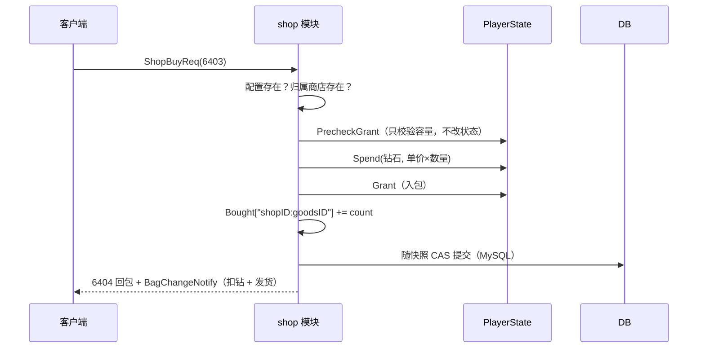
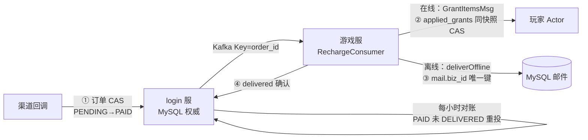

# 09 商店与经济（shop / recharge / grant / spend / attr）

> 一句话定位：本文覆盖游戏的经济系统——商店（限购与归属验证）、充值（R2.3 双栅栏最终一致）、统一的发放/消耗入口（grant/spend）与属性经济（attr）；核心问题是「钱与货如何原子对齐、幂等如何跨重启成立」。

## 1. 概述

经济系统的四个组成部分：

| 部分 | 位置 | 管什么 |
|---|---|---|
| shop 商店 | `internal/game/module/shop` | 商品列表、购买（扣费 → 发货 → 次数累加同一次 CAS）、归属验证 |
| recharge 充值 | `internal/login/` + `internal/game/mq/recharge_consumer.go` | 订单状态机 + Kafka 发货 + 离线邮件兜底（双栅栏） |
| grant / spend | `internal/game/module/grant.go` `spend.go` | 全模块统一的发奖/扣费入口：预检、溢出防护、零改动失败 |
| attr 属性 | `internal/game/module/attr` | 战斗属性的「计算面」：基础值 + 加成之和 |

它们的共同主线是**资产原子性**：一次购买 = 扣钻石 + 加道具 + 记次数，三者在同一条消息的同一次快照 CAS 里提交；充值则更进一步——钱的事实不能由缓存当权威，需要独立于快照链路的持久化事实链。

## 2. 涉及文件

| 路径 | 职责 |
|---|---|
| `internal/game/module/shop/shop.go` | 商店模块：6401-6404，列表/购买/跨天清零/归属验证 |
| `internal/game/module/shop/persist.go` | `RegisterStateful` 适配：Data ↔ `player_shop_record` 行 |
| `internal/game/module/shop/shop_test.go` | 单测：9 个用例，含 `gamedata.Replace` 热更验证归属 |
| `internal/game/module/grant.go` | 统一发奖入口：`Grant` / `PrecheckGrant` / 溢出与容量预检 |
| `internal/game/module/spend.go` | 统一扣费入口：`Spend` / `ErrNotEnough` |
| `internal/game/module/recharge/README.md` | 占位说明：充值入口在登录服 |
| `internal/login/service/recharge_service.go` | 订单状态机（PENDING → PAID → DELIVERED） |
| `internal/game/mq/recharge_consumer.go` | 游戏服侧发货消费者（在线 Actor / 离线邮件） |
| `docs/R2.3-充值双栅栏与最终一致设计.md` | 充值设计文档（本文主要参考） |
| `internal/game/module/attr/attr.go` | 属性模块：计算面与观测钩子 |

## 3. 核心设计

### 3.1 商店购买：顺序即正确性



`onBuy` 闭包内的顺序是刻意的（`shop.go:155-182`）：**先只预检 → 扣费 → 才发货**。反过来做就会出现「钱扣了货没到」或「货到了钱没扣」，只能客服补偿。三个失败分支（满包 6404、钻石不足 6402、配置/归属问题 6401）全部 `return false`——闭包无改动，不产生提交，玩家重试即可。

限购的跨天清零放在**读取路径**上（`persist.go:66-73`）：`normalize` 在 `load` 时按 `Day` 比较，跨天后第一次访问就看到 0，不需要全服定时任务，也不怕玩家离线几天漏刷。只读路径（列表）的 reset 不写回——下次读会重算，行为一致。

### 3.2 商店归属：从「配置写了但代码没读」到「下架」

商品行的第一列是 `shop_id`（归属商店）。旧实现用 `const defaultShopID = 1` 硬编码：商品挂到别的商店也记在 1 号店的计数下，**限购会串**。修复后（`shop.go:56-59`）：

```go
// shopExists 商店配置是否存在（shop 表是商品归属的权威）。
//
// 商品行第一列是 shop_id：归属到不存在的商店说明配置被改坏，
// 这种商品既不展示也不能买——否则玩家能绕过「商店下架」直接购买。
func shopExists(shopID int32) bool {
	_, ok := gamedata.GetShopCfg(int64(shopID))
	return ok
}
```

从 shop 表删掉一个商店，它下面的商品既不展示也不能买——这就是「下架」的实现方式。测试用 `gamedata.Replace` 热更临时配置验证（见 6.2），因为默认配置里商品恰好挂在 1 号店，硬编码和查表结果一样，测不出区别。

### 3.3 充值：双栅栏与最终一致

充值涉及钱，暴露了单栅栏（Redis 权威链路）答不上来的三个问题：发货后崩溃快照未落库、delivered 确认丢失、Kafka 重投 + 幂等键 TTL 过期。R2.3 的答案是**两条链路各管一段**：



两条链路互为对账凭据：订单说 PAID 而资产没有对应 `applied_grants` → 重投；资产有 `applied_grants` 而订单不是 DELIVERED → 补确认。任何单点丢失都会在下一个对账周期收敛。

游戏服消费者的三态本地性判定（`recharge_consumer.go:77-83`）：完全离线与「在线但在别的节点」都走离线邮件——邮件落库在玩家归属服，上线即可领取，不必等玩家回到本节点。在线发放走 Actor 投递 + 3s 超时（`recharge_consumer.go:201-227`）：`GrantItemsMsg` 带 `BizID=order_id` 是防重幂等的第二道闸。

确认消息失败只告警不重试（`recharge_consumer.go:111-126`）：奖励已到账，若此时返回 error，重投会被幂等标记挡成「已处理」，确认永远补发不了——**告警 + 对账优于报错重试**。

### 3.4 grant/spend：统一入口解决三类历史错误

```go
// internal/game/module/grant.go:63-81
func Grant(state PlayerState, grants []ItemGrant) ([]BagChange, error) {
	valid, err := validGrants(state, grants)
	if err != nil {
		return nil, err
	}
	if len(valid) == 0 {
		return nil, nil
	}
	// 容量按「新增种类」算，必须在入包前判断：入包后再判就得回滚。
	if !state.CanHold(valid) {
		return nil, ErrBagFull
	}
	out := make([]BagChange, 0, len(valid))
	for _, g := range valid {
		state.AddItem(g.ItemID, g.Count) // AddItem 内部标脏，调用方无需再 MarkDirty
		out = append(out, BagChange{ItemID: g.ItemID, Count: state.GetItemCount(g.ItemID), Delta: g.Count})
	}
	return out, nil
}
```

`Grant` 把 7 个模块各自重复的「预检容量 → 逐个 AddItem → 手工 MarkDirty」三步收成一次调用，并且保证「要么全发，要么一个都不改」：先全量预检，通过后才逐项入包。它修掉三类历史错误（`grant.go:1-12`）：预检漏做（背包满了还发，道具静默丢失）、溢出漏查（存量超 int32 后在协议里变负数）、MarkDirty 漏写（改了背包却不提交）。

```go
// internal/game/module/spend.go:29-43
func Spend(state PlayerState, itemID int32, count int64) error {
	if count <= 0 {
		return nil
	}
	if state.GetItemCount(itemID) < count {
		return ErrNotEnough
	}
	// RemoveItem 自带「数量不足返回 false 且不部分扣减」。
	// 上面刚查过一次，这里失败只可能是状态在两次读之间变了；
	// 按余额不足处理——宁可让玩家重试，也不能静默扣失败。
	if !state.RemoveItem(itemID, count) {
		return ErrNotEnough
	}
	return nil
}
```

`Spend` 与 `Grant` 对称：把「够不够」和「扣不扣得掉」合成一个答案，失败时状态零改动。`count <= 0` 视为免费直接成功——配置里「消耗填 0」的玩法不需要额外分支。

## 4. 关键代码解析

### 4.1 shop：onBuy 的三段式与复合键

```go
// internal/game/module/shop/shop.go:155-182（节选）
	err := m.Mutate(ctx, func(d *Data) bool {
		// 顺序即正确性：先只预检（不改状态）→ 扣费 → 才发货。
		// 反过来做就会出现「钱扣了货没到」或「货到了钱没扣」，只能客服补偿。
		grants := []module.ItemGrant{{ItemID: itemID, Count: gain}}
		if err := module.PrecheckGrant(ctx.State, grants); err != nil {
			resp.Code = codeBagFull
			return false
		}
		price := int64(cfg.Col3) * count
		if err := module.Spend(ctx.State, itemDiamond, price); err != nil {
			resp.Code = codeDiamondNotEnough
			return false
		}
		// 预检已过，这里必定成功；仍按错误处理是纵深防御（配置热更等极端情况）。
		c, grantErr := module.Grant(ctx.State, grants)
		if grantErr != nil {
			resp.Code = codeBagFull
			return false
		}
		changes = c

		normalize(d, today)
		key := goodsKey(int32(cfg.Col1), req.GoodsId)
		d.Bought[key] += int32(count)
		bought = d.Bought[key]
		applied = true
		return true
	})
```

`PrecheckGrant` 单独存在的理由（`grant.go:37-41`）：商店是「校验 → 中间还有别的事（扣费）→ 才发货」的场景，大多数模块直接用 `Grant` 即可，这类模块不必自己重抄容量与溢出判断。计数键 `"shopID:goodsID"` 是字符串复合键而非嵌套 map——购买记录是稀疏的，复合键省一层 map 且 JSON 序列化后人类可读，便于线上排查（`shop.go:65-71`）。

数量裁剪到 1-999（`shop.go:131-138`）：0/负数按 1，上限防单次请求买穿限购与造成大额扣费。

### 4.2 recharge：rewardItems 与演示期边界

```go
// internal/game/mq/recharge_consumer.go:234-240
func rewardItems(msg pkgmq.RechargeOrderMsg) ([]player.GrantItem, error) {
	if msg.AmountFen <= 0 {
		return nil, fmt.Errorf("amount_fen must be > 0")
	}
	// 演示道具 ID 1001 = 钻石；1 分 = 1 钻石（P6 按档位表配置）
	return []player.GrantItem{{ItemID: 1001, Count: int64(msg.AmountFen)}}, nil
}
```

演示期硬编码档位，生产必须改为查 `gamedata` 的 recharge_product 表——注释同时提醒：真实场景的 0 元单应由配置表白名单放行，而非这里拒绝。

### 4.3 attr：只消费「和」的计算面

attr 模块本身只有 50 行，没有任何协议——它是「计算面」：最终值 = 基础值（`player_attr` 表，升级重算，随 Profile 快照）+ 加成（装备/伙伴通过 `State.AddBonus/ClearBonus` 维护）。本模块只消费这个和，把五维属性打包进 PlayerInfo 下发。加成刻意不落库：每次登录由装备/伙伴按快照重算，落库反而会造成重复累加（`attr.go:6-9`）。这与 equip 的「登录重算」是同一契约的两侧。

## 5. 演进记录

| 提交 | 事件 |
|---|---|
| `cb6bbb3` | P6 业务闭环（第二批）：商店模块落地 |
| `5ab39ac` | refactor(module): 充值补离线持久发放（R2.2–R2.4）——DeliverOffline |
| `a12618f` | feat(module): Grant 统一发奖路径，补上溢出防护并清掉 11 处冗余标脏 |
| `869ac85` | feat(module): Spend 统一扣费路径，修掉丢弃 RemoveItem 返回值的静默失败 |
| `7798eab` | refactor(shop): 迁到 Stateful[Data]（287 → 268 行）；补 7 个单测（0% → 74%） |
| `cda0e9e` | fix(config): shop 归属漂移修复——按 Col1 取 shopID 并校验存在 |

**Grant 统一入口（a12618f）**：此前 7 个模块各自重复「预检 → AddItem → MarkDirty」，三处都能出错。统一后顺带清掉 11 处冗余 `MarkDirty("bag")`——`AddItem` 内部其实已经标脏，那行本来是「靠人记得」的历史写法。

**Spend 统一入口（869ac85）**：修掉「丢弃 `RemoveItem` 返回值」的静默失败——游戏里表现为「升级成功但钱没扣」。

**shop 归属修复（cda0e9e）**：与 skill_upgrade 消耗、mail_template 文案同批修掉的「配置写了但代码没读」漂移。运营照表调数值、玩家侧毫无变化且不报错——比缺功能更坑。测试用 `gamedata.Replace` 热更临时配置：商品挂 2 号店时计数键是 `"2:9"`、归属商店不存在时列表隐藏且购买被拒；三处变异（改回线性消耗/忽略模板/计数硬编码 1）全部被抓。

## 6. 测试情况

当前 `go test -cover ./internal/game/module/shop/ ./internal/game/module/attr/`：shop **75.8%**、attr **100%**。充值侧的测试在 `internal/game/mq/recharge_consumer_test.go` 与 `internal/login/service/recharge_service_test.go`。

**shop（9 个用例）**：购买主路径 `TestBuyDeductsAndGrants`（扣钻 + 发货 + 计数）、`TestBuyNotEnoughDiamond`（6402 且不扣钱）、`TestBuyBagFullDoesNotCharge`（6404 且不扣钱）、`TestBuyUnknownGoods`、`TestBuyClampsCount`（1-999 裁剪）；列表 `TestListShowsBought`；跨天 `TestNormalizeResetsAcrossDays`；归属两个用例用 `gamedata.Replace` 热更：

```go
// internal/game/module/shop/shop_test.go:143-164（节选）
func swapConfig(t *testing.T, shopJSON, goodsJSON string) {
	t.Helper()
	origShop, err := json.Marshal(gamedata.ShopCfgList())
	require.NoError(t, err)
	origGoods, err := json.Marshal(gamedata.ShopGoodsCfgList())
	require.NoError(t, err)

	t.Cleanup(func() {
		_, err := gamedata.Replace(map[string][]byte{"shop": origShop, "shop_goods": origGoods})
		require.NoError(t, err, "恢复出厂配置失败")
	})

	_, err = gamedata.Replace(map[string][]byte{
		"shop":       []byte(shopJSON),
		"shop_goods": []byte(goodsJSON),
	})
	require.NoError(t, err, "热更配置失败")
}
```

只动这两张表：其他包不读它们，跨包并行跑测试时不会互相干扰（gamedata 是全局快照，动别的表就有风险）。`TestBuyKeyUsesConfiguredShopID` 断言计数键是 `"2:9"` 且**不包含** `"1:9"`；`TestGoodsInMissingShopHiddenAndUnbuyable` 断言归属商店不存在时列表不展示、直接买回 6401 且不扣钱。

**attr**：两个钩子 + 构造，100% 覆盖——小模块的全部可测面就是生命周期。

## 7. 小结

- 商店的购买顺序（预检 → 扣费 → 发货）与清零位置（读取路径）是两个「位置决策」：前者保证钱货原子，后者免去全服定时任务。
- 商店归属验证把「下架」变成配置动作：删 shop 表的行，商品自动既不展示也不可买。
- 充值的核心认知是「钱的事实不能由缓存当权威」：订单链路（MySQL 权威）与资产链路（快照权威）互为对账凭据，任何单点丢失都在下一个对账周期收敛；离线邮件用 DB 唯一键兜底。
- grant/spend 用两个函数消灭了 7 个模块的重复预检与两类静默失败（漏标脏、丢返回值）——统一入口是经济正确性的基础设施。
