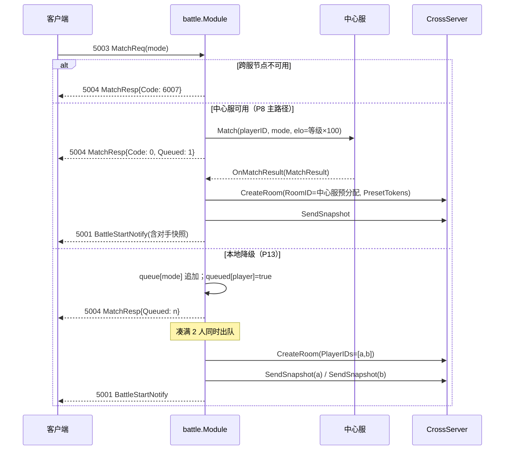
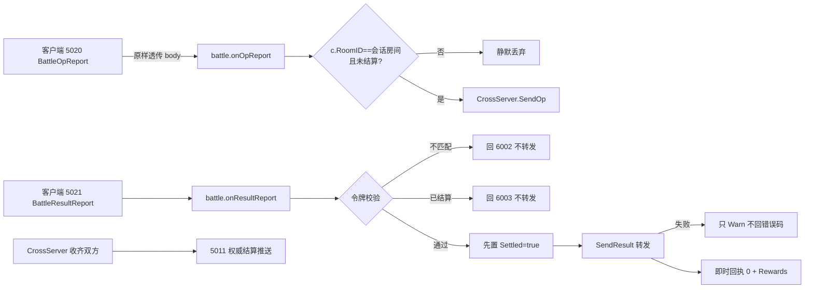
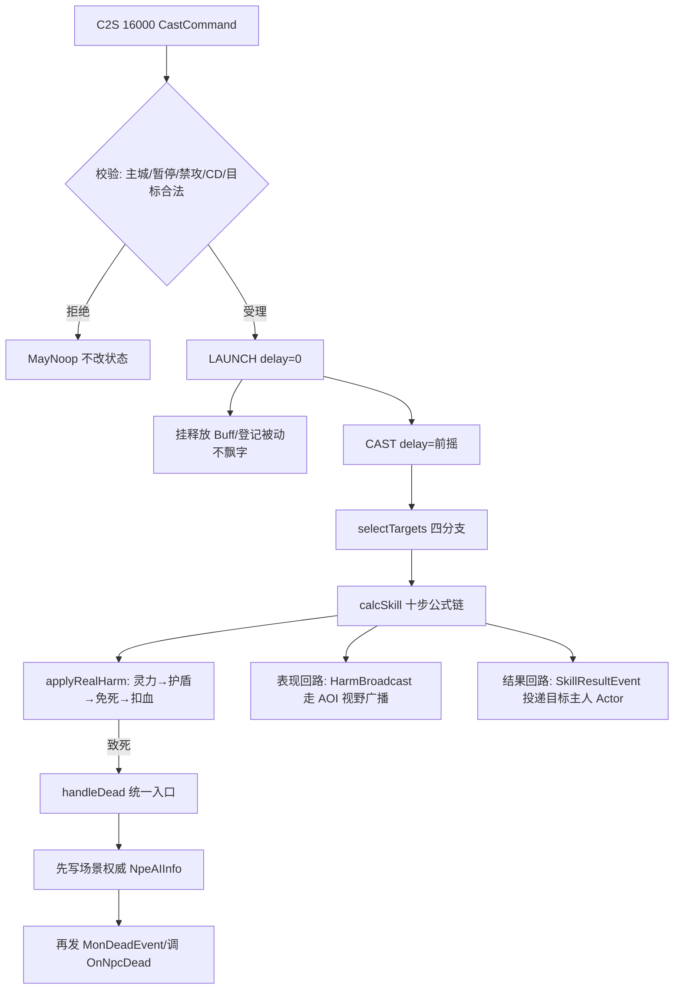
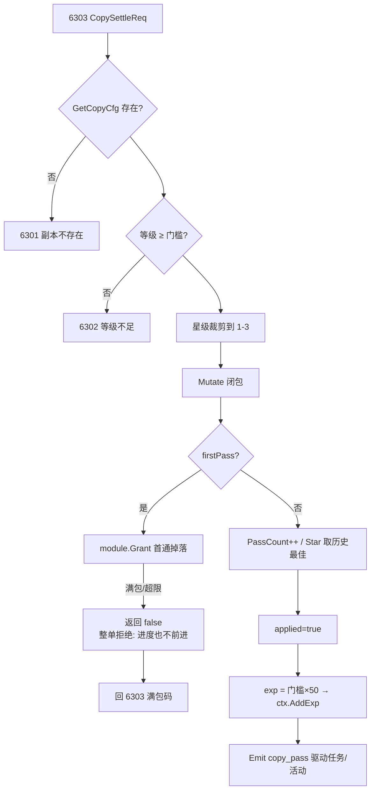

# 10-战斗与副本

> 一句话定位：战斗与副本是游戏服里「离实时性最近」的两个模块——`battle` 以模块级共享状态管匹配、建房、透传与结算，`copy` 以玩家私有状态管副本进度与首通发奖，而真正的技能伤害结算在 `internal/scenemap/battle` 这张「挂在 MGR 上的算法库」里完成；三层各守一段，互不越权。

## 概述

「战斗」在这个项目里被拆成三个完全不同的东西，理解这一点是读懂本章的前提：

| 层次 | 位置 | 职责 | 并发模型 |
| --- | --- | --- | --- |
| 战斗模块层 | `internal/game/module/battle` | 匹配凑人、向 CrossServer 申请建房、消息透传、结算回执 | 模块级共享状态，`sync.Mutex` 显式保护 |
| 副本模块层 | `internal/game/module/copy` | 副本进度（星级/次数/首通）、结算发奖 | 玩家快照 `Ext["copy"]`，Actor 单线程免锁 |
| 战斗运行时 | `internal/scenemap/battle` | 技能公式、Buff、子弹、死亡链 | 挂在 MGR 上的算法库，只在 MGR goroutine 内执行 |

Demo 期有一个重要的职责边界写在 `internal/game/module/battle/battle.go:1-8`：服务端只做三件事——**通知发起**（匹配凑人 → 申请建房 → 下发 `BattleStartNotify`）、**消息透传**（`BattleOpReport` 原样转发，不解析 body）、**接收结果**（`BattleResultReport` → 令牌校验 + 幂等 → 回 `BattleSettleNotify`）。战斗演算（技能/伤害/胜负）完全在客户端，服务端不做防作弊校验（后置到战斗 2.0）。这与 `internal/scenemap/battle` 是两回事：后者是 ARPG 场景框架内的实时技能结算，是「战斗 2.0」的预研实现，同一套代码库里的两种战斗形态服务不同玩法。

副本模块则走常规业务模块路子：进度存玩家快照，结算时与经验在同一次 Redis CAS 提交（契约见 [05-持久化Stateful.md](05-持久化Stateful.md)）。

## 涉及文件

| 文件 | 行数 | 职责 |
| --- | --- | --- |
| `internal/game/module/battle/battle.go` | 626 | 战斗模块全量：协议注册、匹配、建房、透传、结算、跨服回调 |
| `internal/game/module/battle/battle_test.go` | — | 30 个用例，覆盖率 97.1% |
| `internal/game/module/copy/copy.go` | 210 | 副本进度与结算发奖 |
| `internal/game/module/copy/persist.go` | 59 | `RegisterStateful` 注册 + `toRow`/`fromRow`/`validate` |
| `internal/game/module/copy/copy_test.go` | 152 | 3 个用例，覆盖率 55.1% |
| `internal/scenemap/battle/doc.go` | 44 | 包定位、双回路、不变量清单 |
| `internal/scenemap/battle/formula.go` | 453 | `calcSkill` 十步伤害流水线 |
| `internal/scenemap/battle/cast.go` | 610 | LAUNCH/CAST 两段式出手、子弹、火墙、子技能 |
| `internal/scenemap/battle/buff.go` | 246 | Buff 叠加、DoT/HoT、时停恢复 |
| `internal/scenemap/battle/death.go` | 145 | 死亡统一入口、仇恨维护 |
| `internal/scenemap/battle/target.go` | 237 | 选敌四分支、范围判定 |
| `internal/scenemap/battle/sprite.go` | 243 | 战斗投影（属性/ Buff 快照） |
| `internal/scenemap/battle/runtime.go` | 493 | 运行时、延时任务、冷却、Tick |
| `internal/scenemap/battle/config.go` | 391 | 技能/Buff/怪物配置表（万分比整数） |
| `internal/scenemap/battle/types.go` | 290 | 飘字、事件、结果回执类型 |
| `internal/scenemap/battle/command.go` | 59 | `EnsureCommand`/`SyncPlayerCommand`/`CastCommand` 命令适配 |
| `internal/game/server_start.go` | — | 装配：battle 模块与 copy 模块注册 |

## 核心设计/流程

### battle：匹配到开战的主链路



### 战斗中的两条上报路径



### scenemap/battle：一次出手的完整链路



### copy：结算的原子边界



## 关键代码解析

### battle：为什么模块级共享状态必须显式加锁

`internal/game/module/battle/battle.go:136-161` 的注释把这件事说得很清楚：背包/任务等玩家内模块的状态挂在玩家快照上，由 Actor 单线程串行访问、天然免锁；而战斗是**全模块级共享状态**——会被多个玩家的 Actor 并发读写（各自的 `OnMessage`），还会被 CrossServer/中心服回调线程直接触达（`OnBattleSync` 等）。所以 `Module` 用 `mu sync.Mutex` 保护 `sessions`/`queue`/`queued` 三个 map。

加锁只是及格线，真正的纪律是**锁的粒度**。两处典型写法：

```go
// internal/game/module/battle/battle.go:222-224
if m.center != nil && m.center.Available() {
    // 先解锁再调中心服：Match 内部走 RPC，可能慢，绝不能持锁等待
    m.mu.Unlock()
```

```go
// internal/game/module/battle/battle.go:506-516
// 先在锁内收集 targets、再解锁推送：Push 内部要跨 Actor 投递，可能慢，
// 持锁执行会把所有玩家的 OnMessage 全堵住
m.mu.Lock()
targets := make([]int64, 0, 2)
for pid, s := range m.sessions {
    if s.RoomID == msg.RoomId && pid != msg.PlayerId {
        targets = append(targets, pid)
    }
}
m.mu.Unlock()
```

另一处细节是 `SessionOf` 返回**浅拷贝**而非原指针（`internal/game/module/battle/battle.go:597-607`）：调用方拿到的是快照，不会与内部状态的并发修改产生数据竞争。

### onMatch：中心服路径与本地降级路径

`onMatch`（`internal/game/module/battle/battle.go:187-266`）按优先级分三路：

1. **前置拒绝**：`cross.Available()` 为 false 直接回 6007——「不给玩家进了队列却永远匹配不到的希望」。
2. **重复入队/战中再匹配**：`queued` 与 `sessions` 双重检查回 6006。其中已结算未回收的会话（`Settled=true`）会被立即清掉，否则「玩家打完一场要等 2s 才能再排」——这 2s 来自 `OnBattleResult` 里的延迟清理。
3. **中心服匹配**（P8 主路径）：Elo 用等级 ×100 近似（demo 期无独立 Elo 存储），失败回 6007 且**不走本地队列**（不能悄悄降级，否则中心服恢复后两边状态不一致）。
4. **本地队列降级**：凑满 `matchPlayers=2` 人时，`queue` 与 `queued` 两个结构必须在同一把锁内同步变更——注释特意强调「否则防重复入队防护失效」。

mode 空串兜底为 `"arena"`（`internal/game/module/battle/battle.go:188-192`）：避免客户端不传模式时把队列打散到 `""` 键下永远凑不到人。playerID 一律取 `ctx.State.PlayerID()` 而不信协议体（防伪造他人匹配）。

### onResultReport：令牌校验 + 幂等「先占坑再转发」

`internal/game/module/battle/battle.go:383-427` 是结算安全的核心，三层校验层层收紧：

```go
// 房间不匹配视同令牌无效：客户端改报别的房间，等价于拿着别房的信物来冒领
if s == nil || s.RoomID != req.RoomId {
    resp.Code = codeTokenInvalid
    return nil
}
if req.BattleToken != s.Token {
    resp.Code = codeTokenInvalid
    return nil
}
if s.Settled {
    resp.Code = codeAlreadyDone
    return nil
}
```

通过后的顺序刻意是「**先占坑再转发**」（`internal/game/module/battle/battle.go:409-421`）：先在内存置 `Settled=true`，再 `SendResult` 转发；即使转发失败也不接受第二次上报。注释写明了这个取舍：「宁可丢一次转发（CrossServer 侧还有兜底结算），也不能重复计分」。转发失败只记 Warn 不回错误码——客户端侧结果已显示，权威奖励由 CrossServer 收齐双方后回推 5011，最终一致。

### OnBattleResult：迟滞安全与排行上报

跨服回调 `OnBattleResult`（`internal/game/module/battle/battle.go:524-579`）防的是「迟滞消息」：旧房间的迟到结算不能把玩家新会话误标为已结算，所以置位前再校验一次 `s.RoomID == res.RoomId`。竞技场积分按 胜 +30 / 负 -10 / 平 0 上报，**平局 delta=0 时跳过上报**（避免为零变动白发一次中心服请求）；幂等键 `fmt.Sprintf("battle:%d:%d", res.RoomId, res.PlayerId)` 保证同一次结算重投只加一次分。会话清理延迟 2s 且删前再校验 RoomID——给在途的 `onResultReport` 留出读完会话的窗口。

### copy：onSettle 的 applied 标记

`onSettle`（`internal/game/module/copy/copy.go:112-201`）是 [06-任务与签到quest.md](06-任务与签到quest.md) 里 quest 迁移时踩过的同一个坑的教科书处理。首通发奖遇到满包时，闭包内必须**先设拒绝码再返回 false**：

```go
// internal/game/module/copy/copy.go:152-166
if firstPass {
    grants := make([]module.ItemGrant, 0, 4)
    for _, drop := range gamedata.CopyDropCfgList() {
        if drop.Col1 != cfg.Id {
            continue
        }
        grants = append(grants, module.ItemGrant{ItemID: int32(drop.Col2), Count: drop.Col3})
    }
    bagChanges, grantErr := module.Grant(ctx.State, grants)
    if grantErr != nil {
        resp.Code = codeBagFull
        return false
    }
    changes = module.ToItemChanges(bagChanges)
}
```

闭包返回 false 时 `applied` 保持 false，`copy.go:174-177` 立即 return——**拒绝码不能被成功码覆盖**，且进度也不前进（玩家清包后重新结算）。满包整单拒绝而不是部分发放，是因为掉落是一个整体奖励包，发一半比不发更难解释。

### copy：星级裁剪与值类型 map

客户端上报的星级裁剪到 1-3（`internal/game/module/copy/copy.go:126-133`）：0/负数按 1 星、超高按 3 星，防止脏数据落库。`Record` 注释（`copy.go:52-53`）特意标注了一个 Go 知识点：`map[int32]Record` 是**值类型 map**，读出来的是副本，改字段后必须整值写回（`d.Records[req.CopyId] = rec`），就地改 `rec.Star` 不生效。

首通判定用「先取反再置位」（`copy.go:141-148`）：`firstPass = !rec.FirstPass` 必须在改写 `rec.FirstPass = true` **之前**求值，否则第二次结算永远被判为首通。通关经验 = 等级门槛 × 50（门槛缺失保底 50），`ctx.AddExp` 是可选注入（nil 时跳过，测试/无等级系统环境）；`ctx.Emit("copy_pass")` 驱动任务/活动消费，与 [06-任务与签到quest.md](06-任务与签到quest.md) 的 quest 事件推进衔接。

### copy/persist.go：validate 的三条结构性不变量

`internal/game/module/copy/persist.go:48-58` 在落库前校验副本 ID 为正、星级 0-3、次数非负。星级上界 3 写死在校验里而非配置，注释解释了原因：「它同时约束客户端展示与服务端存储」。`newData` 保证 map 非 nil（`persist.go:22-23`）——`onSettle` 会写入，nil map 赋值直接 panic。

### scenemap/battle：MGR 为什么不 import battle

`internal/scenemap/battle/doc.go:12-20` 阐明了一个依赖方向决策：MGR 的职责是「串行 + 权威」，不是「认识伤害公式」；反过来让 MGR 依赖 battle 会把「改一个技能系数」变成「改场景核心」。battle 因此以两种方式挂进 MGR：

- **命令**：`battle.NewCastCommand` 返回 `mgr.Command`，玩家 Actor 通过 `Mgr.Call` 投递，在 MGR 串行队列里执行；
- **定时钩子**：装配层把 `battle.Tick` 塞进 `mgr.Deps.BuffTick`（500ms，吃倍速），由 MGR 统一驱动 buff/子弹/火墙/延时施法。

连「初始化运行时」都要走命令而非直接调函数（`internal/scenemap/battle/command.go:7-11`）：`Ensure` 会写 `State.Ext`（可观察状态），必须在 MGR 的串行队列里做，直接调会与正在执行的进图/移动命令竞争同一份 State——这正是单写者纪律要杜绝的越权。

### calcSkill：十步流水线

`internal/scenemap/battle/formula.go:26-35` 的注释解释了为什么把公式链拆成十步而不是一坨 if：「掉序（例如先吸血后扣血）是这类系统最隐蔽的 bug，按规格顺序排列能让 review 只对照文档即可」。流水线（`formula.go:38-166`）：

1. **前置拦截**：攻击者死亡/禁攻直接取消整条链（禁攻是「整条链取消」而非「打 0 伤害」，客户端不该看到飘字）；目标无敌保留一次 SUPER 飘字（伤害 0 + 免疫标签）；
2. **LAUNCH**：只挂释放 Buff、登记被动，不产生伤害；
3. **伤害类型分流**：纯效果/AOE/吸血/同主人四类特殊路径提前返回；
4. **斩杀**：只对小怪、目标无免死、按万分比概率；
5. **闪避**：命中率统一换算到万分比（`formula.go:276-281`，规格原文的 `+1` 浮点校正被有意移除，见设计文档 §5）；
6. **伤害公式**：每一步显式 `PermilleOne` 整除截断，顺序与截断点一起构成「可复现」；
7. **落地扣血**：`applyRealHarm` 按 灵力 → 护盾 → 免死 → 扣血 的顺序结算（`formula.go:354-358`），`dead=true` 后统一走死亡入口；
8. **吸血 → 反伤**：顺序不可变；
9. **命中 Buff/被动**；
10. **收尾**。

所有系数用万分比整数而非 float64（`internal/scenemap/battle/config.go:9-13`）：「伤害链路要可复现、可回放，浮点在跨平台/编译器上会产出无法解释的线上问题；整数乘法 + 显式截断把舍入点固定在每一步」。

### handleDead：统一入口 + 幂等 + 双写顺序

`internal/scenemap/battle/death.go:8-22` 是战斗系统里最容易被写错的一段。一只怪可能在同一拍被三类来源打到：技能命中、Dot 跳伤、火墙 tick；每个来源各自「扣血到 0 → 发放掉落」会出双份掉落、重复通关。所以：

```go
// internal/scenemap/battle/death.go:26-29
if rt.dead[sp.UUID] {
    return // 幂等：同一只怪只结算一次死亡
}
rt.dead[sp.UUID] = true
```

`rt.dead` 是 MGR 私有的进程内标记。双写顺序同样关键（`death.go:19-21`）：**先写场景权威**（`NpeAIInfo`：HP/AI/DeadAt/清仇恨），**再发事件/调钩子**——反过来会出现「玩家已收到击杀事件，但场景里怪还活着」的窗口，玩法在事件里立刻清场/推进波次时会看到一只不该存在的怪。

配套的确定性设计：`tickBuffs` 按 UUID 升序遍历（`buff.go:123-128`），因为 Dot 致死会触发死亡链，「同一拍两只怪互致死」的击杀归属在两次运行间必须相同。`Sprite.EffAtk` 只累加 BuffAttr 类层数（`sprite.go:123-127`），装备/光环加成由玩家 Actor 同步属性时算好——「两份计算必然漂移」。Buff 施加时从配置**快照**字段（`sprite.go:185-188`）：配置热更不应改变已挂在玩家身上的 Dot 数值。

## 演进记录

- **`4dbbef9` feat(scenemap): 实现技能战斗结算系统并接入场景框架**——`internal/scenemap/battle` 从零落地：公式/施法/死亡链/Buff/选敌/子弹火墙一应俱全，通过命令与 `Deps.BuffTick` 两种方式挂进 MGR，并配套 examples 装配。
- **`dbcd757` refactor(copy): 迁到 Stateful[Data]（275 → 210 行）**——7 个手写编解码模块（quest/activity/partner/skill/shop/equip/copy）迁移收官，业务文件里不再出现 `json.Marshal`/`SetExt`/`model.*Row`。提交说明特别记录：`onSettle` 用 `applied` 标记处理「首通满包时拒绝码不能被成功码覆盖」，与 quest 迁移时踩过的坑相同。
- **`5f93baa` test(battle): 补战斗模块单测（0% → 97.1%）；删死代码 reply**——battle 从零覆盖补到 97.1%，重点钉住三条不变量（队列/会话一致性、结算的令牌与幂等、回调的迟滞安全），并做三处变异验证（去掉令牌校验/结算幂等/重复入队检查全部被抓）。
- **`7452c87` refactor: 清死代码；修 4 处错误码与 proto 撞车**——`battle.codeAlreadyIn=6001` 与 proto `BATTLE_NOT_FOUND` 撞、`codeModeClosed=6004` 与 `BATTLE_FULL` 撞，玩家会看到错误的失败原因；改为 6006/6007（proto 语义一致的 6002/6003 保持不动）。同时新增 `errcode` 守护测试：模块码撞 proto 值必须登记白名单。
- **`dcd8354` fix(module): 修复重复回包导致响应串号**——`Typed` 统一回包后，模块内手写 `reply` 会多发一条响应，多出来的那条会被下一次请求当成自己的响应读走；battle/copy 等模块同步清理。
- **`a12618f` feat(module): Grant 统一发奖路径**——copy 首通掉落等 11 处发奖收敛到 `module.Grant`（溢出预检 → 容量预检 → 入包），详见 [09-商店与经济.md](09-商店与经济.md)。

## 测试情况

**battle 模块**（`internal/game/module/battle/battle_test.go`，30 个用例，实测覆盖率 97.1%）。按提交 `5f93baa` 固化三条不变量：

- 队列与会话一致性：`TestMatchRejectsDuplicateQueue`、`TestMatchRejectsWhileInBattle`、`TestMatchPairsTwoPlayers`（凑满两人必须同时出队）、`TestMatchReturnsPlayersToQueueOnCreateFailure`（建房失败放回队尾）、`TestMatchClearsSettledSession`（已结算会话立即清）；
- 结算的令牌与幂等：`TestResultReportRejectsInvalidToken`、`TestResultReportSettlesAndIsIdempotent`、`TestResultReportSurvivesCrossFailure`（转发失败仍回 0 但幂等位已占住）；
- 回调的迟滞安全：`TestOnBattleResultIgnoresStaleRoom`、`TestOnBattleSyncPushesPeersOnly`、`TestOnBattleResultSettlesAndReportsRank`（room+player 幂等键）。

其余覆盖中心服匹配（Elo 近似、失败回码、不走本地队列）、空 mode 兜底 arena、快照发送失败不阻塞开战（`TestMatchSnapshotSendFailureDoesNotBlock`）、操作透传原样 body、`OnMatchResult` 四种残缺输入、平局不上报积分、`SessionOf` 返回拷贝防数据竞争。

**copy 模块**（`internal/game/module/copy/copy_test.go`，3 个用例，实测覆盖率 55.1%）：`TestSettleFirstPassGrantsOnce`（首通只发一次奖）、`TestStarKeepsBest`（历史最佳只升不降）、`TestLevelGate`（等级门槛强校验）。覆盖率中等的原因：`onList` 依赖 `gamedata.CopyCfgList` 全局配置、满包分支需要构造 `module.Grant` 失败场景，这两类在当前脚手架下成本偏高，属于已知缺口而非遗漏。

**scenemap/battle 运行时**（18 个用例，实测覆盖率 45.5%），分两个文件：

- `formula_test.go`（8 个）：固定输入 → 固定输出的伤害断言（`TestDamageFormulaFixedValue`，配置数值刻意做成「一眼能算出来」，见 `config.go:318-322`）、不暴击对照组、闪避归一化（命中 0 必闪/命中满必中）、护盾吸收与免死截断、DoT 周期结算与到期移除、叠层上限（MaxStacks=3）、斩杀只对小怪且不走闪避链、无敌 Buff 的 0 伤害 + SUPER 标签；
- `cast_test.go`（10 个）：LAUNCH 不飘字直到 CAST、CD 拒绝、主城与缺技能拒绝、镜像白名单、多段伤害按段间隔、范围技按人数截断、**击杀幂等**（同拍多来源只走一次死亡链，`TestKillIsIdempotent`）、死亡目标不被后续技能结算、Ensure 幂等、友方单体默认目标是自己。

未覆盖部分主要是子弹飞行（`tickBullets`）与火墙周期（`tickFirewells`）的时间推进细节，这两类逻辑与多段伤害同构，由 examples 的集成测试（`internal/scenemap/examples/battle_flow_test.go`）做端到端兜底。

## 小结

战斗与副本这一组把「三种并发模型」摆在了同一章里：battle 是模块级共享状态，靠 `sync.Mutex` 加「锁内只做快、锁外做慢」的粒度纪律；copy 是玩家私有状态，靠 Actor 单线程和一次 Redis CAS 保证「结算事实、首通奖励、经验」同生同滚；scenemap/battle 是挂在 MGR 上的算法库，靠单写者纪律和「命令 + 定时钩子」两种挂载方式与场景框架解耦。

最值得复用的有三条：**幂等先占坑再转发**（宁可丢一次旁路，不可重复计分）、**死亡统一入口 + 先写权威再发事件**（表现可以迟到，事实不能矛盾）、**错误码与 proto 段位对齐**（6001 撞 `BATTLE_NOT_FOUND` 的教训：客户端按码弹文案，码错了比失败本身更伤）。副本侧则是 [04-模块系统module.md](04-模块系统module.md) 状态机范式与 [09-商店与经济.md](09-商店与经济.md) 统一发奖入口的组合运用，`applied` 标记的写法与 quest 完全同构。

下一篇 [11-社交系统.md](11-社交系统.md) 看聊天/组队/公会如何用窄接口隔离测试；场景框架全貌（AOI/MGR/room/bridge）见 [12-场景scenemap.md](12-场景scenemap.md)；模块基座与持久化契约见 [04-模块系统module.md](04-模块系统module.md) 与 [05-持久化Stateful.md](05-持久化Stateful.md)。
