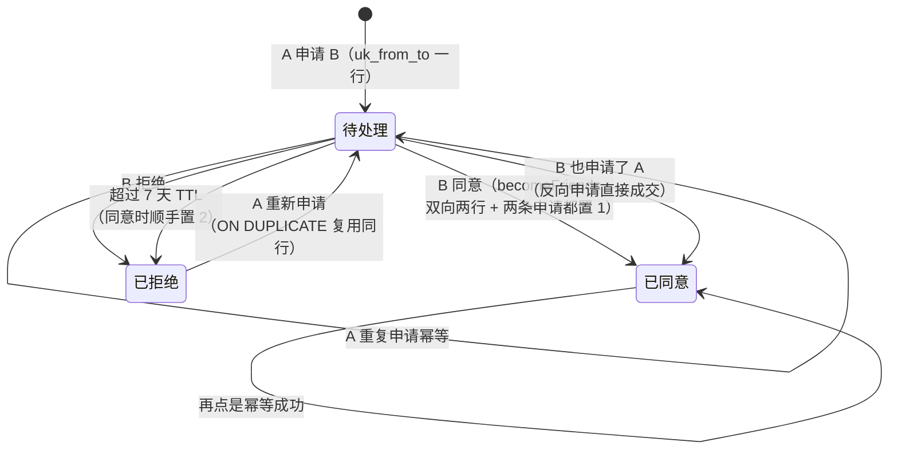

# 11-社交系统

> 一句话定位：社交五件套（聊天/组队/公会/好友/榜单）共享同一套架构姿态——**关系型数据全部 MySQL 直写、不过 Persister 快照链路，模块零内存态、零锁**，跨玩家的并发安全交给数据库（唯一键 + `FOR UPDATE` + 事务），模块层只留编排逻辑并用窄接口隔离出可单测的部分。

## 概述

社交系统的本质是「关系」：一条好友关系横跨两个玩家，一支队伍属于多个玩家，一个公会属于几百个玩家。这类数据与任务/背包有根本区别——背包状态可以整个塞进一个玩家的快照 JSON 列，而「好友关系」放任何单边快照都无法表达「两边都在或都不在」，也无法约束唯一性。所以五个社交模块一致地选择了 MySQL 直写：

| 模块 | 存储 | 状态 | 并发安全靠什么 |
| --- | --- | --- | --- |
| chat | `chat_record` + Redis 暂存 + Kafka | 无（纯编排） | 唯一键 `uk_owner_msg`、`ON DUPLICATE KEY` |
| team | `team` + `team_member` | 无 | 事务 + `FOR UPDATE` 锁队行 |
| guild | `guild` + `guild_member` | 无 | 事务 + `FOR UPDATE` 锁会行 + 唯一键 |
| friend | `friend` + `friend_apply` | 无 | 事务 + 双向两行 + 间隙锁 |
| rank | 不持有（代理中心服 Redis ZSet） | 无 | 中心服单点权威 |

五个模块因此都不需要 `sync.Mutex`：`OnMessage` 在各自玩家的 Actor 内串行执行，而「两个玩家同时操作同一关系」的竞争全部下沉到数据库事务。这也是它们与 [10-战斗与副本.md](10-战斗与副本.md) 里 battle 模块（模块级共享状态 + 显式加锁）形成对照的原因——状态放哪里，决定了并发模型。

另一个共同手法是**窄接口抽取**：`chatRepo`/`teamRepo`/`guildRepo` 把模块对仓储的依赖收窄成接口，`*Repo` 隐式实现、装配层零改动，测试注入 fake 即可脱离 MySQL 验证编排逻辑。三个模块的补测试提交（`9d1bb6c`/`c231cc2`/`a53d736`）都伴随着这一步。

## 涉及文件

| 文件 | 行数 | 职责 |
| --- | --- | --- |
| `internal/game/module/chat/chat.go` | 419 | 私聊全链路：发送/投递/历史 |
| `internal/game/module/chat/chat_test.go` | — | 23 个用例，覆盖率 75.5% |
| `internal/game/module/team/team.go` | 450 | 组队：信息/创建/加入/退出 |
| `internal/game/module/team/team_test.go` | — | 21 个用例，覆盖率 50.7% |
| `internal/game/module/guild/guild.go` | 422 | 公会：信息/创建/加入/退出 |
| `internal/game/module/guild/guild_test.go` | — | 19 个用例，覆盖率 58.8% |
| `internal/game/module/friend/friend.go` | 511 | 好友：申请/同意/拒绝/删除 |
| `internal/game/module/friend/friend_test.go` | — | 3 个用例，覆盖率 11.2% |
| `internal/game/module/rank/rank.go` | 179 | 榜单查询（代理中心服） |
| `internal/game/module/rank/rank_test.go` | — | 4 个用例，覆盖率 100% |
| `internal/game/mq/chat_cross_consumer.go` | — | 跨服私聊消费者（本地性判定 + 幂等） |
| `internal/game/offline.go` | — | 登录时 `drainOfflineChat` 补投离线私聊 |
| `internal/game/server_adapters.go` | — | `chatMessenger` 实现 `Messenger` 四方法 |

## 核心设计/流程

### chat：一条私聊的三路投递

```mermaid
flowchart TD
    A[6001 ChatSendReq] --> B{频道校验<br/>channel∈{0,2}?}
    B -->|否| B1[4001 频道未开放]
    B --> C{内容非空<br/>对端 id>0?}
    C -->|否| C1[4005]
    C --> D{双长度上限<br/>≤200 字符且 ≤900 字节?}
    D -->|否| D1[4006 内容超长]
    D --> E{频控 1条/秒 突发3?}
    E -->|否| E1[4003 发言过快]
    E --> F[nextMsgID 生成<br/>毫秒<<20 | 20位随机]
    F --> G[本端落 out 历史<br/>background ctx]
    G --> H[deliver 三路互斥]
    H --> I{对端在线?}
    I -->|离线| I1[PendOffline<br/>Redis List 暂存]
    I -->|本服在线| I2[先落 in 历史<br/>再 Actor 推送]
    I -->|跨服在线| I3[ProduceCross<br/>Kafka 按 ToID 分区]
    I1 --> J[回包 0 + msgID<br/>投递失败不回错误码]
    I2 --> J
    I3 --> J
    K[对端登录] --> L[drainOfflineChat 补投]
    M[跨服节点消费] --> N[本地性判定 + msgID 幂等<br/>→ DeliverInbound 落 in]
```

### friend：申请的状态机



## 关键代码解析

### chat：msgID 的位域组装与「概率唯一」的坦诚

`nextMsgID`（`internal/game/module/chat/chat.go:395-418`）用 `毫秒时间戳 << 20 | 20 位 crypto/rand` 组装全局消息 ID，三重考量写在注释里：时间戳占高位保证整体单调递增（MySQL 顺序插入、索引页分裂最少，且 2^40.7 左移 20 位后 2^60.7 不溢出 int64）；低 20 位（约 104 万槽位）放同毫秒随机；用 `crypto/rand` 而非 `math/rand` 是因为 msgID 会暴露给客户端且是 Kafka 幂等键，不能是可预测序列。

但这个设计最值得学的是它**对局限的坦诚**：注释明确算出碰撞概率上界 n(n-1)/2^21——每毫秒 10 条约 0.4%、100 条约 48%，并说明「真要支撑每毫秒上千条，必须换成节点 ID + 序列发号器，当前位宽不够」；碰撞后果是 `uk_owner_msg` 静默忽略后一条，即「极低概率丢一条消息」而非串号。提交 `c441ac2` 专门修正了原先夸大的说法（原注释称「几千条并发仍可忽略」），测试也从「断言 1000 条 ID 互不相同」改为测位域边界——那是在测实现没承诺的性质。

### chat：为什么内容要有双长度上限

`internal/game/module/chat/chat.go:58-69` 的两条上限是一对组合拳：`maxContentRunes=200` 按**字符**限制（中文一字 3 字节，只数字节会把 200 字中文拦成 66 字），`maxContentBytes=900` 兜底极端 emoji 组合（一个视觉字符可占十几字节，能把 rune 数压得很低、字节数很大）。必须有上限的原因：包大小上限（64KB）只拦单包，一条 64KB 私聊照样会写进 MySQL、推给对手（客户端渲染卡死）、作为 Kafka 消息撑大分区。

频控的位置也有讲究（`chat.go:270-275`）：放在内容校验**之后**——被拒绝的脏请求不占用额度，否则「玩家打字打错一次就要等一秒」。这与网关的包级限流分工明确（`chat.go:202-206`）：包限流管「总量」，聊天频控管「单条成本高」——每条消息要写 MySQL、推给对手、进 Kafka，每秒 1 条的玩家包限流完全放行，但一小时已经写了 3600 行库。

### chat：三路投递的顺序细节

`deliver`（`chat.go:325-356`）三路互斥，每路都有注释解释的取舍：

- 全程用 `context.Background()`：`OnlineNode` 走 Redis 可能慢，且请求 ctx 在回包后即取消——投递是「受理之后」的异步动作，不能挂在请求生命周期上；
- 本服在线**先落后推**：客户端收到推送立刻拉历史时，这条 in 记录已可查，不会出现「消息到了、历史里没有」；
- 每路失败都只 Warn 不回错误码：回包只表示「服务端已受理」，私聊是尽力而为链路。

历史方向还原（`chat.go:378-386`）是个存储优化：一行 out 一行 in 共享同一 msg_id，比每行都存 sender_id 省一半存储；回包时按 owner 视角用 direction 反推收发方。查询用 `ORDER BY id DESC LIMIT ?` 利用主键索引倒序取最近 N 条，回包时逆序遍历转正序——「比在 SQL 里再套一层子查询省一次排序」。

### team vs guild：一对镜像设计

组队与公会结构同构（两表 + 人数上限 + 创建/加入/退出四协议），但四处**刻意的差异**是本章最好的设计教材：

| 维度 | team | guild | 理由 |
| --- | --- | --- | --- |
| 上限来源 | `team_limit.xml` 全局唯一（取第一行） | `guild_level.xml` 按等级查表 | 队伍不需要分级；公会等级决定容量 |
| 人数统计 | 事务内 `COUNT(*)` 实时统计 | 冗余 `member_count` ±1 | 队伍上限 5 人，锁内 count 成本可忽略；公会几百人才值得维护计数器 |
| 锁的对象 | `FOR UPDATE` 锁 team 主行 | `FOR UPDATE` 锁 guild 行 | 队伍无冗余计数可锁，锁主行让随后的 COUNT 看到一致快照 |
| 解散方式 | 软删（`status=2`） | 硬删（DELETE 行） | 保留行供对账排查，且自增 id 不复用，旧客户端拿着旧 teamId 不会蒙到一支新队伍 |
| 掉线处理 | 自动退队 | 不退会 | 队伍是临时关系防挂机占位；公会是持久社交关系防误退 |

`team.go:322-328` 的注释点破了最后一条的精髓：「同一生命周期钩子在不同模块承载相反的产品决策」。公会解散时 `member_count` 的扣减用 `GREATEST(member_count - 1, 0)`（`guild.go:245-249`）：冗余计数在异常路径（手工改库/漏更新）可能已失真，SQL 层兜底比信任应用层更稳——「人数不为负」是数据库 invariant。

公会创建的姓名校验（`guild.go:332-342`）同样按字符而非字节：`TrimSpace` 先去首尾空白，`utf8.RuneCountInString` 判 2-16——「按字节校验会把合法中文名误判超短/超长；`"  龙  "` 这类输入应按 1 字判非法而不是 4 字放行」。

### friend：双边关系为什么必须事务 + 间隙锁

`friend.go:1-9` 的包注释讲清了根本约束：好友是**双人状态**，不能像任务/签到那样放进单玩家快照——「一份快照无法表达两边都在或都不在，也无法约束唯一性」。所有写操作在事务里完成「两行都写」或「两行都删」，任一步失败整体回滚，不会出现单边好友。

上限检查的锁法（`friend.go:477-498`）比 team/guild 更精细：用 `SELECT id ... FOR UPDATE` 扫自己的好友行而不是 `COUNT(*) FOR UPDATE`——目的是在 REPEATABLE READ 下拿到 **next-key lock**（锁住「现有行 + 行间空隙」），让并发 INSERT 在唯一键冲突前就被挡下。注释称之为「MySQL 间隙锁的典型用法」。

`Apply` 的三种分支（`friend.go:290-299`）覆盖了「看起来是新申请」的所有情况：对方已经申请我 → 直接成交（`becomeFriends`，不必等对方再点一次）；我已申请且待处理 → 幂等返回「已申请」；我之前被拒绝 → `ON DUPLICATE KEY UPDATE status = 0` 复用同一行回到待处理（唯一键保证一对人只有一行）。申请 TTL 7 天（`friend.go:61-66`）的过期判定做在**同意时**而非定时清理任务——「少一个后台作业，少一类『任务没跑』的故障模式」。

### rank：Plain 基座与「不回空榜」

`rank` 是五个模块里唯一用 `module.Plain` 基座的（`rank.go:89-99`）：零状态（不读写玩家快照、不落库），只需声明协议与处理器；Plain 同时向框架声明「这些消息无状态」，玩家 Actor 因此跳过 clone State + 两次 JSON Marshal 的快照流程，纯读请求不为 CAS 付开销（基座详见 [04-模块系统module.md](04-模块系统module.md)）。

它的核心决策在 `rank.go:5-8`：中心服不可用时回 6702「榜单暂不可用」，**而不是回空榜**——空榜会让玩家误以为自己没有成绩，也比「稍后重试」更难排查。`Querier` 是单方法接口 + 中性 `Result` 结构，模块不 import 中心服 proto，中心服协议变更只影响组装层。rankType 长度预检（`maxRankTypeLen=32`）在打到中心服之前本地挡掉：它会变成 Redis key 的一部分，「既是 key 规范也是防滥用」。

## 演进记录

- **`cb6bbb3` P6 业务闭环（第二批）**：等级/任务/装备/技能/聊天/公会/组队/副本/商店/活动同批落地，社交四件套（chat/team/guild/friend 的好友闭环在更早的 `8fa79fa`）在此成型。
- **`8fa79fa` feat(friend): 好友最小闭环，双边关系走 MySQL 事务（R5.1–R5.3）**：确立「关系型数据不过 Persister」的范式，后续 team/guild 全部沿用。
- **`57a7803` feat(rank): 客户端榜单查询与上报去重（R8.1/R8.2）**：游戏服不持有榜单数据，查询代理中心服 Redis ZSet。
- **`9e47ec2`/`a156f4b` refactor(module): Thin 推广与 Typed 类型化处理器**：三个关系型模块（chat/team/guild）从手写 `OnMessage` 迁到 Thin + `Typed`，模块层手写解包清零。
- **`9d1bb6c` test(chat): 补聊天模块单测（0% → 74.7%）；抽出 chatRepo 接口、删死代码 reply**：16 个用例钉住频道校验、三路投递互斥、三种降级、历史倒序转正序；变异验证（在线判断翻转/历史不反转）均被抓。
- **`c231cc2` test(team): 补组队模块单测（0% → 50.7%，模块层全覆盖）；抽出 teamRepo 接口**。
- **`a53d736` test(guild): 补公会模块单测（0% → 58.8%，模块层全覆盖）；抽出 guildRepo 接口**。
- **`31bfff4` feat: 打通 GM/封禁踢人链路；聊天内容加长度上限**：双上限（200 字符 / 900 字节）落地，配套 4 个用例（201 字中文/超长 ASCII/emoji 撑字节/边界 200 字必须放行）；变异验证（去掉校验、边界写成 `>=`）被抓。
- **`c441ac2` fix(writebehind): 停机取消不再当故障上报；修正 chat msgID 的碰撞概率说法**：把「几千条并发仍可忽略」的夸大注释改为准确量级（1000 条同毫秒约 48%），测试改测位域边界。
- **`1051ef9` feat(limit): 补业务限流（网关包频率 / 聊天频控 / 登录防爆破）**：聊天默认 1 条/秒、突发 3，装配层可覆盖。
- **`7452c87` refactor: 修 4 处错误码与 proto 撞车**：chat 的 4001（频道未开放）、4003（发言过快）与 proto 语义一致，登记进 errcheck 白名单保留——这是「撞车修复」里被区别对待的正确案例。

## 测试情况

**chat**（23 个用例，实测覆盖率 75.5%，提交 `9d1bb6c` 时为 74.7%）。按功能分五组：

- 发送校验：`TestSendRejectsClosedChannel`、`TestSendAllowsZeroChannelAsPrivate`（channel=0 老客户端兼容）、`TestSendRejectsEmptyContentAndBadPeer`、`TestSendRejectsTooLongContent`、`TestSendAcceptsBoundaryContent`（200 字边界必须放行）、`TestSendRateLimited`、`TestSendBadContentDoesNotConsumeQuota`（脏请求不占频控额度）；
- 三路投递互斥：`TestSendOfflinePends`、`TestSendLocalOnlinePushes`、`TestSendCrossNodeProducesKafka`；
- 降级路径：`TestSendNoMessengerDegrades`、`TestSendNoRepoDegrades`、`TestSendSurvivesDeliveryFailures`（投递失败不影响回包）；
- 历史：`TestHistoryReversesAndRestoresSides`（倒序转正序 + direction 还原收发方）、`TestHistoryHasMoreWhenPageFull`、`TestHistoryNoRepoDegrades`、`TestHistoryRepoErrorPropagates`；
- 其他：`TestDeliverInboundWritesInDirection`、`TestNextMsgIDBitLayout`（位域边界 + 毫秒单调 + 不溢出）、`TestOnLogoutMarksDirty`。

**team**（21 个用例，实测覆盖率 50.7%，模块层全覆盖）。仓储层 SQL 事务（FOR UPDATE/软删）归集成测试，模块层用例覆盖：四个协议的正常与降级路径（`TestInfoNoRepoDegrades` 等）、哨兵错误到业务码的翻译（`TestJoinTranslatesRepoErrors`）、前置拦截（`TestJoinRejectsWhenAlreadyInTeam`）、真故障走 error 通道（`TestJoinUnknownErrorPropagates`）、掉线退队（`TestLogoutLeavesTeam`/`TestLogoutSwallowsRepoError`——登出流程不被 DB 抖动卡住）、配置兜底（`TestMaxMembersFallback`）。

**guild**（19 个用例，实测覆盖率 58.8%，模块层全覆盖）。除与 team 同构的路径外，特有：`TestCreateNameValidation`/`TestCreateNameIsTrimmed`（按字符校验 + TrimSpace）、`TestCreateNameUsed`（1062 → ErrNameUsed → 6103）、`TestInfoIsLeaderFromLeaderID`（会长身份以 leader_id 为权威，不查成员表 title）、`TestLogoutDoesNotQuitGuild`（掉线不退会的产品决策）、`TestMaxMembersByLevel`（按等级查表）。

**friend**（3 个用例，实测覆盖率 11.2%）。只有 `TestApplySelfRejected`、`TestApplyInvalidTarget`、`TestLimitsHaveDefaults`——模块层入口的前置校验与配置兜底。**这是社交五件套里覆盖最弱的**：`Apply`/`Handle`/`becomeFriends` 的双边事务逻辑（反向申请直接成交、TTL 过期顺手置拒绝、间隙锁防穿透）目前完全依赖集成测试覆盖，没有模块层单测——`Repo` 直接持有 `*db.DB` 而未抽窄接口是根本原因（与 chat/team/guild 的 `chatRepo`/`teamRepo`/`guildRepo` 模式相比缺了同一环）。补测路径明确：仿照其余三模块抽 `friendRepo` 接口，用 fake 驱动 `Apply` 的三种分支与 `Handle` 的状态机。

**rank**（4 个用例，实测覆盖率 100%）：`TestListReturnsTopAndMine`（Top-N + 我的名次 + 周边）、`TestListDefaultsRankType`（空类型兜底 arena_score）、`TestListUnavailable`（中心服故障回 6702 而非空榜）、`TestListRejectsLongRankType`（超长类型本地预检）。

## 小结

社交系统五个模块是「关系型数据该怎么做」的完整范本：**数据直写 MySQL、状态不进快照、并发交给事务、编排留在模块层、依赖收窄成接口**。chat 在此之上多走了一步——投递路径跨越在线/离线/本服/跨服四种拓扑，用「三路互斥 + 全程 background ctx + 失败只 Warn」把尽力而为的语义贯彻到底，msgID 的概率唯一与双长度上限都是「把代价说清楚」的务实设计。

两对镜像差异值得记住：team 软删/guild 硬删（对账 vs 简洁）、team 掉线退队/guild 不掉线（临时关系 vs 持久关系）——同一技术位置承载相反产品决策，靠注释把理由钉住。friend 的 11.2% 覆盖率是明确的已知缺口，窄接口抽取（另外三个模块都做了）就是补测入口。

聊天/组队/公会与任务系统的事件联动（如 `copy_pass` 驱动任务）见 [06-任务与签到quest.md](06-任务与签到quest.md)；统一经济入口（好友/公会礼包等发奖路径）见 [09-商店与经济.md](09-商店与经济.md)；battle 模块级共享状态的加锁范式与本章的「零锁」恰成对照，见 [10-战斗与副本.md](10-战斗与副本.md)。
