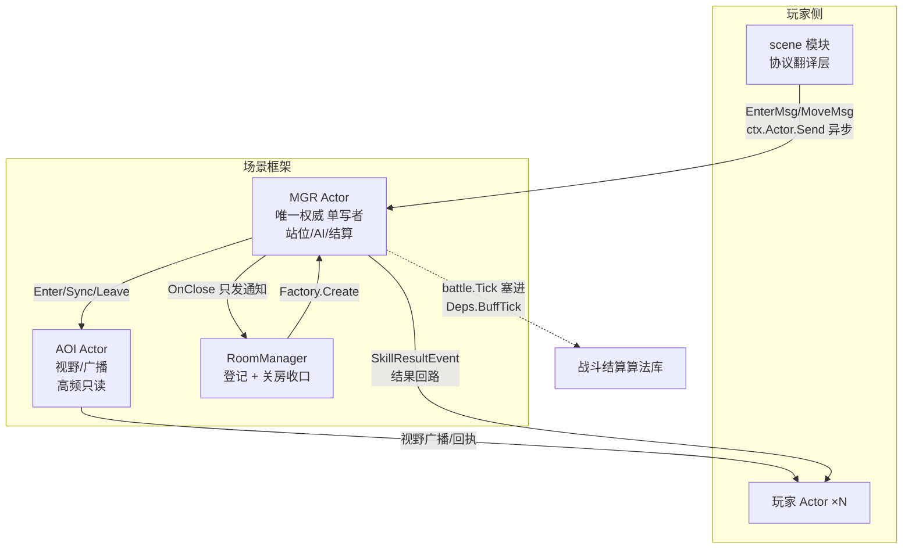
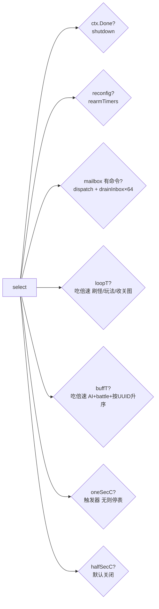

# 12-场景scenemap

> 一句话定位：`internal/scenemap` 是 RPG 场景（地图）框架——一张可玩的图 = 1 个 AOI Actor（视野广播）+ 1 个 MGR Actor（唯一权威）+ N 个玩家 Actor，怪物没有独立进程；它与 `internal/worldmap`（SLG 大地图）是两套完全独立、互不 import 的子系统，本章把两套都讲清。

## 概述

项目里有两个名字里带「场景/地图」的东西，分工写在 `internal/scenemap/doc.go:4-10`：

| 维度 | scenemap（RPG） | worldmap（SLG） |
| --- | --- | --- |
| 管什么 | 一张「可玩的地图」：主城/副本/战场 | 一张 5000×5000 的大世界：城池/部队/资源点 |
| 坐标 | 格/像素 | 定点整数 |
| 状态 | 内存为主（副本可丢） | MySQL 持久化 |
| 玩法 | 进图-移动-打怪-通关 | 出征-采集-战斗 |
| 结构 | Actor 三元组（AOI + MGR + 玩家） | 分层（domain/spatial/application/runtime/store/view） |

两者只共享 `pkg/config`、`pkg/log` 这类叶子包，互不 import。选择哪一套取决于玩法形态：RPG 房间制实时交互用 scenemap，SLG 大军团策略用 worldmap。游戏服的 `internal/game/module/scene` 则是 scenemap 的协议翻译层（玩家侧入口），也在本章覆盖。

scenemap 的架构总则（`doc.go:14-26`）只有一段话，但是「不可换」的：

```text
一张可玩的图 = 1 个 AOI Actor（视野与广播）
             + 1 个 MGR Actor（站位/AI/战斗结算，唯一权威）
             + N 个玩家 Actor（只编排自身，不存场景权威态）

怪物没有独立进程：它们是 MGR 私有 map 里的数据 + MGR 自投递的延时命令。
一怪一 goroutine 会在几百怪时产生 mail 风暴与调度抖动。
```

AOI 与 MGR 必须分开的理由（`doc.go:23-26`）：视野/广播是高频、只读、可并行的路径，站位/结算是串行、强一致的路径——「一只怪结算到一半不能被打断」。抢同一个 goroutine 会互相拖慢，所以分成两个 Actor。

## 涉及文件

| 文件/目录 | 行数 | 职责 |
| --- | --- | --- |
| `internal/scenemap/doc.go` | 47 | 架构总则、目录职责、并发铁律 |
| `internal/scenemap/types.go` | 224 | UUID/EntityKind/MapKey 等核心类型 |
| `internal/scenemap/errors.go` | 57 | 哨兵错误族（ErrOverloaded/ErrClosed/ErrTimeout…） |
| `internal/scenemap/actor.go` | 152 | 有界邮箱 `Mailbox[T]`、`Call`、`SafeRun` |
| `internal/scenemap/grid/` | ~560 | 纯函数几何：像素↔格、距离、扇形、A\*、阻挡 |
| `internal/scenemap/mgr/mgr.go` | 632 | MGR Actor：Config/Deps/run 主循环 |
| `internal/scenemap/mgr/timer.go` | 353 | Timer 接口、四定时器、倍速换算 |
| `internal/scenemap/mgr/{state,index,enter,move,command,lifecycle,gameplay,aoi,entity}.go` | ~1900 | 状态/索引/进出/换格/命令/关图/玩法接口 |
| `internal/scenemap/aoi/{aoi,view,snapshot,pool,msg}.go` | ~2050 | 九宫格视野、不可变快照、广播、房间池 |
| `internal/scenemap/room/manager.go` | 594 | 房间登记表 + 关房唯一收口 |
| `internal/scenemap/bridge/bridge.go` | 96 | MGR 的 AOIHandle ↔ aoi.AOI 翻译层 |
| `internal/scenemap/entity/{ai,npe,refresh,store}.go` | ~1230 | 怪物 AI 状态机、刷怪器 |
| `internal/scenemap/battle/` | ~4000 | 技能战斗结算（见 [10-战斗与副本.md](10-战斗与副本.md)） |
| `internal/scenemap/gameplay/{registry,city,dungeon}.go` | ~490 | 玩法插件注册表 + 主城/副本实现 |
| `internal/scenemap/examples/` | ~650 | 最小可跑示例（多线主城 + 副本房） |
| `internal/game/module/scene/scene.go` | 247 | 玩家侧协议翻译层（41xx） |
| `internal/worldmap/` | ~8000 | SLG 分层框架（domain/spatial/application/runtime/store/view） |

## 核心设计/流程

### 一张图里的三个 Actor 怎么协作



### MGR 的主循环（单写者）



## 关键代码解析

### Mailbox：有界是特性不是缺陷

`internal/scenemap/actor.go:10-19` 把邮箱设计动机说得很直白：无界队列会把「过载」从「明确拒绝」变成「内存缓慢耗尽」——后者线上表现为延迟越来越大、最后 OOM，比直接拒绝难排查得多。由此派生出两组语义，调用方靠 error 区分：

- `TrySend` 永不阻塞，满即 `ErrOverloaded`（**没有副作用，可重试**）；
- 关闭后 `ErrClosed`（图已关，**不要重试**）。

`Send`（`actor.go:51-66`）是阻塞变体，只给「必须送达」的控制消息（关闭、迁移）用。`Call`（`actor.go:104-133`）是带超时的同步调用，两个细节值得抄进任何 Actor 框架：

```go
// 契约：fn 负责把结果写入 reply（容量必须 >= 1），Call 只等结果。
// 超时返回 ErrTimeout —— 结果未知，调用方不能当失败重试。
if cap(reply) < 1 {
    return zero, fmt.Errorf("%w: reply 必须至少 1 个缓冲", ErrInvalidArgument)
}
```

强制 reply 容量 1 的理由（`actor.go:109-111`）：如果 reply 无缓冲，超时后那个 goroutine 仍会写 reply，写方永久阻塞——把「忘记给缓冲」变成构造期错误，而不是线上 goroutine 泄漏。`SafeRun`（`actor.go:135-152`）则是进程安全的最后防线：一个 MGR 可能承载几百只怪，「因为某个玩法的越界 panic 把整个进程带走是不可接受的」。

### MGR：句柄不暴露状态，读也要变成命令

`Mgr` 的设计纪律（`internal/scenemap/mgr/mgr.go:1-32`）可以归纳为四条：**唯一权威**（站位/占用/AI/关图计时都在这）、**单写者**（所有状态只在 run goroutine 里读写，不加锁）、**命令化**（外部只能通过 mailbox 投 Command）、**只发通知不关自己**（关图走 OnClose 交给 RoomManager 收口——避免「Actor 在自己的 goroutine 里等自己退出」的死锁）。

「句柄不暴露任何场景状态」（`mgr.go:215-216`）意味着想读状态只能 `Call`——把读也变成命令，这是串行换确定性的代价与收益：所有结算按命令顺序发生，线上可以按日志逐条回放。

主循环（`mgr.go:495-527`）有三处精妙的实现细节：

```go
case call, ok := <-m.mb.C():
    // 注意：这里必须用 `call := <-ch` 接住消息。写成 `case <-m.mb.C():`
    // 会把消息取出并丢弃（Go 的 channel 接收是"取走"语义），
    // 表现为"命令永远没执行、调用方全部超时"，而定时器一切正常。
```

`commandBudget=64`（`mgr.go:45-51`）限制单次唤醒最多处理的命令数：一次抽干 mailbox 会让 MGR 长时间不回到 select，定时器全部延后、停服信号也收不到——「每 64 条命令就让出一次调度点」是批处理与公平性的典型取舍。`onLoopTick` 把 Reset 放在处理**之后**（`timer.go:319-325`）：间隔是「处理结束 → 下一拍开始」，处理偶发超时会自然推迟下一拍而不是追赶——追赶会造成 tick 风暴，「一张卡过的图会在恢复瞬间连跑十几次结算」。

### 四定时器：为什么不用 Ticker，以及倍速怎么算

`Timer` 接口 + `Deps.NewTimer` 工厂（`mgr.go:205-210`）存在的唯一理由是测试：断言「倍速 2x 时 loop 跑得加倍」若依赖真实时钟，CI 负载一高就 flaky；注入假定时器后测试显式驱动每一拍，结果完全确定。

`repeatingTimer`（`timer.go:66-78`）坚持用 `time.Timer` 自续期而非 `time.Ticker`，理由是 Ticker 有两个不可接受的缺陷：间隔创建后不可改（倍速一切换就得 Stop 旧的 New 新的，新旧交替必然丢/多一拍），且 Ticker 会丢弃「来不及处理」的 tick——「对游戏循环来说，丢一拍意味着 buff 少结算一次」。而 `Reset` 必须 Stop + 排空（`timer.go:75-78`）：定时器已触发但值还没被 select 取走时直接 Reset，旧值留在 channel 里，下一次 select 立刻又触发一次——典型的「越跑越快」bug。

倍速换算（`timer.go:124-138`）全程整数：`间隔 = 基础 × 1000 / 倍速`（千分比，2000=2x），并有 1ms 下限（Go 定时器在高负载下的实际粒度，再小只会让 MGR 空转烧 CPU）。哪些定时器吃倍速是一组产品决策（`timer.go:9-22`）：loop/buffCheck 吃（倍速是玩法节奏，加速必须同时加快刷怪和 buff，否则「3 倍速只有怪走得快」），oneSec/halfSec 不吃（「每 5 秒开门」变「每 1.6 秒开门」与玩家的时间直觉冲突）。

停表技巧（`timer.go:182-195`）：`setOneSecArmed(false)` 把 `m.oneSecC` 置为 nil——select 在 nil channel 上永远阻塞，等价于「这个 case 不存在」，比每次 select 前判断 bool 更省事。无触发器的图自动停表（`timer.go:337-345`）：「空转一张没有触发器的图是纯浪费，几百张图就是几百个每秒唤醒」。

### 可复现性：排序是结算的一部分

`handleBuffCheck`（`timer.go:263-291`）暴露了分布式游戏框架里最容易被忽视的问题：NPES 是 map，Go 的 range 顺序每次运行都不同（随机起点 + 随机步长），而 buff 结算有副作用（扣血、死亡、触发被动）——「两只互相致死的怪，谁先死取决于遍历顺序 → 掉落归属不稳定；复现线上问题时回放顺序对不上，日志再全也没用」。所以统一走 `NpeUUIDs()` 升序遍历，「让结算顺序成为状态的一部分」。战斗结算（`Deps.BuffTick`）与 AI（`Deps.AITick`）刻意放在同一拍、同一 goroutine（`timer.go:279-283`）：两条时间线合并成一条，结算顺序才可回放——这也是 [10-战斗与副本.md](10-战斗与副本.md) 里「不让 battle 自己起定时器」的原因。

### AOI：视野格不是行走格，快照整份替换

`AOIGridSize=6`（`aoi/view.go:10-22`）：视野格的边长 = 6 个行走格，九宫格 = 18×18 行走格。一张 100×100 的图只有 17×17 个视野格，索引体量是行走格索引的 1/36。注释特意警告：「两者混用是这套框架最常见的 bug：把行走格当视野格用，广播范围会放大 36 倍」。

跨 Actor 读走「不可变快照 + `atomic.Pointer`」（并发铁律之一）。Snapshot 整份替换而非增量补丁的理由（`aoi/snapshot.go:77-80`）：读方需要「一次读到自洽的一屏」；如果发布增量补丁，读方 apply 到一半被调度，就会看到「实体已出现在 Entities、但还在旧的 Views 里」的半更新状态——「要修就得在读方加锁或版本重试，等于把 AOI 的串行成本转移给所有读者」。Snapshot 的三 map 不变量（`snapshot.go:71-76`）由测试断言。

对外方法默认**异步投递**（`aoi/aoi.go:14-27`）：投进有界邮箱就返回，error 只表示「没投进去」。「如果 MGR/玩家 Actor 每做一步都等 AOI 回执，两个 Actor 就被耦合成同步链——AOI 慢一帧，MGR 跟着慢一帧」；需要确定语义的场景（测试、开房首批实体、关房前最后一笔）才用 CallXxx 变体，「但不要在每帧移动上用 Call——那等于把异步设计的收益全部还回去」。

### bridge：翻译层为什么必须独立成包

`internal/scenemap/bridge/bridge.go:1-7` 是一个依赖倒置的标准案例：mgr 定义 `AOIHandle` 接口，aoi 是具体实现，但两边的实体描述与广播范围枚举各自演化（mgr 用格+像素两份坐标，aoi 只认像素；mgr 的 ScopeAround 是格半径，aoi 是像素半径）——「让任一方 import 另一方都会成环，所以翻译层放在这里，装配时注入」。Broadcast 的范围翻译（`bridge.go:78-96`）有一个安全决策：未知范围返回错误而**不退化成全图广播**——「全图广播一条技能特效在 500 人的主城就是一次 500 倍放大，宁可漏发也不能误发」。

### room：关房必须走完

`RoomManager`（`room/manager.go:1-12`）只做三件事：登记、关房、通知，「它不认识 mgr、不认识 gameplay，MGR 只以 Closer 接口出现——依赖方向固定为 room → aoi，room ⊥ mgr」。关房用 `context.WithoutCancel` 另起有超时的 ctx 把收口走完（`manager.go:32-38`）：「MGR 少关一步会留下 goroutine 与计时器，AOI 少关一步会让池里的槽位永远不可用」——只是不让它无限等。

### gameplay：查不到地图类型就炸，不默认

`Registry`（`gameplay/registry.go:23-29`）用强类型 map 而不是事件总线：「用 map 让『类型没注册』在查的那一刻显式返回错误；换成 `map[string]func(any)` 的事件总线，拼错 key 的后果是静默不触发，线上只能靠玩家反馈发现」。`Lookup` 有一个**有意不用默认值兜底**的决策（`registry.go:65-72`）：常见做法是查不到地图类型时给个默认值，「结果是能进图、但所有结算都走主城逻辑——看起来正常，实际关卡进度、掉落、通关判定全不对，而且不会报错」；这里改成显式 `ErrMapTypeMissing`，「开图期直接失败，比运行期静默错算便宜得多」。重复注册返回 `ErrAlreadyExists` 而非后写覆盖——「谁最后启动谁生效」的部署顺序不确定性，要在开图期就炸出来。

### scene 模块：协议翻译层的边界

`internal/game/module/scene/scene.go` 是玩家侧入口，只做三件事：转发请求、下线通知离场、翻译错误码。它不保存位置、不判断视野。码值统一用 41xx（`scene.go:36-47`）：proto 的 4xxx 段是社交/聊天，直接占用会让客户端把「你不在场景里」显示成「频道未开放」（这正是提交 `7452c87` 修的错误码撞车案例之一）。

进入/移动**不在这里回包**（`scene.go:70-73`）：请求转给场景 Actor，结果由场景广播异步送达，没有请求-响应配对，所以用 `Handle` 而非 `HandleR`。`onEnter` 的 EnterMsg 携带三类信息（`scene.go:107-111`）：身份、回执地址（PID——场景推送时要能找到玩家 Actor）、进场快照（Name/Level/X/Y——场景侧不再回查玩家，避免双向依赖）。切场景先通知旧场景移除实体（`scene.go:123-133`），两条消息发往不同 Actor 没有全局顺序，「玩家 Actor 按当前 SceneID 过滤推送，因此这个窗口不会串场」。

离场清理有三条路径（`scene.go:81-88`）：模块 OnLogout、Actor 终止、心跳超时。`onLogout` 恒返回 nil 是契约选择：「OnLogout 的职责是尽力通知，不是保证清理；下线流程不能被一条离场通知卡住」。

### worldmap：另一套并发模型

`internal/worldmap`（`worldmap/doc.go`）为 SLG 大军团玩法另起一套分层：domain（纯领域类型，禁止导入 MySQL/Protobuf/Redis）、spatial（空间索引）、application（命令规划器：只读快照 + 命令 → MutationPlan，不做 IO）、runtime（WorldManager/WorldInstance/SceneLoop）、store（SQL 事务仓储）、view（AOI 投影）。它与 scenemap 的 Actor 模型不同——SLG 的「一支部队一个 goroutine」不现实（几万支部队），所以用单写者 SceneLoop + 事务池 + 只读快照规划器的组合。空间索引层（spatial）覆盖率 93.5%，是全项目测试最密的包之一：场景网格、静态占位、直线路径与静态阻挡、行军线索引都有表驱动测试。

## 演进记录

- **`ffee7b7` feat(scene): 场景 Actor 与进入/移动/离开闭环（R9.1）**：玩家侧 `internal/game/scene` 与模块层落地。
- **`9534281` feat(scene): 九宫格 AOI 与生命周期（R9.2/R9.3）**：视野/广播独立成 Actor，房间池上线。
- **`7a7b572` feat(scenemap): 新增独立 RPG 场景（地图）框架**：按《场景大地图设计.md》落地，一次 8 个包 12721 行 + 90 个测试（P0 骨架 + P1 主循环 + P2 实体/AI），架构总则（AOI + MGR + 玩家 Actor 三元组、怪物无独立进程）自此定型。
- **`4dbbef9` feat(scenemap): 实现技能战斗结算系统并接入场景框架**：`internal/scenemap/battle` 以「命令 + BuffTick 钩子」两种方式挂进 MGR，不新增 goroutine、不改 MGR 的形状。
- **`bea479d` refactor(test): 断言统一为 require；场景定时器改为可注入以消除 flaky**：mgr 增加 `Timer` 接口与 `Deps.NewTimer`（默认仍是真实定时器，生产行为不变），三个定时器用例改用 `fakeTimers` 逐拍驱动——断言从「150ms 内跑了约几次」变成「投 12 拍就是 12 次」，**耗时 150ms → 8ms，30 次 race 重复全绿**。
- **`01a90d6` test(scene): 场景空闲超时用例改虚拟时钟，不睡真实时间**：关图计时类测试的进一步提速。
- **`dcd8354` fix(module): 修复重复回包导致响应串号；scene 同步补 4005**：scene 模块 onSync 在离开场景后明确回 4105（否则 Typed 零值回包的 code=0 与「同步成功」无法区分）。
- **`138769a`/`01c45c1`/`b2347e3`/`b7903e1` feat(worldmap)**：M1 领域层与空间索引 → 规划器与 runtime 端到端可跑 → M2/M3/M8 持久化、战斗裁决、AOI 投影与内部 gRPC → 真机验证缺陷修复。
- **`7452c87` refactor: 修 4 处错误码与 proto 撞车**：scene 从 4001/4003 改统一 41xx，并新增 `errcode` 守护测试（模块码撞 proto 值必须登记白名单）。

## 测试情况

scenemap 全家桶的实测覆盖率（`go test -cover`）：

| 包 | 覆盖率 | 说明 |
| --- | --- | --- |
| `scenemap/mgr` | 60.8% | 26 个用例：进出/索引/换格/关图状态机/占位规则/定时器 |
| `scenemap/aoi` | 67.0% | 九宫格判定、快照不变量、广播、慢消费者丢弃 |
| `scenemap/room` | 66.3% | 登记表、并发关幂等、节点宕机通知、池回收 |
| `scenemap/entity` | 64.9% | AI 状态机（含脱战 5s 清仇恨）、环形找位、刷怪波次 |
| `scenemap/battle` | 45.5% | 18 个用例，详见 [10-战斗与副本.md](10-战斗与副本.md) |
| `scenemap/grid` | 56.5% | 几何纯函数、A\*、阻挡计数 |
| `scenemap/gameplay` | 48.7% | 注册表分派、主城/副本行为 |
| `scenemap/examples` | 69.6% | 端到端流程（含 `battle_flow_test.go`） |
| `module/scene` | 54.0% | 协议翻译与降级路径 |
| `worldmap/spatial` | 93.5% | 空间索引表驱动测试，全项目最高 |

`mgr_test.go` 的测试手法值得单独说：全部测试**不 import aoi/entity/gameplay 任何具体包**（`mgr_test.go:17-19`），只用接口桩（`stubGameplay`/`stubAOI`）——「只想测索引与关图计时」的测试不必构造一堆真实依赖。定时器相关三个用例（`TestLoopTimerSelfRenewsAtExpectedRate`/`TestLoopIntervalScalesWithSpeed`/`TestSetSpeedRearmsWithoutStopping`）用 `fakeTimers` 逐拍驱动，配合 `waitArmed` 等同步辅助消除竞态。另有并发用例 `TestConcurrentPostSingleWriter` 验证「多 goroutine 投递 + 单写者执行」、`TestNpeUUIDsAreSorted` 钉住可复现性约束、`TestNoEffectCommandIsRejected`/`TestLenientNoEffectOnlyLogs` 覆盖「命令未改变状态」的严格/宽松两档。

## 小结

scenemap 是整个项目里架构密度最高的子系统，值得带走的决策按优先级排：

1. **串行换确定性**：MGR 单写者 + 命令化 + 排序结算，让「线上问题可按日志回放」成为可能；为此付出的代价（读状态也要 Call）用有界邮箱 + 超时 + panic 隔离兜住。
2. **职责按访问模式切分**：高频只读（AOI）与串行强一致（MGR）分开，怪物降级为数据 + 延时命令——并发模型跟着访问模式走，不跟着实体数量走。
3. **接口倒置防成环**：mgr 定义 `AOIHandle`、battle 以命令 + 钩子挂载、room 只认 `Closer`——每个边界都是「核心定义接口，实现注入」，测试因此能用桩单独验证任一环。
4. **把不确定性消灭在构造期**：配置错误不开图而走 OnClose 流程、地图类型未注册显式报错、重复注册拒绝覆盖、未知广播范围拒绝退化——「开图期炸出来比运行期静默错算便宜得多」是通篇反复出现的价值观。

游戏服侧的入口（scene 模块）与业务模块的关系见 [04-模块系统module.md](04-模块系统module.md)；战斗结算算法库细节见 [10-战斗与副本.md](10-战斗与副本.md)；writebehind 持久化（scenemap 状态在内存、不过此链路）见 [05-持久化Stateful.md](05-持久化Stateful.md)。
