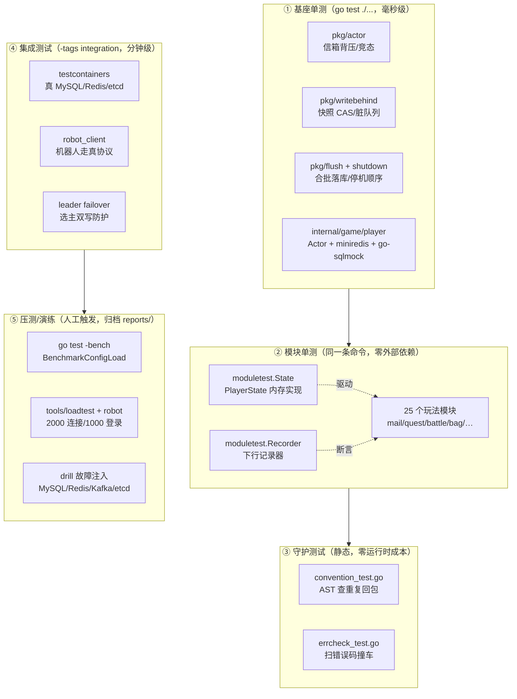

# 01-测试总览与分层

一句话定位：本文是全项目测试版图的地图——测试分几层、每层住在哪、怎么跑、出了什么问题，以及「每项修复都要变异验证」这条贯穿始终的测试哲学。

## 概述

game_study 是 Go 1.22 编写的分布式游戏服务端，七个进程（`gateway`/`login`/`center`/`game`/`cross`/`map`/`flusher`，见 `cmd/`），技术栈为 gRPC + protobuf + etcd + Redis + MySQL + Kafka，日志用 zap，测试用 testify + testcontainers + miniredis + go-sqlmock。

截至 HEAD（`497e603`），仓库内（不含 `pkg/pb`、`pkg/gamedata` 两个生成目录）共有 **160 个 `_test.go` 文件**。它们不是一堆平铺的用例，而是按「离真实环境多远」分成五层，每层解决一类不同的问题：

| 层 | 位置 | 外部依赖 | 单次耗时 | 回答的问题 |
| --- | --- | --- | --- | --- |
| ① 基座单测 | 各包 `*_test.go` | 无 | 毫秒 | 这段逻辑对吗 |
| ② 模块单测 | `internal/game/module/<mod>/` | 无（内存桩） | 毫秒 | 玩法规则对吗 |
| ③ 约定/守护测试 | `convention_test.go`、`errcheck_test.go` 等 | 无（AST/扫描） | 毫秒 | 坏味道进来了吗 |
| ④ 集成测试 | `test/integration/`（`integration` tag） | 真 MySQL/Redis/etcd/Kafka | 分钟级 | 链路通吗 |
| ⑤ 压测/演练 | `test/benchmark/`、`test/robot/`、`reports/` | 全栈 | 十分钟级 | 撑得住吗 |

设计原则只有一条：**能放上层的不放下层**。一条业务规则如果用内存桩能在 1ms 内验完，就绝不为了「真实一点」去起容器——容器留给那些不起容器就验不了的东西（建表 SQL、选主 failover、跨进程中转）。

## 涉及文件

| 路径 | 职责 |
| --- | --- |
| `internal/**/*_test.go` | 各包单元测试：基础设施（actor/flush/writebehind/cache…）与业务模块 |
| `internal/game/module/moduletest/state.go` | 模块单测的内存脚手架（`State` + `Recorder`），详见 [`02-moduletest脚手架.md`](02-moduletest脚手架.md) |
| `internal/game/module/convention_test.go` | AST 静态检查「Typed handler 不得自己回包」，详见 [`03-约定测试与AST守护.md`](03-约定测试与AST守护.md) |
| `internal/common/errcode/errcheck_test.go` | 错误码撞车守护（撞 proto / 跨模块复用），详见 [`03-约定测试与AST守护.md`](03-约定测试与AST守护.md) |
| `test/integration/*.go`（18 个文件，27 个顶层用例） | 带 `integration` tag 的全链路测试，testcontainers 起真中间件，详见 [`04-集成测试与CI.md`](04-集成测试与CI.md) |
| `test/benchmark/bench_test.go` | Go benchmark 入口 + 验收口径登记 |
| `test/robot/robot_client.go` | 机器人客户端（816 行）：登录、握手、收发协议，集成测试与压测共用 |
| `reports/bench-*`、`reports/drill-*` | 压测基线与故障演练报告（每次里程碑复跑归档） |
| `.github/workflows/ci.yaml` | CI 五步卡点，详见 [`04-集成测试与CI.md`](04-集成测试与CI.md) |
| `Makefile` | `make test` / `test-race` / `test-integration` 等入口 |

## 核心设计/机制



分层不是目录划分，是**故障预算**的划分：越往下越难复现。第 ③ 层的存在本身就源于一次教训——「Typed handler 重复回包导致响应串号」这个 bug，单测抓不到（单测直接调 handler，不经过 `Typed` 的自动回包），集成测试只能间接暴露（现象是「幂等失效」，看起来像业务逻辑错），最后是靠 AST 静态检查兜住的（`07a6a1d`）。

## 关键代码解析

### 1. 怎么跑

```bash
# ①+②+③：单元测试与守护测试（默认不编译 integration 包）
go test ./...

# 加上竞态检测（Actor / 落库 / 玩家核心是重点对象）
make test-race        # go test -race ./pkg/actor ./pkg/flush ./internal/game/player

# ④：集成测试（需要本机 Docker，testcontainers 自己拉镜像）
go test -tags=integration ./test/integration/ -count=1
make test-integration # 超时放宽到 20m，覆盖镜像拉取

# ⑤：benchmark（目前是骨架，见下文）
go test ./test/benchmark/ -bench=. -benchmem -benchtime=10s
```

`integration` 这个 build tag 的作用与它挡住过的坑，详见 [`04-集成测试与CI.md`](04-集成测试与CI.md)——简单说：`test/integration` 带 `//go:build integration`，不传 tag 时**整个包不参与编译**，因此 `go test ./...` 永远绿；代价是「包编译不过也没人发现」，这一点在 `3b47b9a` 修掉了 30+ 处重复声明后才真正开始跑。

### 2. 模块单测的内存替身矩阵

模块单测（第 ② 层）面对的共同难题是：`module.PlayerState` 有 18 个方法（`internal/game/module/module.go:40`），每个模块测试各写一份 fake 既重复又容易漏方法。集中后的 `moduletest` 包解决了一半问题，另一半（仓储、跨服、中心服）仍按模块各自 fake：

| 替身 | 位置 | 模拟什么 |
| --- | --- | --- |
| `moduletest.State` | `internal/game/module/moduletest/state.go:25` | 玩家内存状态（道具/属性/Ext/业务键） |
| `moduletest.Recorder` | `internal/game/module/moduletest/state.go:142` | 下行报文记录器 |
| `fakeRepo` | `internal/game/module/mail/mail_test.go:29` | 邮件仓储（可注入各类错误） |
| `fakeCross` / `fakeCenter` | `internal/game/module/battle/battle_test.go:52` / `:116` | 跨服建房、中心服匹配 |
| `thinState` / `bizState` / `grantState` | `thin_test.go:17` / `context_test.go:13` / `grant_test.go:13` | 基座自身测试的最小实现 |

### 3. benchmark 与 robot：目前到什么程度

`test/benchmark/bench_test.go` 现阶段是**骨架**：只有一个真 benchmark（`BenchmarkConfigLoad`，配置解析路径）加一个 `TestBaselineTargets`——后者不跑压测，只把 23.4 的验收口径（10W 连接、2000 TPS 登录、P99 < 50ms…）打印出来「登记在册，防漂移」，其余压测项以 `TODO(P7)` 注释挂名：

```go
// TODO(P7) 压测项登记（23.4）：
//   - BenchmarkGatewayConns    全连接 + 保活 30 分钟（10W 连接, RSS<2GB）
//   - BenchmarkGameMixed       5K 机器人混合业务消息（聊天/道具/移动, P99<50ms）
//   - BenchmarkLoginTPS        集中登录（RSA 握手 + Token 签发, >=2000 TPS）
//   - BenchmarkFlusherThroughput 观察 flusher 指标 + MySQL 负载（300 并发, 60s）
//   - BenchmarkKafkaFanout     世界聊天 1000 条/秒, 端到端 < 1s
//   - BenchmarkActorBackpressure 构造慢消费者, 断言拒绝而非 OOM
```
（`test/benchmark/bench_test.go:48-54`）

真正跑起来的压测在 `test/robot/robot_client.go`：机器人客户端走「HTTP 游客登录 → TCP 连网关 → RSA/AES 握手 → 收发 codec 帧」，既被集成测试当驱动器用（`p1_p4_smoke_test.go`、`p6_gameplay_test.go`），也被 `tools/loadtest` 复用做连接/登录压测，结果归档到 `reports/bench-<时间戳>/`（含 `conn.json`/`login.json`/`biz.json` 与人读的 `REPORT.md`）。

## 演进记录

| 提交 | 事件 |
| --- | --- |
| `eed6721` | P0 骨架：CI 五步卡点落地，生成体系进 CI |
| `b93f071` | P7：压测工具 + 故障演练（`drill-*` 报告） |
| `091ef50`→`bea479d` | testify 断言迁移 + **定时器改可注入**：`fakeTimers` 逐拍驱动，断言从「150ms 内跑了约几次」变成「投 12 拍就是 12 次」，耗时 150ms→8ms，30 次 race 全绿（详见 [`../70-开发过程实录/01-定时器测试flaky修复.md`](../70-开发过程实录/01-定时器测试flaky修复.md)） |
| `ec6258d`→`a5f369f` | 断言机械转换：if 断言 1808 → 215 处（−88%）；期间**方向写反被 `TestGridLifecycle` 抓到，回滚该文件重做**（详见 [`03-约定测试与AST守护.md`](03-约定测试与AST守护.md) 演进记录） |
| `dcd8354` | 修「Typed 重复回包导致响应串号」：6 个模块删掉 handler 内显式回包 |
| `07a6a1d` | 静态检查「Typed handler 不得自己回包」进测试（带 `scanned > 10` 自检） |
| `3b47b9a` | **integration 包恢复可编译**：30+ 处重复声明逐处修复，该包带 tag 从未编译过、P6~P14 用例一次都没跑过 |
| `7452c87` | 修 4 处错误码与 proto 撞车（scene 4001/4003→4101/4103、battle 6001/6004→6006/6007），`errcheck_test.go` 上岗守护 |
| `907f750` | 修 `Recorder`「把空响应当没回包」的 bug（`append([]byte(nil), body...)` 判空陷阱） |
| `873b1d8` | 中心服选主补测试：单元 + **真 etcd failover**（`leader_test.go`） |
| `497e603` | 修 shutdown 两个时间竞争导致的 flaky：改用结构化同步，负载下各 100 次通过 |

## 测试哲学：变异验证

这个项目有一条硬规矩：**每项修复都要注入 bug，验证测试真的能抓到**。做法是把刚写好的测试对着「故意改坏的生产代码」跑一遍——改坏还能绿，说明测试是摆设，回去重写。git 历史里有 19 个提交在消息里记录了变异验证（累计 17+ 处验证点），例如：

- `7452c87`：把 scene 改回 4001、让 team 借 guild 的 6101 —— 均被 `errcheck_test.go` 抓到；
- `907f750`：去掉幂等短路 / 卸下符号写反 / 去掉槽位冲突检查 —— 装备三处变异全部被抓；
- `07a6a1d`：注入响应回包会失败并给出文件行号，注入通知推送仍通过（双向验证）；
- `873b1d8`：删掉 `defer setLeader(false)` —— failover 用例抓到「A 退出后仍自称主」。

配套的两个自检约定也源于同一思想：守护测试必须**证明自己扫到了东西**——`convention_test.go:48` 的 `require.Greater(t, scanned, 10)` 防「目录扫空了所以永远通过」，`errcheck_test.go:100` 的 `require.Greater(t, scanned, 30)` 同理。

## 小结

五层测试各守一段：基座单测保逻辑、模块单测保玩法规则、守护测试保约定（零运行时成本，坏味道进不了门）、集成测试保链路（真容器真 failover）、压测演练保容量。贯穿所有层的是同一条纪律：**测试的价值不在于数量，在于被变异验证过**——没抓过 bug 的测试，和没有测试差不多。

下一篇 [`02-moduletest脚手架.md`](02-moduletest脚手架.md) 拆解第 ② 层的核心装备：一份内存 `PlayerState` 加一个下行记录器，如何让 25 个玩法模块在无 DB 无网络下一毫秒跑完。
