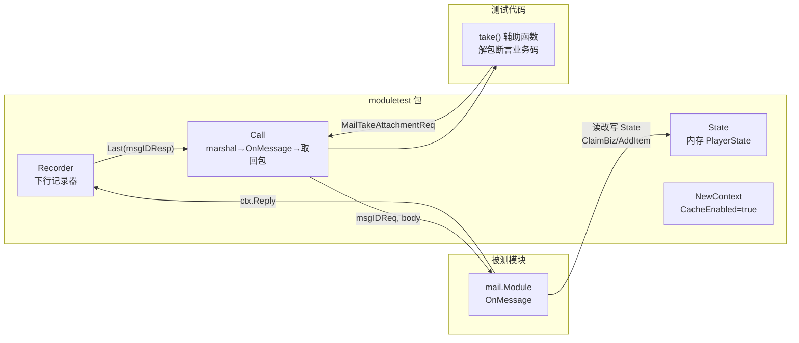

# 02-moduletest脚手架

一句话定位：`internal/game/module/moduletest/state.go` 是全模块玩法单测的地基——一份内存版 `PlayerState` 加一个下行记录器，让「领取是否幂等」「满包是否不发奖」这类纯业务规则不碰数据库、不碰网络，一毫秒跑完。

## 概述

写玩法模块单测时会反复撞上同一堵墙：`module.PlayerState` 是个 18 方法的接口（`internal/game/module/module.go:40`；`moduletest` 包注释里写的「17 个方法」已过时——`SetSceneID` 是后来加的）。每个模块测试各写一份 fake，重复且容易漏方法；更麻烦的是，每个模块还要各自实现一个「能收下行的口子」来断言业务码。`moduletest` 包把这两件公共替身集中起来（`0833cc5` 随邮件模块单测引入），新增模块直接复用。

它的边界写死在包注释里：**只模拟内存语义，不模拟数据库、Actor、提交链路**——那些属于玩家层与集成测试的职责。所以 `State` 的字段读写不加锁（模块内测是单 goroutine 串行调用，与 Actor 内真实执行模型一致；加锁反而会掩盖「模块被并发调用」这类问题），`CanHold` 只回一个布尔值（满包预检的结论由测试用 `SetCanHold` 指定），`Ext` 就是内存 map。

目前 11 个模块的测试直接用它：attr / bag / battle / chat / equip / guild / item / mail / profile / shop / team。更早的模块（quest/activity/copy…）还带着自己手写的 fake，属于迁移债务，不影响正确性。

## 涉及文件

| 路径 | 职责 |
| --- | --- |
| `internal/game/module/moduletest/state.go` | 脚手架本体：`State`（213 行内的核心类型）、`Recorder`、`NewContext`、`Call` |
| `internal/game/module/mail/mail_test.go` | 使用范例：`fakeRepo` + `moduletest` 驱动领取幂等 |
| `internal/game/module/battle/battle_test.go` | 使用范例：rig 装配，四个 fake（cross/center/push/rank）+ 每请求独立 Recorder |
| `internal/game/module/quest/quest_test.go` | 对照组：手写 `fakeState`（脚手架引入前的形态） |

## 核心设计/机制



三个设计点值得单独说：

1. **`Recorder` 按消息号记「最近一条 + 条数」**。条数统计是专门为「一次请求只应回一个包」的断言准备的（`mail_test.go:129`、`battle_test.go:236`）：多回一条会让下一次请求读错包，而这种错位在客户端表现为「业务码莫名丢失」——正是 `dcd8354` 修过的重复回包串号 bug。
2. **`Call` 的 respID 由调用方显式给出**，脚手架不猜。模块自己知道请求号→响应号的映射（`msgIDMailTakeReq → msgIDMailTakeResp`），猜反而引入隐式契约。
3. **`NewContext` 固定 `CacheEnabled: true`**（缓存权威模式），与生产默认路径一致，避免测的是一条永不启用的分支。

## 关键代码解析

### 1. State：18 个方法的内存实现

```go
// State 是 module.PlayerState 的内存实现。
//
// 零值不可用，请用 NewState。字段读写不加锁：模块内测是单 goroutine 的
// 串行调用，与 Actor 内真实执行模型一致；加锁反而会掩盖「模块被并发调用」
// 这类问题。
type State struct {
	id      int64
	items   map[int32]int64
	ext     map[string]json.RawMessage
	biz     map[string]bool
	dirty   []string
	profile module.Profile
	attrs   map[string]int64
	canHold bool
	setExts int
}
```
（`internal/game/module/moduletest/state.go:20-35`）

六个字段对应六类玩家数据：道具、模块私有状态（Ext）、业务幂等键（biz）、标脏记录、角色档案、属性。测试只公开需要的旋钮：

```go
// SetCanHold 控制满包预检结果（false 模拟背包放不下）。
func (s *State) SetCanHold(v bool) { s.canHold = v }
```
（`internal/game/module/moduletest/state.go:49-50`）

```go
// DirtyModules 返回被标脏的模块名（按调用顺序）。
func (s *State) DirtyModules() []string { return append([]string(nil), s.dirty...) }
```
（`internal/game/module/moduletest/state.go:58-59`）

业务键的语义与生产完全一致——首次占用返回 true，重复返回 false，这是幂等断言的支点：

```go
// ClaimBiz 实现 module.PlayerState：首次占用返回 true。
func (s *State) ClaimBiz(key string) bool {
	if s.biz[key] {
		return false
	}
	s.biz[key] = true
	return true
}
```
（`internal/game/module/moduletest/state.go:127-133`）

`mail_test.go:114` 的 `require.True(t, st.HasBiz("mail:7"), "领取事实必须落到业务键上")` 与 `mail_test.go:147` 的 `require.False(t, st.HasBiz("mail:9"), "发奖失败不能占业务键，否则清包后永远领不了")` 一正一反，把「领取事实与发奖原子绑定」钉死。

### 2. Recorder：修过「把空响应当没回包」的 bug

```go
// Send 实现 module.Sender。
//
// 这里用 make+copy 而不是 append([]byte(nil), body...)：proto 空消息
// （例如只有 code=0 的响应）序列化后是 0 字节，append 到 nil 切片会返回 nil，
// 把「回了一个空包」变成「没回包」——调用方据此判空就会误报。
func (r *Recorder) Send(msgID uint32, body []byte) error {
	r.mu.Lock()
	defer r.mu.Unlock()
	buf := make([]byte, len(body))
	copy(buf, body)
	r.last[msgID] = buf
	r.count[msgID]++
	return nil
}
```
（`internal/game/module/moduletest/state.go:153-166`）

这个坑值得所有 Go 测试作者记住：`append([]byte(nil), empty...)` 返回 **nil**。装备模块补单测时（`907f750`）撞上它——回包是 0 字节（响应里只有 `code=0` 时 proto 序列化出来就是空），`Last` 返回 `(nil, false)`，调用方 `require.NotNil(raw, "没有回包")` 直接误报。修复是 `make+copy`：`make([]byte, 0)` 是非 nil 空切片，「回了一个空包」与「没回包」从此可区分。

`Last`/`Count`/`Total` 三个查询方法都带 `sync.Mutex`（`Recorder` 可能被模块内其他 goroutine 触达，如 battle 的跨服回调），与 `State` 的不加锁形成对照——**单线程执行模型才免锁，跨线程就必须锁**。

### 3. NewContext + Call：一次请求的完整旅程

```go
// NewContext 组装模块执行上下文（缓存权威模式，State 已就绪）。
func NewContext(st *State, rec *Recorder) *module.Context {
	return &module.Context{State: st, CacheEnabled: true, Send: rec.Send}
}

// Call 发一条请求，返回对应响应报文。
//
// respID 由调用方显式给出（模块自己知道请求号 → 响应号），这里不猜。
func Call(m module.Module, ctx *module.Context, rec *Recorder, msgID, respID uint32, req proto.Message) ([]byte, error) {
	body, err := proto.Marshal(req)
	if err != nil {
		return nil, err
	}
	if err := m.OnMessage(ctx, msgID, body); err != nil {
		return nil, err
	}
	raw, _ := rec.Last(respID)
	return raw, nil
}
```
（`internal/game/module/moduletest/state.go:194-212`）

注意 `Call` 的两个失败通道：`OnMessage` 返回 error（仓储故障等）时**不回包**，测试断言的是 error 而不是响应体——`mail_test.go:229` 的 `TestListPropagatesRepoError` 正是「查库失败必须上抛 + 失败请求不回业务包」成对断言。

### 4. 真实范例：mail 的领取四态

`mail_test.go` 的 `take` 辅助函数是脚手架的典型用法——三行封装「发请求 → 解回包」：

```go
// take 发一次领取请求并解出响应。
func take(t *testing.T, m *Module, ctx *module.Context, rec *moduletest.Recorder, mailID int64) *gamev1.MailTakeAttachmentResp {
	t.Helper()
	raw, err := moduletest.Call(m, ctx, rec, msgIDMailTakeReq, msgIDMailTakeResp, &gamev1.MailTakeAttachmentReq{MailId: mailID})
	require.NoError(t, err, "call take")
	require.NotNil(t, raw, "没有回包")
	resp := &gamev1.MailTakeAttachmentResp{}
	require.NoError(t, proto.Unmarshal(raw, resp))
	return resp
}
```
（`internal/game/module/mail/mail_test.go:95-103`）

四个用例把领取路径的规则逐一钉死：

| 用例 | 场景 | 断言要点 |
| --- | --- | --- |
| `TestTakeGrantsAndMarksTaken`（`:106`） | 首次领取 | 发奖入包、`HasBiz("mail:7")` 为真、`repo.marked` 调过一次（SQL 标记是尽力更新） |
| `TestTakeIsIdempotent`（`:123`） | 重复领取 | 回 5002 不再发奖；且 `rec.Count == 1`——**一次请求只回一个包**（这条正是串号 bug 的回归用例，注释里写明「曾经因为 Typed 自动回包 + handler 自己又回一次」） |
| `TestTakeBagFullKeepsClaimable`（`:139`） | 满包 | `SetCanHold(false)` → 回 5004 一件都不入包、不占业务键；`SetCanHold(true)` 后能重领 |
| `TestTakeSurvivesMarkFailure`（`:188`） | 标记失败 | `MarkTaken` 报 `DeadlineExceeded` 仍回 codeOK——「标记失败只影响列表展示，不能让领取失败」，快照才是权威 |

### 5. 真实范例：battle 的 rig 装配

战斗模块的共享状态更复杂（多玩家并发、跨服/中心服回调直接触达），测试用一个 `rig` 把四个 fake 装齐，并且**每个请求都新建 Recorder**：

```go
func (r *rig) ctx(playerID int64) *module.Context {
	rec := moduletest.NewRecorder()
	return moduletest.NewContext(moduletest.NewState(playerID), rec)
}

func (r *rig) match(t *testing.T, playerID int64, mode string) *gamev1.MatchResp {
	t.Helper()
	ctx := r.ctx(playerID)
	rec := moduletest.NewRecorder()
	ctx.Send = rec.Send
	raw, err := moduletest.Call(r.m, ctx, rec, msgIDMatchReq, msgIDMatchResp, &gamev1.MatchReq{Mode: mode})
	require.NoError(t, err)
	require.NotNil(t, raw, "匹配没有回包")
	resp := &gamev1.MatchResp{}
	require.NoError(t, proto.Unmarshal(raw, resp))
	require.Equal(t, 1, rec.Count(msgIDMatchResp), "一次请求只能回一个包")
	return resp
}
```
（`internal/game/module/battle/battle_test.go:221-238`）

配套的匹配规则断言同样密不透风：第一个人只入队不建房（`TestMatchQueuesFirstPlayer`，`:280`）、第二个人凑满才建房一次且双方各收一条开战通知（`TestMatchPairsTwoPlayers`，`:291`，连「快照要先于开战通知送达房间」都断言了 `require.Len(t, r.cross.snaps, 2)`）、重复入队回 6006 且队列计数不变（`TestMatchRejectsDuplicateQueue`，`:334`）。

### 6. 对照组：quest 为什么还自己写 fake

`quest_test.go` 引入于 `dff3b7a`（早于邮件模块），用的是同构但手写的 `fakeState`（`quest_test.go:19-63`）：只保留任务模块用到的能力，`AddExp` 通过 `Context.AddExp` 注入。两种形态都对——手写 fake 的价值是「只模拟模块真正用到的行为」，当模块需要注入故障（mail 的 `listErr`/`markErr`）或对接复杂协作者（battle 的四个 fake）时，公共 `State` + 模块私有 fakeRepo 是更现实的组合。脚手架不追求消灭所有 fake，只消灭重复的那一份。

## 演进记录

| 提交 | 事件 |
| --- | --- |
| `0833cc5` | 邮件模块单测引入 `moduletest`：`State` + `Recorder` + `NewContext` + `Call` 四件套定型 |
| `907f750` | 装备单测撞出 `Recorder.Send` 的空包 bug：`append([]byte(nil), body...)` 把 0 字节回包变成 nil；改 `make+copy`，并补三处变异验证（去幂等短路/卸下符号写反/去槽位冲突检查） |
| `9d1bb6c` / `c231cc2` / `a53d736` / `5f93baa` | chat/team/guild/battle 模块单测全面接入，各自按需补 `fakeRepo` 类私有替身 |
| `dcd8354` | 串号 bug 修复后，mail/battle 测试里固化了 `rec.Count(...) == 1` 的「一请求一响应」断言 |

## 小结

`moduletest` 的设计可以概括成三句话：**内存语义而非全量模拟**（18 个接口方法外加 3 个测试旋钮，只实现业务真正会碰的语义）；**条数与内容一起记**（Recorder 的 count 专门服务「一请求一响应」断言）；**路由交给调用方**（Call 不猜响应号）。它换来的速度是实打实的——`make test` 全量毫秒级跑完，而等价的集成验证要分钟级。代价是边界清晰：仓储故障、Actor 提交、跨进程链路不归它管，那正是下一篇守护测试与 [`04-集成测试与CI.md`](04-集成测试与CI.md) 的战场。
