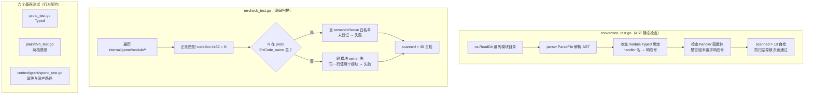

# 03-约定测试与AST守护

一句话定位：有一类 bug 运行时测试抓不到、代码审查也容易漏——本目录讲两种「守护测试」如何用零运行时成本把它们拦在 CI 门外：AST 静态检查防重复回包，源码扫描防错误码撞车；外加基座自身的六个行为契约测试。

## 概述

游戏服务端的测试大多在验「逻辑对不对」，但有几类问题性质不同：

- **约定破坏**：`module.Typed` 的契约是「fn 返回 nil 后自动回包」，handler 里再 reply 一次就是两条响应。这个错编译期不报、单测抓不到（单测直接调 handler，不经过 Typed）、集成测试只表现出「幂等失效」——看起来像业务逻辑错，实际是响应串号。
- **口径漂移**：模块自建错误码与 proto 已定义值撞车，客户端按 proto 文案提示，玩家看到错误的失败原因；两个模块复用同一个码值，客户端就无法从码值反推是哪个模块出错。
- **基座回归**：`Typed`/`Plain`/`Thin`/`Grant`/`Spend`/`ApplyOnce` 是所有模块的地基，它们的语义（解码失败不回包、满包零副作用、RemoveItem 失败算余额不足）一旦被改坏，受影响的是全部 25 个玩法模块。

三类问题分别由 `convention_test.go`（AST 静态检查）、`errcheck_test.go`（源码扫描）和六个基座测试文件守护。共同点是**零外部依赖**：不起容器、不连 DB，`go test ./...` 毫秒级跑完，因此可以（而且已经）进 CI 每步必跑。

## 涉及文件

| 路径 | 守护对象 | 手段 |
| --- | --- | --- |
| `internal/game/module/convention_test.go` | Typed handler 不得自己回本请求响应号 | go/ast 静态检查 |
| `internal/common/errcode/errcheck_test.go` | 模块错误码不撞 proto 值、不跨模块复用 | 正则扫描 + proto 镜像表 |
| `internal/game/module/proto_test.go` | Typed：解包/回包/错误通道 | 行为契约测试 |
| `internal/game/module/plain_test.go` | Plain 无状态基座 + Registry 声明 | 行为契约测试 |
| `internal/game/module/thin_test.go` | Thin 薄基座：分发/守卫/失败响应/可回滚 | 行为契约测试 |
| `internal/game/module/context_test.go` | ApplyOnce 幂等语义 | 行为契约测试 |
| `internal/game/module/grant_test.go` | Grant 发奖：原子性/溢出/容量预检 | 行为契约测试 |
| `internal/game/module/spend_test.go` | Spend 扣费：余额判定/免费边界 | 行为契约测试 |

## 核心设计/机制



为什么这些守护必须是测试而不是 lint 规则或评审 checklist：**它们要随代码一起版本化、一起跑，且失败信息要指到文件行号**。AST 检查放在 `_test.go` 里，用的是与生产代码同一套 Go 工具链（`go/parser` + `go/ast`），不引入额外工具链依赖。

## 关键代码解析

### 1. convention_test.go：用 AST 守住「一请求一响应」

先看它要防的是什么（`internal/game/module/convention_test.go:5-12` 的文件头注释）：

> 为什么这条约定需要强制：Typed 在 fn 返回 nil 后会自动 reply。如果 handler 里又调了一次 reply，同一个请求会发出两条响应。客户端读走第一条，多出来的那条留在连接里，被**下一次请求**当作自己的响应读走——表现为「每个响应都晚一拍」，业务错误码（5002/7104/4005）全部被前一条残留的 code=0 顶掉。

测试入口先做防空扫自检——「目录扫空了所以永远通过」是守护测试最隐蔽的死法：

```go
func TestTypedHandlersDoNotReplyManually(t *testing.T) {
	entries, err := os.ReadDir(".")
	require.NoError(t, err)
	require.NotEmpty(t, entries, "测试工作目录不对：应该在被测包目录下")

	scanned := 0
	for _, e := range entries {
		if !e.IsDir() {
			continue
		}
		files, err := filepath.Glob(filepath.Join(e.Name(), "*.go"))
		require.NoError(t, err)
		for _, file := range files {
			if strings.HasSuffix(file, "_test.go") {
				continue
			}
			scanned++
			checkFile(t, file)
		}
	}
	// 防止「目录扫空了所以永远通过」：必须真的扫到业务模块。
	require.Greater(t, scanned, 10, "没有扫到模块源码，检查逻辑本身失效了")
}
```
（`internal/game/module/convention_test.go:27-49`）

核心是两遍 AST 遍历：第一遍收集「哪些 handler 绑给了 `module.Typed`，响应号是什么」：

```go
// 1) 收集 Typed 绑定：handler 名 → 响应号常量名。
//    module.Typed(MsgXxxResp, m.onXxx)
typed := map[string]string{}
ast.Inspect(f, func(n ast.Node) bool {
	call, ok := n.(*ast.CallExpr)
	if !ok {
		return true
	}
	sel, ok := call.Fun.(*ast.SelectorExpr)
	if !ok || sel.Sel.Name != "Typed" || len(call.Args) != 2 {
		return true
	}
	m, ok := call.Args[1].(*ast.SelectorExpr)
	if !ok {
		return true
	}
	typed[m.Sel.Name] = exprString(call.Args[0])
	return true
})
```
（`internal/game/module/convention_test.go:61-79`）

第二遍只查这些 handler 的函数体，命中回包调用就报出文件行号：

```go
ast.Inspect(f, func(n ast.Node) bool {
	fn, ok := n.(*ast.FuncDecl)
	if !ok || fn.Recv == nil || fn.Body == nil {
		return true
	}
	respID, isTyped := typed[fn.Name.Name]
	if !isTyped {
		return true
	}
	ast.Inspect(fn.Body, func(inner ast.Node) bool {
		call, ok := inner.(*ast.CallExpr)
		if !ok {
			return true
		}
		if !isResponseReply(call, respID) {
			return true
		}
		pos := fset.Position(call.Pos())
		t.Errorf("%s: handler %s 用了 module.Typed 却又回了 %s，"+
			"客户端会收到两条响应，多出来的那条会让下一次请求读错包",
			pos, fn.Name.Name, respID)
		return true
	})
	return true
})
```
（`internal/game/module/convention_test.go:84-109`）

判定「是不是回本请求的响应」靠 `isResponseReply`，三种形态全覆盖，且刻意放过通知类推送：

```go
// isResponseReply 判断一次调用是不是「回本请求的响应」。
//
// 只认响应，不认推送：模块里 ctx.Reply(msgIDBagChange, ...) 这类通知是合法的，
// 判定依据是发的协议号是否等于该 handler 的响应号。
//
// 形如 m.replyTake(ctx, resp) 的薄封装无从得知协议号，但它是「只传 resp 的
// reply 辅助函数」的固定形态，按违规处理——这正是 mail/bag 出过问题的写法。
func isResponseReply(call *ast.CallExpr, respID string) bool {
	switch fn := call.Fun.(type) {
	case *ast.Ident:
		if fn.Name != "reply" {
			return false
		}
		return len(call.Args) >= 2 && exprString(call.Args[1]) == respID
	case *ast.SelectorExpr:
		switch {
		case fn.Sel.Name == "Reply":
			return len(call.Args) >= 1 && exprString(call.Args[0]) == respID
		case fn.Sel.Name == "reply":
			return len(call.Args) >= 2 && exprString(call.Args[1]) == respID
		case strings.HasPrefix(fn.Sel.Name, "reply") && len(call.Args) == 2:
			// m.replyXxx(ctx, resp)：封装回包，看不到协议号，按违规算。
			return true
		}
	}
	return false
}
```
（`internal/game/module/convention_test.go:112-138`）

第三种形态（`m.replyXxx(ctx, resp)` 且只有两个参数）是**宁可误报也不漏报**的保守设计：协议号被封装吞掉了，静态分析无从得知，而它恰恰是 mail/bag 实际出事的写法（`mail.replyTake`、`bag.replyUse` 两个包装在 `dcd8354` 里被删除）。配套的 `exprString` 把 `ctx.Reply` 这样的选择器表达式还原成字符串做相等比较（`:141-153`）。

### 2. errcheck_test.go：错误码的两层口径

错误码有两层（`internal/common/errcode/errcheck_test.go:3-14` 文件头）：proto 的 `ErrCode`（跨模块共性语义，客户端与 proto 同源生成，码值→文案在客户端）+ 各模块的 `codeXxx`（按模块分段：41xx 场景、5xxx 邮件、6xxx 战斗、7xxx 任务）。两层并存不是问题，**数值撞车**才是：模块用了 proto 已定义的值但语义不同，客户端按 proto 文案提示，玩家看到的就是错的。

第一个测试把「允许的语义复用」写成白名单，其余撞车一律失败：

```go
// semanticReuse 允许与 proto 共用码值的情形：模块 → 码值 → 期望的 proto 名。
//
// 只有**语义真的相同**才能登记。新增一条等于承诺「客户端按 proto 文案提示
// 这个码时，玩家看到的话是对的」。
var semanticReuse = map[string]map[int32]string{
	"bag": {
		3001: "ERR_CODE_ITEM_NOT_EXIST",
		3002: "ERR_CODE_ITEM_NOT_ENOUGH",
		3004: "ERR_CODE_ITEM_NOT_USABLE",
	},
	"chat": {
		4001: "ERR_CODE_CHANNEL_CLOSED",
		4003: "ERR_CODE_CHAT_TOO_FAST",
	},
	"mail": {
		5001: "ERR_CODE_MAIL_NOT_FOUND",
		5002: "ERR_CODE_MAIL_TAKEN",
		5003: "ERR_CODE_NO_ATTACHMENT",
	},
	"battle": {
		6002: "ERR_CODE_BATTLE_TOKEN_INVALID",
		6003: "ERR_CODE_RESULT_REPORTED",
	},
}

// codeDecl 匹配模块里的业务码常量声明（缩进的 codeXxx int32 = N）。
var codeDecl = regexp.MustCompile(`(?m)^\t(code\w+)\s+int32\s*=\s*(\d+)`)
```
（`internal/common/errcode/errcheck_test.go:29-55`）

扫描主体：用 `commonv1.ErrCode_name`（proto 生成物，即「哪些值已被 proto 占用」的权威表）反查每个模块码，撞了的必须登记且登记名要对得上：

```go
protoName, defined := commonv1.ErrCode_name[int32(val)]
if !defined {
	continue // 模块自有码段，与 proto 无交集
}
want, allowed := semanticReuse[mod][int32(val)]
require.True(t, allowed,
	"%s/%s 的 %s = %d 与 proto 的 %s 撞车且未登记语义复用："+
		"客户端会按 proto 文案提示，玩家看到的是错的",
	mod, filepath.Base(f), name, val, protoName)
require.Equal(t, want, protoName,
	"%s/%s 的 %s = %d 登记的语义是 %s，但 proto 该值是 %s",
	mod, filepath.Base(f), name, val, want, protoName)
```
（`internal/common/errcode/errcheck_test.go:85-96`）

第二个测试防跨模块复用——同一个码值被两个模块使用，客户端就无法从码值反推是哪个模块出错：

```go
// TestNoCrossModuleCodeReuse 不同模块不能共用同一个码值。
//
// 共用意味着客户端无法从码值反推是哪个模块出错——同一个数字在两个模块
// 表示不同失败，文案只能写一个，另一个必然错。
```
（`internal/common/errcode/errcheck_test.go:103-107`，主体是 `owner` 表记录每个码值的归属模块，`:130-133` 发现冲突即 `t.Errorf`）

两个测试都带扫描量自检（`require.Greater(t, scanned, 30)`，`:100`），与 `convention_test.go` 的 `scanned > 10` 同一思想。

### 3. 六个基座测试各自守护什么

基座（`module` 包自身）被全部 25 个玩法模块依赖，它的语义必须逐个钉死。六个文件分工明确：

**`proto_test.go` —— Typed 的四条通道**（`internal/game/module/proto_test.go`）：

| 用例 | 守护的语义 |
| --- | --- |
| `TestTypedDecodesAndReplies`（`:15`） | 正常路径：解开请求、业务填 resp、自动回包 |
| `TestTypedEmptyBodyIsZeroRequest`（`:36`） | 空消息体（列表类请求）不报错，req 传非 nil 零值，**且照常回包** |
| `TestTypedDecodeError`（`:51`） | 解码失败不进业务、不回包（数据已损坏，空响应没有意义） |
| `TestTypedBusinessErrorPropagates`（`:63`） | 业务返回 error 时上抛且**不自动回包**（交给错误通道） |

最后两条是「错误与回包互斥」的铁律：客户端要么收到业务响应，要么收到错误通道的处理，不会收到一个 `code=0` 的空包冒充成功。

**`plain_test.go` —— Plain 无状态基座与注册表声明**（`internal/game/module/plain_test.go`）：分发按 msgID 路由（`:54`）、未注册协议报错而非静默忽略（`:66`）、重复注册构造期 panic（`:80`）、生命周期钩子可选（`:91`）、`MsgIDs` 返回副本防调用方改内部状态（`:104`）、所有协议声明无状态（`:113`）、`HandleR` + `PlainErrCode` 让零状态模块也能在缓存失败时给业务错误包（`:168`，未设 errCode 就不回——「Plain 不该凭空造业务码」）。

**`thin_test.go` —— Thin 薄基座**（`internal/game/module/thin_test.go`）：guard 拒绝时按 errCode 回失败响应且 handler 不执行（`:75`）、缓存失败响应的协议号与错误码（`:94`）、只有注册过的协议才声明可回滚（`:110`）、`Fail` 回业务错误码而普通错误上抛不回包（`:118`）、`HandleR` 声明的原型能自动构造错误包（`:195`）、响应没有 code 字段时降级为空包（`:219`）、nil 原型启动期 panic（`:230`）、`ThinRespOf` 优先于 `HandleR` 自动推导（`:240`，留给「一个请求回多种响应」的少数场景）。

**`context_test.go` —— ApplyOnce 幂等语义**（`internal/game/module/context_test.go`）：同键只执行一次（`:57`）、**业务失败不能占键**（`:76`，否则一次配置错误就永久锁死，修好后可重试）、空键直接执行不写 applied_grants（`:93`）、缺玩家状态明确报错（`:109`）。「失败不占键」这条直接对应 `module.go:174` 里 `ApplyOnce` 的实现约定。

**`grant_test.go` —— 发奖路径**（`internal/game/module/grant_test.go`）：五条用例对应 `Grant` 的每条防线——满包拒绝且一个道具都不加（`:74`）、int32 溢出拒绝整批且前一项也不写入（`:88`，注释点明「这条防护原先只有 signin 有」）、空配置按不发处理不算失败（`:105`）、`PrecheckGrant` 只读不改状态（`:117`，商店「先验后扣」靠它）、协议映射 `Count` 取发放后存量（`:133`）。

**`spend_test.go` —— 扣费路径**（`internal/game/module/spend_test.go`）：余额不足不扣不改（`:20`，恰好够的边界值必须放行）、消耗为 0 或负数视为免费（`:31`）、`RemoveItem` 返回 false（校验后状态又变了）必须报余额不足而不是静默当扣费成功（`:43`）——这条正是 `spend.go:9-12` 注释里「升级成功但钱没扣」事故的守门人。

## 演进记录

| 提交 | 事件 |
| --- | --- |
| `a12618f` | Grant 统一发奖路径落地：补溢出防护、清 11 处冗余标脏，`grant_test.go` 同步守护 |
| `869ac85` | Spend 统一扣费路径：修掉丢弃 `RemoveItem` 返回值的静默失败，`spend_test.go` 同步守护 |
| `ba16094` | Typed 铺到 27 个协议，模块层手写解包清零——覆盖面越大，约定越需要强制 |
| `dcd8354` | 修重复回包串号：6 个模块删 handler 内显式回包。教训是单测/集测都只能间接暴露，必须固化 |
| `07a6a1d` | `convention_test.go` 上岗：双向变异验证（注入响应回包→失败并行号；注入通知推送→通过），外加 `scanned > 10` 自检 |
| `7452c87` | 修 4 处错误码撞车（scene「不在场景」4001→4101、「场景繁忙」4003→4103；battle「已在队列」6001→6006、「玩法未开放」6004→6007），`errcheck_test.go` 随之上岗；变异验证：把 scene 改回 4001、让 team 借 guild 的 6101，均被抓 |
| `1051ef9` | 补聊天频控，chat 4003（CHAT_TOO_FAST）作为语义一致复用登记进白名单 |
| `ec6258d`→`bea479d` | testify 断言机械迁移（if 断言 1808→215 处）。期间断言方向一度写反，被 `internal/worldmap/spatial/grid_test.go` 的 `TestGridLifecycle`（大量 `require.True/False/EqualValues` 小断言）在逐包跑测试时抓到，该文件转换**回滚重做**；收尾提交逐条比对 132 处「原条件与 require 谓词」的方向，0 异常 |

## 小结

这一层测试的共同哲学是：**把「曾经付出过代价的教训」变成机器可执行的断言**。重复回包的代价是客户端每个响应晚一拍；错误码撞车的代价是玩家看到错误的失败文案；方向写反的代价是测试永远绿——三者有个共同点：运行时表现都与根因相距甚远，只有静态的、逐值的、逐方向的检查才追得上。守护测试自身也要被守护：`scanned > 10`、`scanned > 30` 和变异验证，保证的是「检查本身没有失灵」。

模块怎么被驱动、断言怎么写在 [`02-moduletest脚手架.md`](02-moduletest脚手架.md)；这些单元与守护测试如何与真容器集成测试、CI 五步卡点合流，见 [`04-集成测试与CI.md`](04-集成测试与CI.md)。
