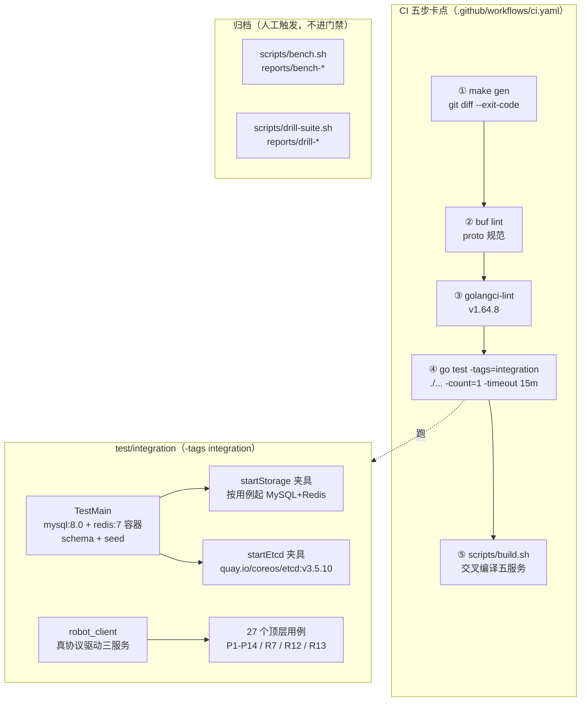

# 04-集成测试与CI

一句话定位：单元测试证明「零件对」，集成测试证明「装配起来也对」——本文讲 `test/integration/` 如何用 testcontainers 起真 MySQL/Redis/etcd 跑全链路、CI 五步卡点如何强制生成体系的可信度、以及压测结果为什么「只记录、不卡门禁」。

## 概述

`test/integration/` 是仓库里唯一一个**带构建标签**的测试包（18 个文件、27 个顶层用例）。它覆盖的是单元测试结构上够不到的东西：

- **真容器**：MySQL 8.0 建表灌数（`sql/schema` + `sql/seed` 可执行性本身就是测试对象）、Redis 7、etcd 3.5.10；
- **真链路**：三服务进程（login/gateway/game）+ 机器人客户端走真协议（RSA/AES 握手、codec 帧）；
- **真故障**：MySQL 断开后落库必须保留脏标记、恢复后同一脏任务能补落；
- **真并发**：中心服选主 failover——两个实例同时自认主会导致归档双写，这类错误打桩测不出来。

运行前提是本机 Docker（CI 用 ubuntu-latest runner 自带）：

```bash
go test -tags=integration ./test/integration/ -v -count=1
make test-integration   # 超时放宽到 20m，覆盖镜像拉取
```

与之配合的是 `.github/workflows/ci.yaml` 的五步卡点：gen diff、buf lint、golangci-lint、`go test -tags=integration ./...`、交叉编译。任一步失败即阻断合并。

## 涉及文件

| 路径 | 职责 |
| --- | --- |
| `test/integration/main_flow_test.go` | 包级 `TestMain`：起 MySQL + Redis 容器，执行 schema/seed；容器环境 → 建表 → 灌数 → CRUD 闭环 → 幂等 |
| `test/integration/p10_p11_storage_test.go` | `startStorage` 夹具（MySQL + Redis）；P10 ID 表与回源、P11 增量落库 |
| `test/integration/leader_test.go` | 选主真 etcd failover（`startEtcd` 夹具） |
| `test/integration/p1_p4_smoke_test.go` | P1-P4 全链路冒烟：三服务 + 三中间件真拉起，机器人走「游客登录 → 握手 → 绑定 → 心跳」 |
| `test/integration/p5_kafka_test.go` | P5 Kafka 链路（未设 `KAFKA_BROKERS` 自动跳过，不阻塞 CI） |
| `test/integration/p6_gameplay_test.go`、`p6b_gameplay_test.go` | P6 两批业务闭环：创角/进游戏/邮件/背包；等级任务/装备技能/私聊/公会组队/商店活动 |
| `test/integration/p7_metrics_test.go` | P7 可观测：`/metrics`、`/healthz`（恒 200）、`/readyz`（依赖断开 → 503） |
| `test/integration/p8_center_test.go`、`p9_relay_bridge_test.go` | P8 中心服注册/匹配/中转；P9 跨实例中转（Kafka `center.relay`） |
| `test/integration/p12_preload_test.go` | P12 登录预加载（含 etcd 容器）；真容器 + 真服务 |
| `test/integration/p13_cross_battle_test.go` | P13 跨服战斗全链路（匹配 → 建房 → 快照 → 操作透传 → 结算） |
| `test/integration/p14_rank_test.go` | P14 排行榜/统计/选主（ZINCRBY 分数语义） |
| `test/integration/r7_activity_test.go` | R7 活动贡献 → 里程碑 → 发奖（真 Kafka，重投不重复累加） |
| `test/integration/r12_save_ack_test.go` | R1.2 保存回执：FlushAll 排空全部批次、MySQL 断开保留脏标记 |
| `test/integration/r13_shutdown_test.go` | R1.3 关闭顺序：Drain → 落库 → 停 Actor，不丢最后一批 |
| `test/integration/friend_test.go` | 好友双边一致（申请/同意/删除/互相申请/满员/过期，断言落在库行数上） |
| `test/integration/signin_test.go` | 单表签到全链路（缓存权威 + Write-Behind，可控时钟固定「今天」） |
| `test/robot/robot_client.go` | 机器人客户端（816 行，约 60 个协议方法），集成测试与压测共用 |
| `test/benchmark/bench_test.go` | Go benchmark 骨架 + 23.4 验收口径登记 |
| `.github/workflows/ci.yaml` | CI 五步卡点 |
| `scripts/bench.sh`、`scripts/drill-suite.sh` | 压测与故障演练脚本，产物归档 `reports/` |

## 核心设计/机制



### integration tag：保护与代价

每个文件第一行都是 `//go:build integration`。它解决一个真实问题：集成测试依赖 Docker，而开发机和 CI 的单元测试阶段不该被它拖慢——`go test ./...` 因此永远只跑前 142 个文件，毫秒级完成。

代价在 `3b47b9a` 之前一直没被暴露：**不传 tag 时整个包不参与编译**。上一轮批量断言转换在包里留下 30+ 处重复声明（`:=` 重复定义已有变量），因为包编译不过且没人编译它，P6~P14 的集成用例「实际上一次都没跑过」。修复方式是逐处改为复用已有变量（`:=` → `=`）、2 处 int/int64 冲突改用独立变量名——机械但必须逐处看。这个教训直接影响了本文档的一条实践：**带 tag 的包要定期手动编译一次**，CI 第 ④ 步现在每次都会编译它。

## 关键代码解析

### 1. TestMain：包级共享容器

`main_flow_test.go:50` 的 `TestMain` 只跑一次，为整个包准备 MySQL + Redis，并执行建表与灌数：

```go
// TestMain 起一套容器环境（23.3 第 1 步：起环境 → 建表 → 灌数）
func TestMain(m *testing.M) {
	ctx := context.Background()

	// --- MySQL ---
	mysqlC, err := mysql.Run(ctx, "mysql:8.0",
		testcontainers.WithWaitStrategyAndDeadline(3*time.Minute, wait.ForLog("port: 3306  MySQL Community Server").WithStartupTimeout(3*time.Minute)),
		testcontainers.CustomizeRequest(testcontainers.GenericContainerRequest{
			ContainerRequest: testcontainers.ContainerRequest{
				Env: map[string]string{
					"MYSQL_ROOT_PASSWORD": testDBPass,
					"MYSQL_DATABASE":      testDBName,
				},
			},
		}),
	)
	...
```
（`test/integration/main_flow_test.go:50-68`）

连接串特意带 `multiStatements=true`（支持整文件执行 DDL）与 `parseTime=true`（时间列扫描），建表灌数就是顺序 `Exec` 目录下每个 `.sql`：

```go
// execSQLDir 顺序执行目录下全部 .sql（multiStatements=true）
func execSQLDir(ctx context.Context, db *sql.DB, dir string) error {
	entries, err := os.ReadDir(dir)
	...
```
（`test/integration/main_flow_test.go:127-145`）

`TestSchemaApplied`（`:148`）断言 25 张表全部建成——**DDL 的可执行性是本测试的核心价值**，schema 文件写错在单元测试里永远发现不了。`TestCRUDAndIdempotent`（`:180`）则验终态：Upsert 重复执行不产生重复行、唯一键冲突报错、可空时间列（`player_item.expire_at`）零值写 NULL 且读出不报 converting 错误——最后这条注释标明「曾因 Go 零值 time.Time 越界报 1292」。

### 2. 按用例起容器：startStorage 与 startEtcd

除共享的 TestMain 外，两个夹具按需起容器。`startStorage`（`p10_p11_storage_test.go:37`）起 MySQL + Redis 并初始化 schema，返回 `(*db.DB, *redis.Client, dsn)`——dsn 单独返回是为了「断开再重连」类用例（见下文 R1.2）。`startEtcd`（`leader_test.go:31`）起单节点 etcd：

```go
func startEtcd(t *testing.T) *clientv3.Client {
	t.Helper()
	ctx := context.Background()

	c, err := testcontainers.GenericContainer(ctx, testcontainers.GenericContainerRequest{
		ContainerRequest: testcontainers.ContainerRequest{
			Image:        "quay.io/coreos/etcd:v3.5.10",
			ExposedPorts: []string{"2379/tcp"},
			Cmd: []string{
				"/usr/local/bin/etcd",
				"--advertise-client-urls=http://0.0.0.0:2379",
				"--listen-client-urls=http://0.0.0.0:2379",
			},
			WaitingFor: wait.ForListeningPort("2379/tcp").WithStartupTimeout(60 * time.Second),
		},
		Started: true,
	})
	require.NoError(t, err, "start etcd")
	t.Cleanup(func() { _ = c.Terminate(context.Background()) })
	...
```
（`test/integration/leader_test.go:31-63`）

三个细节：`WaitingFor` 用监听端口而非固定 sleep（镜像拉取慢的机器上固定 sleep 必挂）；容器与客户端都挂 `t.Cleanup`（测试失败也回收）；`MappedPort` 拿宿主机映射端口拼 endpoint（容器内 2379 不等于宿主端口）。

### 3. leader_test.go：为什么选主要用真 etcd

文件头（`leader_test.go:3-11`）把理由说得很直白：

> 选主是「错了会写坏数据」的那一类：两个实例同时自认主，归档/赛季结算会双写。所以这里用真 etcd 跑完整链路，而不是打桩。

`TestLeaderFailover`（`:84`）是主用例，它验证的不是「能选主」而是「翻转的确定性」：

```go
	go func() { _ = a.Run(ctxA) }()
	require.Eventually(t, a.IsLeader, 15*time.Second, 50*time.Millisecond, "A 应先成为主")

	// A 确认是主之后再让 B 参选，避免「谁先到」的时序歧义
	go func() { _ = b.Run(ctxB) }()
	require.Never(t, b.IsLeader, 1500*time.Millisecond, 100*time.Millisecond,
		"A 在位期间 B 不能自认主")
	...
	// 让位：ctx 取消 → campaign 内部 Resign，其他实例应立刻接管
	// （不必等满租约，这正是「主动退出要 Resign 而不是干等 TTL」的意义）
	cancelA()
	require.Eventually(t, b.IsLeader, 15*time.Second, 50*time.Millisecond, "A 退出后 B 应接管")
	require.Eventually(t, func() bool { return !a.IsLeader() }, 5*time.Second, 50*time.Millisecond,
		"A 退出后不能再自称主")

	require.Equal(t, []bool{true, false}, recA.snapshot(), "A 的回调必须是「成主→失主」各一次")
	require.Equal(t, []bool{true}, recB.snapshot(), "B 只经历一次成主")
```
（`test/integration/leader_test.go:98-118`）

注意最后两行：**回调序列本身是断言对象**。上层任务循环以 OnChange 为唯一切换信号，「成主→失主→又成主」的抖动回调会让归档任务重复启动——比「最终谁是主」更严格。`TestResignHandsOverImmediately`（`:129`）则把 TTL 故意拉到 10s，断言 Resign 后接管耗时远小于 TTL：「否则说明走的是租约过期而不是主动让位」，这是滚动升级不断服的关键。`TestSingleInstance`（`:156`）补单实例路径与 Stop 语义（Stop 后 Run 应立即返回 nil 而不是报错）。

### 4. 其他集成用例：断言落在「终态」上

集成测试的断言风格与单测截然不同——不验证接口返回值，验证数据库行数、容器指标、进程探针。几个代表：

| 用例 | 断言对象 | 防的事故 |
| --- | --- | --- |
| `TestR13ShutdownDrainsInflightBeforeFlush`（`r13_shutdown_test.go:25`） | 消息投递后**不等待**直接关服，Drain → FlushAll → Stop 后 5 个玩家签到行全部完整 | 关服丢最后一批 |
| `TestR12FlushAllDrainsAllBatches`（`r12_save_ack_test.go:33`） | batch=2、5 个玩家分 3 轮，每轮都落库 | 只落第一批 |
| `TestR12SaveFailureKeepsDirtyThenRecovers`（`:75`） | 断开 MySQL → FlushAll 报错且 `DirtyCount()==1`；重连后补落成功 | 落库失败吞掉脏数据 |
| `TestFriendFlow`（`friend_test.go:57`） | `SELECT COUNT(*) FROM friend` 双边各一行、满员拒绝后对方零行 | 单边好友关系 |
| `TestP7MetricsEndpoints`（`p7_metrics_test.go:38`） | `/healthz` 恒 200、Redis 断开时 `/readyz` 503 但 `/healthz` 仍 200 | 存活探针误查依赖 |
| `TestSigninActorFlow`（`signin_test.go:37`） | 在线签到 SQL 立即查应为空（只写缓存），同分片多角色一次 FlushBatch 落两行 | 缓存/落库口径不一 |

`p5_kafka_test.go` 是唯一**条件跳过**的用例：未设 `KAFKA_BROKERS` 环境变量时 `t.Skip`——「不阻塞 CI 的默认集成测试」，本地用 `make dev` 起 broker 后再跑。

### 5. CI 五步卡点

`.github/workflows/ci.yaml` 的注释即设计宣言：「任一步失败即阻断合并：生成体系的可信度靠 CI 强制保证。」

```yaml
      # ① 生成物一致性：make gen 后 git diff 必须干净（杜绝手改生成代码）
      - name: "① gen + diff"
        run: |
          make gen
          git diff --exit-code -- pkg/pb pkg/gamedata pkg/model

      # ② buf lint + proto 兼容性检查
      - name: "② buf lint"
        run: |
          cd api/proto
          buf lint

      # ③ golangci-lint run
      - name: "③ golangci-lint"
        uses: golangci/golangci-lint-action@v6
        with:
          version: v1.64.8

      # ④ go test（含 test/integration，testcontainers 起真实中间件，23.3；
      #   ubuntu-latest runner 自带 Docker，超时放宽到 15m 覆盖镜像拉取）
      - name: "④ go test (unit + integration)"
        run: go test -tags=integration ./... -count=1 -timeout 15m

      # ⑤ 交叉编译五服务
      - name: "⑤ build.sh"
        run: ./scripts/build.sh linux amd64
```

三处版本锁写在文件头，理由分别是：buf 锁 1.74.0（与本地一致，避免生成输出随版本漂移导致 gen diff 误报）；golangci-lint 锁 v1 大版本（v2 要求 go >= 1.23，与 go.mod 的 1.22 不兼容）；Go 1.22 与 go.mod 指令一致（GOTOOLCHAIN 不触发额外下载）。第 ④ 步用 `-tags=integration ./...` 而不是只跑 `./test/integration/`——**单元测试与集成测试同一步跑，合流后的失败才准确定位**；`-count=1` 禁缓存，`-timeout 15m` 覆盖镜像拉取。

### 6. benchmark 与 reports：结果如何记录

`test/benchmark/bench_test.go` 目前只有一个真 benchmark（`BenchmarkConfigLoad`，登录 TPS 的依赖项之一）加口径登记（`TestBaselineTargets`）。真正的压测走 `scripts/bench.sh`（`make bench`）：依次跑 login / biz / biz-ro / conn 四种负载，产物落 `reports/bench-<时间戳>/`：

```text
reports/bench-20261018-220321/
├── login.json / login.log      # 机器可读 + 人读的逐场景结果
├── biz.json / biz.log          # 混合业务消息
├── biz-ro.json / biz-ro.log    # 只读业务（排除聊天写库）
├── conn.json / conn.log        # 连接保持
├── metrics-*.txt               # 三服务的指标快照
└── REPORT.md                   # 汇总：负载表 + 结果表 + 对照 23.4 目标
```

`REPORT.md` 的尾部写明归档规矩：「本报告是**单机基线**，用于回归对比。每次里程碑复跑一次，指标劣化超过 20% 视为回归。」历史报告因此如实保留了失败——`bench-20261018-212408`（最早一轮）登录 2 失败、规模仅 100/10/200；`bench-20261018-220321` 混合业务 P99 121.72ms 超出 50ms 目标、只读业务 1000 次全失败（`wait resp 3004: i/o timeout`）。**记录坏结果比只留好结果更有价值**：它让「什么时候坏的」可查。

### 7. robot 压测工具

`test/robot/robot_client.go` 是自研机器人客户端（816 行），不依赖任何压测框架：`GuestLogin`（HTTP 游客登录拿 token）→ `Connect` + `Handshake`（TCP 连网关，RSA/AES 会话加密）→ `call`（发请求、等响应，`pendingPush` 缓存推送避免「等响应时读到推送被丢弃」的假阴性——注释记录了这个坑）。协议覆盖面到全部玩法：背包/装备/技能/任务/签到/活动/聊天/公会/组队/副本/商店/场景/匹配/战斗，约 60 个方法。

它一身三用：集成测试里当**功能驱动器**（`p1_p4`/`p6`/`p13` 靠它走真协议）；`tools/loadtest` 拿它做**连接/登录压测**（`make loadtest`，默认 1000 连接，10W 需 `ulimit -n 200000`）；`scripts/bench.sh` 拿它做**四种负载压测**。

## 演进记录

| 提交 | 事件 |
| --- | --- |
| `b93f071` | P7 可观测 + P15 全链路演练：压测工具、故障注入、首批 `drill-*` 报告 |
| `331b5e5` | P15 演练修复 8 个真实缺陷；`drill-suite` 覆盖 MySQL/Redis/Kafka/etcd 注入与恢复 |
| `ec6258d`→`a5f369f` | 断言机械转换波及 integration 包——因带 tag 不编译，30+ 处重复声明无人发现 |
| `3b47b9a` | **integration 包恢复可编译**：逐处修 30+ 重复声明；修正签到冷启动（Redis 丢失要 Del + ZRem，与「整体丢失」一致）与两处过时 seed（按新 JSON schema）。修复后 21 个用例中 18 个通过，剩余 3 个是长期未运行积累的既有缺陷 |
| `dcd8354` | 修重复回包串号后，`go test -tags integration ./test/integration/` 全绿（21 个用例）；P6/P6B 幂等、P12 PlayerInfo 的既有缺陷随修复清零 |
| `873b1d8` | `leader_test.go` 新增：单元 + 真 etcd failover（3 个用例：failover、Resign 立即接管、单实例） |
| `497e603` | shutdown 两个时间竞争 flaky 改结构化同步（详见 [`../70-开发过程实录/01-定时器测试flaky修复.md`](../70-开发过程实录/01-定时器测试flaky修复.md)） |
| `eed6721` / `7981b36` | CI 五步卡点落地（P0 骨架期）；随后修正 CI 配置（buf 版本锁、gendb 时间列/主键写入缺陷），版本锁策略沿用至今 |

## 关于「benchmark 进 CI」的讨论结论

**结论：只记录，不卡门禁。** CI 五步里没有 bench 步骤，`reports/bench-*` 全部由 `make bench` 人工触发归档。

理由有三层。其一，benchmark 测的是容量而不是正确性，而 CI 的价值在于「合并前抓住确定的对错」——把一条随机器负载波动的 P99 曲线设成合并门槛，换来的是大量「重跑即过」的噪声，恰好违背本项目「时间竞争测不出确定行为」的一贯立场（`497e603` 修 shutdown flaky、`bea479d` 改 fakeTimers，都是把带时间的断言改成确定断言）。其二，现有基线全部是单机数据（五服务 + 中间件同机），CI runner 的规格与单机开发机不可比，数字不可横比。其三，归档机制已经够用：`REPORT.md` 明确「每次里程碑复跑一次，指标劣化超过 20% 视为回归」——把对比放在**同一环境的前后两次报告之间**，由人研判，比让 CI 在一个未知规格的机器上Judge 一个绝对阈值更可靠。

配套的工程实践是故障演练（`make drill-suite` → `reports/drill-*`）：注入 MySQL 断连/Redis 断连/Kafka 停 broker/etcd 重启，校验「进程存活、readyz 摘除、恢复后冒烟通过」。它同样不进 CI，但是每次里程碑的必修课——`drill-20261019-232825/REPORT.md` 记录 15 项检查全绿。

## 小结

这一层测试的回答对象是「装配与容量」：testcontainers 让 MySQL/Redis/etcd 成为可版本化的测试夹具（`mysql:8.0`、`redis:7-alpine`、`etcd:v3.5.10` 全部写死在代码里），机器人客户端让真协议驱动不需要人工操作，leader failover 用「回调序列」而非「最终状态」做断言。CI 五步把「生成物一致 → proto 规范 → lint → 全量测试（含集成）→ 可构建」钉成合并硬门槛；而 benchmark 与演练刻意留在门槛之外——**确定的错误交给 CI，波动的数字交给人**。

回头看，这一层最大的风险曾经是「带 tag 的包悄悄不编译」（`3b47b9a` 之前 30+ 处重复声明躺了整整两轮提交）。如果你要给测试体系加新层，记住这条：任何「默认不跑」的代码路径，都要有一个地方保证它至少还在编译。
