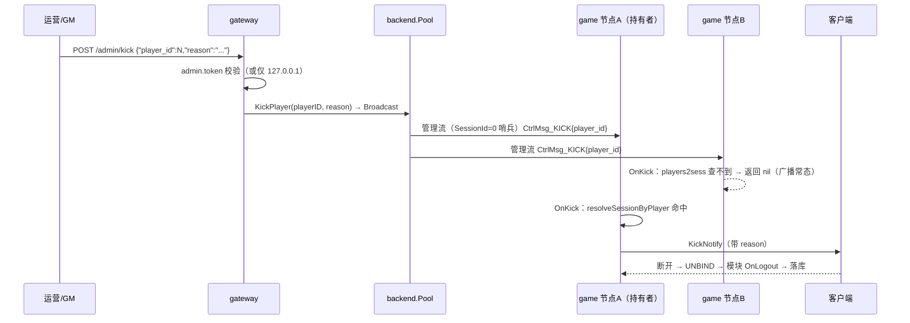

# 70-07 封禁与 GM 踢人链路

> 专题：`CtrlMsg_KICK` 从「两端都没实现」到全链路打通，中途按用户纠偏做了一次设计返工。
> 涉及提交：`31bfff4`（打通链路 + 聊天长度上限）、`c866bea`（按角色号踢人的返工）、`00ca387`（管理流）。
> 结论：GM 封禁/踢人从「只能拦住下次登录」变成「在线的人立刻收到带原因的下线通知」。

## 1. 起点：协议定义了，两端都没实现

proto 里早有 `CtrlMsg_KICK`，但游戏服只有一个 TODO、网关从不发帧。后果：**「封禁生效」只能拦住下次登录，在线的人要等自然掉线**——运营封一个正在刷资源的号，什么都不会发生。

## 2. 第一版：会话级踢人（31bfff4）

先打通再说：

- **游戏服**：`StreamHandler` 加 `OnKick`；`handleCtrl` 的 KICK 分支真正分发。实现里只发 `KickNotify`，**不在这一层直接清会话**——避免跳过模块下线钩子（`OnLogout` 要落库）；
- **网关**：`KickSession` 构造控制帧，经 `backend.Pool` **复用会话既有的 gRPC 流**下发；
- **入口**：`POST /admin/kick`，配了 `admin.token` 校验 Bearer；未配则只接受 `127.0.0.1/::1`——默认部署不必新增配置也能给运维 curl 用，外网打不进来。

为什么用控制帧而不是直接断 TCP（`c866bea` 后的注释原话）：

> 走 CtrlMsg_KICK 控制帧而不是直接断 TCP：断 socket 只会触发 UNBIND，客户端看到的是「连接异常」；控制帧让游戏服发 KickNotify，客户端能显示具体原因并做「被踢下线」的 UI 处理。

## 3. 设计返工：用户纠偏「参数就是 player_id」

第一版用 session_id 踢人，于是要回答「怎么按角色找到会话」。当时的做法（后被完整删除）：加 `BindAck` 回传，让网关维护一份 player→session 索引。

用户看完代码后的原话纠正：

> 不对 不应该是sid 封号应该是知道玩家的player Id 然后发给游戏服 让它找到玩家再踢 参数就是player Id

这个纠正背后是一条架构原则：**那份索引等于把游戏服的数据复制一份到网关——顶号、换角时两边必然对不上（踢到旧会话），与「数据所有权归 Actor」冲突**。`c866bea` 按此返工，净减 134 行：

| 删除 | 原因 |
| --- | --- |
| proto：BindAck 消息与 oneof 分支 | 协议层就不该有它 |
| 网关：`onBindAck`/`SetBindAckHandler`/`KickSession`/`GetByPlayer`/`BindPlayer` | 网关不再需要「角色→会话」能力 |
| `session.Session` 的 `playerID` 字段 | 它曾经名叫 playerID 却存 account_id，是这次误判的根源 |
| 游戏服：`SendBindAck`/`notifyBindAck`/`bindActor` 回传 | 同上 |
| session.Manager 从四张表回到三张 | 少一张表少一处不一致 |

顺带修掉一个并发隐患：`streamConn` 加 `sendMu`——Broadcast 会借用别的会话的流下发，而 gRPC 的 `Send` 不保证并发安全，两个写方（router 读循环 + 管理流）不加锁会让 HTTP/2 帧交错、对端直接断流。

## 4. 最终链路



四个关键设计点：

**① 广播而不是查 presence 再单发**（`c866bea`）：

```go
// Broadcast 向每个后端节点各发一帧（同一节点的多条会话流只发一次）。
//
// 用途：管理端只知道 player_id、不知道会话号——会话映射属于游戏服
// （players2sess 是唯一权威），网关保一份副本只会产生两份真相。
// 因此这里广播，由持有该玩家的节点命中并处理，其余节点忽略即可。
//
// 取舍：节点数通常个位数，广播成本可接受；换来的是「网关不需要知道谁在线」。
func (p *Pool) Broadcast(frame *internalv2.StreamFrame) (int, []error) {
	// 同一 target 只取一条流：一个节点上可能有很多会话流，
	// 逐条发会让同一节点收到 N 份同样的踢人指令。
	byTarget := make(map[string]*streamConn, len(p.streams))
	for _, sc := range p.streams {
		if _, ok := byTarget[sc.target]; !ok {
			byTarget[sc.target] = sc
		}
	}
	…
}
```

**② 无 player_id 直接忽略，不回退用 session_id**（`c866bea`）：回退等于把会话号当角色号查表——查不到静默失败、查到了踢错人。宁可漏（协议写错），不能错杀。

**③ 查不到返回 nil 而不是错误**（`server_session.go:338`）：广播时非持有者节点必然查不到，这是常态不是故障。

**④ 管理流让空载网关也能踢**（`00ca387`）：踢人指令走 `SessionId=0` 的哨兵管理流，不依赖「恰好有一个已绑定的会话流」——网关刚重启、还没有玩家上线时，GM 指令照样能到游戏服。这正是删掉 BindAck 索引后必须补的能力：既然网关不认识任何会话，就得有一条不依附于会话的通道。

## 5. 封禁的两步生效

封禁不是踢一次人，是「拒新 + 踢旧」：

1. **拒新**：登录服 `account.status` 校验（fail-closed，未知状态拒登录），见 [30-登录服/02](../30-登录服/02-账号体系与封禁.md)；
2. **踢旧**：封禁操作触发本条链路，在线会话立刻收到带原因的通知下线。

两步之间有时间窗（封禁写入到踢人指令到达），窗口内旧会话还能操作——这是异步链路的固有代价，用 `reason` 文案让客户端提示「账号已被封禁」来缓解。

## 6. 验证

- 网关帧内容（必须是 `PlayerId`、`SessionId` 留空）、广播按节点去重、部分节点失败要报错；
- rpc 层「无 player_id 忽略」、游戏服按角色查表、会话三表清理与 GC 回收；
- 三处变异（帧改用 SessionId / rpc 用 SessionId 当角色号 / Broadcast 不去重）全部被抓。

## 7. 经验沉淀

1. **「两端都没实现」的协议最危险**：proto 里有它，读代码的人会以为能用。定义了就要么实现，要么删掉。
2. 副本即债务：任何「为了查询方便而复制的映射」，都会在顶号/换角时变成两份真相。**权威只有一份，其余广播**。
3. 被用户纠偏时先想原则再动手：这次的纠偏表面是「参数用 player_id」，底下是「数据所有权归 Actor」——想通这一层，删掉的就不只是 BindAck，还有整套「网关认识会话」的心智。
