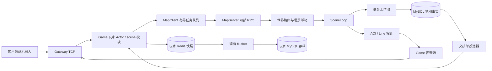
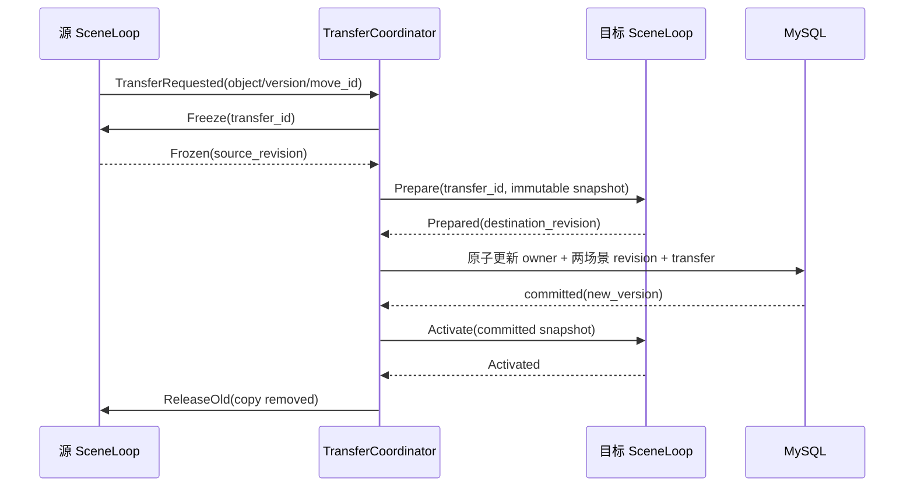

# SLG 场景地图设计开发

> 文档性质：基于当前 `game_study` 仓库的新增子系统实施规格，**不是现有地图功能说明**。编写日期：2026-10-19。本文中的 MapServer、表、接口、协议和配置，除明确标注为“现有”外均待开发。默认实现路径已经选定，AI 开发者按阶段执行，不自行换成另一套一致性模型。
>
> 阅读方法：程序员先读第 1–6 章理解职责与数据，再读第 7–16 章理解业务与故障；AI 开发按第 20 章任务顺序实施，每阶段交付代码、测试及边界说明。本文件本身不要求立即修改业务代码或启动服务。

## 目录

1. [设计来源与关键取舍](#1-设计来源与关键取舍)
2. [目标、范围与验收闭环](#2-目标范围与验收闭环)
3. [与当前仓库的接入关系](#3-与当前仓库的接入关系)
4. [服务、场景和并发所有权](#4-服务场景和并发所有权)
5. [坐标、分区和空间索引](#5-坐标分区和空间索引)
6. [领域模型与不变量](#6-领域模型与不变量)
7. [命令、持久化与幂等](#7-命令持久化与幂等)
8. [跨场景所有权移交](#8-跨场景所有权移交)
9. [出征、移动与回城](#9-出征移动与回城)
10. [采集与资源刷新](#10-采集与资源刷新)
11. [战斗、排队与延迟动作](#11-战斗排队与延迟动作)
12. [AOI、Ghost 与行军线](#12-aoighost-与行军线)
13. [地图与玩家资产交接](#13-地图与玩家资产交接)
14. [数据库与存储接口](#14-数据库与存储接口)
15. [协议、错误码与鉴权](#15-协议错误码与鉴权)
16. [恢复、停服与故障处理](#16-恢复停服与故障处理)
17. [配置、容量与监控](#17-配置容量与监控)
18. [目录与接口骨架](#18-目录与接口骨架)
19. [测试与验收矩阵](#19-测试与验收矩阵)
20. [可直接分配给 AI 的开发任务](#20-可直接分配给-ai-的开发任务)
21. [扩展顺序与禁止的捷径](#21-扩展顺序与禁止的捷径)

## 1. 设计来源与关键取舍

### 1.1 参考资料

本文基于场景大地图设计资料整理，覆盖存储归属、进程职责、模块划分三方面；以下结论均以 Go 服务端视角重新推演，资料原文未明确处由本文给出统一规定。

参考资料对富饶表 owner 的表述并不完全一致：一处写 instance 创建，一处写场景持有。本文不对资料未明确处做推断；统一规定“场景拥有本场景富饶块逻辑，实例负责生命周期”。原文的强锁宏缺少 `BIT_TRUE` 定义，不能直接根据字面位运算复刻；Go 版使用明确枚举和转换表。

### 1.2 模块与数据设计对应

| Go 设计 | 设计要点 |
|---|---|
| `WorldManager` | 管理实例目录、启动与退出；目录失效时停止整个实例，避免孤儿场景 |
| `WorldInstance` | 管理该世界的场景循环、AOI、行军线和恢复屏障 |
| `SceneLoop` | 单消费者串行修改状态，不允许外部 goroutine 持有可变对象指针 |
| `AOIWorker` | 维护订阅和投影，批量推送，可丢弃投影后重建 |
| `ViewCoordinator` | 处理跨广播块订阅和投影，不持有业务对象写权限 |
| `LineWorker` | 行军路径显示；不是行军逻辑真源 |
| 不可变路由快照 + 消息查询 | 不建立全局可任意写的对象表 |
| SceneLoop 私有 map / heap | 明确生命周期及单写者 |
| 地图专用 SQL 事务仓储 + 内存镜像 | 地图业务命令持久化成功后才确认；不复用玩家写后落库结构 |
| SQL 原子移交记录 + 场景冻结 + 激活确认 | 不因移交删除持久化任务；提供崩溃后的确定恢复步骤 |
| `Phase + BusyReason + OpID` | 不混用 Go mutex 与业务锁，不支持任意位组合 |

### 1.3 本文确定的实现决策

1. 新增独立 `cmd/map` / `internal/worldmap`，服务名 `map`。五个现有服务保持各自职责；新增后是六个服务加玩家 flusher。
2. 第一版一个世界同一时刻由一个 MapServer 实例承载，内部 25 个场景循环；多个世界可分配到不同节点。**不在第一版实现单世界跨机器分片。**
3. 地图持久化以同一个 MySQL 实例中的事务为权威。Redis 仅可存路由/查询缓存，Kafka 仅作异步投递通道，均不作为地图业务事实唯一来源。
4. 一次场景业务命令涉及的部队、资源点、采集会话、操作回执和 outbox 在同一 SQL 事务中提交。只有提交明确成功，才能变更内存镜像并发布成功事件。
5. 位置信息按持久化的移动片段和时间推导，不每帧写 SQL。每帧只更新可重建投影；到达、改速、召回、采集、战斗、移交等状态边界才产生持久化命令。
6. MapServer 不直接写玩家 Items、Redis 玩家快照或 player_item。回城产物通过持久化交接单投递给玩家 Actor，再利用现有快照提交与 flusher 落库。
7. 战斗采用服务端结算接口。当前 Cross 的客户端上报演算 Demo 不能直接作为 SLG 战损和资源分配的权威。
8. 第一版只实现免费出征的地图编队及采集闭环；涉及实际兵力、体力和道具扣费，必须完成第 13 章资产预留协议后才开放。

选择 SQL 命令提交会增加延迟和数据库压力，但能明确处理多个共享对象的原子修改。先测量再优化；将来切换日志或 Redis 方案必须另写迁移协议，不能只替换一个 Repository 实现就声称语义相同。

## 2. 目标、范围与验收闭环

### 2.1 第一版功能

- 按 world_id 创建世界、加载地形和富饶块配置。
- 玩家进入地图、创建唯一主堡、订阅视野、查询自己的部队。
- 免费编队从主堡出征，跨场景移动，到资源点采集，可召回，回城后可靠发奖。
- 同资源点最多一个采集会话；敌对部队可触发服务端战斗，其他攻击者按目标 FIFO 排队。
- 场景边界移交、目标逻辑归属、跨 AOI 区块显示均有明确处理。
- 重复请求、超时重试、进程重启、SQL 提交回包丢失、AOI 慢客户端均有恢复路径。
- 机器人能够在无图形客户端条件下跑通完整闭环。

第一版不含联盟领土、集结、行军拦截、城池攻防战损、自由迁城、动态寻路避让、战争迷雾、跨世界迁移、单世界跨节点热迁移。它们可以扩展，但不得伪装为完成的 API。

### 2.2 最终业务验收案例

```text
玩家 A 登录 → MapEnter → 获得主堡位置 → WatchView
→ MarchStart(resource R) → 收到持久化后的 operation_id 与 troop_id
→ 跨过场景边界 → 到达 R → 采集开始
→ 玩家 B 到达同一 R → 防守场景串行裁决并调用 BattleResolver
→ 战斗结果落库 → 胜者继续采集 / 败者带已有货物回城
→ A 或 B 回城 → 地图交接单生成 → 玩家 Actor 幂等入包
→ 地图交接单确认 → 重启 map/game/flusher 后资产不重复
```

此例战败不掠夺已装载资源，胜者仅获得后续采集权；具体经济规则见第 11 章。免费演示编队不等于实现了真实兵力资产。

### 2.3 必须持续成立的不变量

| 编号 | 不变量 |
|---|---|
| INV-01 | 一个世界只有一个有效写入 epoch；旧 epoch 不得继续提交 |
| INV-02 | 一个对象只有一个逻辑 OwnerScene，同一版本最多应用一次 |
| INV-03 | 同一资源点最多一个活动采集会话，余量永不小于 0 |
| INV-04 | 资源扣减与部队货物增加属于同一地图事务 |
| INV-05 | 同一玩家同一编队槽位最多一支活动部队，包括回城待交接状态 |
| INV-06 | 战斗结果只可应用一次，迟到结果不可覆盖超时裁决 |
| INV-07 | 同一交接单最多加一次背包；未确认的交接单可持续重投 |
| INV-08 | 可视投影可以重建，投影丢失不能造成资源、部队或交接单丢失 |
| INV-09 | 命令回复成功前，相关业务事实已经提交；入队成功不是业务成功 |
| INV-10 | 未解析的 SQL 提交结果会冻结相关场景，禁止用旧镜像继续写 |

## 3. 与当前仓库的接入关系

### 3.1 已有能力与缺口

| 当前代码 | 可以利用的部分 | 开发时必须补充 |
|---|---|---|
| [pkg/actor](../pkg/actor/actor.go) | 玩家串行入口、有界信箱、消息机制 | 无监督进程层级；SceneLoop 不直接复用分片 Receive 执行慢 I/O |
| [module.Context](../internal/game/module/module.go) | 玩家状态、ClaimBiz、Ext、提交后响应能力 | 地图客户端和可靠资产交接适配器 |
| [pkg/writebehind](../pkg/writebehind/types.go) | 玩家快照版本、Items、Ext、AppliedGrants | 不能直接表示按世界共享的地图对象和多对象事务 |
| [module/register/register.go](../internal/game/module/register/register.go) | 模块 Persister 的聚合注册点 | 只给玩家 mapdispatch 状态加注册，不给它塞地图世界对象 |
| [pkg/registry/etcd](../pkg/registry/etcd/registry.go) | 服务注册、节点地址 | world→map 节点目录；SQL 写入栅栏不是 etcd 注册自动提供的 |
| [GameService](../api/proto/internalv2/game.proto) | Gateway→Game 双向流和已有会话绑定 | 地图协议在 Game 中转，Game→Map 新建内部 RPC |
| [battle 模块](../internal/game/module/battle/battle.go) | 可参考跨服调用装配 | 现有客户端演算 Demo 不承担 SLG 权威战斗 |
| [消息号边界](../internal/common/constant/constant.go) | 已预留地图 4000–4999 | scene.proto、自动生成消息注册、模块路由 |
| [pkg/shutdown](../pkg/shutdown/shutdown.go) | 分阶段退出与聚合错误 | 新地图入口正确区分运行取消与启动失败，并验证 Shutdown 可达 |

### 3.2 外部调用链



Gateway 无需直连 MapServer，保持连接鉴权、加密、转发职责。Game 从绑定会话取得 player_id，客户端传来的 player_id 不可信。Game 的 scene 模块不能在玩家 Receive 中等待远程 RPC；它发起任务，完成后以带会话代次的消息回到同一玩家 Actor。

Map 在 Game 断开或玩家离线后继续推进已提交行军和采集。视野注册是连接态，部队生命周期不是连接态。

## 4. 服务、场景和并发所有权

### 4.1 运行单元

| 单元 | 第一版数量 | 可变状态 | 是否权威 |
|---|---:|---|---|
| WorldManager | 每进程 1 | 已加载世界、生命周期 | 本进程运行目录 |
| WorldInstance | 每世界 1 | epoch、场景和恢复屏障 | SQL 归属的内存镜像 |
| SceneLoop | 每世界 25 | 本场景对象、采集、战斗和计时索引 | 已提交事实镜像 |
| TxWorkerPool | 每进程 8 | 不可变事务任务 | 无业务内存写权 |
| ViewCoordinator | 每世界 1 | 订阅路由和源序号 | 可重建 |
| AOIWorker | 每世界 16 | 区块对象投影和订阅集合 | 可重建 |
| LineWorker | 每世界 1 | 路线空间索引 | 可重建 |
| TransferCoordinator | 每世界 1 | 正在移交的调度状态 | SQL transfer 表可恢复 |
| DeliveryWorker | 每进程有界池 | 重试游标和连接 | SQL 交接单为权威 |

25 和 16 是初始配置，逻辑场景和广播块不要求一一对应；不是根据 CPU 核数自动调整。线上更改场景网格属于数据迁移。

### 4.2 SceneLoop 执行规则

场景有独立 goroutine 和有界 channel。每轮处理有限条命令，再处理到期任务和投影 Tick，防止热点邮箱饿死定时器。一个场景同时最多一个待决持久化命令；查询和 Tick 只能读取上一个已提交状态，写命令排队。

所有命令使用以下步骤：

```text
校验 envelope / epoch / 请求权限
→ 使用已提交镜像计算 MutationPlan（深拷贝）
→ 设置 pending(command_id, scene_revision)
→ 非阻塞提交 TxWorkerPool
→ I/O 完成消息回场景控制通道
→ 若提交确定成功，应用 immutable result，推进 revision
→ 向客户端回复或发布投影
```

事务工作池不能访问 SceneLoop 的 map 或对象指针。计划中的切片、map、JSON 字节必须复制；禁止“复制结构体但共享内部 map”的伪快照。

I/O 完成消息、关闭消息、移交控制消息使用独立有界控制通道。提交任务前先获得控制回执名额；回执使用该名额送达，不可与普通满邮箱竞争后丢失。控制通道拒收或事件循环 panic 时令整个 world fail-stop，停止接入并按恢复协议重建。

不能在 SceneLoop 内同步等待另一个 SceneLoop，也不能让两个场景互相 Request 等待。跨场景协调由 TransferCoordinator 用消息推进，不占用场景执行线程。

### 4.3 生命周期与崩溃防护

Go goroutine 没有自动 link/monitor。实现 WorldInstance 的统一 context、WaitGroup、错误上报和 readiness 状态。任一权威场景 panic、SQL 结果长期不可解析、控制通道损坏：

1. 世界标记 NotReady，拒绝新写，取消投影推送。
2. 停止全部场景接收新业务，等待已知在途事务，解析结果。
3. 释放旧租约或等待数据库租约到期；重新获取更大的 epoch。
4. 整个世界重新恢复，不只清空出错场景后继续跑。

AOIWorker 故障允许只重建投影，不需要重启世界。恢复次数设上限和退避，连续失败持续 NotReady，不无限重启掩盖数据错误。

## 5. 坐标、分区和空间索引

### 5.1 单位与编号

- 世界：`WorldID uint64`，所有持久化主键、幂等键、RPC 均包含 world_id。
- 对象：`ObjectID uint64`，使用 SQL 分配的正整数 ID；RPC/JSON 调试工具按字符串展示，避免 JavaScript 精度丢失。
- 地图尺寸：默认 5000×5000 格，左下角原点，合法格坐标 `0 <= x < width`、`0 <= y < height`。
- 运行位置：定点 `Pos{X,Y int64}`，1 格 = 1000 position units。界面显示可转换为浮点，权威计算不使用 float 累积。
- 持久时间：UTC Unix 毫秒 int64；延迟用 time.Duration。禁止混用秒和毫秒。
- 场景：5×5，每场景 1000×1000 格，行优先 `scene_id = sy*cols+sx+1`。
- AOI：4×4，每广播块 1250×1250 格；其内部再按 25×25 格 AOI cell 分桶。
- 富饶块：默认 100×100 格，编号独立，不复用 scene_id/block_id。

```go
// 设计骨架：必须先检查坐标范围与尺寸可整除。
func SceneAt(p Pos, sceneWidthUnits, sceneHeightUnits int64, cols int32) SceneID {
    sx := p.X / sceneWidthUnits
    sy := p.Y / sceneHeightUnits
    return SceneID(sy*int64(cols) + sx + 1)
}
```

边界采用左闭右开。例如 x=1000 格属于右侧场景，不同时归属两个场景。右上世界外边界不可放置；负坐标先拒绝，不能依赖 Go 负数除法结果。

### 5.2 三类归属不要混用

1. `PhysicalScene`：根据当前推导位置计算，影响普通行军边界。
2. `OwnerScene`：当前唯一写入者；普通移动时追随 PhysicalScene，驻防、战斗或目标绑定时可临时归属防守目标场景。
3. `ViewCell/Block`：只用于广播分桶，与前两者无写入权限关系。

攻击方为同场景裁决而迁入防守场景时，即使物理位置还在边界外，仍按 OwnerScene 路由。AOI 根据物理位置渲染，不把它瞬移到某个“场景中心”。

### 5.3 占位索引与冲突

SceneLoop 私有 `occupied[cell] -> []ObjectID`；第一版主堡和资源点 1×1 格，静态地形、主堡、资源点互斥，部队移动不占静态格。跨场景 footprint 的建筑第一版拒绝。

持久化 `map_occupancy` 唯一键 `(world_id, cell_x, cell_y, layer)` 是最终占位约束，OwnerScene 的内存预检只是加速。两个创建同时争格，只有一个事务能成功；另一个返回 PositionOccupied，不能先广播再撤回。

不采用“同格两个同类对象”的设定。将来支持多层格、联盟建筑或跨边界大建筑，需扩展 layer/footprint 和多格事务，不默认绕过唯一键。

## 6. 领域模型与不变量

以下为领域类型规格，最终拆到 `internal/worldmap/domain`。枚举值要稳定写入协议/快照，新增值不能重排。JSON 使用 snake_case，schema_version 独立于 object version。

```go
type WorldID uint64
type ObjectID uint64
type SceneID int32
type Pos struct { X, Y int64 }

type ObjectHeader struct {
    WorldID WorldID
    ID ObjectID
    Kind ObjectKind
    OwnerScene SceneID
    Version uint64
    SchemaVersion uint32
    Deleted bool
}

type City struct {
    Header ObjectHeader
    PlayerID int64
    GuildID int64 // 镜像；权限判断须使用服务端更新的关系版本
    Position Pos
    ConfigVersion string
}

type Troop struct {
    Header ObjectHeader
    PlayerID int64
    SlotID int32
    HomeCityID ObjectID
    Phase TroopPhase
    Busy BusyState
    Target TargetRef
    Move *MoveSegment
    Cargo map[int32]int64
    CapacityUnits int64
    Stats CombatSnapshot
    Deferred *DeferredAction
    DispatchID string
    SettlementID string
}

type MoveSegment struct {
    MoveID string
    From, To Pos
    StartAtMS, EndAtMS int64
    SpeedUnitsPerSec int64
    Path []Pos
    SegmentIndex int32
    PathVersion uint64
}

type ResourceNode struct {
    Header ObjectHeader
    Position Pos
    RichBlockID int64
    ResourceType int32
    ItemID int32
    Total, Remaining int64
    ActiveCollectID string
    RefreshGeneration int64
    PendingDestroy bool
    ConfigVersion string
}

type CollectSession struct {
    ID string
    TroopID, ResourceID ObjectID
    StartAtMS, EndAtMS int64
    RateMilliItemsPerSec int64
    PlannedQty int64
    RuleVersion string
    Status CollectStatus
}

type BusyState struct {
    Reason BusyReason
    OpID string
    SinceMS, DeadlineMS int64
}
```

### 6.1 必需枚举

| 枚举 | 值及解释 |
|---|---|
| ObjectKind | CITY=1、TROOP=2、RESOURCE=3；LINE 是投影，不是业务对象 |
| TroopPhase | MARCHING=1、COLLECTING=2、QUEUED=3、FIGHTING=4、RETURNING=5、SETTLING=6、CLOSED=7 |
| BusyReason | NONE=0、TRANSFER=1、DEFEND_TRANSITION=2、BATTLE=3、RETURN_TRANSITION=4 |
| CollectStatus | ACTIVE=1、SETTLED=2 |
| BattleStatus | PENDING=1、RESOLVED=2、TIMED_OUT=3 |
| DeliveryStatus | PENDING=1、APPLIED=2、QUARANTINED=3 |
| CommandStatus | COMMITTED=1；暂态 PENDING 存在运行队列，不将 SQL 失败写成成功回执 |

`Phase` 表达业务活动，`Busy` 表达暂时不允许并发转换的原因。合法组合由统一 `ValidateTroop` 检查。例如 COLLECTING 必须存在活动 CollectSession；FIGHTING 必须有 battle_id，不能同时 RETURNING。业务锁不是 mutex，不因超时就一律清零。

### 6.2 数据归属矩阵

| 数据 | 唯一写入者 | 持久化 | 恢复方式 |
|---|---|---|---|
| 城池、部队、资源对象 | OwnerScene 经 TxWorker | map_object | 加载和语义校验 |
| 部队所持 Cargo | 部队 OwnerScene | 部队快照 | 不可仅放内存 |
| 活动采集会话 | 资源 OwnerScene，部队先共置 | map_collect | 重建到期任务 |
| 战斗及目标排队 | 防守目标 OwnerScene | map_battle / map_battle_queue | 加载队列顺序和结果状态 |
| OwnerScene 变更 | TransferCoordinator 协调的 SQL 事务 | map_transfer + map_object | 按最终 OwnerScene 恢复 |
| 富饶计数 | 场景从对象派生 | 非独立权威事实 | 扫描重建 |
| 移动列表、定时堆 | SceneLoop | 不单独存 | 由 Move/Collect/Battle 的 deadline 重建 |
| on_road 目标索引 | 资源场景的只读投影 | 不作为占位/采集承诺 | 从部队目标重建 |
| AOI、线路、订阅 | 对应投影 worker | 不落业务库 | 从对象和连接订阅重建 |
| 回城资产交接 | Map SQL / 玩家 Actor 分别拥有各自提交 | map_delivery / 玩家 Ext、AppliedGrants | 持续重试并查询业务回执 |

## 7. 命令、持久化与幂等

### 7.1 Envelope 与业务操作键

```go
type CommandEnvelope struct {
    WorldID WorldID
    PlayerID int64 // 来自内部鉴权，不从客户端 body 取信任
    SessionGeneration uint64
    RequestID string
    OperationID string
    PayloadHash [32]byte
    ExpectedObjectVersion uint64
    WorldEpoch uint64
    DeadlineMS int64
    TraceID string
}
```

客户端写请求必须携带 UUID request_id，作用域是 `(world_id, player_id, request_id)`；相同键、相同语义参数返回首次结果，不再次出征/召回。相同键不同 payload 返回 IdempotencyConflict。hash 计算使用标准化领域参数，不能依赖 protobuf 原始编码顺序，也不含 trace/deadline/session 这类可变化字段。

`operation_id` 由服务端在首次接受时生成并在首次事务中持久化。提交前的 Pending 回复还必须包含原 request_id；若进程重启后 operation_id 尚无记录，客户端使用原 request_id 和原参数重试，不能仅凭 NotFound 认为业务失败。内部系统命令使用确定性键，例如 `arrive:{troop}:{move_id}`、`collect-end:{session}`、`battle-result:{battle_id}`、`refresh:{world}:{block}:{generation}:{slot}`。

`map_command` 保存不可变的首次命令结果；`map_operation` 记录延迟操作的进度和最终结果。出征操作在部队创建提交时即 DONE，不等回城；普通召回在 RETURNING 提交时 DONE，战斗中延迟召回先 PENDING，后续战斗/召回事务更新为 DONE/FAILED。Operation 查询将首次结果与最新进度分开返回，不能覆盖首次幂等响应。

数据库事务回执包含请求参数摘要、返回码、对象 ID、提交版本及必要响应字段。重试从回执读取，不能重新按当前对象状态生成一个含义不同的“首次结果”。只读查询不写回执。

### 7.2 单场景事务顺序

所有地图写事务锁顺序统一：

```text
map_world 所有权行（共享锁，校验 epoch/owner/lease）
→ 受影响 map_scene 行（scene_id 升序，FOR UPDATE）
→ 命令唯一键和 map_object 行（object_id 升序）
→ collect/battle/queue/occupancy
→ delivery/outbox
→ scene revision + map_command
→ COMMIT
```

对 world 行使用兼容的共享读锁使不同场景可并行提交；租约接管需要独占更新。每个业务事务再次检查 `owner_id + epoch` 和数据库当前时间下的 `lease_until`。接管者只能在旧租约过期后增加 epoch，旧事务持有的锁释放前接管更新会等待；不能仅靠内存检查或 etcd 节点存在性保证栅栏。

`scene_revision` 是事务级序号，`object_version` 是对象级序号，`world_epoch` 是节点所有权代次，三者用途不同，不用同一个 version 字段混装。

事务使用短超时，失败全部回滚。死锁只允许以同一 command_id 有限重试；先查询幂等回执再重放。业务失败（无负载、目标无效）作为可确定的结果写入 command 回执，避免同一请求稍后突然变成功。

### 7.3 提交结果不明确

连接断开或 COMMIT 超时不得立即认为回滚：

1. 保持场景 pending，客户端得到 Pending(operation_id) 或由 Game 发起查询。
2. 新连接查询 `map_command`；已存在则采用该结果和提交后快照。
3. 未查到不能直接证明旧事务没有提交。解析器锁住相同 scene 行，等待旧事务结束，再在同一事务内检查回执。
4. 回执仍无记录时，使用原 command_id、原参数及预期 revision 重试，唯一键和版本校验防止重复。
5. 无法取得数据库连接或解析超过预算，世界 NotReady，不释放冻结继续写。

发布 AOI 失败不回滚已提交业务。投影消费者通过 revision 缺口重新拉取快照；需要可靠投递的奖励只从 map_delivery/outbox 重试，不把内存 channel 当可靠日志。

## 8. 跨场景所有权移交

### 8.1 触发与前置约束

普通行军穿越物理边界、攻击方进入防守目标场景、回城脱离目标场景，均使用同一 Transfer 流程。一次只移交一支部队；战斗双方和采集双方在处理共享状态前必须共置到目标 OwnerScene。

普通边界切换时计算准确的边界穿越时刻和位置。Tick 超过多个边界时按路径顺序补处理，不直接把 OwnerScene 改成最终位置所在场景。一个部队同时最多一个 transfer；BUSY/FIGHTING 对象不能另起移动移交。

### 8.2 协议



详细约束：

1. 源场景等已有 pending 命令结束后冻结；目标场景也进入短暂 transfer barrier，不继续接受会改变相关状态的写。第一版冻结两场景的所有业务写，降低协议复杂度。
2. 多个 transfer 按 scene_id 顺序预留场景；协调器不同时启动共享场景的移交，避免 A→B 与 B→A 相互等待。互不相交的移交可并行。
3. Prepare 仅是运行时预留，目标不能将对象公开为可写对象，也不能开始采集/战斗。
4. 数据库事务锁定源/目标场景行，验证预期 revision、部队 OwnerScene 和 version、world epoch，写一条完整的 COMMITTED transfer、更新对象 OwnerScene、推进两个 revision。边界移动状态一并固化，避免新场景倒退到旧起点。
5. 提交前失败可以 Abort 并解除屏障；提交结果未知必须按第 7.3 节解析，不能自动 Abort。
6. 提交后只能按数据库结果完成激活，不允许内存回滚 OwnerScene。激活失败令 world 重建；SQL 已决定唯一归属。
7. 两场景确认新 revision 后解除屏障。源可暂存只读转发路由，不保留可执行旧对象。

### 8.3 切换窗口的请求

路由目录的对象 OwnerScene 是缓存。带旧 owner/version 的请求到源场景：返回 OwnerMoved 或交给 Router 重新读取，最多一次内部重路由；总 deadline 不重置。不建立 10 跳循环转发链。

Prepare 阶段新写请求返回 Busy/Pending，客户端用同一 request_id 重试；未入队命令不能回复“操作已完成”。重复 transfer_id 返回相同结果。取消只在提交前允许，提交后通过新业务命令反向移动。

### 8.4 崩溃恢复

| 故障点 | 持久状态 | 恢复 |
|---|---|---|
| Freeze 前后、SQL 提交前 | OwnerScene 仍是源，无已提交 transfer | 重建源对象；临时屏障自然消失 |
| COMMIT 回包丢失 | 是否转移由事务回执决定 | 解析 transfer 和 command，禁止猜测 |
| COMMIT 后、Activate 前 | OwnerScene 已是目标 | 新 epoch 只在目标加载一次 |
| Activate 后、源未清理 | SQL 目标为真源 | 重启后不加载旧镜像，旧 epoch 无写权 |
| 重复 Activate/Release | transfer_id 与版本相同 | 幂等完成，无重复 enter/leave 业务副作用 |

原参考的“暂停 db_cache 落库”不直接移植。Go 版在移交窗口冻结写命令，但不删除已持久化对象，也不丢弃 dirty/outbox。

## 9. 出征、移动与回城

### 9.1 出征

`MarchStart` 参数：world_id、request_id、slot_id、target_id、intent。客户端不指定速度、负载、伤害、奖励或当前坐标。

顺序：

1. Game 检查当前已绑定 player_id、世界资格、配置功能开关；地图校验主堡归属。
2. 地图从服务端配置/可信玩家能力快照计算速度、负载、战斗属性，记录 rule_version。免费 MVP 不从 Items 扣费。
3. 根据 `(world,player,slot)` 活动槽位唯一约束占用槽位。SETTLING 仍占用，防止奖励未交接又复用造成混淆。
4. 验证目标存在、种类和关系、路径可达、起点与终点合法。目标预检不承诺到达时仍可采集。
5. 在主堡 OwnerScene 事务创建 Troop、Move、命令回执和可恢复 deadline。
6. 提交成功后广播线路和对象投影，返回 troop_id、move_id、arrive_at_ms、object_version。

初期直线路径只允许穿过静态可通行格；路径使用栅格遍历检测阻挡。遇到阻挡返回 PathBlocked，不偷偷穿墙。后续 A* 在工作池中计算，结果带请求版本，过期结果丢弃且不改状态。

### 9.2 时间推导与 Tick

多段路径预先存储各段长度和起止时间。权威位置按照本段时间计算：

```text
elapsed = clamp(now_ms - start_at_ms, 0, end_at_ms - start_at_ms)
pos = from + (to - from) * elapsed / duration_ms
```

运算使用受界 int64 / 安全乘除函数，检查溢出。段长度用整数平方根并规定向上取整；速度正数，零长度段直接完成，不除零。运动从已持久化绝对起点重算，不能每帧 `pos += speed*dt` 累积误差。

默认逻辑 Tick 1 秒，客户端使用路线和 server_time 插值。离线重启后按 deadline 顺序补处理到达；同毫秒事件顺序固定为 `(due_at_ms, event_kind_priority, object_id)`；优先级固定为 BATTLE_TIMEOUT=10、COLLECT_END=20、MOVE_BOUNDARY=30、MOVE_ARRIVE=40、REFRESH=50。客户端命令以场景实际接受顺序排在本轮已到期事件之后；远端战斗结果和超时仍以首次成功事务为终态，不按客户端时间回插历史。所有命令内部的 now 在规划时一次获取并入计划，重试不重新计算额外采集收益。

改速先计算旧路线在命令时间的坐标，再生成新 MoveID 与剩余路线；旧到达任务带旧 MoveID，触发时直接判定过期。改速第一版可以关闭，接口预留不表示已实现。

### 9.3 到达仲裁

部队到目标附近后重新校验目标存在和版本；资源目标无移动，第一版只需同格到达。攻击或驻防前，部队通过 Transfer 共置到目标 OwnerScene，再二次检查：

| 条件 | 结果 |
|---|---|
| 目标已消失 / 无剩余资源 | 转回城，给出失败原因，不发采集奖励 |
| 空资源点、负载可用 | 建立采集会话 |
| 同玩家另一支部队已采集 | 返回 Occupied 并回城，不排采集 FIFO |
| 同联盟占用 | 不攻击，回城 |
| 敌方占用且目标不在战斗 | 准备战斗 |
| 敌方占用且目标在战斗 | 加入目标战斗队列 |

### 9.4 召回和延迟动作

- MARCHING：在当前权威位置截断路线，固化回城路径。
- COLLECTING：先按采集会话结算已采部分，再回城，结算和路线变更一个事务提交。
- QUEUED：从目标队列删除，然后回城，删除与 Phase 变更同一事务。
- FIGHTING：不强制清锁，保存一个 `DeferredAction{Kind:Recall, RequestID}`；战斗完成后执行。回复 AcceptedDeferred，客户端通过 Operation 查询最终结果。
- TRANSFER：返回 Pending，提交后可重试召回。
- RETURNING：幂等返回当前回城状态，不重复创建路线。
- SETTLING/CLOSED：返回既有交接状态。

每支部队只保留一个有效延迟召回，重复请求不叠加；明确优先级 `ForceReturn > Recall`。强制召回来自服务端管理命令，也必须经过状态机和审计，不是清空 Busy 字段。

### 9.5 回城与收尾

到达主堡后，在地图事务中：Troop→SETTLING，固化 Cargo，创建唯一 delivery/outbox，清除 Move 投影。**先保留货物及交接单，不能先把 Cargo 清零再尝试发奖。**

玩家 Actor 确认资产提交后，地图事务将 delivery→APPLIED、Troop→CLOSED、Cargo 清空、释放槽位。确认报文丢失仍可重复投递，依据 delivery_id 查询玩家收据。

第一版主堡不可迁移和摧毁。将来主堡位置变化时，回城目标必须读取主堡最新版本并重算路线，不能回到已无主堡的旧格子直接入包。

## 10. 采集与资源刷新

### 10.1 开始采集的原子性

资源点与部队共置后，一个事务：锁定 Resource/Troop、确认无活动会话、创建 CollectSession、写 `resource.active_collect_id`、Troop→COLLECTING。资源占用不是“先检查空闲、再异步占用”。

采集进度以 CollectSession 为真源，属于资源点这一侧；Troop 仅持有已结算 Cargo。资源点状态可展示速率与结束时间，但不能再维护一套独立计数与 Session 互相冲突。

### 10.2 负载与精确结算

物品重量来自固定版本配置，必须大于 0。所有数量为整数；速率采用“千分之一物品/秒”。

```text
capacity_left = capacity_units - Σ(cargo_qty[item] * weight[item])
load_qty = floor(capacity_left / target_item_weight)
planned_qty = min(resource_remaining, load_qty)
rate_milli = 服务端规则算出的正整数
need_ms = ceil(planned_qty * 1_000_000 / rate_milli)
end_at_ms = start_at_ms + need_ms

elapsed_ms = clamp(settle_at_ms - start_at_ms, 0, end_at_ms - start_at_ms)
produced = floor(rate_milli * elapsed_ms / 1_000_000)
qty = min(planned_qty, resource_remaining, load_qty, produced)
```

在自然结束时间到达时，可直接以 planned_qty 结算，避免整数离散误差；提前召回按 floor，不能每次中断都 ceil 产生套利。速率与负载变化需先结算旧会话，再开新会话，不在活动会话中悄悄替换规则。

例：速率 2500（2.5 个/秒），负载剩 17，资源剩 100，则 planned=17，持续 6800ms；3000ms 召回得到 floor(7.5)=7。重复相同 end 命令始终只结算 7。

### 10.3 结算事务

锁定会话、资源、部队；若 Session 已 SETTLED 则返回原结果。一次事务将资源余量减 qty、Cargo 加 qty、会话置 SETTLED、清 active_collect_id，并执行后续回城/战斗状态转换。资源不存在、部队版本冲突时不凭缓存继续扣加。

采集结束后：余量=0 标记删除；余量低于 1% 可按配置 `immediate_remove_ratio_bp=100` 回收；低于保留率只标 `pending_destroy`。活跃采集/战斗目标不允许被普通刷新删除。剩余量阈值使用整数基点比较，禁止浮点误差。

### 10.4 被攻击时的采集规则

战斗开始前先在同一命令中结算当前已采收益，暂停会话，货物留部队；战斗期间不继续采集。胜者根据剩余资源和空负载新建会话，败者保留已有 Cargo 回城。超时视为攻击无效、防守胜，防守方重新开会话。

第一版不允许掠夺 Cargo，不发生兵力扣减。以后添加掠夺必须写明确守恒方程、战损协议和对应反重测试。

### 10.5 富饶块刷新

配置：每块总上限 max_count；每资源类型 min_count、weight、资源等级、单点总量；刷新周期默认 8h。怪物、Boss 第一版只保留配置扩展，不复用资源刷新冒充完整玩法。

每块使用稳定 refresh_generation，由配置锚点计算周期。顺序：

1. 扫描可销毁、无活动会话/战斗/队列的 pending_destroy 对象，逐批事务删除并释放 occupancy。
2. 从已提交对象重算当前计数；富饶计数不独立落库作为第二真源。
3. 校验 Σmin_count <= max_count，先补最低数量，再按权重补剩余额度。
4. 每批最多 20 个，位置尝试最多 100 次/对象；空间不足记录 skipped，不无限循环。
5. 同一 `(block,generation,slot)` 使用稳定刷新键与随机种子，重试不能重复创建。随机候选、配置版本写入计划，不在 SQL 重试时重新抽奖。
6. 刷新记录、资源 CREATE 审计与对象创建同一事务提交，资源删除写 DESTROY 余量审计，采集结算写 COLLECT 审计，推进 cursor；重启从未完成 slot 继续。

一个富饶块必须完全落在一个逻辑场景内，启动时校验，避免第一版引入跨场景批量刷新事务。满块不删除正在采集的资源点来硬凑配额。

## 11. 战斗、排队与延迟动作

### 11.1 共置与战斗输入

攻击方先迁移到防守目标 OwnerScene。该场景串行校验联盟关系、目标是否仍存在、攻击方是否已撤回、双方是否有其他 Busy 状态，再创建 battle。

BattleRecord 持久字段：battle_id、target_id、attacker_id、defender_id、input_hash、双方 server-side CombatSnapshot、rule_version、random_seed、status、deadline、result、applied_operation_id。战斗运行时缓存不是结算唯一依据。

`CombatSnapshot` 至少包含配置兵种/等级、攻击、防御、生命、速度及快照版本。免费 MVP 属性由服务端固定配置生成；真实玩家属性在出征时从 Game 可信快照取得，不能信任客户端。

### 11.2 BattleResolver 契约

```go
type BattleResolver interface {
    Resolve(context.Context, BattleInput) (BattleResult, error)
}
```

输入带不可变 battle_id 和 input_hash，相同输入必须返回相同结果。开发阶段使用确定性 FakeResolver 跑通流程，并明确标记仅用于测试；可上线版本需接入服务端权威规则、规则版本和可回放随机种子。

Resolver 在工作池执行，结果回目标 SceneLoop，不能在 SceneLoop 阻塞等 RPC。外部 Resolver 需认证响应来源；客户端任何 BattleResultReport 不能操作本系统的 map_battle。

### 11.3 结果、超时与迟到消息

结果命令在 SQL 中做 `PENDING→RESOLVED` 比较更新，并在同一事务修改双方 Troop、Resource、CollectSession 和队列。重复结果返回首次结果，input_hash 不符隔离告警。

战斗默认超时 15s，此为 Go 新方案配置，不照搬原文 14s/15s 的救急清锁。超时产生确定的 `PENDING→TIMED_OUT` 命令，按“攻击无效、防守保留、无战损”处理。结果和超时谁先提交谁生效，迟到者不能反转结果。

恢复后 PENDING 战斗用同输入重新 Resolve；已过 deadline 则走超时命令。不得一边发起新战斗一边等旧战斗结果。

### 11.4 目标战斗队列

队列属于防守目标，持久化 FIFO `(enqueue_seq, troop_id)`。每目标最多 100，满时拒绝新攻击并让该攻击部队回城，不丢弃旧队列成员。队列成员唯一 `(world,target,troop)`。

战斗结束后重新检查队头：部队还有效、目标还有效、双方仍敌对、请求未取消，才开始下一战；失效成员事务删除。一个命令最多跳过 20 个失效成员，剩余发后续任务，防止长循环。

资源采集没有“轮到你就采”的 FIFO。这里排的是敌对攻击，原参考的这一差别必须保留。

### 11.5 业务锁处理表

| Busy / Phase | 普通移动 | 召回 | 异常恢复 |
|---|---|---|---|
| NONE / MARCHING | 可按版本改目标，若第一版关闭则拒绝 | 立即规划回城 | 由 Move deadline 重建 |
| NONE / COLLECTING | 先结算会话再变更 | 部分结算后回城 | 恢复 Session |
| QUEUED | 必须先移除队列 | 取消排队再回城 | 恢复 FIFO |
| TRANSFER | 返回 Pending | 重试 | 解析 SQL 所有权 |
| DEFEND_TRANSITION | 返回 Busy | 保存一次延迟召回 | 查询对应 op，不直接清锁 |
| BATTLE / FIGHTING | 拒绝 | AcceptedDeferred | 读取 battle 终态或超时命令 |
| RETURN_TRANSITION | 返回 Busy | 幂等 | 解析事务回执 |

Watchdog 按 Busy.OpID 查询持久事实。没有事实却长期 Busy 是数据不变量错误，world NotReady 并告警；禁止“超过 15 秒自动清任何锁”导致双结算。

## 12. AOI、Ghost 与行军线

### 12.1 视野订阅

客户端提交矩形 viewport，服务端限制最大 200×200 格，地图外部分裁剪；非法空矩形拒绝。每玩家每会话只保留一个有效订阅，换视野递增 view_generation。ViewCoordinator 将矩形覆盖的 AOI cells 分发给相关广播块。

订阅标识为 `(world_id,player_id,session_generation,view_generation)`，不同 Game 连接重建后旧推送不能进入新会话。客户端无权通过订阅查询不可见的敌方私有属性。

### 12.2 快照与增量的一致性

AOI 投影保存 `object_id→(object_version,owner_scene,source_revision,display)`。每个源场景的投影批次带连续 source_revision；业务事务没有对象显示变化也发 revision watermark。发现缺口暂停对应来源增量并拉取快照，不能静默跳过。

单个 AOIWorker 安装快照时冻结自己的输入应用，复制当前投影并建立 barrier，随后按版本应用缓存增量。跨块订阅不承诺整个世界一个时刻的全局快照：Coordinator 收集各 worker 的 snapshot_token，合并对象时以 object_version 去重，然后发 ViewSnapshotBegin/Chunk/End，之后发增量。

移交事件包含同一个 transfer_id 和两个场景 revision；源 leave 不能删除目标已进入的较高 object_version。删除消息带 tombstone version，防止旧 enter 复活对象。重建时从地图权威快照恢复，不向客户端请求业务状态。

### 12.3 客户端增量协议

每个 view_generation 有独立 seq，从 1 单调递增。客户端最后连续 seq 回 ACK；缺口超过缓存范围或服务端重启时发 ResyncRequired，客户端重新 WatchView。投影可丢弃，但缺口必须显式通知。

每个批次含 enter / update / leave，单对象 update 可以在刷新周期内合并为最后一个版本。enter 后 leave 可抵消，但不能跨 view_generation 合并。移动对象优先下发 MoveSegment，客户端插值；服务端按低频纠正当前位置。

内部消息和外部包都需控制大小。当前单包上限 65536 字节，AOI payload 默认上限 48KiB，序列化后检查实际长度，超出拆 Chunk；禁止只按“最多 200 个对象”假定不会超包。

### 12.4 Ghost 的边界

ViewCoordinator/Ghost 处理跨广播块订阅、投影路由、对象多块可见性；不参与 Move 结果、采集归属或战斗判定。它失效只需重新订阅和全量快照，不影响部队继续行军。

### 12.5 行军线

LineWorker 从已提交 MoveSegment 生成 `line_id=move_id`，保存折线路段及包围盒。视野可与路线相交，即使起点和终点都不在视野也要显示；先用包围盒粗筛，再用线段/矩形相交精判，不能只按端点做 AOI。

行军线的归属玩家信息、出发终点可按玩法可见性裁剪。改速/召回换 MoveID，先以版本删除旧线再建立新线。到达、CLOSED 或重建时从持久化路线推导，不单独持久化一份线对象。

### 12.6 慢消费者与权限

每订阅最多 256 个待推批次、最大 2MiB。到限后停止保留逐条增量，发送一个 ResyncRequired；持续不 ACK 则取消视野订阅，部队业务照常运行。广播堵塞不能阻塞场景 SQL 回执或玩家资产交接。

公开投影只含对象类型、位置、外观、公开归属、公开移动片段。Cargo、精确战斗属性、内部 Busy.OpID 不发给敌人。联盟关系改变时使旧权限缓存失效并重订阅，不能只靠客户端隐藏字段。

## 13. 地图与玩家资产交接

### 13.1 为什么不能直接调用 AddItem 后确认

地图 MySQL 事务与玩家 Redis CAS 是两个提交边界。RPC 返回、邮箱投递或内存 AddItem 均不代表玩家快照已提交；跨系统不宣称单事务“恰好一次”。本方案采用“持久化交接单 + 至少一次投递 + 玩家原子去重应用”，实现业务上的一次发奖。

### 13.2 回城奖励协议

交接单内容：delivery_id、world_id、troop_id、player_id、cargo、payload_hash、created_at、status。delivery_id 全局唯一，建议服务端 UUID；业务去重键 `slg:delivery:{delivery_id}`。

1. Map 在回城事务中创建 delivery，状态 PENDING；payload 创建后不可修改。
2. DeliveryWorker 拉未完成单，调用 Game 内部 ApplyMapDelivery。玩家离线时保留单据，等待上线或以后实现专门离线玩家串行执行器，第一版不绕过 Actor 直接写玩家缓存。
3. Game 校验来源和单据摘要，转为玩家内部消息。Actor 在缓存提交路径中使用 `ApplyOnce/ClaimBiz`，预检所有物品和整数上限，增加 Items，并将 `{delivery_id,hash}` 写入 `Ext["mapdispatch"]` 回执。
4. 去重事实、回执和 Items 在同一次玩家 Redis 快照 CAS 中提交。**成功确认必须发生在这个 CAS 成功之后。**现有 Context.Reply 处理客户端响应不意味着新内部 Ack 自动具备同样语义，必须在 player 缓存路径增加提交后确认钩子/消息回执适配。
5. 缓存提交未知：Game 回复 Pending，保留需要重载状态；Map 重试相同 delivery_id。后续从权威快照查回执并比较 hash，不能直接再次加奖。
6. Map 收到 Applied（包含 delivery_id/hash 和玩家提交版本）后，事务置 APPLIED 并关闭部队。
7. Map 在写 APPLIED 前崩溃会再投，Game 从已提交回执返回 AlreadyApplied。不会重复加奖。

背包满或数量超限回复 RetryableBlocked，保留 Cargo 和槽位，不先发邮件。以后需要邮件兜底，应先将交接所有权转入持久邮件事务，并保证不能同时背包领取和邮件领取。

### 13.3 玩家模块存储与 flusher 接入

新增玩家模块 `mapdispatch`，只存该玩家的出征许可/交接回执，不存整个世界对象。建议 schema：`player_map_dispatch(player_id PK, data_json JSON)`，按当前 gendb 支持的单行状态约定实现 FlatOps 或手写 Persister。

必须同时完成：

- Game 导入模块并注册处理能力。
- [module/register/register.go](../internal/game/module/register/register.go) 加空白导入，确保不导入业务模块的进程（如集成测试）冷启动时能识别 `Ext["mapdispatch"]`。
- Persister.Load/PersistBatch 使用传入 SQL 事务，不自己 Commit。
- 新回执与 Items 随玩家 snapshot 版本一起落 MySQL；测试独立 flusher 的新模块加载与恢复。

第一版回执不自动删除，设置每玩家最大 10000 条并监控，到限拒绝新的地图资产流程，不能悄悄清空去重键。后续压缩必须定义双端水位：Map 已永久封存且不再投递、玩家 SQL 已持久化相应版本、历史请求不可重用；在完成这个协议前只扩容与归档，不采用短 TTL 去重。

### 13.4 真实消耗的出征许可（生产付费出征前必须完成）

免费 MVP 可跳过扣费；一旦出征消耗体力、道具或真实兵力，采用可恢复许可流程：

```text
Game 玩家 Actor 提交 ReserveDispatch(dispatch_id, request_hash, costs, slot)
→ 玩家快照原子扣/冻结费用并记录 RESERVED
→ Map 用相同 dispatch_id 幂等创建部队，事务记录许可已 CONSUMED
→ Game 收到并持久化 CONSUMED 回执
```

预留成功后 Map 不可用：保持 RESERVED 并重试。取消不能只按“超时了”退款：调用 Map.CancelDispatch，Map 在 `map_dispatch` 中原子执行 ABSENT→CANCELLED 墓碑，或返回已有 CONSUMED。CANCELLED 会阻止任何迟到创建；只有取得持久化 CANCELLED 后，Game 才能用同 dispatch_id 一次性退款并提交 REFUNDED。

创建和取消竞争锁同一个 `(world,dispatch_id)` 唯一记录，只有一个终态胜出。无法查询 Map 时不能猜测退款。许可过期也需要落 CANCELLED 墓碑，不仅依赖两台机器的时钟。

费用预留、退款、确认必须在玩家 Actor 的同一权限和版本框架中执行。地图不持有 SQL 的玩家 Items 写权限；Map 出征权限由 Game 内部认证与许可查询证明，不从客户端传一个 dispatch_id 就信任。

### 13.5 交接故障矩阵

| 故障 | 正确行为 |
|---|---|
| delivery 写入成功、发送前 map 崩溃 | SQL PENDING 被重扫 |
| 玩家 CAS 成功、Ack 丢失 | 重投查询收据，返回 AlreadyApplied |
| 玩家 CAS 回包未知 | 重载并查回执，不能直接重复发 |
| Redis 故障 | Map PENDING 不变，停止玩家资产应用 |
| 玩家 flusher 失败 | 交接可已在 Redis 应用；持续告警并保留队列，不声称 MySQL 已追平 |
| 玩家 Redis 数据整体丢失 | 本方案不能单靠 Map APPLIED 保证恢复，必须执行冻结与对账；上线需明确 Redis 持久化、备份和损失承诺 |
| Map 重复发同 delivery_id 不同 payload | 永久隔离告警，不自动覆盖旧回执 |

## 14. 数据库与存储接口

### 14.1 表清单

地图表全部 InnoDB，位于同一 MySQL 数据库/事务域。业务 JSON 中 ID 编码规则统一；SQL 字段使用明确 BIGINT 类型；所有查询包含 world_id。

| 表 | 主键/唯一键 | 核心列与索引 |
|---|---|---|
| map_world | PK world_id | owner_id、epoch、lease_until_ms、topology_version、config_version、status |
| map_scene | PK(world_id,scene_id) | revision、schema_version；所有事务围绕 revision 串行 |
| map_object | PK(world_id,object_id) | kind、owner_scene、version、schema_version、player_id、payload JSON、deleted；索引(world,owner_scene,deleted)、(world,player_id,kind) |
| map_city_owner | PK(world_id,player_id) | city_id UNIQUE(world,city_id)；主堡创建事务同时插入，防止同玩家并发建两座城 |
| map_active_slot | PK(world_id,player_id,slot_id) | troop_id UNIQUE(world,troop_id)；部队关闭才删除 |
| map_occupancy | PK(world_id,cell_x,cell_y,layer) | object_id；索引(world,object_id) |
| map_collect | PK(world_id,collect_id) | resource_id、troop_id、start/end、planned、rate、status、settled_qty；索引(world,status,end_at_ms) |
| map_battle | PK(world_id,battle_id) | target/双方 ID、input_hash、input/result JSON、status、deadline；索引(world,status,deadline) |
| map_battle_queue | PK(world_id,target_id,enqueue_seq) | troop_id；UNIQUE(world,target_id,troop_id) |
| map_transfer | PK(world_id,transfer_id) | object_id、source/dest、before/after_version、source/dest_revision、status、command_id；索引(world,object_id) |
| map_command | PK(world_id,actor_key,request_id) | command_id UNIQUE、payload_hash、result_code、result_json、committed_at_ms；索引(world,committed_at_ms) |
| map_operation | PK operation_id | world/player、request_id、kind、status(PENDING/DONE/FAILED)、result_json、related_object_id、updated_at_ms；UNIQUE(world,player,request_id) |
| map_delivery | PK delivery_id | world/troop/player、payload_hash、cargo JSON、status、attempts、next_retry_ms、applied_player_version；UNIQUE(world,troop_id,settlement_no)，索引(status,next_retry_ms) |
| map_outbox | PK event_id | world/scene/revision、kind、payload、status、next_retry；索引(status,next_retry_ms) |
| map_resource_ledger | PK event_id | world/resource、command_id、kind(CREATE/COLLECT/DESTROY)、qty、remaining_after、created_at；UNIQUE(world,command_id,resource_id,kind)，永久审计或有水位归档 |
| map_refresh | PK(world_id,rich_block_id,generation) | config_version、seed、cursor、finished、version |
| map_dispatch | PK(world_id,dispatch_id) | player_id、request_hash、status、troop_id、permit_hash |
| player_map_dispatch | PK player_id | data_json 或项目生成器对应 JSON 列；玩家 Persister 独立管理 |

map_object 的 payload 按 kind 分为 City/Troop/Resource 且带 schema_version。第一版采用类型化 JSON 快照减少跨表同步，不允许任意 map[string]any 混写；集成测试验证 SQL JSON 往返。热点查询列从 payload 提升为列时，要写双写一致性检查和迁移。

活动采集唯一约束由 `map_object.active_collect_id` 对应资源快照以及场景事务锁保证；若提升为专用资源表，可用 NULL 活动标记唯一索引。不能在 MySQL 普通 UNIQUE(resource_id,status) 上同时保留多条 SETTLED 历史，否则历史记录会冲突。

### 14.2 初始 DDL 样例与必须实现的约束

下列为可落地的关键表模板，不是现有 schema；AI 需按上表生成全部表及增量迁移。新库 schema 和老库 migration 同步提交，迁移序号取仓库下一个可用编号，不能照抄固定编号覆盖旧迁移。

```sql
CREATE TABLE map_world (
  world_id BIGINT UNSIGNED NOT NULL,
  owner_id VARCHAR(128) NOT NULL DEFAULT '',
  epoch BIGINT UNSIGNED NOT NULL DEFAULT 0,
  lease_until_ms BIGINT NOT NULL DEFAULT 0,
  topology_version INT UNSIGNED NOT NULL,
  config_version VARCHAR(64) NOT NULL,
  status TINYINT UNSIGNED NOT NULL,
  PRIMARY KEY (world_id)
) ENGINE=InnoDB;

CREATE TABLE map_scene (
  world_id BIGINT UNSIGNED NOT NULL,
  scene_id INT NOT NULL,
  revision BIGINT UNSIGNED NOT NULL DEFAULT 0,
  schema_version INT UNSIGNED NOT NULL DEFAULT 1,
  PRIMARY KEY (world_id, scene_id)
) ENGINE=InnoDB;

CREATE TABLE map_object (
  world_id BIGINT UNSIGNED NOT NULL,
  object_id BIGINT UNSIGNED NOT NULL,
  kind TINYINT UNSIGNED NOT NULL,
  owner_scene INT NOT NULL,
  version BIGINT UNSIGNED NOT NULL,
  schema_version INT UNSIGNED NOT NULL,
  player_id BIGINT NOT NULL DEFAULT 0,
  payload JSON NOT NULL,
  deleted TINYINT UNSIGNED NOT NULL DEFAULT 0,
  PRIMARY KEY (world_id, object_id),
  KEY idx_scene (world_id, owner_scene, deleted),
  KEY idx_player (world_id, player_id, kind)
) ENGINE=InnoDB;

CREATE TABLE map_command (
  world_id BIGINT UNSIGNED NOT NULL,
  actor_key VARCHAR(96) CHARACTER SET ascii COLLATE ascii_bin NOT NULL,
  request_id VARCHAR(64) CHARACTER SET ascii COLLATE ascii_bin NOT NULL,
  command_id CHAR(36) CHARACTER SET ascii COLLATE ascii_bin NOT NULL,
  payload_hash BINARY(32) NOT NULL,
  result_code INT NOT NULL,
  result_json JSON NOT NULL,
  committed_at_ms BIGINT NOT NULL,
  PRIMARY KEY (world_id, actor_key, request_id),
  UNIQUE KEY uk_command (command_id),
  KEY idx_committed (world_id, committed_at_ms)
) ENGINE=InnoDB;
```

object_id 分配采用独立 `map_id_allocator` 自增 BIGINT 表，INSERT 获取 LastInsertId；ID 允许有空洞，禁止用 `time.Now().UnixNano()` 或进程内计数器跨重启发 ID。事务重试沿用已分配 object_id；ID 分配不代表对象已创建。

保留墓碑、命令回执和交接单，第一版不自动清理。生产归档必须有重试有效期与永久业务唯一键，不允许仅清理回执后接受历史 request_id 再次扣费。表增长通过容量预警与归档任务处理。

### 14.3 采集结算事务示例

下面是实现步骤规格，SQL 字段按最终表映射，不直接执行这一段伪代码：

```text
BEGIN
  对 world 行共享加锁，校验 owner/epoch/lease
  对 scene 行 FOR UPDATE，校验 expected_revision
  查询 command 唯一键；已存在则比较 hash 并返回首次结果
  对 troop/resource 按 object_id 顺序 FOR UPDATE，校验版本
  锁定 collect_session，确认 ACTIVE
  根据计划中的 settle_at_ms 计算 qty，并再次验证数量上下界
  UPDATE resource.remaining -= qty，active_collect_id = empty，version += 1
  UPDATE troop.cargo += qty，phase = RETURNING，move = new_segment，version += 1
  UPDATE collect_session SET status=SETTLED, settled_qty=qty
  INSERT resource_ledger COLLECT 记录
  INSERT command 回执和 operation 结果
  UPDATE scene SET revision=revision+1
  INSERT projection outbox / watermark
COMMIT
将提交后快照回场景；成功回复只在此之后
```

同一目标操作预检再多也不能省去事务内版本复核。重复命令先命中回执，不再次按当前剩余资源重新计算。地图自身的资源删除采用带版本墓碑；可重建的空间索引也必须在同一业务事务中维护 occupancy 行。

### 14.4 存储接口

```go
// 新增设计接口；返回结果必须深拷贝且不持有场景内存引用。
type MapRepository interface {
    AcquireWorld(ctx context.Context, world WorldID, owner string, ttl time.Duration) (WorldLease, error)
    RenewWorld(ctx context.Context, lease WorldLease, ttl time.Duration) (WorldLease, error)
    LoadWorld(ctx context.Context, lease WorldLease) (WorldSnapshot, error)
    Commit(ctx context.Context, plan MutationPlan) (CommitResult, error)
    ResolveCommand(ctx context.Context, key CommandKey) (CommandResolution, error)
    CommitTransfer(ctx context.Context, plan TransferPlan) (TransferResult, error)
    ListPendingDeliveries(ctx context.Context, cursor DeliveryCursor, limit int) ([]Delivery, error)
    AckDelivery(ctx context.Context, ack DeliveryAck) error
}
```

MutationPlan 必含 epoch、affected_scene_revisions、expected_object_versions、创建/更新/墓碑、会话/队列变更、回执、outbox；Repository.Commit 不接收任意回调让调用方绕开校验。世界归属获取与续租使用数据库时间计算 lease，客户端时钟只用于监控误差。

LoadWorld 在取得 epoch 且无新写时进行一致性快照读。历史大世界需分页，但分页期间不能混入新写导致半新半旧。未知 schema_version 或损坏对象拒绝 Ready，不静默丢对象。

## 15. 协议、错误码与鉴权

### 15.1 客户端号段与文件

新增 `api/proto/game/v1/game.proto`，使用现有 `game_study.game.v1` / `gamev1`，消息号占用当前预留的 4000–4999。以下是**拟分配**清单；实施前运行生成器检查冲突，编号一经发布不可复用。

| 消息号 | 消息 | 请求/响应关键字段 |
|---:|---|---|
| 4001/4002 | MapEnterReq/Resp | world_id、request_id / code、home_city、server_time_ms、world_config_version |
| 4003/4004 | MapLeaveReq/Resp | world_id / code；只退订视野，不删除部队 |
| 4011/4012 | MapWatchReq/Resp | world_id、rect、view_generation / code、accepted_generation |
| 4013/4014 | MapUnwatchReq/Resp | world_id、generation / code |
| 4015 | MapViewSnapshotNotify | generation、snapshot_token、chunk_index、chunk_count、objects、lines、server_time |
| 4016 | MapViewDeltaNotify | generation、seq、enters、updates、leaves、line_deltas |
| 4017 | MapViewResyncNotify | generation、reason |
| 4018 | MapViewAckReq | generation、last_contiguous_seq |
| 4021/4022 | MapMarchStartReq/Resp | request_id、slot、target、intent / code、operation_id、troop、committed_version |
| 4023/4024 | MapRecallReq/Resp | request_id、troop_id、expected_version / code、operation_id、deferred、troop |
| 4025/4026 | MapTroopListReq/Resp | world_id / code、自己的全部活动部队、settling 信息 |
| 4031/4032 | MapOperationGetReq/Resp | request_id 或 operation_id / code、状态、首次结果 |
| 4033 | MapTroopChangedNotify | troop_id、version、phase、公开货物/交接状态（仅本人） |
| 4034 | MapSettlementNotify | delivery_id、troop_id、status、items（仅本人） |

每个有 `@msg` 的 request/response 都按生成器规范加注解，并执行 `make gen-proto gen-msgid`；不手改 `pkg/pb` 和 `pkg/codec/msgids_gen.go`。`MapViewAckReq` 是单向确认，不为其虚构业务成功响应。

### 15.2 Proto 字段骨架

```proto
// 设计片段：定义到 scene.proto，生成前补齐 import / package / go_package。
message MapPos { int64 x_units = 1; int64 y_units = 2; }
message MapRect { int32 min_x = 1; int32 min_y = 2; int32 max_x = 3; int32 max_y = 4; }
message MapMarchStartReq {
  uint64 world_id = 1;
  string request_id = 2;
  int32 slot_id = 3;
  uint64 target_id = 4;
  int32 intent = 5;
}
message MapMarchStartResp {
  int32 code = 1;
  string operation_id = 2;
  uint64 troop_id = 3;
  uint64 object_version = 4;
  int64 arrive_at_ms = 5;
  bool pending = 6;
}
```

Rect 的 min 包含、max 不包含；外部使用格坐标，MapPos 使用定点 units，字段名必须标单位。Troop DTO 的字段不直接使用数据库 JSON 对外序列化，防止内部信息泄漏。

### 15.3 内部 RPC

新增 `api/proto/internalv2/map.proto`，与现有内部 proto 目录一致。内部 RPC 不需要分配客户端消息号。

```proto
service MapService {
  rpc Execute(MapCommandRequest) returns (MapCommandResponse);
  rpc GetOperation(MapOperationRequest) returns (MapCommandResponse);
  rpc GetOwnTroops(MapOwnTroopsRequest) returns (MapOwnTroopsResponse);
  rpc ViewStream(stream MapViewUpstream) returns (stream MapViewDownstream);
  rpc GetDelivery(MapDeliveryQuery) returns (MapDeliveryRecord);
  rpc CancelDispatch(MapCancelDispatchRequest) returns (MapDispatchResponse);
}
```

MapCommandRequest 含可信 player_id、world_id、request_id、session_generation、command oneof 和内部 trace；不能只传 `bytes payload` 却没有稳定版本和命令类型。

Game 端新增 ApplyMapDelivery/GetMapDeliveryReceipt 内部 RPC 或内部流消息，投递到玩家 Actor，并提供明确的提交后确认语义。现有 GameService 需要扩展时保持字段和服务的向后兼容，新增方法不改旧方法语义。

ViewStream 每个 Game 实例维护有限条流，按 world 分组；重连重新声明订阅，旧 stream_generation 消息丢弃。关键奖励不用视野流承载。

### 15.4 错误码与状态

在项目错误码规范下新增地图领域码，下面 44001 起为本文规划值，实施时核对全库。消息号和错误码是不同概念。

| 错误码 | 名称 | 客户端处理 |
|---:|---|---|
| 0 | OK | 使用 committed 结果 |
| 44001 | InvalidPosition | 修正参数，不原样重试 |
| 44002 | PositionOccupied | 换位置或目标 |
| 44003 | ObjectNotFound | 刷新视野/列表 |
| 44004 | NotOwner | 拒绝，无权限 |
| 44005 | SlotBusy | 查询已有部队 |
| 44006 | TargetOccupied | 按规则回城或攻击，不等于事务错误 |
| 44007 | TroopBusy | 稍后用相同 request_id 重试或查询 |
| 44008 | StaleVersion | 拉取当前状态，重新决策后使用新请求 |
| 44009 | IdempotencyConflict | request_id 被不同参数复用，不能自动换参重试 |
| 44010 | PathBlocked | 修改目标 |
| 44011 | CapacityExhausted | 不继续采集 |
| 44012 | WorldRecovering | 有退避地查询/重试 |
| 44013 | Overloaded | 未接受新命令，指数退避 |
| 44014 | OperationPending | 已接受但结果待解析，查询同一操作 |
| 44015 | QueueFull | 当前攻击失败，回城 |
| 44016 | PayloadMismatch | 交接隔离，运维调查 |
| 44017 | FeatureDisabled | 当前阶段不支持 |

RPC deadline 超时仅说明调用没有在时限内完成；Game 不把它翻译成“地图操作一定失败”。对 OperationPending 返回 operation_id 并允许查询。AcceptedDeferred 使用 OK 加 deferred=true，避免与已完成召回混淆。

### 15.5 信任边界

- Game→Map 和 Map→Game 使用内部服务认证，生产环境 mTLS 或有时效的服务凭据，开发也需拒绝伪造 player_id 的裸外部请求。
- 客户端只通过 Game 已绑定身份访问自己的槽位和交接状态；Map 再次校验 object.player_id。
- Game 发送的属性/联盟快照包含版本、签发时间、签发方，Map 只接受认证服务的快照。权威联盟关系提供版本查询；第一版关闭联盟攻击关系时需明确默认规则。
- 游戏业务修改不使用管理员 HTTP GET；管理操作单独鉴权并记录操作者、operation_id、原因和前后版本。
- RPC 和客户端请求均限制字符串、路径点、视野面积、列表数量和请求速率，避免合法格式的超大 payload。

## 16. 恢复、停服与故障处理

### 16.1 启动顺序

```text
加载 YAML / 地形与规则配置，校验尺寸和版本
→ 初始化日志、指标和 DB 连接
→ 取得 world SQL 租约和新 epoch（没有租约不加载为可写）
→ 一致性加载对象、活动会话、战斗、队列、交接、刷新游标
→ 校验引用、唯一占位、活动槽位、资源守恒和 schema_version
→ 创建 25 个场景循环，构建空间/定时/移动索引
→ 依 due_at 顺序补处理到期业务，限制每轮数量
→ 构建 AOI 和 Line 初始投影
→ 注册 map 服务和 world 路由，开放 RPC、Ready
```

补处理不是将离线所有 Tick 重演。普通行军直接计算最早未处理状态边界；采集在计划结束时间封顶；战斗按已持久化结果或 deadline 裁决。大量逾期任务按批推进，在补处理屏障完成前不接受会改变同对象顺序的新写。

MapEnter 主堡创建只能在世界 Ready 后发生。世界初次创建和恢复需区分：已有世界不因资源数少就重新初始化全部资源导致重复刷新。

### 16.2 世界租约

默认租约 30s、每 5s 续租。续租失败立即停止接受新写，未提交工作排队/拒绝；事务仍必须数据库检查 lease。连续失败使 world NotReady。世界接管通过锁定 map_world 行、确认旧 lease 到期、epoch+1 完成，不能只根据本机定时器认为旧节点死亡。

所有权目录放 etcd 用于发现，SQL epoch 用于写入隔离。每条路由携 world_id、owner_id、epoch、endpoint；节点地址存在不代表数据库租约有效。

第一版故障切换是整个世界转移到一个新节点，LoadWorld 后恢复，期间世界暂时不可写。没有单场景跨节点分布式事务承诺。

### 16.3 正常停止

新 cmd/map 用 `run(ctx) error` 风格，正常取消不被视为启动失败，并确保 defer/Shutdown 可执行：

```go
// 教学生命周期骨架；Start/Run 接口实现时统一约定，不直接粘贴替换旧入口。
runErr := srv.Run(runCtx)
stopCtx, cancel := context.WithTimeout(context.Background(), shutdownBudget)
defer cancel()
stopErr := srv.Shutdown(stopCtx)
if errors.Is(runErr, context.Canceled) && runCtx.Err() != nil {
    runErr = nil
}
return errors.Join(runErr, stopErr)
```

关闭顺序：NotReady/摘 world 路由 → 拒绝新写/新订阅 → 停外部业务入口 → 等待在途事务及未知结果解析 → 停投影 → 停交接发送任务并保留 PENDING 单 → 停 SceneLoops/TxWorkers → 释放世界租约 → 关闭 DB/etcd/metrics。

只在事务工作全部结束后释放租约，超时未结束则保持 NotReady 并等进程退出/租约到期，不让旧事务与新 owner 并行猜测。未投递交接单不要求关服前全部发完，因为 SQL 已持久化且可恢复；不能将其作为失败数据直接删除。

### 16.4 故障决策表

| 故障 | 是否停止写入 | 恢复与观察 |
|---|---|---|
| SQL 不可达 | 是 | 不确认新业务，冻结 pending，恢复后解析回执 |
| etcd 不可达、SQL 租约仍可续 | 已连接节点可在租约内运行；禁止无目录盲目接管 | 路由缓存短期使用，持续监控 |
| 租约丢失 / epoch 过期 | 是，立即 | 旧提交被栅栏拒绝，重新路由 |
| SceneLoop panic | 整个 world 停 | 新 epoch 完整重建 |
| AOIWorker panic / 慢消费者 | 否 | 重建投影、客户端 resync |
| Game 离线 | 地图继续 | 视野取消，奖励单等待玩家可接收 |
| BattleResolver 超时 | 仅相关战斗等待 | deadline 命令按规则终结 |
| commit 成功但投影事件漏发 | 否 | revision 缺口/定期校验触发快照修复 |
| 地图快照 JSON 损坏 | 对该 world 停 | 输出 object_id/version，人工修复或前滚迁移，禁止跳过加载 |
| 玩家 Redis 恢复到旧备份 | 停资产交接并对账 | 比较 map_delivery 与玩家收据，不能自动假设已领或未领 |

### 16.5 配置版本与时间

地形、拓扑和 ID 编码版本只能停世界迁移；资源新刷新规则允许新 generation 生效。已有 Move/Collect/Battle 固定其 rule_version，规则热更新不能重算过去的收益。

运行时 Clock 提供稳定的业务 Now；持久化毫秒可跨重启。监测本机 UTC 与数据库时间偏差，超过 2s 暂停时间敏感新命令并告警。测试用假时钟，不真实等待 8 小时。

## 17. 配置、容量与监控

### 17.1 配置样例

新增 `configs/map/map-{dev,test,docker,prod}.yaml`，在 `pkg/config` 新增 MapConfig 并做严格业务校验。以下是设计样例，尚不能直接交给当前 Config.Load 运行：

```yaml
server:
  name: map-01
  grpc_addr: "0.0.0.0:9400"
map:
  enabled: true
  world_ids: [1]
  world_width_cells: 5000
  world_height_cells: 5000
  position_units_per_cell: 1000
  scene_cols: 5
  scene_rows: 5
  aoi_block_cols: 4
  aoi_block_rows: 4
  aoi_cell_size: 25
  rich_block_size: 100
  tick_interval: 1s
  aoi_flush_interval: 100ms
  scene_mailbox_size: 4096
  scene_control_capacity: 64
  max_commands_per_turn: 64
  max_due_events_per_turn: 64
  tx_workers: 8
  tx_queue_capacity: 256
  tx_timeout: 2s
  command_deadline: 6s
  lease_ttl: 30s
  lease_renew_interval: 5s
  max_view_width: 200
  max_view_height: 200
  view_pending_bytes: 2097152
  aoi_payload_limit_bytes: 49152
  max_battle_queue_per_target: 100
  battle_timeout: 15s
  refresh_interval: 8h
  refresh_batch_size: 20
  resource_position_attempts: 100
  delivery_retry_min: 1s
  delivery_retry_max: 60s
  max_player_receipts: 10000
metrics:
  enable: true
  addr: "0.0.0.0:9401"
shutdown:
  total_timeout: 60s
```

MySQL、etcd、服务凭据按当前项目环境变量注入风格配置，不提交真实密码。测试配置可缩小世界与周期，但必须满足网格整除关系。

启动校验：所有尺寸/周期/容量为正；世界能被场景网格整除；广播块由世界和块数整除；富饶块不跨场景；speed/rate/weight 合法；min_count 总和不超上限；tx_timeout 小于业务 deadline；lease_renew_interval 明显小于 ttl；计算坐标/资源的最大乘积不溢出 int64。

### 17.2 初始容量目标与计算

以下为待测目标，不是当前仓库性能结论。基准机固定 8 vCPU、16GiB，MySQL 独立实例，报告中记录磁盘/网络/Go 版本：

- 1 世界、25 场景、10万持久对象、1万移动部队、2000 活动视野。
- 稳态 200 次业务边界写/秒，短时 500 次/秒；移动 Tick 不变成 1万次/秒 SQL 写。
- 无故障时命令提交 P95 ≤200ms、P99 ≤500ms；视野更新 P95 ≤500ms；不含显式 Pending 和恢复期间。
- 热点单场景写延迟约等于队列等待加 SQL 时间。单 pending 模型下单场景吞吐上界接近 `1/事务耗时`，不能把 25 场景总吞吐当作单热点承诺。

估算：10万对象×平均 1KiB JSON 是约 100MiB 原始快照，Go 结构体、map、索引、投影和复制倍增需实测。2000 视野×每秒 5 批×平均 4KiB≈39MiB/s 下行，必须按实际对象密度限频和合并。

资源超过预算时返回 Overloaded 或缩小视野，不能无限扩 mailbox。每个世界、场景、玩家分别限流，关键资产交接与管理查询保留独立配额。

### 17.3 指标与日志

必备指标：world_ready/epoch/lease_remaining、scene_mailbox_depth/reject_total、command_latency/tx_latency/unknown_commit_total、scene_tick_lag、transfer_pending/age/fail、active_collect、battle_pending/timeout、queue_depth、delivery_pending/oldest_age/retry/quarantined、aoi_pending_bytes/resync/bytes、recovery_duration、invariant_violation。

Prometheus label 只用 service、有限数量 world/scene、command_kind、result。player_id/object_id/request_id 放结构化日志，不放高基数 label。日志必须带 world、epoch、scene、operation_id、object version、trace_id；不打印服务令牌。

告警起点：世界 NotReady >30s；租约剩余 <10s；未知提交 >5s；交接最老年龄 >5min；场景 mailbox 连续一分钟 >80%；采集/战斗 Busy 超出 deadline 且未解析；投影重建频繁。告警阈值结合基准调整并记录依据。

## 18. 目录与接口骨架

### 18.1 建议文件落点

全部为待新增；按职责拆文件，不把所有功能写进 server.go。

```text
cmd/map/main.go
internal/worldmap/
  server.go                     组件装配、Run/Shutdown
  domain/
    ids.go position.go object.go troop.go resource.go
    collect.go battle.go transfer.go delivery.go command.go errors.go
    invariant.go                类型校验、合法状态转换
  runtime/
    manager.go instance.go scene.go mailbox.go clock.go
    scheduler.go                最小堆与过期事件令牌
    transaction_pool.go         不可变 I/O 计划与保留回执通道
    recovery.go                 一致性恢复与屏障
  application/
    enter.go dispatch.go march.go recall.go arrive.go
    collect.go refresh.go battle.go transfer.go settlement.go
  spatial/
    grid.go occupancy.go path.go line_index.go
  view/
    coordinator.go worker.go projection.go snapshot.go line.go
  store/
    repository.go mysql.go lease.go command.go transfer.go
    object.go collect.go battle.go delivery.go refresh.go
  delivery/
    worker.go game_client.go retry.go
  rpc/
    map_server.go mapper.go auth.go view_stream.go
internal/game/
  mapclient/client.go pool.go tasks.go
  module/scene/scene.go          玩家侧协议入口，不保存世界对象
  module/mapdispatch/            玩家交接回执与许可、Persister
  player/map_messages.go        内部消息、提交后确认、会话代次检查
api/proto/game/v1/game.proto
api/proto/internalv2/map.proto
configs/map/map-{dev,test,docker,prod}.yaml
configs/gamedata/xml/map_*.xml   地形/资源/行军规则，按生成器能力拆分
sql/schema/map_*.sql
sql/schema/game.sql
sql/migrations/<next>_world_map.sql
sql/migrations/<next>_player_map_dispatch.sql
test/integration/slg_map_*_test.go
test/robot/map_flow.go
tools/mapcheck/                 只读一致性检查、交接对账
```

`domain` 不导入 rpc/store/runtime；`application` 只计算计划和结果；`runtime` 调 application 并提交 store；`view` 只消费不可变投影；`rpc` 负责鉴权和 DTO 转换；store 不通过回调反向修改 runtime。

### 18.2 关键执行接口

```go
type Clock interface { Now() time.Time }

type SceneRouter interface {
    TrySubmit(CommandEnvelope, Command) (OperationHandle, error)
    Query(context.Context, Query) (QueryResult, error)
}

type SceneState interface {
    // 只给规划器当前场景的只读视图；不能泄露内部 map。
    Object(ObjectID) (ObjectSnapshot, bool)
    Revision() uint64
}

type Planner interface {
    Plan(ReadOnlySceneSnapshot, CommandEnvelope, Command, int64) (MutationPlan, error)
}

type ProjectionSink interface {
    // 返回队列错误不改变已提交业务；失败必须设置需要重建标志。
    TryPublish(ProjectionBatch) error
}

type DeliveryApplier interface {
    Apply(context.Context, Delivery) (DeliveryApplyResult, error)
    Query(context.Context, DeliveryReceiptQuery) (DeliveryApplyResult, error)
}
```

上述类型是接口方向规格，不保证仅复制这些片段即可编译。AI 在第一阶段补齐 DTO/错误类型和包依赖，不另造与本文冲突的 Owner/Version 定义。

### 18.3 SceneLoop 伪代码

```go
for {
    // 控制消息优先但每轮有预算，防止控制洪泛饿死关闭与时钟。
    drainControlWithinBudget()
    if closing && noPendingTx() { return }
    if pendingTx() {
        // 仍可服务已提交状态查询；不得另规划业务写。
        serviceCommittedQueriesAndControl()
        continue
    }
    cmd := nextDueOrClientCommandWithinBudget()
    plan := planner.Plan(committedSnapshot(), cmd.Envelope, cmd.Body, clock.Now().UnixMilli())
    if plan.Rejected { replyStableBusinessFailure(plan); continue }
    token, err := txPool.TryReserveCompletion()
    if err != nil { replyOverloadedWithoutAccepting(cmd); continue }
    markPending(plan.CommandID)
    txPool.SubmitImmutable(plan, token)
}
```

真实实现使用阻塞 select/定时唤醒，不能把这段伪代码直接做忙轮询。`replyStableBusinessFailure` 如需保证重复语义，也要通过持久化 command 回执完成；只有格式非法、未接受的限流错误无需写回执。

### 18.4 现有仓库修改清单

| 文件/模块 | 修改内容 |
|---|---|
| pkg/config/config.go | 新增 MapConfig 与启动校验，不悄悄接受无效拓扑 |
| internal/game/server.go | 注入 MapClient，注册 scene/mapdispatch，增加内部交接处理 |
| internal/game/player/cache_actor.go 等 | 内部交接在缓存 CAS 后 Ack，失败/未知结果不 Ack 成功 |
| internal/game/module/register/register.go | mapdispatch Persister 注册，保证 flusher 识别 |
| tools/genmsgid / make gen-msgid | 新消息按现有注解生成，不手改输出 |
| scripts/build.sh | SERVICES 增加 map；构建数说明随之更新 |
| scripts/run-all.sh | 初始化依赖后启动 map，Game 连接就绪检查，停止顺序匹配 |
| deploy/docker-compose.yaml | map 镜像、配置、9400 内部端口、9401 探针、依赖和卷 |
| scripts/docker-up.sh | 加入 map 构建启动与 readiness，不仅容器 running |
| deploy/monitoring | map 抓取、告警和交接积压面板 |
| test/robot | 新地图流程，不替代现有登录冒烟 |
| docs/README.md、功能实现状态.md | 实现后再更新为实际完成状态，不提前宣称上线 |

新增地图表不通过玩家 gendb 自动落库路径承载；若项目生成器无法解析所需约束，保留手写地图仓储并用真实 MySQL 测试约束。禁止为了适应生成器而删掉唯一键、版本或事务边界。

## 19. 测试与验收矩阵

### 19.1 纯领域测试

| 用例 | 必须断言 |
|---|---|
| 世界四角、负数、右上边界 | 左闭右开，无非法 scene_id |
| 大坐标和整数运算 | 无溢出，非法速度/重量提前拒绝 |
| 多段移动、零长度、暂停恢复 | 绝对时间位置一致，到达不重复 |
| 改速旧定时消息 | 旧 MoveID 不生效 |
| 采集 2.5/s，3s 提前召回 | 收益 7，重复结算仍 7 |
| 满载、余量不足、刚好到期 | min 上限正确，无负数与超载 |
| 状态转换非法组合 | FIGHTING 不同时 RETURNING，缺失会话拒绝 |
| 随机刷新种子/slot 重放 | 同命令生成相同计划 |
| 路线两端都在视野外但穿过矩形 | 行军线仍可见 |
| 同时间事件排序 | 重启前后顺序可重复 |

### 19.2 运行时和并发测试

- 两个玩家同时采同一资源点：一个成功占用，另一个按敌对规则进入攻击或回城。
- 场景 mailbox 满：新命令明确拒收，旧命令保留；控制回执不丢。
- 某事务耗时较长：同场景不继续写，其他场景能推进。
- A→B、B→A 并发 transfer：协调顺序确定，无循环等待。
- 源/目标准备后任一失败：提交前可释放屏障，提交未知不解冻。
- SceneLoop panic：世界统一 NotReady，不只重建空 map 继续写。
- 视野连续移动和旧会话迟到回包：generation 不回退，不向新会话投旧响应。
- 慢 AOI 消费者：触发 resync，场景事务和 delivery 仍推进。
- TxPool 关闭期间回执：没有 goroutine 永久阻塞，无向已关闭 channel 写 panic。

### 19.3 真实 MySQL 集成测试

Mock 无法代替以下数据库行为，使用项目现有 testcontainers 风格：

1. 占位唯一键竞争与事务回滚。
2. world 行共享锁、租约接管独占更新、旧 epoch 提交被拒。
3. 多场景锁顺序和死锁有限重试。
4. 采集扣资源、加 Cargo、session 终态、回执全部提交或全部回滚。
5. SQL COMMIT 成功后代理丢响应，ResolveCommand 不重复应用。
6. transfer 原子更新两 revision 和 OwnerScene，崩溃后对象只加载一次。
7. battle result 与 timeout 并发，只有一个终态生效。
8. outbox/delivery 事务后进程退出，重启可继续扫描。
9. JSON schema 往返、迁移前后读取、未知版本拒绝启动。
10. refresh 批处理中断，generation/slot 不重复增加资源。

### 19.4 玩家资产与 flusher 集成测试

- 同 delivery 并发投递两次，只增加一份 Items，回执同 CAS 提交。
- 玩家 CAS 成功而 Game Ack 丢失：地图重投后 AlreadyApplied。
- Redis 提交成功但客户端回包丢失：重载判定，不重复加奖。
- 背包满：Map PENDING、部队 SETTLING、槽位保留，不丢货。
- Game/Map/flusher 独立重启：新 mapdispatch Persister 可加载且背包与回执版本匹配。
- 不同 payload 相同 delivery_id：隔离，不污染玩家状态。
- 真扣费阶段：Reserve 成功、Map.Create 与 Map.Cancel 竞争，创建和退款不能同时成功。
- 回执容量达到上限：拒绝新流程，不自动删去重记录。

### 19.5 故障注入清单

在一次性测试数据库执行，注入点使用接口/钩子控制，不在生产开放随意 crash 接口：

```text
F01: plan 完成、SQL 前停止
F02: SQL 内更新资源后制造错误，事务回滚
F03: COMMIT 成功、完成回执前停止
F04: transfer COMMIT 后、目标 Activate 前停止
F05: 采集到期时连续重复投递 100 次
F06: battle 结果与超时同时到达
F07: delivery 创建后、投递前停止
F08: 玩家 CAS 成功、delivery Ack 前停止
F09: map owner GC/进程暂停超过租约，备用节点接管
F10: AOI worker 重启且旧增量仍在网络中
```

每项验证 SQL 事实、玩家 Redis、玩家 MySQL、命令回执和世界状态，不能只检查有无错误日志。恢复后运行 mapcheck 断言 INV-01–10。

### 19.6 mapcheck 只读核验项

为运维和自动测试提供 `tools/mapcheck`，输入 world_id，在停止写或一致性快照中检查：

- 每个活动 Troop 恰有一条 active_slot，每个主堡恰有一条 city_owner；引用对象存在且 player_id 匹配。
- 每个活动 CollectSession 的资源和部队 OwnerScene 相同、互相引用，资源余量与货物不为负，资源最多一个活动采集者。
- 初始资源总量 = 当前剩余 + 所有该资源已结算产量 + 刷新销毁剩余；销毁余量以审计事件保留，不能凭空删掉无法解释。
- QUEUED 部队对应唯一 queue 行，FIGHTING 双方对应同一个 PENDING battle；终态战斗没有未处理的 Busy。
- SETTLING 部队有唯一 PENDING/APPLIED delivery；CLOSED 部队无活动槽位，交接已确认。
- transfer 终态版本和当前对象归属允许存在后续更新，但绝不能出现同版本两个 Owner；SQL 对象索引与内存抽样结果一致。
- delivery payload_hash 与玩家收据相同；APPLIED 状态但玩家权威收据不存在时生成对账异常，禁止工具自动补发。

工具默认只读，输出异常对象和证据，不内置“全部解锁”“重置队列”修复按钮。在线检查若没有一致性快照，结果必须标明可能跨版本，不能将暂态误报直接触发修复。

### 19.7 执行命令与验收报告

以下为实现后的目标验证命令，路径尚待创建；不表示当前已跑通：

```bash
go test ./internal/worldmap/...
go test -race ./internal/worldmap/... ./internal/game/mapclient/...
go test ./internal/game/module/mapdispatch ./internal/game/player ./pkg/writebehind
go test -tags=integration -timeout 20m ./test/integration/ -run 'TestSLG'
make gen-check
go build ./cmd/...
```

增加机器人命令 `go run ./test/robot -scenario slg-map` 前需先核对当前 robot 是包还是独立工具，现仓库不能保证该命令可执行；开发任务应提供实际新增的 CLI 和 README，不能只在文档写一个不存在的入口。

验收报告必须包含 commit、工具链、数据库版本、场景参数、负载参数、测试命令、通过/失败数、恢复耗时、业务不变量结果、未完成功能。未跑集成测试就写“未执行”，不能用普通单测结果代替。

## 20. 可直接分配给 AI 的开发任务

### 20.1 全阶段共同约束

向开发 AI 下发任务时同时提供本文件和仓库。先读 AGENTS.md（若存在）、go.mod、现有协议生成规则与测试惯例；保留工作区已有改动。只实现当前阶段，阶段完成再进入下一个，不一次写大量不可运行空接口。

每阶段交付：实际文件列表、设计对应章节、可执行测试、结果与未解决风险。需要偏离本文必须记录具体原因和兼容影响，不能默默将 SQL 权威换成 Redis 或全局 sync.Map。

### M0：仓库接入与规格固化

**前置**：无。**任务**：核对 4000 号段、现有 Game 模块接口、player 缓存提交回执点、生成器和迁移序号；增加 feature flag 默认关闭、最小 cmd/map、配置和生命周期测试。新入口正常信号退出一定调用 Shutdown。

**交付**：`internal/worldmap` 最小包、`cmd/map`、配置解析、架构决策记录。**验收**：全入口可编译；无数据库时给清晰启动错误；取消后清理执行一次；旧功能不变。不能因为尚未创建地图对象就将 world Ready。

### M1：领域、坐标、索引与纯模拟

**依赖**：M0。**任务**：实现第 5–6 章类型、校验器、坐标分场景、静态 occupancy、移动片段、采集公式、可注入 Clock 和 timer heap；实现内存事务替身，只用于领域测试。

**交付**：domain/spatial/application 的纯计算代码与表驱动测试。**验收**：边界/溢出/部分采集/重复事件覆盖；无 package 全局可变对象表；业务模型不导入 MySQL/Protobuf。

### M2：地图 MySQL、租约与命令原子提交

**依赖**：M1。**任务**：完成第 14 章全部地图表、schema/migration、ID 分配、MapRepository、world lease、scene revision、命令幂等、COMMIT 未知结果解析。

**验收**：真实 MySQL 测试覆盖重复键、相同键不同参数、lease 竞争、提交回包丢失；事务失败无半对象。此阶段暂不做 AOI，不用内存替身掩盖 SQL 未实现。

### M3：场景循环与世界恢复

**依赖**：M2。**任务**：25 场景单写循环、有界业务/控制通道、TxPool 回执预留、pending 屏障、统一 world fail-stop、恢复校验器。

**验收**：race 通过；场景慢 SQL 不阻塞其他场景；控制回执不会因业务满邮箱丢失；panic 恢复后以新 epoch 加载，无法校验则持续 NotReady。

### M4：跨场景移交与路线恢复

**依赖**：M3。**任务**：TransferCoordinator、两场景 barrier、SQL 原子移交、OwnerMoved 路由、边界事件排序及多边界补处理。

**验收**：A↔B 并发、重复 Activate、提交后崩溃、旧 owner 请求全部覆盖；INV-02 成立。不得仅改对象 scene_id 就宣称 handoff 完成。

### M5：主堡、免费出征、资源与采集

**依赖**：M4。**任务**：主堡唯一创建与 occupancy、免费槽位部队、路线、资源刷新、CollectSession、召回、回城生成 PENDING delivery。无真实扣费，无真实战斗收益。

**验收**：跨场景采集/中途召回/自然结束、刷新重放、资源守恒；回城先留交接单，此阶段不直接写玩家背包。

### M6：玩家回执、资产交接与 flusher

**依赖**：M5。**任务**：mapdispatch Ext、Persister、module/register 注册、内部提交后 Ack、DeliveryWorker、未知结果重载、背包满重试。明确当前 ClaimBiz/ApplyOnce 与缓存提交如何结合，不能只调用 AddItem 后返回 nil。

**验收**：第 19.4 节所有免费奖励相关测试通过；注册表能加载新 Ext；重复投递不增发；离线玩家单据保留。M6 是玩家持久化注册表的主要接入点，无需把地图对象写入其玩家 Snapshot。

### M7：视野与线路

**依赖**：M5，可在 M6 完成后顺序实施。**任务**：ViewCoordinator、AOIWorker、LineWorker、snapshot barrier、revision 缺口、seq ACK、重连和慢客户端 resync。

**验收**：跨块视野、旧版本删除、线穿视野、超包拆分、旧会话推送隔离。广播故障不能影响 M5/M6 业务不变量。

### M8：服务端战斗与目标队列

**依赖**：M4–M7。**任务**：BattleResolver 接口与测试替身、持久战斗状态、FIFO 攻击队列、超时裁决、延迟召回、战后重新采集。

**验收**：相同目标同时攻击、result/timeout 竞争、重启重放、同盟误攻等测试通过。使用 FakeResolver 时报告“战斗流程测试完成，真实战斗演算未接入”，不开放生产 PVP。

### M9：协议、部署和机器人闭环

**依赖**：M6–M8。**任务**：补齐 scene.proto/map.proto、Game scene 模块、MapClient 异步任务与会话代次、build/run-all/docker-up/Compose/监控、独立可运行机器人。

**验收**：第 2.2 节完整闭环；原登录/签到冒烟仍通过；机器人验证实际包格式、视野分片和重连；报告列出服务与端口。允许更早增加开发 RPC 便于联调，但对外号段和鉴权验收不可省略。

### M10：故障、性能与生产开关

**依赖**：M9。**任务**：F01–F10 故障演练、mapcheck、压力报告、容量限流、停服预算、运维手册。真实付费出征另完成 Reserve/Cancel 协议与测试；真实 PVP 另交付权威战斗演算。

**验收**：不变量检查全通过；故障恢复结果可重复；未达到容量目标列瓶颈和限制，不伪造吞吐。只有免费采集版达标时只开免费采集功能，扣费和生产 PVP 继续关闭。

### 20.2 可复制的单阶段提示词

```text
请基于 docs/slg场景地图设计开发.md 实现阶段 Mx。
先阅读该阶段依赖和相关现有代码，保留已有工作区改动。
遵守世界 SQL epoch 栅栏、场景单写者、先提交后确认、同目标共置、
资源扣减与 Cargo 增加同事务、玩家交接 CAS 后 Ack 这些不变量。
仅实现本阶段需要的完整可运行路径，生成物通过工具生成，不手写覆盖。
补齐阶段要求的有意义测试并执行；环境无法执行的测试如实标记。
交付实际修改、验证结果、未完成边界和下一阶段依赖。
遇到一致性设计冲突先给出具体代码证据和修正建议，不静默降低保证。
```

## 21. 扩展顺序与禁止的捷径

### 21.1 后续扩展

1. 真实兵力、体力和道具预留：先完成 map_dispatch 墓碑取消与一次退款。
2. 寻路：A* 工作池、配置版本和路径缓存；不在 SceneLoop 同步跑大搜索。
3. 自由迁城：多格占位事务、旧回城目标重路由、迁城与在途部队规则。
4. 联盟领土/集结：新建共享聚合根和指挥权限，明确多个部队共同战斗/取消的原子边界。
5. 单世界跨节点场景：另立协议，包含场景级 epoch、跨库不可原子问题、路由世代和在线迁移恢复。本文同库 transfer 不能原样假装支持跨库。
6. 极热点优化：先批量串行命令提交、分离热点目标聚合与投影，再评估事务日志/分片；任何优化保持第 2.3 节不变量或明确改变产品承诺。
7. 归档：命令请求重放窗口、交接收据压缩、墓碑和审计生命周期联合设计，不以 TTL 删除全部幂等证据。

### 21.2 不得采用的实现捷径

- 不使用全局 `sync.Map` 作为多 goroutine 可写的对象表。
- 不把 `actor.Send == nil`、RPC 入队或 SQL Exec 返回当作事务已提交。
- 不在场景每帧写玩家表/地图对象表，不每玩家创建地图 goroutine。
- 不在 handoff 时删除持久化事实或丢掉待处理命令。
- 不用“先加内存资源、后台有空再写库”承诺采集事务可靠性。
- 不通过直接改 player_item 绕过玩家 Redis 权威状态。
- 不将客户端 battle result 用作 SLG 资产结算依据。
- 不靠清所有业务锁、删队列或重刷全图解决恢复失败。
- 不把 AOI 丢帧策略用于战斗命令、交接单、保存回执。
- 不用普通单测替代 SQL 锁、提交结果未知和跨系统发奖的真实集成验证。

最终交付需要同时让程序员能够解释数据归属、并发顺序和失败后行为，让 AI 能根据阶段任务创建文件、接口与测试。可编译只是第一道验收；资源守恒、唯一归属、幂等交接和可恢复的状态机才是地图子系统的完成标准。
