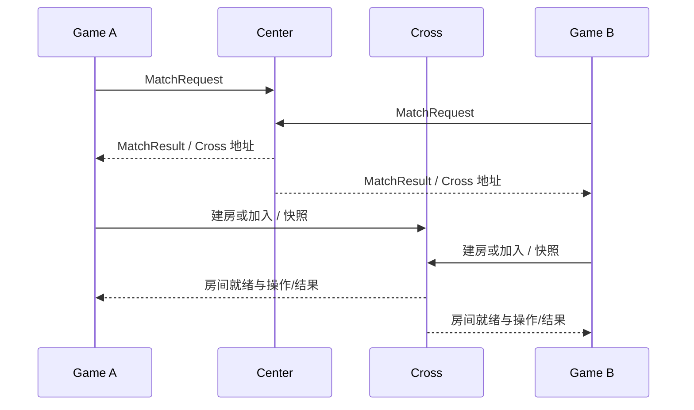

# 13 中心匹配跨服战斗与排行榜

[上一章](12-任务装备技能与社交玩法.md) · [课程总览](00-总览与阅读顺序.md)

## 这一章做出什么

理解节点上报、中心匹配、跨服房间、结果路由和排行榜，知道它与完整战斗引擎的差别。

## 前置条件与本章文件

已有 Game 通信与消息所有权；先做单 Center、单 Cross 两玩家测试，再考虑多中心。

- [internal/game/center/client.go](../../internal/game/center/client.go)：Report 流与控制回调。
- [internal/center/server.go](../../internal/center/server.go)：中心装配与分组。
- [internal/center/match/matcher.go](../../internal/center/match/matcher.go)：匹配队列。
- [internal/center/leader/leader.go](../../internal/center/leader/leader.go)：中心选主。
- [internal/game/module/battle/battle.go](../../internal/game/module/battle/battle.go)：游戏侧匹配与战斗状态。
- [internal/game/cross/pool.go](../../internal/game/cross/pool.go)：每跨服节点流与房间路由。
- [internal/cross/battle/room.go](../../internal/cross/battle/room.go)：房间生命周期。
- [internal/center/rank/rank.go](../../internal/center/rank/rank.go)：排行榜。

## 按顺序实现

第一步只实现节点 Report：Game 向 Center 注册自身、周期上报，断流重连。Center 维护节点与分组状态。地址字段要表达“被连接者地址”，不能仅因配置字段叫 addr 就照抄错对象。

第二步做中心匹配：玩家申请模式，Center 按队列匹配，通知双方 Game 一个匹配结果和 Cross 节点。重复申请、取消匹配和断线清理都要定义。

第三步建立 Game→Cross 的长期双向流，首帧 BIND 用游戏节点 ID。它与 Gateway→Game 的玩家会话 BIND 不是同一种粒度：一个面向游戏节点，一个面向客户端会话。

第四步房间创建、玩家快照、操作转发、结果与超时。路由表 roomID→Cross 保证后续操作回到同一个节点。结果重复上报必须幂等，奖励内容必须受服务端规则约束。

第五步排行榜：先读 rank 服务的数据结构、更新和查询；再看快照与 leader 负责的周期任务。leader 只控制协调任务，不意味着所有存储更新自动强一致。多中心消息中转看 relay 与 bridge，按目标节点判定本实例是否应处理。



第六步扩展到参考项目的地图/AOI/行军：地图需要服务端坐标与空间索引，AOI 维护进入/离开集合，行军保存开始/截止时间与任务状态；到期投递至所有者执行，恢复时按业务键补结算。当前仓库没有对应完整模块，这些属于扩展设计而不是现有调用链。

## 核心源码与注释阅读

源码节选：[internal/game/cross/pool.go](../../internal/game/cross/pool.go)。这是现有包中的片段，依赖同文件类型，不是可单独运行的完整程序。

```go
func (p *Pool) CreateRoom(ctx context.Context, req battle.CreateRoomReq) (uint64, map[int64]string, error) {
	c, addr, err := p.pickReady(ctx)
	if err != nil {
		return 0, nil, err
	}

	reqID := p.nextReqID()
	ch := make(chan *internalv2.RoomCreateResp, 1)
	p.pendingMu.Lock()
	p.pending[reqID] = ch
	p.pendingMu.Unlock()
	defer func() {
		p.pendingMu.Lock()
		delete(p.pending, reqID)
		p.pendingMu.Unlock()
	}()

	if err := c.Send(&internalv2.CrossFrame{
		Data: &internalv2.CrossFrame_CreateReq{CreateReq: &internalv2.RoomCreateReq{
			ReqId:         reqID,
			Mode:          req.Mode,
			ExpectPlayers: int32(matchPlayersOf(req)),
			TimeoutSec:    int32(req.Timeout.Seconds()),
			PlayerIds:     req.PlayerIDs,
			RoomId:        req.RoomID,
			PresetTokens:  req.PresetTokens,
		}},
	}); err != nil {
		return 0, nil, fmt.Errorf("send create req: %w", err)
	}

	select {
	case resp := <-ch:
		if resp.GetCode() != 0 {
			return 0, nil, fmt.Errorf("cross rejected room creation (code=%d)", resp.GetCode())
		}
		p.mu.Lock()
		p.rooms[resp.GetRoomId()] = addr
		p.mu.Unlock()
		return resp.GetRoomId(), resp.GetTokens(), nil
	case <-ctx.Done():
		return 0, nil, ctx.Err()
	case <-time.After(5 * time.Second):
		return 0, nil, fmt.Errorf("create room timeout")
	}
}
```

## 逐段解释与知识点

CreateRoom 使用 reqID 等待响应，房间 ID 与请求 ID 不同。pending 通道有缓冲，超时后必须移除映射，迟到响应不可再写入已经关闭的 channel。

房间的 ready、在线、胜负与发奖是不同状态。Cross 的 timeout fallback 处理不返回的战斗，不会自动验证客户端每个物理操作的真实性。

当前 Pool.ReadyCount 依 Client.Ready 的首次就绪标记，断线后是否准确反映当前可用要核对。连接 once-ready 与业务 currently-ready 不应同名混用。

多实例场景还需要节点租约、故障迁移与重复结果去重。单实例测试通过不能证明网络分区下的唯一结算。

## 怎么验证与定位错误

参考测试：TestP8CenterMatchFlow、TestP9CrossInstanceRelay、TestP13CrossBattleFlow、TestP14RankAndLeader。它们需要 integration tag 和真实依赖，不是普通 go test ./... 的一部分。

观察日志应有中心节点注册、cross stream established/bound、匹配结果与房间路由。启动时 DNS 尚不可用可能触发退避，长期不恢复才检查服务名和端口。

## 独立练习与通过标准

画一张双玩家跨服结算图，在每个箭头标注身份、幂等键与失败后负责人。通过标准：说清奖励在谁的存储提交、重复结果怎样收敛，以及排行失败是否需要补偿。

下一章：[第 14 章 测试监控与优雅停服](14-测试监控与优雅停服.md)。
