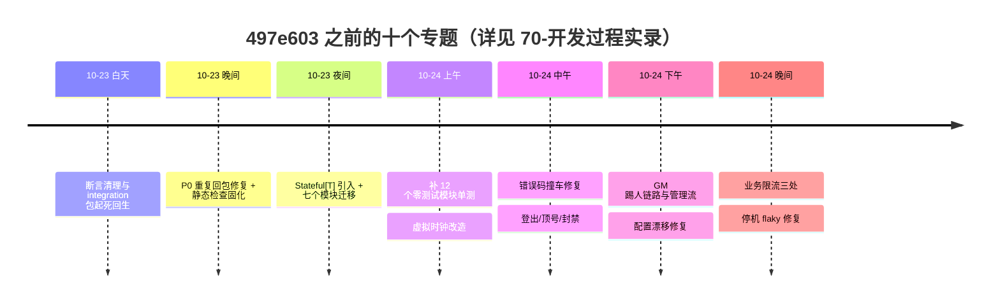

# game_study 项目文档（架构研究）

> 本文档库是 game_study（Go 分布式游戏服务端）的**全量注释**：不改一行代码，用 50 篇文档把项目的架构、每个包的职责、关键代码的实现动机，以及这一轮「修 bug → 补测试 → 重构」的完整开发过程讲清楚。
>
> 本目录已合并原 `doc/`，与历史设计文档、开发教程统一收在 `docs/`。若你是按教程上手的新同学，先看[学习文档导航](README.md)（项目解说、开发流程、签到实战）更顺；本文档适合想逐包理解架构与实现动机的读者。
>
> - 代码基线：`497e603`（git 历史 124 个提交）
> - 阅读方式：第一次读请从 [00-总览](00-总览/01-项目简介与全局架构.md) 开始；想快速了解最近发生了什么，直接看 [70-开发过程实录](70-开发过程实录/01-定时器测试flaky修复.md)。

## 文档地图

### 00-总览 —— 先读这里

| 文档 | 内容 |
| --- | --- |
| [01-项目简介与全局架构](00-总览/01-项目简介与全局架构.md) | 项目定位、七个进程的分工与端口、全局架构图、五条核心设计原则 |
| [02-目录结构与模块地图](00-总览/02-目录结构与模块地图.md) | 顶层目录职责、internal/pkg 分层、30+ 业务模块一览 |
| [03-技术栈与外部依赖](00-总览/03-技术栈与外部依赖.md) | go.mod 逐依赖说明、外部中间件、版本锁定策略、「为什么不用某个库」 |
| [04-服务启动流程](00-总览/04-服务启动流程.md) | cmd 入口的通用模式、以 game 为例的启动时序、优雅停机四阶段 |

### 10-基础设施层 —— pkg/ 公共能力

| 文档 | 内容 |
| --- | --- |
| [01-Actor模型](10-基础设施层/01-Actor模型.md) | 分片事件循环、有界信箱背压、Drain、P0 跨节点投递 |
| [02-网络层与编解码](10-基础设施层/02-网络层与编解码.md) | TCP 服务器、帧格式（长度不含自身）、protobuf/registry 两段式编解码、消息号分配 |
| [03-配置系统与热更新](10-基础设施层/03-配置系统与热更新.md) | 五步加载流水线、LimitConfig 三值语义、Clock 虚拟时钟 |
| [04-游戏数据gamedata](10-基础设施层/04-游戏数据gamedata.md) | embed XML 策划表、atomic.Pointer 无锁热替换 |
| [05-服务发现registry](10-基础设施层/05-服务发现registry.md) | etcd 三段式注册、租约保活、rpc resolver |
| [06-缓存cache与writebehind](10-基础设施层/06-缓存cache与writebehind.md) | Redis 缓存权威、异步落库、epoch 围栏令牌、分字段快照 |
| [07-限流shutdown与工具包](10-基础设施层/07-限流shutdown与工具包.md) | 令牌桶三道频控、停机四阶段编排、八个工具包定位 |

### 20-网关层 —— 连接的守门人

| 文档 | 内容 |
| --- | --- |
| [01-网关总览与连接管理](20-网关层/01-网关总览与连接管理.md) | 进程装配、goroutine-per-conn、会话四态、后端 gRPC 流 |
| [02-路由与消息分发](20-网关层/02-路由与消息分发.md) | OnPacket 七步安全顺序、内部号白名单、登出协议、TokenRevoker |
| [03-踢人与管理流](20-网关层/03-踢人与管理流.md) | /admin/kick → 广播 → 管理流全链路，「网关不存角色→会话映射」的设计决策 |
| [04-限流与安全防护](20-网关层/04-限流与安全防护.md) | 五道闸门、包频率限流、登录防爆破分工 |

### 30-登录服 —— 账号与凭证

| 文档 | 内容 |
| --- | --- |
| [01-登录流程与握手](30-登录服/01-登录流程与握手.md) | 四层架构、登录→握手→绑定时序图、RSA 盐值握手 |
| [02-账号体系与封禁](30-登录服/02-账号体系与封禁.md) | account.status 状态机、fail-closed、封禁两步生效 |
| [03-登录安全与审计](30-登录服/03-登录安全与审计.md) | IP 防爆破、Kafka 审计旁路、错误码分段 |

### 40-中心服 —— 全局服务

| 文档 | 内容 |
| --- | --- |
| [01-中心服总览](40-中心服/01-中心服总览.md) | 九个子系统职责、启动七步、1s tickLoop |
| [02-Leader选主](40-中心服/02-Leader选主.md) | etcd Election、租约 TTL、Resign、真 etcd failover 测试 |
| [03-匹配排行与里程碑](40-中心服/03-匹配排行与里程碑.md) | 匹配三环、ZINCRBY 排行榜、虚拟时钟测试 |

### 50-游戏服 —— 玩法主体

| 文档 | 内容 |
| --- | --- |
| [01-游戏服总览与启动](50-游戏服/01-游戏服总览与启动.md) | 四段十二步启动时序、停机四阶段、外部依赖降级表 |
| [02-玩家Actor与消息处理](50-游戏服/02-玩家Actor与消息处理.md) | 信箱分发、四栅栏、Manager 生命周期、跨节点注册 |
| [03-会话管理与顶号踢人](50-游戏服/03-会话管理与顶号踢人.md) | 三张映射同一把锁、claimOnline 接管、跨节点顶号全链路 |
| [04-模块系统module](50-游戏服/04-模块系统module.md) | Typed 自动回包（P0 事故后确立的约定）、Plain/Thin/Stateful 三档基座 |
| [05-持久化Stateful](50-游戏服/05-持久化Stateful.md) | Read/Mutate/State、RegisterStateful 四项校验、七个模块迁移实录 |
| [06-任务与签到quest](50-游戏服/06-任务与签到quest.md) | 任务三态状态机、签到 UTC+8 口径、登录奖励幂等 |
| [07-邮件系统mail](50-游戏服/07-邮件系统mail.md) | mailRepo 窄接口、EXISTS 避 N+1、离线投递唯一键兜底 |
| [08-背包与装备](50-游戏服/08-背包与装备.md) | 背包资产协议面、装备加成闭包外结算 |
| [09-商店与经济](50-游戏服/09-商店与经济.md) | 购买顺序、商店归属修复、充值双栅栏、grant/spend 统一入口 |
| [10-战斗与副本](50-游戏服/10-战斗与副本.md) | battle 0%→97.1% 补测试、copy 迁 Stateful、十步公式链 |
| [11-社交系统](50-游戏服/11-社交系统.md) | chat/team/guild/friend/rank 的共同姿态与四处镜像差异 |
| [12-场景scenemap](50-游戏服/12-场景scenemap.md) | AOI+MGR+玩家 Actor 三元组、Timer 注入消 flaky、worldmap SLG 分层 |

### 60-测试体系 —— 质量怎么保

| 文档 | 内容 |
| --- | --- |
| [01-测试总览与分层](60-测试体系/01-测试总览与分层.md) | 五层测试版图、跑法、内存替身矩阵、变异验证哲学 |
| [02-moduletest脚手架](60-测试体系/02-moduletest脚手架.md) | 共享内存 PlayerState、Recorder 下行记录器及其 bug 修复 |
| [03-约定测试与AST守护](60-测试体系/03-约定测试与AST守护.md) | 「Typed handler 不得回包」静态检查、错误码撞车白名单 |
| [04-集成测试与CI](60-测试体系/04-集成测试与CI.md) | testcontainers 真容器、CI 五步卡点、benchmark 只记录不卡门禁 |

### 70-开发过程实录 —— 这一轮具体做了什么

按时间顺序还原十个专题的完整过程：现象 → 根因 → 方案 → 代码 → 验证。

| 文档 | 内容 |
| --- | --- |
| [01-定时器测试flaky修复](70-开发过程实录/01-定时器测试flaky修复.md) | Timer 接口 + fakeTimers 逐拍驱动，150ms → 8ms |
| [02-P0响应串号与幂等失效](70-开发过程实录/02-P0响应串号与幂等失效.md) | 重复回包让每个响应晚一拍，所有错误码被 code=0 顶掉 |
| [03-补齐12个零测试模块](70-开发过程实录/03-补齐12个零测试模块.md) | moduletest 脚手架 + xxRepo 窄接口，0% → 43%~97% |
| [04-P1迁往Stateful](70-开发过程实录/04-P1迁往Stateful.md) | 七个模块迁到 Stateful[Data]，持久化代码从业务文件清零 |
| [05-虚拟时钟改造](70-开发过程实录/05-虚拟时钟改造.md) | 不睡真实时间：显式驱动或等条件成立 |
| [06-登出与跨节点顶号](70-开发过程实录/06-登出与跨节点顶号.md) | 登出三件套（协议/顺序/语义）、跨节点从「拒绝」改「接管」 |
| [07-封禁与GM踢人链路](70-开发过程实录/07-封禁与GM踢人链路.md) | 从两端都没实现到全链路打通，含一次设计返工 |
| [08-配置漂移修复](70-开发过程实录/08-配置漂移修复.md) | 「配置写了但代码没读」的三处实例 |
| [09-错误码撞车与守护](70-开发过程实录/09-错误码撞车与守护.md) | 4 处模块码撞 proto 值，白名单测试守住边界 |
| [10-停机flaky与持续集成](70-开发过程实录/10-停机flaky与持续集成.md) | 时间竞争改结构化同步、integration 包起死回生、CI 五步卡点 |

### 80-优化与展望 —— 还能做什么

| 文档 | 内容 |
| --- | --- |
| [01-代码层优化扫描](80-优化与展望/01-代码层优化扫描.md) | 已扫描未动的三项（reply 合并/列名语义化/Point-Rect）与明确不做清单 |
| [02-后续优化清单](80-优化与展望/02-后续优化清单.md) | 按优先级排的后续工作，每项含动机、做法、验证方式 |

## 这一轮开发的时间线

## 约定

- 文档中的代码片段均从上述代码基线的真实源码摘录，标注 `文件路径:行号`；提交号均可在 `git log` 中核对。
- 「演进记录」里的结论（覆盖率数字、行数变化）来自对应提交的实测记录，不是估算。
- 发现文档与代码不一致时，以代码为准，并欢迎提 issue 修正文档。
