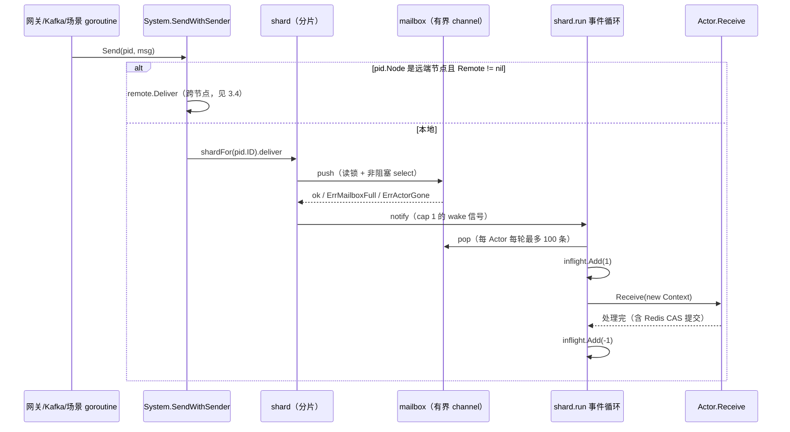

# 01 Actor 模型

一句话定位：`pkg/actor` 用「分片事件循环 + 有界信箱」把每个玩家的全部消息收敛到单 goroutine 上串行执行，业务侧因此完全免锁；跨节点投递（P0）让这套模型从单进程延伸到多游戏服节点。

## 1. 概述

分布式游戏服务端最核心的并发问题是：**同一个玩家的数据会被多处同时修改**——网关转发业务包、Kafka 消费者发货、场景广播、定时结算，任何两条路径同时读写玩家状态都会产生竞态；而给每份状态加锁的传统做法，会让锁的粒度、顺序、死锁规避迅速失控。本项目用 Actor 模型从根本上消灭它：每个玩家一个 Actor，状态由该 Actor **独占**；所有修改以「消息」形式投递；消息在固定分片的单 goroutine 上 **FIFO 串行** 处理——同一玩家不存在并发，业务代码无需加锁。

在此之上还有两层设计。**分片（shard）而非一线程一 Actor**：goroutine 虽轻，万级在线玩家仍是万级 goroutine，调度与内存开销不可忽视——按 `actorID` 哈希取模编入 1024 个分片，每分片一个 goroutine 轮转处理名下所有 Actor，片内串行免锁、片间并行。**有界信箱与背压**：信箱是容量 1024 的 channel，满时拒绝新消息并返回 `ErrMailboxFull`，由调用方决策重试/降级，而不是无限堆积直到 OOM。

P0 阶段补充跨节点投递：多游戏服部署时玩家按 `player_id % 节点数` 分布，「给玩家 X 发消息」必须能投到别的进程。方案是 `PID.Node` + `RemoteSender` 接口 + 显式序列化契约，经中心服中转，设计文档见 `../docs/R2.4-跨节点Actor投递设计.md`。

## 2. 涉及文件

| 路径 | 职责 |
| --- | --- |
| `pkg/actor/actor.go` | 核心抽象：PID（进程标识）、Actor 接口、Behavior、actorCell、envelope |
| `pkg/actor/mailbox.go` | 有界信箱：push/pop/close、背压拒绝（`ErrMailboxFull`/`ErrActorGone`） |
| `pkg/actor/system.go` | ActorSystem：分片创建、事件循环、Send/Spawn/Terminate/Drain、定时器 |
| `pkg/actor/context.go` | 每条消息的处理上下文：PID/Sender/Message/Send/Respond/ScheduleOnce |
| `pkg/actor/remote.go` | 跨节点投递契约：RemoteSender、RemoteMessage、RemoteEnvelope、编解码注册表 |
| `internal/game/player/actor.go` | 玩家 Actor：Bind/Unbind/Packet/推送/发奖/场景心跳的分发与处理 |
| `internal/game/player/manager.go` | 在线玩家索引（player_id → PID）、跨节点位置解析、GetOrSpawn 守卫 |
| `internal/game/player/remote.go` | 玩家可远程消息的类型注册（PacketMsg/PushMsg/KickMsg） |
| `internal/game/remote/remote.go` | RemoteSender 实现：经中心服 RelayRequest/RelayPush 中转 |
| `internal/game/server_adapters.go` | 中心服中转入口 `OnRelayPush`：解信封 → DeliverRemote 投本地 Actor |
| `internal/game/server_start.go` | 装配：initActorSystem 创建 System 并注入 NodeID/Remote |

## 3. 核心设计

### 3.1 消息投递与处理全景



### 3.2 分片：为什么是哈希取模而不是一线程一 Actor

`shardFor`（`pkg/actor/system.go:284`）用 **fnv32a** 对 actorID 哈希后对分片数取模：`fnv.New32a()` 写入 ID，取 `Sum32()%shardCount` 得固定落点。两个关键取舍：**fnv 而非 maphash**——maphash 的种子随进程变化，同一 actorID 在不同进程会落到不同分片；fnv 是固定纯函数，跨进程/跨重启结果一致，重启后同一玩家仍落同一分片、进程内缓存不失效。**Spawn 与 Send 都走 shardFor**——寻址逻辑单点收敛（改哈希算法只改一处），也防调用方伪造 `PID.Shard` 字段（Send 按 `target.ID` 重新计算分片，不信 PID 里带的序号）。

分片循环 `run`（`pkg/actor/system.go:417`）的结构是「非阻塞检查退出 → drain 一轮 → 空闲才阻塞等待」：

```go
func (sh *shard) run(ctx context.Context, wg *sync.WaitGroup) {
	defer wg.Done()
	ticker := time.NewTicker(100 * time.Millisecond)
	defer ticker.Stop()
	for {
		select {
		case <-ctx.Done():
			return
		case <-sh.sys.stopCh:
			return
		default:
		}
		processed := sh.drain(100)
		sh.reportDepth()
		if processed == 0 {
			select {
			case <-ctx.Done():
				return
			case <-sh.sys.stopCh:
				return
			case <-sh.wake:    // 新消息到达，立即处理
			case <-ticker.C:   // 兜底（定时器投递等不经过 notify 的场景）
			}
		}
	}
}
```

- **wake 信号（cap 1）**：只靠 100ms ticker 轮询的话，消息到达后最坏要等 100ms 才被处理，实测业务 P99 被钉在 ~150ms，违反「P99 < 50ms」的目标。改为「有消息立即唤醒 + ticker 兜底」后延迟降到微秒级。cap 1 意味着多个 Actor 同时到达只保留一个信号——循环每轮本来就会排空所有信箱，不需要精确计数。
- **每轮先 drain 再睡**：有活干时立即进入下一轮，不浪费一次 select 调度。

### 3.3 per-Actor budget 轮转：公平性设计

`drain(budget)` 的 budget 是**每个 Actor** 的上限，不是整分片共享额度（`pkg/actor/system.go:463`）：

```go
func (sh *shard) drain(budget int) int {
	processed := 0
	for _, cell := range sh.allCells() {
		for n := 0; n < budget; n++ {
			env, ok := cell.mbox.pop()
			if !ok {
				break
			}
			// inflight 先加后处理：保证 idle() 在看到「信箱空」之前，
			// 先看到「有消息在飞」，杜绝 Drain 提前返回的窗口。
			sh.inflight.Add(1)
			sh.process(cell, env)
			sh.inflight.Add(-1)
			processed++
		}
	}
	return processed
}
```

共享额度会让第一个繁忙 Actor 吃光 100 条，同分片其他 Actor 本轮一条都处理不到，高负载下表现为长期饥饿（P99 抖动）；按 Actor 分配预算后每个 Actor 每轮至少前进 100 条。`allCells` 从 map 收集快照（遍历顺序随机，每轮处理顺序不固定，但不影响公平性），且**必须快照而不能持锁遍历**：process 内的业务可能调 `Terminate → remove`（要写锁），若 drain 全程持读锁，同一 goroutine 内「已持 RLock 再请求 Lock」会死锁（RWMutex 不可重入），快照把临界区压缩成一次拷贝。

### 3.4 Drain：关闭时如何区分「信箱空」和「真的处理完」

一条消息被 pop 之后信箱计数已归零，但 handler 可能还在写 Redis——只看 `len(mbox)` 会让 Drain 提前返回，丢掉最后一条业务。`shard.inflight` 原子计数解决这个问题（`pkg/actor/system.go:482`）：

```go
func (sh *shard) idle() bool {
	if sh.inflight.Load() > 0 {
		return false
	}
	sh.mu.RLock()
	defer sh.mu.RUnlock()
	for _, c := range sh.cells {
		if c.mbox.len() > 0 {
			return false
		}
	}
	return true
}
```

`System.Drain`（`pkg/actor/system.go:169`）10ms 轮询所有分片 idle，任一在途即继续等：

```go
func (s *System) Drain(ctx context.Context) error {
	ticker := time.NewTicker(10 * time.Millisecond)
	defer ticker.Stop()
	for {
		if s.idle() {
			return nil
		}
		select {
		case <-ctx.Done():
			return fmt.Errorf("actor drain: %w", ctx.Err())
		case <-ticker.C:
		}
	}
}
```

关闭顺序里 Drain 必须排在保存之前：在途消息的最后一次 Redis 提交如果没等到，后续 `FlushAll` 读到的就是旧快照，玩家最后一段进度会丢。Drain 不阻止新消息投递——调用方应先停外部入口（gRPC、Kafka 消费者），否则一边排空一边进新消息，只能等到超时。

### 3.5 信箱：背压与关闭安全

mailbox 是容量 1024 的有界 channel（`pkg/actor/mailbox.go:56`），核心方法是 push：

```go
func (m *mailbox) push(env envelope) error {
	m.mu.RLock()
	defer m.mu.RUnlock()
	if m.closed {
		return ErrActorGone
	}
	select {
	case m.queue <- env:
		return nil
	default:
		m.rejects.Add(1)
		return ErrMailboxFull
	}
}
```

- **满则拒绝新消息**：不默认丢弃最旧消息——旧消息可能是发奖、保存、绑定等不可重建的工作，用「新消息被拒 + 调用方决策」取代「静默挤掉」。
- **RWMutex + closed 标志双保险**：close 后向 channel 发送会直接 panic；push 持读锁做「检查 + 发送」，close 持写锁改标志并 close(chan)，互斥消灭插入窗口。选 RWMutex 而非 Mutex：push 是高频多发送方路径（网关/Kafka goroutine 都可能投递），读锁允许多个 goroutine 并发投递，close 极低频、写锁等待可忽略。
- **rejects 原子计数器**：多发送方并发拒绝时计数不丢，供分片循环做增量指标上报（`reportDepth`）。

pop 只由分片单线程调用，无需锁；从已关闭 channel 读安全返回 `ok=false`，所以 Terminate 之后分片循环仍能排空残余消息。

### 3.6 panic 边界：一个玩家的脏消息不拖垮整个分片

`process`（`pkg/actor/system.go:552`）用 defer + recover 包住每条消息的 `Receive`：

```go
func (sh *shard) process(cell *actorCell, env envelope) {
	start := time.Now()
	ok := true
	defer func() {
		if r := recover(); r != nil {
			ok = false
			metrics.ActorPanicInc()
			if logger := sh.sys.logger; logger != nil {
				logger.Error("actor panic recovered",
					"actor", cell.pid.ID, "shard", sh.index, "panic", fmt.Sprint(r),
					"stack", string(debug.Stack()))
			} else {
				debug.PrintStack()
			}
		}
		if metrics.Enabled() {
			metrics.ActorProcessed(ok)
			metrics.ActorObserve(time.Since(start))
		}
	}()
	actx := &Context{
		ctx:     context.Background(),
		system:  sh.sys,
		self:    cell.pid,
		sender:  env.sender,
		message: env.message,
	}
	cell.actor.Receive(actx)
}
```

recover 只能恢复**当前 goroutine**（分片循环）的 panic，恢复后循环接着处理下一条；但 Actor 内部自起 goroutine 炸了仍会挂进程——这是「共享事件循环」模型的边界，也反推出「Receive 禁止阻塞」的硬契约（阻塞会饿死同分片其他 Actor）。Context 每条消息新建，杜绝「上一条消息的 sender 污染下一条」类 bug。

### 3.7 定时器：自调度消息而非 ticker goroutine

`timerLoop`（`pkg/actor/system.go:604`）每 100ms 线性扫描到期 entry 并投递——定时消息量小（千级），O(n) 扫描成本远低于时间轮的结构维护；信箱满时按 `timerRetryLimit=3` 次重试（3 × 100ms ≈ 300ms 窗口），仍失败记日志丢弃，不静默。业务侧典型用法是玩家 Actor 的场景心跳（`internal/game/player/actor.go:480`）：`onSceneHeartbeat` 向 `sceneLink` 发心跳后，用 `ctx.ScheduleOnce(a.heartbeatInterval(), ctx.PID(), &sceneHeartbeatTick{})` 给自己投递下一条——心跳状态活在 Actor 里，不需要额外 goroutine，也就不存在「Actor 停了 ticker 忘记回收」的泄漏路径。注意计时精度是 100ms tick 且重启即丢失，需要持久化的定时任务应落库。

### 3.8 跨节点投递：单进程 Actor → 多节点 Actor

System 原本是单进程的。多游戏服部署时，「给玩家 X 发消息」必须能投到**别的进程**。设计三块（`pkg/actor/remote.go`）：

1. **`PID.Node`**：空 = 本地；非空 = 远端节点 ID。本地 PID 一律 `Node=""`，单机部署下全部逻辑自然短路，零行为变化。
2. **`RemoteSender` 接口**：只有 `Deliver(to *PID, msg any) error` 一个方法——框架不绑定任何传输，由组装层实现（当前经中心服中转）。
3. **`RemoteMessage` 显式序列化契约**：`RemoteTypeURL() string` + `MarshalRemote() ([]byte, error)` 两个方法手写而不是用反射——反射版「什么都能发」会把带 Done channel 的请求-响应消息也送进远程路径，序列化到一半才失败；显式实现 = 编译期承诺「这个消息是纯数据」。

`SendWithSender` 的跨节点分支（`pkg/actor/system.go:239`）：

```go
func (s *System) SendWithSender(target *PID, msg any, sender *PID) error {
	if target == nil {
		return fmt.Errorf("target pid is nil")
	}
	if s.remote != nil && target.Node != "" && target.Node != s.nodeID {
		return s.remote.Deliver(target, msg)
	}
	sh := s.shardFor(target.ID)
	return sh.deliver(target.ID, envelope{sender: sender, message: msg})
}
```

三个条件缺一不可：Node 为空（本地 PID）或就是本节点（本节点持有的远端视图，如玩家重连后归属表还没刷新）都按本地投递；Remote 为 nil（单机模式）时也落本地，找不到报 `ErrActorGone`，与改造前一致，不会静默丢消息。

信封用 JSON 而不是 gob：gob 需要提前 Register 所有具体类型（漏注册运行时才炸），JSON + 显式 type_url 注册表在启动期就能发现漏注册；代价是体量大一点，但远程消息是 KB 级全量快照/协议包，不在乎。信封结构是 `RemoteEnvelope{ActorID, TypeURL, Payload}`——ActorID 必须进信封：中转层（中心服）不知道也不该知道消息要投给哪个 Actor，它只透传不透明 bytes。

接收侧（`internal/game/server_adapters.go` 的 `OnRelayPush`）一次调用 `DecodeRemoteEnvelope` 拿到 actorID 与消息，再 `System.DeliverRemote(actorID, msg)` 按 actorID 哈希投本地 Actor（sender 为 nil，跨节点没有可 Respond 的发送方）。语义是「尽力而为 + 对账兜底」：Actor 不存在时返回包装 `ErrActorGone` 的错误由 RPC handler 记日志——玩家已下线时丢消息可接受，客户端重连会拉全量权威状态。

完整链路（以跨节点顶号为例）：新节点登录时 presence 显示旧节点持有 → `Manager.GetOrSpawn` 返回远程 PID → `System.Send` 走 `remote.Deliver` → 中心服 RelayRequest 透传 Envelope bytes → 旧节点 `OnRelayPush` 解出 actorID 与 KickMsg → `DeliverRemote` 投进 `player:X` 的 mailbox → Actor 收到 KickMsg，`onKick` 关闭旧网关会话。

## 4. 关键代码解析

### 4.1 PID：指针语义与跨节点演进

```go
type PID struct {
	ID    string
	Shard int
	Node  string
}

func (p *PID) String() string { return p.ID }
```

ID 是全局唯一名（如 `player:123`），同时作为分片路由键；Shard 是固定落点序号（投递与终止都按 ID 哈希路由到同一分片）；Node 是 P0 新增的节点标识。全链路以 `*PID` 传递：指针语义让「同一个 Actor」在各处是同一份标识，不会因值拷贝产生歧义。注意 `String()` 是指针接收者——日志/错误信息里必须传 `*PID` 才会走到 `String()`。

### 4.2 玩家 Actor：Receive 的三路分发

`internal/game/player/actor.go:289` 的 Receive 是玩家侧的总入口，缓存权威模式下有三条路径：

```go
func (a *Actor) Receive(ctx *actor.Context) {
	if a.repo.CacheEnabled() {
		switch msg := ctx.Message().(type) {
		case *PushMsg, *ScenePush, *sceneHeartbeatTick:
			// 纯下行消息不参与「克隆快照 → 提交」流程：它们只读状态、不改状态。
		case *PacketMsg:
			if a.canBypassCache(msg.MsgID) {
				a.receive(ctx)
				return
			}
			a.receiveCached(ctx)
			return
		default:
			a.receiveCached(ctx)
			return
		}
	}
	a.receive(ctx)
}
```

- 纯下行（推送/场景广播/心跳）：不改状态，直接进 `receive`；
- 无状态模块协议（`canBypassCache`）：跳过 clone/CAS——榜单查询、聊天转发这类不碰 State 的请求占相当比例，而 clone 一份含背包/属性/Ext 的 State 并不便宜；
- 其余消息进 `receiveCached` 的「克隆 → 业务 → diff → CAS → 回滚/保留」流程，契约见 `../docs/R2.1-缓存原子变更契约.md`。

`canBypassCache`（`internal/game/player/actor.go:314`）三个前提缺一不可：

```go
func (a *Actor) canBypassCache(msgID uint32) bool {
	return a.loaded && a.cachePending == nil && !a.cacheReload &&
		a.registry != nil && a.registry.IsStateless(msgID)
}
```

即：模块声明无状态（不写 State）、状态已加载（否则处理器读到空背包）、没有未决提交或待重载（`cachePending`/`cacheReload` 必须走完整流程才能恢复一致的版本栅栏）。类型 switch 的 default 分支兜住未知消息（记日志不 panic），避免新增消息类型时静默丢包。

### 4.3 KickMsg：为什么顶号走 Actor 消息而不是节点级 RPC

`KickMsg`（`internal/game/player/remote.go`）只有一个 `FromNode string` 字段，实现 `RemoteTypeURL()`（返回 `remoteTypeURLKickMsg` 常量）与 `MarshalRemote()`（`json.Marshal`）。踢人是「这个玩家的会话」的事，玩家 Actor 是它的唯一权威（数据所有权）；节点级广播要先查 sid 表，还会绕过 Actor 的串行化——那条路径上的竞态（正在处理业务包时被踢）得用锁重新解决一遍。

不带 Done channel：远程投递是单向的，发起方（新节点）不等待确认。旧节点即使没收到也不影响正确性——presence 已被强制覆盖，旧 Actor 的后续提交会被围栏令牌（epoch）挡掉，最终由 UNBIND 正常下线。

`SetKickHook`（`internal/game/player/actor.go:44`）注入跨节点顶号回调 `func(playerID int64, fromNode string)`；传 nil 表示「不支持跨节点顶号」：收到 KickMsg 时只记日志不处理，用于单机/测试环境。

### 4.4 Manager：双检锁 + 跨节点守卫

`GetOrSpawn`（`internal/game/player/manager.go:117`）是本包最关键的并发路径：

```go
func (m *Manager) GetOrSpawn(ctx context.Context, playerID int64) (*actor.PID, error) {
	m.mu.RLock()
	pid, ok := m.index[playerID]
	m.mu.RUnlock()
	if ok {
		return pid, nil
	}

	if m.presence != nil && m.nodeID != "" {
		if owner, online := m.presence.IsOnline(ctx, playerID); online && owner != m.nodeID {
			return &actor.PID{ID: playerPID(playerID), Node: owner}, nil
		}
	}

	m.mu.Lock()
	defer m.mu.Unlock()
	if pid, ok := m.index[playerID]; ok {
		return pid, nil
	}
	// ... NewActor + Spawn
}
```

- **双检锁**：先 RLock 快路径覆盖绝大多数已在线请求；未命中再 Lock 重检一次——两个会话同时为首个上线者时只有一个线程执行 Spawn。
- **跨节点守卫（P0）**：本地未命中且归属表显示玩家在线在别的节点时，返回该节点的远程 PID 而不是就地 Spawn——双 Actor 是双写分叉（两份内存各自 CAS 同一份 Redis 快照，后写的覆盖先写的）。
- **Redis 查询放在写锁外**：不把 IO 压在临界区上（bind 路径低频，但锁内 IO 会放大成所有 GetOrSpawn 的尾延迟）。

`playerPID(playerID) = "player:%d"` 抽成函数是因为远程投递的 actorID 必须与本地 Spawn 的 key 是同一个字符串，否则消息到不了目标 Actor。

## 5. 演进记录

- **`a23070f` feat(actor): P0 跨节点 Actor 投递，根治多节点双写分叉**——引入 `PID.Node`、`RemoteSender`/`RemoteMessage` 契约、`RemoteEnvelope` JSON 信封与 `sync.Map` 编解码注册表，`internal/game/remote` 提供经中心服中转的实现。动机：多节点部署下「就地 Spawn」会产生双 Actor，两份内存各自 CAS 同一份 Redis 快照导致静默覆盖丢进度。跨节点守卫 + presence 归属表把「谁持有玩家」变成单点事实。
- **`5706d12` fix(actor): 信箱满时拒绝新消息并返回背压错误（R1.1）**——此前信箱满时的行为不可控；改为显式拒绝 + `ErrMailboxFull` 哨兵错误 + rejects 原子计数，把背压决策权交还调用方，同时让积压可观测（分片循环增量上报拒绝数）。
- **`0e7d1f0`/`a40f144` docs(comments): 补充详细中文注释**——全量补齐架构职责、协作关系、关键取舍与 Go 语言知识点注释（本文引用的源码注释即此批成果）。
- **`331b5e5` P15 全链路演练**——压测工具 + 故障注入演练中修复 8 个真实缺陷，其中分片调度相关的 wake 信号改造（从纯 ticker 轮询改为「立即唤醒 + 兜底」）把业务 P99 从 ~150ms 降到目标线以内。
- **`a0ed305` P1-P4 最小可运行链路**——actor 包随加密/内部通信/Actor/持久化一批接入，`System.Drain` 的 inflight 计数设计即出自该阶段对「停机丢最后一条消息」的修复。

## 6. 测试情况

| 测试文件 | 覆盖内容 |
| --- | --- |
| `pkg/actor/actor_test.go` | Spawn/Send 基本链路、重复 Spawn 报错、Send 到已终止 Actor 返回 `ErrActorGone`、nil target 报错、消息 FIFO 串行性 |
| `pkg/actor/mailbox_test.go` | push/pop 往返、满信箱拒绝（`ErrMailboxFull`）且旧消息保留、close 后 push 返回 `ErrActorGone`、重复 close 不 panic、rejects 计数 |
| `pkg/actor/drain_test.go` | Drain 等全部在途处理完、inflight 计数防「信箱空但处理中」的提前返回、Drain 期间新消息不阻塞、ctx 超时返回包装错误 |
| `pkg/actor/remote_test.go` | 信封编解码往返、未注册 type_url 显式报错、重复注册 panic、`DecodeRemoteEnvelope` 校验 actor_id 非空、`EncodeRemote` nil target 报错 |
| `internal/game/remote/remote_test.go` | RemoteSender 经中心服中转的投递（类型断言 → 信封 → SendRelay）、relayID 生成、中心服不可用时的错误传播 |

测试全部为表驱动 + testify 断言；`drain_test.go` 对「处理中消息」的构造使用可控的慢速 Actor，验证 inflight 先加后处理的顺序。

## 7. 小结

`pkg/actor` 用四个机制回答了分布式游戏服的状态并发问题：

1. **分片哈希 + per-Actor budget**：片内串行免锁、片间并行，且高负载下不饿死同片小 Actor；
2. **有界信箱 + 显式背压**：满则拒绝并计数，OOM 风险与积压都可见可控；
3. **inflight 计数 + Drain**：停机时等到「真的处理完」而不是「信箱空」，保住玩家最后一段进度；
4. **PID.Node + RemoteMessage 契约**：同一套模型从单进程延伸到多节点，跨节点投递显式声明、启动期注册、失败不静默。

对业务方（玩家 Actor）而言契约只有三条：Receive 不阻塞、消息类型自己断言、想改状态就发消息。缓存权威模式下的「克隆 → 业务 → CAS」流程见 `../docs/R2.1-缓存原子变更契约.md`，数据落库全链路见 [`06-缓存cache与writebehind.md`](06-缓存cache与writebehind.md)，进程关闭时序见 [`07-限流shutdown与工具包.md`](07-限流shutdown与工具包.md)。
