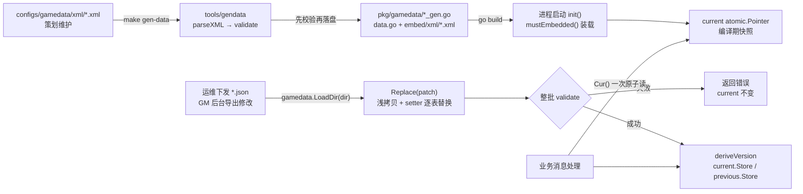

# 04 游戏数据 gamedata

一句话定位：`pkg/gamedata` 把策划维护的 XML 配置表在编译期生成 Go 代码并 embed 进二进制，运行期通过「构造新快照 + 原子指针替换」实现整表事务性热更新——读取方零锁零拷贝，任何一张表不合法则整批不生效。

## 1. 概述

游戏数值配置（道具、掉落、活动周期、技能消耗……）有三个与普通配置截然不同的特征，决定了这套设计：

1. **量大会改**：33 张表、上千行，运营按天调数值，改它不能发版；
2. **要一起生效**：一次活动配置可能同时改 `activity` + `activity_period` + `activity_milestone` 三张表，绝不能出现「item 已更新、quest 还是旧的」的半套状态；
3. **读极频繁**：每条业务消息都可能查表，读路径不能加锁。

`pkg/gamedata` 的答案：

- **编译期**：`tools/gendata` 读 `configs/gamedata/xml/*.xml` → 校验 → 生成 `*_gen.go`（结构体 + 行数据 + 索引 + 查询函数）+ `data.go`（快照汇总 + `go:embed` 原始 XML）。产物被 `make gen-check` 逐字节比对，手改无效。
- **运行期**：`Tables` 是不可变快照，`Replace`/`LoadDir` 构造新快照后 `atomic.Pointer` 换指针；读取方 `Cur()` 一次原子读。失败路径全部发生在 `Store` 之前——「要么全新、要么不动」。
- **版本**：`编译期内容哈希(+热更哈希)`，只保留一层派生；`Rollback` 只回滚一层。

完整的热更新设计文档（能/不能边界、输入格式、读取方约定）见 [`../docs/配置热更新.md`](../../配置热更新.md)；进程级 YAML 配置与它是两条不同的通道，见 [`03-配置系统与热更新.md`](03-配置系统与热更新.md)。

## 2. 涉及文件

| 路径 | 职责 |
| --- | --- |
| `pkg/gamedata/tables.go` | 手写的快照机制：泛型 `table[T]` 视图、`current/previous` 原子指针、`Replace`/`LoadDir`/`Rollback`/`deriveVersion` |
| `pkg/gamedata/data.go` | 生成物汇总：`Tables` 结构（33 张表）、`go:embed` 原始 XML、`mustEmbedded`、`setters` 注册表、`tableNames`、`RawXML`/`LoadedTables`/`Summary` |
| `pkg/gamedata/*_gen.go`（33 个） | 每张表一个：`XxxCfg` 结构体、`xxxRows` 行数据、`newXxxTable`、`XxxCfgList()`/`GetXxxCfg(id)` 查询函数 |
| `pkg/gamedata/item_gen.go` | 生成模式的样板（见 4.1） |
| `pkg/gamedata/embed/xml/*.xml` | XML 源拷贝（embed 输入） |
| `pkg/gamedata/tables_test.go` | 快照机制单测（原子性/失败保留/回滚/LoadDir/并发读） |
| `configs/gamedata/xml/*.xml`（33 个） | 策划维护的配置源，一个文件一张表 |
| `tools/gendata/main.go` | XML → Go 生成器：解析、校验前置、embed 拷贝、生成、`-json-out` 导出热更模板 |
| `tools/gendata/validate.go` | 配置校验：单表结构/主键/列一致/空列/非负列，跨表 `<x>_id` 引用 |

## 3. 核心设计

### 3.1 全链路：从 XML 到热更新



### 3.2 快照不可变：为什么是「换指针」而不是「改字段」

`tables.go` 文件头四条设计要点，第一条就是不可变：

> **快照不可变**：一份 `Tables` 构造好后不再修改，热更新是「构造新快照 + 原子指针替换」。读取方拿到的是某一时刻自洽的一整套表，不会出现「item 已更新、quest 还是旧的」。

并发模型用 `atomic.Pointer[Tables]`（Go 1.19 泛型原子指针）而不是裸指针 + Mutex：

```go
var (
	current  atomic.Pointer[Tables]
	previous atomic.Pointer[Tables]
)

func init() { current.Store(mustEmbedded()) }

// Cur 返回当前配置快照。热路径只做一次原子读，不做拷贝。
func Cur() *Tables { return current.Load() }
```

- 读路径（`Cur`）无锁无分配：每条业务消息查表都是 `current.Load()` 一次原子读；
- `init` 即装载内嵌快照：保证 `Cur()` 在任何调用点都不会返回 nil，调用方无需判空；代价是启动时为 33 张表建一次索引（毫秒级）；
- `Store` 之前的全部写对其他 goroutine 可见（atomic 提供 happens-before 边），快照发布安全。

### 3.3 Replace：事务性热更新

```go
func Replace(patch map[string][]byte) (string, error) {
	if len(patch) == 0 {
		return "", fmt.Errorf("empty patch")
	}

	old := current.Load()
	// 浅拷贝：Tables 里每个表字段都是值类型（table[T] 内含 slice/map 头），
	// 逐个替换字段互不影响；旧快照的底层数据被原样保留，Rollback 才成立。
	next := *old

	// 版本由「表名 + 内容」派生，与 patch 的遍历顺序无关，同一批内容得到同一版本。
	// 先排序再哈希：map 遍历顺序随机，不排序会让同样的配置算出不同版本号。
	names := make([]string, 0, len(patch))
	for name := range patch {
		names = append(names, name)
	}
	sort.Strings(names)

	h := sha256.New()
	for _, name := range names {
		set, ok := setters[name]
		if !ok {
			// 表名与 XML 文件名不一致 = 下发方写错，必须显式失败：
			// 静默忽略会让运维以为配置生效了。
			return "", fmt.Errorf("unknown table %q（表名必须与 XML 文件名一致）", name)
		}
		if err := set(&next, patch[name]); err != nil {
			return "", fmt.Errorf("%s: %w", name, err)
		}
		h.Write([]byte(name))
		h.Write([]byte{0})
		h.Write(patch[name])
	}

	// 整批校验放在最后：单表 setters 只保证自己合法，validate 保证整套自洽
	// （例如某表被改空）。
	if err := next.validate(); err != nil {
		return "", err
	}

	next.Version = deriveVersion(old.Version, h.Sum(nil))
	// Store 是原子发布点：此后所有 Cur() 立即看到新快照；previous 保存旧快照
	// 供 Rollback 使用（只一层，再次 Replace 会覆盖 previous）。
	current.Store(&next)
	previous.Store(old)
	return next.Version, nil
}
```

四个关键决策：

1. **浅拷贝 `next := *old`**：`Tables` 每个表字段都是值类型（`table[T]` 内含 slice/map 头），逐个替换互不影响；旧快照的底层数据被原样保留——这正是 Rollback 成立的前提，也是测试 `TestReplaceAppliesAtomically` 断言「old snapshot must stay immutable」的原因。
2. **setters 注册表而非 switch**：33 个分支的 switch 每次热更新都要线性比较；注册表由生成代码统一维护，map 查找 O(1)。
3. **未出现在 patch 里的表沿用当前快照**：线上改一张表不必把 33 张表全部重传。
4. **先排序再哈希**：map 遍历顺序随机，不排序会让同样的配置算出不同版本号。

### 3.4 五条运行期校验

| 规则 | 失败后果 |
| --- | --- |
| patch 非空 | 拒绝（空批次视为调用方 bug） |
| 表名必须存在（拼错文件名） | 拒绝，避免「以为更新成功」 |
| JSON 可解码 | 整批拒绝 |
| 主键唯一（`newTable` 构造期拦截） | 整批拒绝（重复主键会让 ByID 索引静默覆盖） |
| 表非空（`validate`） | 整批拒绝（空表通常是下发内容写错） |

这些是**运行期防线**；生成期还有更细的校验（列一致、引用完整、非负），见 3.6。两道都要有：生成期拦住提交进仓库的错，运行期拦住下发到线上的错。

### 3.5 版本语义与回滚

```go
func deriveVersion(old string, sum []byte) string {
	base := old
	if i := strings.IndexByte(base, '+'); i > 0 {
		base = base[:i]
	}
	return fmt.Sprintf("%s+%x", base, sum[:8])
}
```

- 启动：编译期 XML 内容哈希（16 位），如 `9a50d4815368a836`；
- 热更新后：`编译期哈希+本次内容哈希前 8 字节`，如 `9a50d4815368a836+9f2c1d4e`；
- 派生时剥掉旧的 `+xxx` 后缀只保留 base：**只保留一层派生**，反复热更新不会让版本串无限变长；
- 相同旧版本 + 相同内容 → 相同新版本：幂等，重复下发同一批配置版本号不变，便于对账「这个进程到底吃没吃这次热更新」。

`Rollback` 只保留一层，刻意不做多层历史（需要链表/快照存储，收益不抵复杂度）：

```go
func Rollback() (string, error) {
	prev := previous.Load()
	if prev == nil {
		return "", fmt.Errorf("no previous snapshot")
	}
	cur := current.Swap(prev)
	previous.Store(cur)
	return prev.Version, nil
}
```

`Swap + 对调 previous`：连续两次 Rollback 等于「取消上次回滚」，语义直观。

### 3.6 生成期校验：比运行期更细

`tools/gendata/validate.go` 的校验目标不是「覆盖设计清单」，而是拦住配置里**真实发生过**的错误类别：

1. **结构**：空表、嵌套元素、根元素带数据属性；
2. **主键**：缺失、非正整数、重复（重复会让 ByID 索引静默覆盖，策划改半天不生效）；
3. **列一致**：某行多出列会被「首行定列」静默丢弃，少列会生成零值——两者都要报错；
4. **空列**：整列全空通常是列名拼错，生成出来是一列零值；
5. **引用**：`<x>_id` 列在存在 `<x>.xml` 时必须指向真实主键；
6. **范围**：count/num/weight/rate 这类计数列不允许为负。

两个有意的取舍：

- **收集式报告而非遇错即停**：一次列全所有问题，策划改一轮再跑；输出按字典序排序，多次运行可 diff。
- **非负校验用白名单而不是全部列**：`reward=-1` 可能是策划的特殊语义（如「不发放」），只拦确定不能为负的列——避免误报把白名单越用越窄、最后没人信校验。

跨表引用校验用「表存在」作开关而不是维护引用清单：新增表不必同步改校验器；命名不合约定（如 `col2` 存道具 ID）的表本来也无法自动判断语义，不强行猜测。组合列（如 `"1001,100"` 的掉落组）逐个拆开校验，才能定位到具体哪个 ID 不存在。

## 4. 关键代码解析

### 4.1 生成模式：item.xml 的一生

策划维护的源（`configs/gamedata/xml/item.xml`）：

```xml
<item>
    <row id="1001" col1="金币" col2="999999" col3="1" />
    <row id="1002" col1="经验药水" col2="99" col3="10" />
    <row id="2001" col1="新手剑" col2="1" col3="1" />
</item>
```

约定：单层结构（根元素下每行一个配置项），数据全部用**属性**表达；每个文件 = 一张表，文件名即表名；行元素必带 `id`（唯一键）。

`make gen-data` 后产出 `pkg/gamedata/item_gen.go`（`pkg/gamedata/item_gen.go:6`）：

```go
// ItemCfg item.xml 配置项
type ItemCfg struct {
	Id   int64  `json:"id"`
	Col1 string `json:"col1"`
	Col2 int64  `json:"col2"`
	Col3 int64  `json:"col3"`
}

// ItemTable item.xml 的只读视图，随快照整体替换，不做原地修改
type ItemTable = table[ItemCfg]

func newItemTable(list []ItemCfg) (ItemTable, error) {
	return newTable(list, func(c *ItemCfg) int64 { return c.Id })
}

// itemRows 内嵌快照的行数据
var itemRows = []ItemCfg{
	{Id: 1001, Col1: "金币", Col2: 999999, Col3: 1},
	{Id: 1002, Col1: "经验药水", Col2: 99, Col3: 10},
	{Id: 2001, Col1: "新手剑", Col2: 1, Col3: 1},
}

// ItemCfgList 当前快照的全量行（等价于 Cur().Item.List()）
func ItemCfgList() []ItemCfg { return Cur().Item.List() }

// GetItemCfg 按 ID 查询当前快照
func GetItemCfg(id int64) (*ItemCfg, bool) {
	return Cur().Item.Get(id)
}
```

注意列名是 `col1/col2/col3` 而不是语义名：类型由推断产生（字符串列 vs 整数列），语义由使用方约定——这保持了 XML 的极简约定，`Col1 = 当前等级、Col2 = 消耗` 这类语义写在查询函数的注释里（如 `skill.go:190` 的 `skillUpgradeCost`）。

`Cols` 与 `Vals` 分离（`tools/gendata/main.go:44`）是生成器内部的关键细节：XML 属性本身无序，若不单独记录列的顺序，每次生成的字段排列可能不同，diff 噪音会淹没真实变更。

### 4.2 泛型表视图：一套索引发米给 33 张表

```go
type table[T any] struct {
	list  []T
	byID  map[int64]*T
}

func newTable[T any](list []T, idOf func(*T) int64) (table[T], error) {
	byID := make(map[int64]*T, len(list))
	for i := range list {
		id := idOf(&list[i])
		// 主键重复必须在构造期拦截：放进 map 后 Get 随机返回一行，
		// 表现为「配置看起来生效了但值不稳定」的灵异 bug。
		if _, dup := byID[id]; dup {
			return table[T]{}, fmt.Errorf("duplicate primary key %d", id)
		}
		byID[id] = &list[i]
	}
	return table[T]{list: list, byID: byID}, nil
}
```

- **泛型 `[T any]`**：一套索引发米给 33 张表复用，避免每张表手写 map + Get；
- **`idOf` 以函数注入而不是接口**：行类型是生成的结构体，没有统一方法可取主键，传闭包比给每张表定义 `PrimaryKey()` 更轻，也省掉一次接口动态分发；
- **`list` 与 `byID` 共享底层数组**（`byID` 里存的是 `&list[i]`），二者永远自洽；
- **`(*T, bool)` 双返回**（comma-ok）：nil + false 表示不存在，调用方必须显式处理，不会把零值当成合法配置；
- **`List()` 不返回拷贝**：行数上千、调用频率高，拷贝成本不值得；只读契约靠注释约束。

### 4.3 消费方约定：每条消息内查一次

热更新后旧指针仍指向旧快照——消息内自洽，但跨消息会读到过期值。所以约定：

1. **每条消息内查一次配置**，不要跨消息缓存 `*Cfg` 指针；
2. 需要多处使用时，在同一次处理内取到局部变量再传递。

典型用法（`internal/game/module/skill/skill.go:194`）：

```go
// skillUpgradeCost 返回「从 level 升到 level+1」的消耗；没有该行表示已满级。
//
// 表结构：Col1 = 当前等级，Col2 = 消耗。用「当前等级」而不是「目标等级」，
// 是因为满级判定需要「查不到」这个信号——最高等级没有对应的行。
func skillUpgradeCost(level int32) (int64, bool) {
	for _, row := range gamedata.SkillUpgradeCfgList() {
		if int32(row.Col1) == level {
			return row.Col2, true
		}
	}
	return 0, false
}
```

`cda0e9e` 修复的三处配置漂移之一就在这个函数：旧实现是 `cost = skill.Col3 * level` 线性公式，而 `Col3` 只有 0 和 5，`skill_upgrade` 表里的 100/300 阶梯完全没被读过——「运营照表调数值、玩家侧毫无变化，而且不报错」。

## 5. 演进记录

- **`2461564` feat(tools): 消息号注册表生成、配置校验与快照热更新（R10.1–R10.4）**——gendata 的 validate.go 与 gamedata 的 `Replace`/`LoadDir`/`Rollback` 该提交落地，「先校验再落盘」与「快照不可变」两大原则从此时确立。
- **`cda0e9e` fix(config): 三处「配置写了但代码没读」的漂移**——除 skill_upgrade 消耗公式外，还有 mail_template 模板零引用（改文案得改发送端）与 shop 归属硬编码 `defaultShopID = 1`（商品挂别的商店限购会串）。三处全部改为按表查值。测试用「改回旧实现」的变异手法守住了修复：线性消耗公式/忽略模板/计数硬编码 1 三个变异全部被抓。后两条测试还用 `gamedata.Replace` 热更临时配置、测完恢复——这是热更能力在测试侧的典型用法。
- **`eac610c` feat(role): 创角写入初始背包（init_bag 配置）**、`4f1c525`/`0fa7a7b` feat(activity)、`ffee7b7` feat(scene)**——gamedata 的消费方随业务模块持续增加；每加一张表就是「XML + 生成 + 模块查表」三步，不需要改框架。
- **`3c048f5` test: 配置表数与 topic 数改为下限断言**——加表是常态，写死张数只会让每个新增配置都来改测试；`TestEmbeddedSnapshot` 的 `require.False(t, len(tableNames) < 34)` 即此决策的产物。
- **`01c45c1` feat(worldmap)**——SLG 地图子系统的玩法参数（行军速度、采集速率）标注为「M1 内置默认；M2 起由 gamedata 注入」，是 gamedata 消费边界的演进方向。

## 6. 测试情况

| 测试文件 | 覆盖内容 |
| --- | --- |
| `pkg/gamedata/tables_test.go` | ① `TestEmbeddedSnapshot`：内嵌快照自洽（validate 全过、表数下限、关键行存在）；② `TestReplaceAppliesAtomically`：替换生效 + 版本变更 + 未 patch 表沿用 + **旧快照不受影响**；③ `TestReplaceFailureKeepsOldSnapshot`：坏 JSON/重复主键/空表/未知表名/空 patch 五种失败全部保留旧快照；④ `TestRollback`：回滚内容与版本正确 + 二次回滚等于取消；⑤ `TestLoadDir`：外部 JSON 目录应用 + 空目录报错 + 拼错表名报错；⑥ `TestConcurrentReadDuringReplace`：8 个读 goroutine 并发 + 50 次替换，任意时刻读到的必须是一套完整快照（旧值或新值），验证跨表一致性 |
| `tools/gendata/validate_test.go` | 六类校验规则的用例（结构/主键/列一致/空列/引用/非负） |
| `test/benchmark/bench_test.go` | 表数下限断言（`3c048f5` 后的形态） |

`TestConcurrentReadDuringReplace` 是这套设计最有价值的一个测试：它不断言「没有数据竞争」（那是 `-race` 的职责），而是断言**语义**——读到的 item 行名只能是旧值或新值之一，且 Quest 表永不为空。快照机制的正确性由此从「实现细节」变成「可执行契约」。

## 7. 小结

`pkg/gamedata` 用五个机制解决了「改得勤、要一起生效、读得频」的配置三难：

1. **生成即校验**：XML → Go 的生成前置六类校验，「先校验再落盘」不产出半套产物，`make gen-check` 逐字节比对防手改；
2. **快照不可变 + 原子换指针**：读取零锁，替换事务性，跨表一致性由「一整套 Tables」天然保证；
3. **版本可对账**：`base+hash8` 一层派生、幂等，日志打一行 `Summary()` 就回答「这个进程跑的是哪份配置」；
4. **两层防线**：生成期拦提交进仓库的错，运行期拦下发到线上的错；
5. **消费约定简单**：每条消息内查一次、不缓存跨消息指针——全部模块都符合（`grep gamedata.Get` 均为「进函数查一次」）。

下一篇 [`05-服务发现registry.md`](05-服务发现registry.md) 离开数据层，看进程如何找到彼此。
