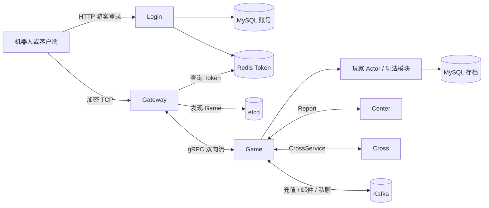

# 项目解说

这套项目维护“谁在线、角色有什么、操作是否合法、奖励是否已经发过、战斗在哪里发生”。客户端只提交意图；角色归属、道具数量和奖励规则由服务器判断。它是通用游戏后端，不是已经包含地图行军系统的 SLG 成品。

## 1. 先用一次游戏操作理解全局

“服务”是独立进程。“模块”是 Game 内的 Go 对象。独立进程不共享 map：Gateway 知道账号，并不意味着 Game 已有角色状态；必须通过 BIND 控制帧传递身份。

## 2. 第一次进入游戏，按什么顺序发生

1. `POST /v1/auth/guest` 带 `device_id`，Login 查找或创建账号。
2. Login 生成随机 Token，存入 Redis，值为 account_id，并设置 TTL。
3. 客户端连接 Gateway 9001。网关主动下发 RSA 公钥与随机盐。
4. 客户端生成 pre-master，经 RSA-OAEP 加密发送；双方通过 HKDF 派生 AES 密钥，验证 Finished。
5. 客户端在应用鉴权请求中带 Token。网关查 Redis，得到 account_id。
6. 网关发现 Game，为会话建立 gRPC Channel，首帧为 BIND，传入 session_id、account_id。
7. Game 保存账号会话映射。首次无角色是正常状态，不应直接断线。
8. 1010 请求进入游戏，返回 2003 时引导发 1020 创角。名字和职业在服务端校验。
9. 创角事务写入 `player`、`player_attr`。成功后绑定玩家 Actor，加载状态。
10. 2001 查询角色信息，Actor 路由到 profile 模块，2002 响应沿同一链路返回。

机器人封装了这些步骤。不要试图把 `{"name":"role.create"}` 作为 TCP 文本发送：本项目既有长度包头，也有 Protobuf 和应用加密。

## 3. 三种身份要用不同的问题辨认

| 身份 | 回答的问题 | 持续时间 |
|---|---|---|
| account_id | 这是哪个账号？ | 持久 |
| player_id / role_id | 操作的是哪个角色？ | 持久 |
| session_id | 响应应该送回哪次连接会话？ | 临时 |
| conn_id | 网关正在管理哪条 TCP 连接？ | 临时 |
| Actor PID | 进程内应该投递给哪个执行对象？ | Actor 生命周期 |

游客 HTTP 应答中历史字段 `player_id` 与 `account_id` 同值，只是兼容字段，不是已经创建了相同 ID 的角色。网关 Session 的某些旧字段名也保留了 player 命名，阅读时看实际赋值来源。

## 4. Game 内部为什么再分层

`server.go` 装配依赖、区分会话级协议与玩家协议；`rpc` 负责读写内部流；`player` 负责状态归属；`module` 实现玩法；`pkg` 提供基础能力。

以使用物品为例：客户端提出“使用某种物品 N 个” → bag 模块解析 Protobuf → 按当前规则把非正数量归一化为 1，并检查物品、上限、数量与可使用性 → 扣除玩家物品 → 产生任务事件 → 标脏 → 回包。

模块不应为了给客户端响应直接拿 TCP 连接。它调用 `module.Context.Reply`，由组装层注入的 Send 能力完成回传。这样测试模块时能用一个捕获函数代替网络。

## 5. 为什么 Actor 不等于不用锁

Actor 约束同一角色的消息依次执行，但系统仍有网络循环、Kafka 消费者、预加载查询、落库 worker 和中心流回调。只有它们都通过消息操作角色，串行所有权才成立。

当前 State 的 getter 常返回副本并使用 RWMutex，是为了保护外部读取。只给玩家 map 加锁，取出指针以后直接修改字段，不能代替 Actor 所有权或对象锁。

同一分片上有多个 Actor。某个角色处理函数同步等待 SQL，会让同片角色等待。这是当前实现需要理解和度量的边界，不能把接口注释“禁止阻塞”当作代码已经异步化。

## 6. 一份数据可能存在三处

| 位置 | 用途 | 不能推导出的保证 |
|---|---|---|
| Actor State | 在线游戏的工作状态 | 修改后已经持久化 |
| Redis | Token、在线路由、幂等与 ID 索引 | 与 MySQL 自动原子提交 |
| MySQL | 长期存档与业务事实 | Actor 内存自动同步 |

当前创角直接提交 SQL；普通角色和背包状态有 Write-Behind；邮件、组队等还有各自 Repo。项目不是“所有数据库写入都由 Flusher 处理”。扩展功能必须先决定持久化边界。

## 7. Center 和 Cross 做什么

Center 维护游戏节点上报、匹配、分组、排行和中心间中转；Cross 接受游戏服的跨服流，维护房间及战斗转发/兜底结算。客户端始终经过 Gateway → Game，不直接拿 Cross 地址连战场。

这里没有把玩家完整存档搬到 Cross；跨服链路传战斗快照和操作。跨服回包、奖励、排行更新是不同步骤，各自需要幂等和失败恢复。Cross 未注册 etcd，是设计中的明确边界。

## 8. 和参考项目的对应关系

| slgserver 的思路 | 本项目实现 |
|---|---|
| WebSocket + JSON 协议名 | TCP 长度包 + 数字 MsgID + Protobuf |
| controller / mgr / model | module / Actor State / Repo |
| 每种 model 的异步写队列 | 分片 Flusher + SaveMsg + 增量背包存档 |
| 独立 chatserver | Game 中 chat 模块 + Kafka 跨服投递 |
| 固定代理地址 | Gateway 经 etcd 发现 Game；Center/Cross 仍有静态地址配置 |
| 城池、行军、视野 | 当前没有同等完整模块；教程以装备、任务、组队、房间代替 |

下一步读[目录结构](项目框架与目录结构.md)定位文件，或直接从[学习路线](开发流程/00-总览与阅读顺序.md)开始练习。
